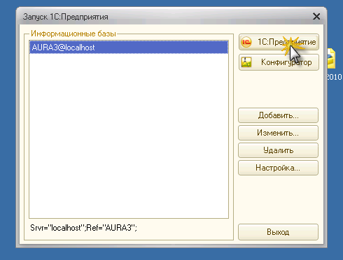
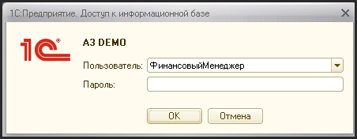

# Запуск Системы

> **Описание:** Инструкция по запуску системы АУРА 3. Описывает процесс выбора конфигурации в 1С:Предприятие 8.2, авторизации пользователя с указанием имени и пароля, выданного Администратором Системы.

---

Для входа в Систему необходимо запустить 1С:Предприятие 8.2 , после чего появится окно, в котором нужно выбрать нужную конфигурацию и нажать кнопку "1С:Предприятие":

Далее появится диалоговое окно, в котором из списка в поле «Пользователь» необходимо выбрать свою фамилию и ввести пароль в поле «Пароль», выданный Администратором Системы. Если все введено правильно, то после нажатия кнопки «ОК» произойдет запуск Системы.

