# Интерфейсные элементы системы

> **Описание:** Описание стандартных элементов управления интерфейса системы АУРА 3: полей ввода текста, дат, числовых значений, выпадающих списков, чекбоксов и кнопок. Рассматривается навигация по формам с помощью клавиатуры, работа с обязательными полями и окно системных сообщений.

## Содержание

- [Элементы управления](#элементы-управления)
  - [Поле ввода текста](#поле-ввода-текста)
  - [Многострочное поле ввода](#многострочное-поле-ввода)
  - [Поле ввода даты](#поле-ввода-даты)
  - [Поле ввода числовой информации](#поле-ввода-числовой-информации)
  - [Ввод при помощи выбора из выпадающего списка](#ввод-при-помощи-выбора-из-выпадающего-списка)
  - [Чекбокс](#чекбокс)
  - [Кнопки](#кнопки)
- [Навигация по форме](#навигация-по-форме)
- [Обязательные поля ввода](#обязательные-поля-ввода)
- [Окно сообщений](#окно-сообщений)

---

## Элементы управления

### Поле ввода текста

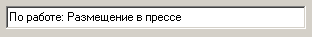

Данное поле предназначено для ввода текстовой информации в одну строку при помощи клавиатуры.

### Многострочное поле ввода

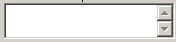

Данное поле предназначено для ввода текстовой информации, состоящей из нескольких строк. Когда текстовая информация выходит за границы поля ввода, появляются полосы прокрутки.

### Поле ввода даты

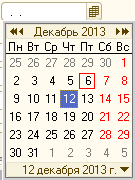

Данное поле предназначено для ввода дат. Дату можно вводить, как с помощью клавиатуры (точки для форматирования даты при этом вводить не надо), так и при помощи выбора из выпадающего окна-календаря. В этом окне с помощью панели кнопок можно перемещаться на год назад и на месяц назад, кнопок на месяц вперед и на год вперед. Установив необходимый месяц и год при помощи данной панели кнопок, необходимо кликнуть на нужный день месяца и выбор даты будет осуществлен. ???Активизировать окно-календарь можно нажатием клавиши «F4», предварительно установив курсор на поле ввода, или кликнув левой клавишей мыши на кнопку в правой части поля ввода даты.

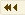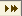

### Поле ввода числовой информации

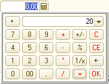

В данное поле можно вводить только числовую информацию. Для ввода информации в данное поле, необходимо установить на него курсор и производить ввод при помощи клавиатуры или активизировать окно-калькулятор, нажав на кнопку в правой части поля ввода. В этом окне можно проводить вычисления, результат которых будет введен в данное поле ввода. Активизировать окно-калькулятор можно также нажатием клавиши «F4», предварительно активизировав это поле ввода.

### Ввод при помощи выбора из выпадающего списка

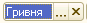

Список - это перечисление некоторых значений, например справочник. Чтобы ввести информацию в поле при помощи списка, необходимо кликнуть левой клавишей мыши, на кнопку в правой части поля ввода, или нажать клавишу «F4», предварительно установив курсор на данное поле ввода. После этого на экране появиться список для выбора. Для выбора необходимого элемента из списка нужно установить курсор на данном элементе при помощи клавиш управления курсором, и нажать клавишу «Enter», или же можно дважды кликнуть левой клавишей мыши на необходимом элементе списка. Когда выбор сделан, окно со списком элементов закрывается, а в поле ввода появляется выбранный элемент из списка.

Для того, чтобы очистить данное поле ввода, необходимо нажать комбинацию клавиш «Shift+F4».

Прямой ввод информации с клавиатуры в это поле невозможен.

### Чекбокс

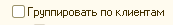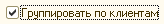

Чекбокс - это элемент управления, который предназначен для установки или сброса какого-либо свойства, указанного в поле данного элемента и имеющего два значения («0, 1», «да, нет», «открыто, закрыто» и пр.). Чтобы изменить состояние чекбокса, необходимо активизировать этот элемент управления и нажать клавишу «Пробел» или кликнуть левой клавишей мыши в поле чекбокса.

### Кнопки

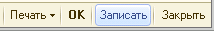

Кнопки предназначены для выполнения некоторых операций. Чаще всего кнопки используются для сохранения и закрытия форм. Функционально назначение кнопки указывается в ее заголовке. Чтобы нажать на кнопку, нужно ее или активизировать и нажать клавишу «Enter», или кликнуть по данной кнопке мышью.

## Навигация по форме

Чтобы ускорить ввод информации, для перемещения между элементами (полями ввода) формы нужно использовать клавиатуру. Для каждой формы имеется свой порядок обхода полей ввода, в зависимости от функционального назначения полей и удобства ввода информации.

При открытии формы, первое поле в последовательности обхода, становиться активным. Чтобы переместиться на следующее поле ввода без изменения информации в текущем поле ввода, нужно использовать клавишу «Tab». Если необходимо редактировать информацию в поле ввода, на котором установлен курсор, то нужно использовать клавишу «Enter». Тогда данное поле ввода активизируется. Для перемещения курсора в обратную сторону от текущего поля ввода на предыдущее, нужно использовать комбинацию клавиш «Shift+Tab».

Для каждой формы предусмотрена определенная кнопка, которая выполняется «по-умолчанию». Нажать эту кнопку можно сразу, не зависимо от того какое поле в форме активно сейчас. Для этого нужно нажать комбинацию клавиш «Ctrl+Enter». Обычно это функция «ОК» или «Сохранить».

Чтобы выйти из формы без сохранения изменений, нужно использовать клавишу «Esc». Тогда, если в форме были внесены изменения, Система запросит сохранять эти изменения или нет. Если нажать клавишу «Esc» в новой, ранее не сохраненной форме, то Система не сохранит данные, которые были введены в форму.

## Обязательные поля ввода???

В формах ввода заголовки обязательных полей выделены жирным шрифтом. Заполнение таких полей обязательно, и попытка сохранения формы без их заполнения, вызовет сообщение об ошибке.

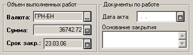

В данном фрагменте формы, обязательными являются поля «Валюта», «Сумма» и «Срок закрытия».

## Окно сообщений

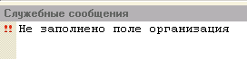

Окно сообщений располагается в нижней части главного окна системы и предназначено для вывода служебной информации и сообщений об ошибках.

