# Работа со справочниками

> **Описание:** Глава описывает общие принципы работы со справочниками системы: создание, редактирование и удаление элементов. Приводится детальное описание всех основных справочников: организации, сотрудники, контрагенты, валюты, счета, статьи учёта, проектные справочники и другие.

## Содержание

- [Описание справочников](#описание-справочников)
  - [Организации](#организации)
  - [Сотрудники](#сотрудники)
  - [Основные средства](#основные-средства)
  - [Валюты](#валюты)
  - [Счета](#счета)
  - [Контрагенты](#контрагенты)
  - [Статьи учета](#статьи-учета)
  - [Виды платежей](#виды-платежей)
  - [Проектные клиенты](#проектные-клиенты)
  - [Проектные справочники](#проектные-справочники)
  - [Направления проектов](#направления-проектов)
  - [Виды проектных работ](#виды-проектных-работ)
  - [Распределение медиаразницы](#распределение-медиаразницы)
  - [Рекламные кампании](#рекламные-кампании)
  - [Ответственные по проектным работам](#ответственные-по-проектным-работам)
  - [Бренды](#бренды)
  - [Сейлзхаузы](#сейлзхаузы)

---

Справочник представляет собой список каких-либо элементов, связанных между собой по какому-либо признаку. Имя справочника отражает этот признак. В зависимости от уровня доступа пользователя, он может иметь или полный доступ к справочнику (создание, модификация и пометка на удаление элементов) или доступ только на просмотр (просмотр элемента и выбор его для заполнения соответствующих полей документов и форм).

Справочник может быть представлен как список непосредственно элементов, так и списком групп элементов. Группа элементов справочника - это список элементов справочника, объединенных по какому-либо признаку в одну группу с именем, характеризующим этот признак.

Рассмотрим работу со справочником на примере справочника «Контрагенты». Чтобы открыть справочник «Контрагенты», выберите в меню «Справочники» пункт «Контрагенты», в результате на экране появится список контрагентов.

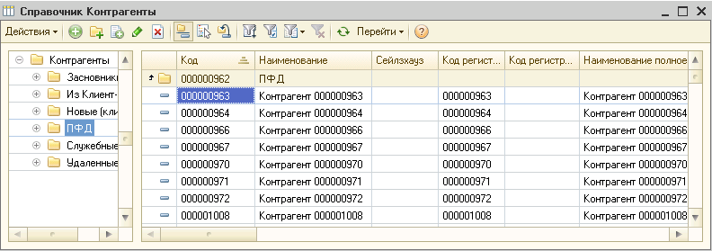

В левой части окна располагается окно навигации по группам справочника, а в правой части - список контрагентов текущей группы. Для того чтобы отменить разделения по группам, т.е. чтобы в списке элементов для выбора были доступны все контрагенты независимо от того, в каких группах они находятся, нужно нажать кнопку на панели инструментов окна со списком контрагентов.

Для просмотра и выбора конкретного элемента справочника можно либо использовать вертикальный скроллбар либо, переместив курсор на колонку «Наименование», вводить наименование контрагента. Если такой контрагент есть в справочнике, то курсор переместится на соответствующий элемент.

Для создания нового элемента справочника нужно или нажать кнопку на панели инструментов списка элементов справочника или нажать клавишу «Insert». На экране появиться окно формы создания нового элемента.

После заполнения всех необходимых полей нужно нажать кнопку «ОК».

Для редактирования элемента справочника сначала нужно установить курсор на строку, которая содержит информацию об этом элементе и затем произвести одно из следующих действий:

- Нажать кнопку в панели инструментов.

- Нажать клавишу «Enter» на клавиатуре.
- Два раза щелкнуть левой клавишей мыши по ячейке, которая относиться к нужной работе.

Для удаления элемента справочника, выделите строку с нужным элементом в списке и затем произвести одно из следующих действий:

- Нажмите кнопку в панели инструментов.

- Нажмите клавишу «Del» на клавиатуре.

Система запросит, действительно ли вы хотите пометить элемент справочника на удаление, и если Вы ответите утвердительно, пометит его на удаление.

В системе элементы не удаляются сразу, а только помечаются на удаление. Это связано с тем, что удаляемый элемент, может использоваться в каких-либо транзакциях. Поэтому, физические удаление элемента из справочника производится администратором системы на следующий день.

## Описание справочников

### Организации

Справочник «Организации» содержит информацию о балансовых единицах, по которым будет вестись учет в системе.

#### Рабочее окно справочника «Организации»

Рабочее окно справочника «Организации» открывается при выборе пункта меню «Справочник / Организации».

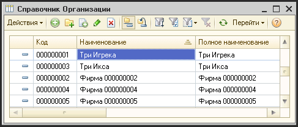

На экране появляется рабочее окно со списком элементов справочника.

#### Форма редактирования информации об организации

При нажатии на кнопку появляется форма редактирования информации о фирме.

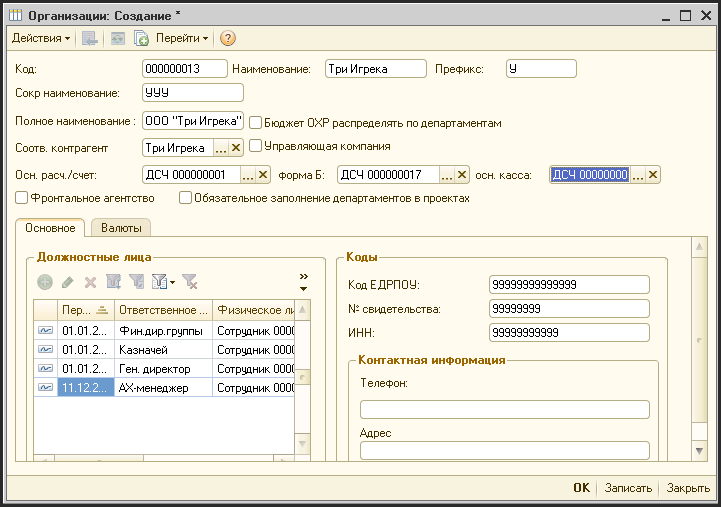

| **Наименование поля** | **Описание** |
| --- | --- |
| Код |     |
| Наименование | Наименование фирмы |
| Префикс | Префикс, который добавляется к номерам проектов и номерам форм. 1 кириллический символ |
| Сокр. наименование | Сокращенное наименование фирмы. |
| Полное наименование | Полное наименование фирмы, с указанием формы собственности |
| Соотв. контрагент | Элемент справочника «Контрагенты», который соответствует данной фирме. Используется для группового и холдингового учета. |
| Управляющая компания | Флаг.  Флаг управляющей компании группы компаний или холдинга. |
| Бюджет ОХР распределять по департаментам | Флаг. |
| Осн. расч. счет | Основной расчетный счет фирмы. Элемент справочника «Счета». |
| Форма Б | ??? |
| Осн. Касса | Основная касса организации. Элемент справочника «Счета». |
| Фронтальное агентство | Флаг. Установлен, если агентство является фронтальным. |
| Обязательное заполнение департаментов в проектах | Флаг. Установлен, если в проектах обязательно необходимо заполнять департаменты. |
| Закладка «Основное» | Содержит основную информацию об организации. (Ответственные лица, идентификационный код, адрес и т.д.) |
| \- Таблица «Ответственные лица» | Состоит из трех колонок: Период, Ответственное лицо, Физическое лицо, Направление и Департамент. Над таблицей панель инструментов, с помощью которой можно добавлять строки, сортировать, редактировать и удалять из таблицы. |
| \- Период | Дата, с которой данное лицо является на соответствующей должности. |
| \- Ответственное лицо | Должность из списка ответственных должностей. Используется для документооборота. |
| \- Физическое лицо | Физическое лицо из справочника «Сотрудники», занимающее данну должность. |
| \- Направление | Направление из справочника «Направления проектов». |
| \- Департамент | Департамент из списка «Департаменты организации» |
| \- Код ЕДРПОУ | Код регистрации юридического лица. |
| \- № свидетельства | Номер свидетельства о регистрации организации. |
| \- ИНН | Идентификационный налоговый номер организации. |
| \- Поле «Контактные данные» | Содержит информацию о местонахождении организации и номера телефонов. |
| \- Телефон | Номера телефонов организации. |
| \- Адрес | Местонахождение организации. |
| Закладка «Валюты» | Содержит информацию о валютах, используемых организацией. |
| \- Валюта национальная | Указывается валюта, в которой будет вестись учет. |
| \- Валюта начисления зарплаты | Указывается валюта для начисления зарплаты. |

##### Подразделения организации

Данный справочник описывает организационную структуру предприятия.

Справочник «Подразделения» вызывается при нажатии на кнопку «Перейти» и выборе элемента «Подразделения» из выпадающего списка «Перейти…» в форме редактирования информации об организации (справочник «Организации»).

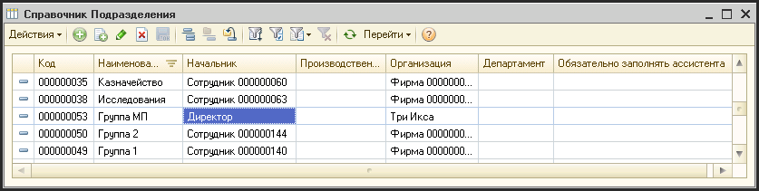

Наполнение справочника происходит с помощью кнопки , при нажатии на которую появляется новая строка в режиме редактирования.

| **Наименование поля** | **Описание** |
| --- | --- |
| Код | Уникальный код подразделения |
| Наименование | Наименование подразделения |
| Начальник | Начальник подразделения |
| Произв. | Флаг. Указание на производственный отдел. Используется для расчета внутренней себестоимости. |
| Организация | Организация, в которую входит подразделение. ??? |
| Департамент | Департамент, в который входит подразделение. ??? |
| Обязательно заполнять ассистента | Флаг. Указывается обязательность заполнения ассистента начальника??? |

### Сотрудники

Справочник «Сотрудники» предназначен для хранения информации о сотрудниках фирмы.

#### Рабочее окно справочника «Сотрудники»

Рабочее окно справочника «Сотрудники» открывается при выборе меню «Справочники / Сотрудники».

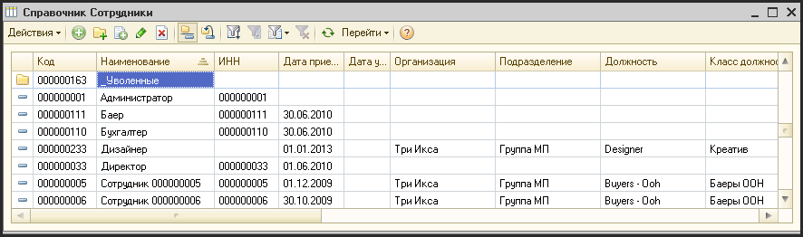

На экране появляется рабочее окно со списком элементов справочника.

#### Форма редактирования информации о сотруднике

При нажатии на кнопку появляется форма для заполнения информации о новом сотруднике.

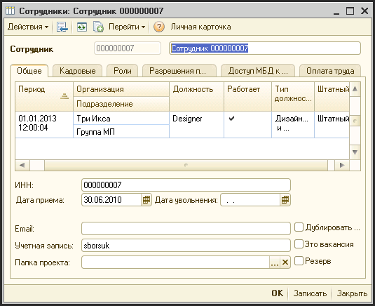

##### Закладка «Общее»

Закладка «Общее» активна сразу при открытии формы редактирования информации о сотруднике

(смотри в предыдущем пункте). В верхней части поля активной закладки располагается Таблица «Общее», содержащая общие данные о сотруднике (в какой организации числится, должность, штатный или нет). Данные для таблицы берутся из кадровых приказов по этому сотруднику. Можно перейти в соответствующий приказ, кликнув дважды левой кнопкой мыши по заполненной строке таблицы «Общее».

| **Наименование колонки** | **Описание** |
| --- | --- |
| Период | Дата кадрового приказа о принятии на работу??? |
| Организация/Подразделение | Наименование организации и подразделения, где работает сотрудник. |
| Должность | Должность сотрудника |
| Работает | Флаг. Установлен, если сотрудник не уволен??? |
| Тип должности | Тип должности в рамках регулярной отчетности. |
| Штатный | Может быть:  \-Штатный  \-Временный  \-Аутсорсер |

Под таблицей расположены поля:

| **Наименование поля** | **Описание** |
| --- | --- |
| ИНН | Индивидуальный налоговый номер сотрудника. |
| Дата приема | Дата приема сотрудника на должность. Дата приема будет установлена автоматически при проведении первого приказа на прием данного сотрудника. |
| Дата увольнения | Дата увольнения сотрудника.  Дата увольнения будет установлена автоматически при проведении приказа об увольнении данного сотрудника. |
| Email | Адрес электронной почты сотрудника. |
| Учетная запись | Учетная запись для входа в систему. |
| Папка проекта | ??? |
| Дублировать | Флаг. ??? |
| Это вакансия | Флаг. ??? |
| Резерв | Флаг. ??? |

##### Закладка «Кадровые»

В закладке «Кадровые» заполняются данные о сотруднике, необходимые для оформления кадровых документов.

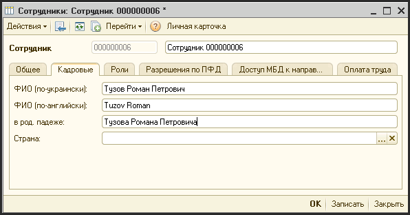

| **Наименование поля** | **Описание** |
| --- | --- |
| ФИО (по-украински) | Фамилия, имя, отчество сотрудника на языке, на котором оформляются кадровые документы. |
| ФИО (по-английски) | Фамилия, имя, отчество сотрудника на английском языке ??? |
| В род. падеже | Фамилия, имя, отчество сотрудника на языке, на котором оформляются кадровые документы в родительном падеже. |
| Страна | Страна. Выбор из списка. ??? |

##### Закладка «Роли»

При активизации закладки «Роли» появляется таблица «Роли», в которой можно присвоить сотруднику роли, необходимые для выбора интерфейса и объектов Системы, с которыми он может работать. ???

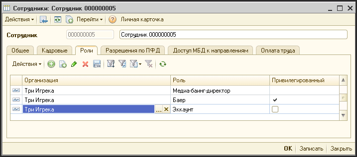

Наполнение таблицы происходит с помощью кнопки, при нажатии на которую появляется новая строка в режиме редактирования.

| **Наименование колонки** | **Описание** |
| --- | --- |
| Организация | Наименование организации, в которой работает сотрудник. Заполняется следующим образом: |
| Роль | Наименование роли. Перечень ролей: И другие. |
| Привилегированный | Флаг привилегированной роли. Имеет смысл только с ролями Эккаунт и Баер. Отметив данный чекбокс, указываем, что данный сотрудник является привилегированным. |

##### Закладка «Разрешения по ПФД»

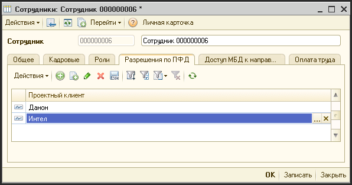

???

##### Закладка «Доступ МБД к направлениям»

При активизации закладки «Доступ МБД к направлениям» появляется таблица «Доступ МБД к направлениям», в которой можно указать, какие направления проектов будут доступны сотруднику при работе в Системе.???

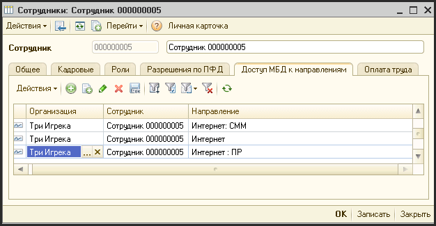

???

| **Наименование колонки** | **Описание** |
| --- | --- |
| Организация | Наименование организации, в которой работает сотрудник. Выбор из списка справочника «Организации» . |
| Сотрудник | Имя сотрудника. Заполняется автоматически. |
| Направление. | Направление, доступное сотруднику. Выбор из списка справочника «Направления проектов». |

##### Закладка «Оплата труда»

Закладка «Оплата труда» содержит три таблицы: «Оклады», «Бонусы» и «Компенсации ЗП». При активизации закладки «Оплата труда» появляется таблица «Оклады».

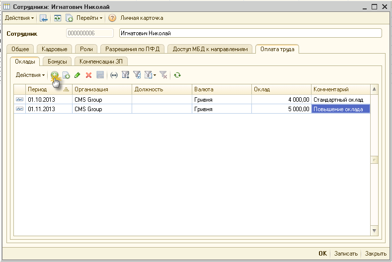

Наполнение таблицы происходит с помощью кнопки, при нажатии на которую появляется новая строка в режиме редактирования.

**Таблица «Оклады»**

| **Наименование колонки** | **Описание** |
| --- | --- |
| Период | Дата, с которой будет начисляться данный оклад. |
| Организация | Наименование организации, в которой работает сотрудник. Выбор из списка справочника «Организации» . |
| Должность | Должность сотрудника. Заполняется автоматически ??? |
| Валюта | Валюта оклада. Выбор из списка справочника «Валюты». |
| Оклад | Сумма оклада. |
| Комментарий | Возможный комментарий. |

**Таблица «Бонусы»**

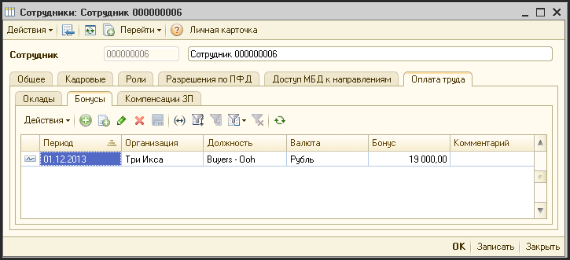

| **Наименование колонки** | **Описание** |
| --- | --- |
| Период | Дата, на которую будет начислен бонус (бонус будет начислен только в этот месяц) |
| Организация | Наименование организации, в которой работает сотрудник. Выбор из списка справочника «Организации» . |
| Должность | Должность сотрудника. Заполняется автоматически ??? |
| Валюта | Валюта бонуса. Выбор из списка справочника «Валюты». |
| Бонус | Сумма бонуса. |
| Комментарий | Возможный комментарий. |

**Таблица «Компенсация ЗП»**

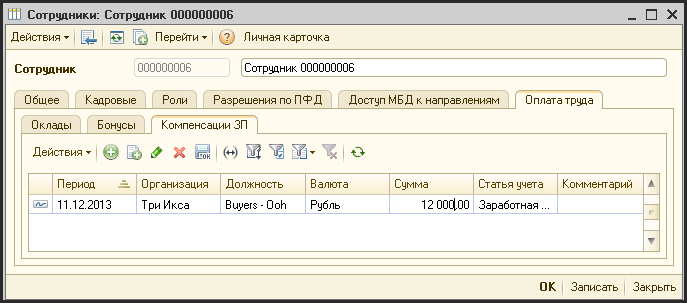

| **Наименование колонки** | **Описание** |
| --- | --- |
| Период | Дата, с которой будет начисляться данная компенсация |
| Организация | Наименование организации, в которой работает сотрудник. Выбор из списка справочника «Организации» . |
| Должность | Должность сотрудника. Заполняется автоматически ??? |
| Валюта | Валюта компенсации. Выбор из списка справочника «Валюты». |
| Сумма | Сумма компенсации. |
| Статья учета | Статья учета. Выбор из справочника «Статьи учета» |
| Комментарий | Возможный комментарий. |

##### Настройка окладов сотрудников

- В системе менеджером по оплате труда ведется:
  - история изменения окладов сотрудников
  - информация о ежемесячных доплатах и удержаниях с сотрудника
  - информация о премировании сотрудников
- Эти данные используются для автоматического заполнения документов по начислению зарплаты
- Все эти операции производятся в справочнике «Сотрудники»

Добавить информацию для начисления заработной платы сотруднику теперь можно непосредственно в самой карточке конкретного сотрудника - была добавлена вкладка «Оплата труда», где, в соответствующем разделе, можно заполнить Оклад, Бонусы и Компенсации ЗП

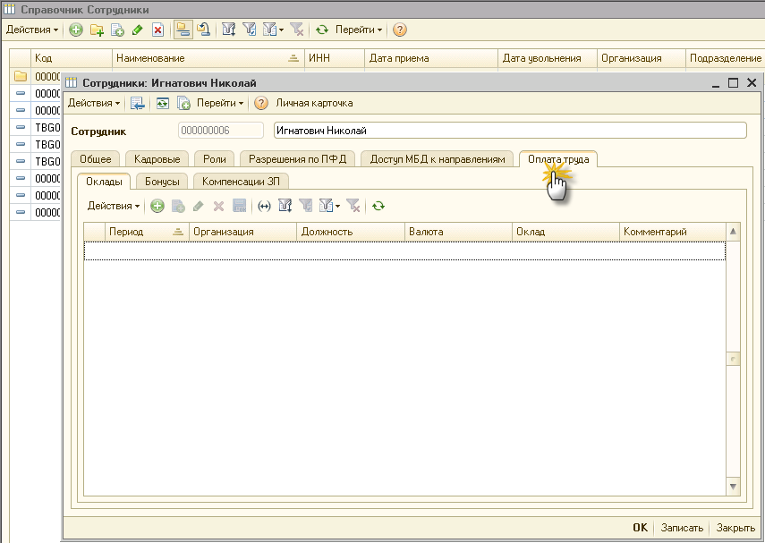

Доступ к этим закладкам имеет только директор компании и менеджер по оплате труда. Финансовый менеджер доступа к этим данным не имеет.

**История окладов**

Для внесения информации по окладу сотрудника необходимо на вкладке «Оклад» добавить новую строку с информацией о сумме оклада. По сотруднику может быть несколько окладов в разной валюте.

Информация по окладу будет учитываться при начислении заработной плат. В учет принимается **_последняя активная запись_** с более ранней датой по отношению к месяцу начисления. Все предыдущие записи изменения оклада хранятся как история изменений.

Статьи учета, которые нужно использовать при оформлении доплат/компенсаций

| **Строка отчета** | **Статья учета** | **Код статьи учета** |
| --- | --- | --- |
| Доплата Декретные | Декретные | 2 031 100 |
| Доплата Фитнес | Фитнесс | 2 030 201 |
| Затраты на увольнение | Расходы на увольнения | 2 030 600 |
| Доплата за моб. связь | Компенсация мобильной связи | 2 030 203 |
| Доплата за обеды | Компенсация за питание | 2 030 204 |
| Доплата за парковку | Компенсация за парковку | 2 030 205 |
| Доплата за ГСМ | Компенсация за ГСМ | 2 030 206 |
|     |     |     |
|     |     |     |
| Удержания Алименты | Алименты | 2 031 010 |
| Удержания Фитнес | Спортивные мероприятия/активности | 4 029 921 |
| Удержания Парковка | Платная парковка | 2 109 901 |
| Удержания Моб. телефон | Расходы на мобильную связь | 2 090 700 |
| Удержания Погашение займа |     |     |

&nbsp;

**Бонусы**

Для внесения информации по бонусам сотрудника необходимо на вкладке «Бонусы» добавить новую строку с информацией о сумме бонуса.

Информация по бонусам будет учитываться при начислении заработной платы. В отличии от истории окладов в этой таблице указываются суммы бонусов начисляемых в конкретных месяцах. Т.е. если указано, на дату 31.10.13 бонус 1000, это значит , что в октябре будет начислен бонус, но в ноябре он уже начисляться не будет.

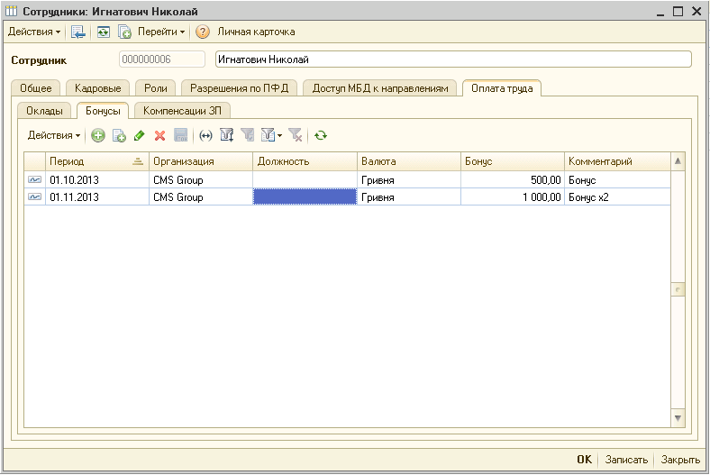

**Доплаты и удержания**

Для внесения информации по компенсациям или удержаниям по сотруднику необходимо на вкладке «Компенсации» добавить новую строку с информацией о сумме компенсации (+) или удержания (-).

Данная информация будет учитываться при начислении компенсаций (удержаний) к (из) заработной платы в соответствующем месяце. Допускается ведение записи в одну дату, но с разными статьями учета.

Эта информация будет использоваться для заполнения документа «Доплаты/удержания по ЗП».

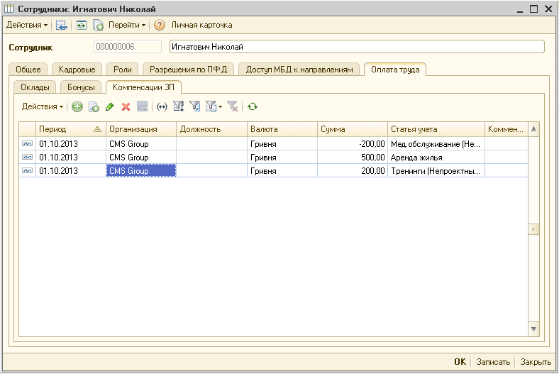

Для того чтобы отменить начисления какой-то доплаты или удержания с какой-то даты необходимо добавить строку с этой датой, нужной статьей и суммой «0».

##### Ведение личной карточки сотрудника

Для открытия формы личной карточки нажимаем на кнопку «Личная карточка» в форме редактирования сотрудника:

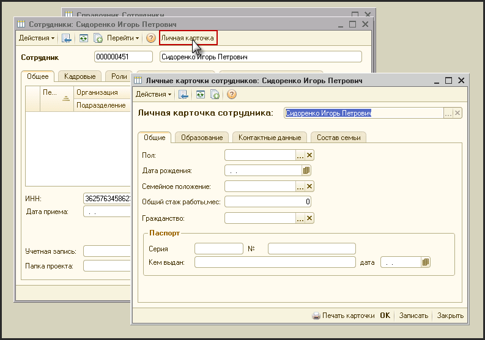

Внимание! Если это новый сотрудник, перед открытием личной карточки нужно обязательно сохранить элемент с новым сотрудником.

Заполнение общей информации:

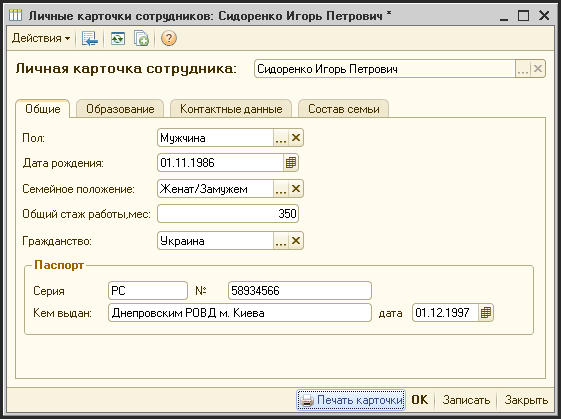

Заполняем сведения об образовании:

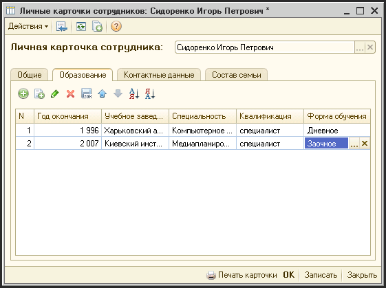

Заполняем контактные данные:

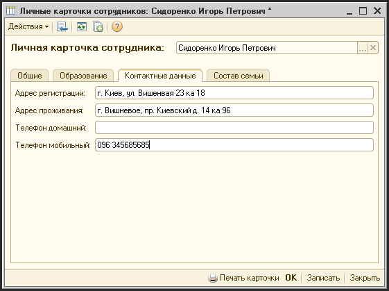

Заполняем состав семьи:

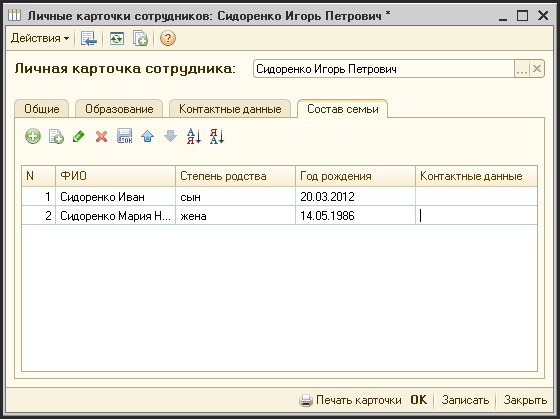

Формируем отчет «Личная карточка»

Для печати личной карточки нужно нажать кнопку «Печать карточки»:

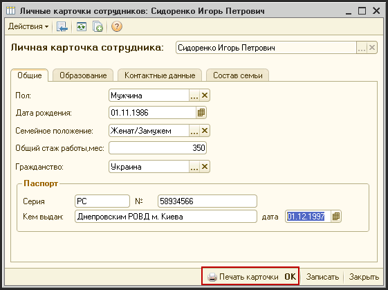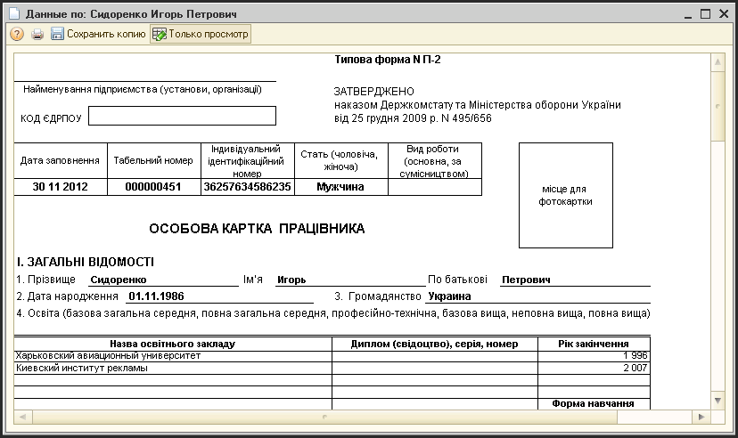

### Основные средства

Справочник «Основные средства» предназначен для хранения информации об основных средствах и нематериальных активах, используемых в фирме.

#### Рабочее окно справочника «Основные средства»

Рабочее окно справочника «Основные средства» открывается при выборе меню «Справочники / Основные средства».

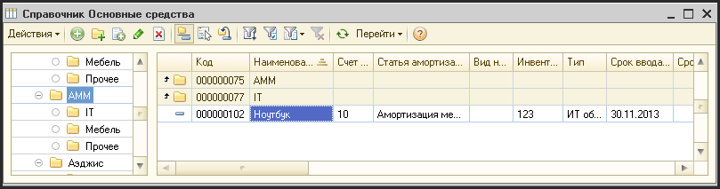

На экране появляется рабочее окно со списком элементов справочника. В левой части окна располагается окно навигации по группам справочника, а в правой части - список основных средств текущей группы.

#### Форма редактирования основного средства

При нажатии на кнопку появляется форма редактирования информации об основном средстве.

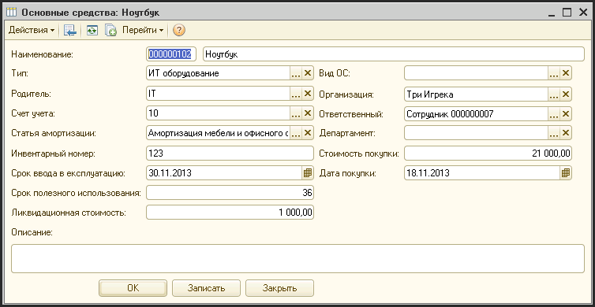

| **Наименование поля** | **Описание** |
| --- | --- |
| №   | Порядковый номер основного средства |
| Наименование | Наименование основного средства |
| Тип | Тип ОС |
| Родитель | Имя группы верхнего уровня иерархии. |
| Счет учета | Счет учета в плане счетов |
| Статья амортизации | Счет амортизации |
| Инвентарный номер | Инвентарный номер |
| Срок ввода в эксплуатацию | Срок ввода в эксплуатацию |
| Срок полезного использования | Срок полезного использования ОС (база расчета амортизации) |
| Ликвидационная стоимость | Ликвидационная стоимость ОС (в базовой валюте) |
| Вид ОС | ??? |
| Организация | Наименование организации, в которой используется данное основное средство |
| Ответственный | ФИО сотрудника, ответственного за использование данного основного средства |
| Департамент | Департамент |
| Стоимость покупки | Цена основного средства (с НДС) ??? |
| Дата покупки | Дата покупки ОС |

### Валюты

Справочник «Валюты» предназначен для хранения информации о валютах, используемых в Системе, и о курсах валют.

#### Рабочее окно справочника «Валюты»

Рабочее окно справочника «Валюты» открывается при выборе меню «Справочники / Валюты».

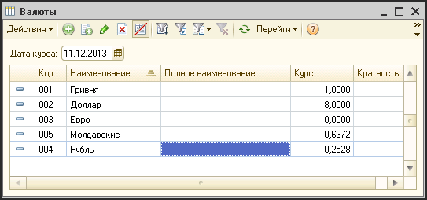

На экране появляется рабочее окно со списком элементов справочника.

#### Форма редактирования валюты

При нажатии на кнопку появляется форма создания нового элемента справочника «Валюты». Для редактирования существующего элемента необходимо нажать на кнопку ,и появится форма редактирования информации о данной валюте.

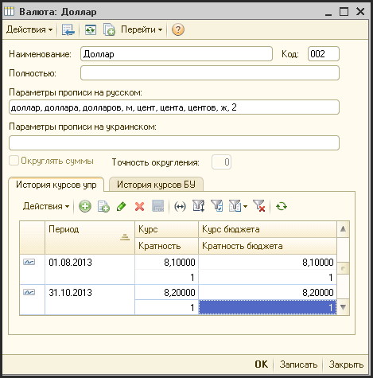

| **Наименование поля** | **Описание** |
| --- | --- |
| Наименование | Наименование валюты |
| Код | Порядковый номер в справочнике. |
| Полностью | Полное наименование валюты |
| Параметры прописи на русском языке | Файл преобразования сумм в строку на русском языке |
| Параметры прописи на украинском языке | Файл преобразования сумм в строку на украинском языке |
| Округлять суммы | Флаг. Для указания необходимости округления сумм. |
| Точность округления | Число цифр после запятой при округлении. |
| **Закладка «История курсов упр» ???** | В данной закладке можно задать курс и кратность новой валюты или изменить курс и кратность существующей. |
| Период | Дата изменения курса валюты. При изменении курса (создании новой строки таблицы) автоматически подставляется текущая дата. |
| Курс / Кратность | Курс валюты по отношению к национальной валюте./  Кратность валюты по отношению к национальной валюте. |
| Курс бюджета / Кратность бюджета | Курс валюты бюджета по отношению к национальной валюте./  Кратность валюты бюджета по отношению к национальной валюте. |
| **Закладка «История курсов БУ» ???** | В данной закладке можно задать курс и кратность новой валюты или изменить курс и кратность существующей. ??? |
| Период | Дата изменения курса валюты бюджета. При изменении курса (создании новой строки таблицы) автоматически подставляется текущая дата. |
| Курс | Курс валюты по отношению к национальной валюте |
| Кратность | Кратность валюты по отношению к национальной валюте |

### Счета

Справочник «Счета» содержит информацию о денежных счетах, который используются для хранения денежных средств компании(ий).

#### Рабочее окно справочника «Денежные счета»

Рабочее окно справочника «Денежные счета» открывается при выборе меню «Справочники / Счета».

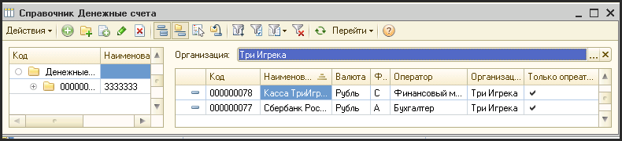

На экране появляется рабочее окно со списком элементов справочника. В левой части окна располагается окно навигации по группам справочника, а в правой части - список денежных счетов текущей группы.

#### Форма редактирования

При нажатии на кнопку появляется форма создания нового элемента справочника «Денежные счета». Для редактирования существующего счета необходимо нажать на кнопку ,и появится форма редактирования информации о данном денежном счете.

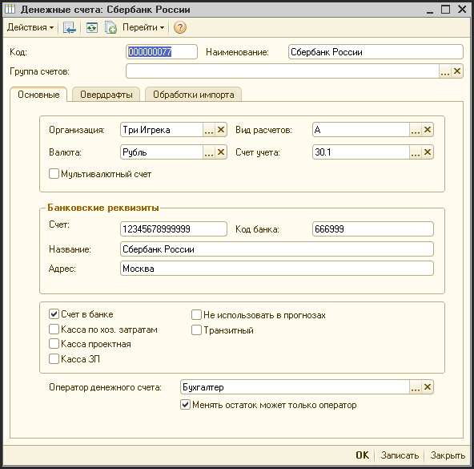

| **Наименование поля** | **Описание** |
| --- | --- |
| Код | Порядковый номер в системе |
| Наименование | Наименование денежного счета |
| Группа счетов | Наименование группы счетов, к которой принадлежит данный денежный счет. |
| **Закладка «Основные»** | Основная информация о данном денежном счете. |
| Организация | Фирма, использующая данный денежный счет |
| Валюта | Основная валюта денежного счета |
| Мультивалютный | Если флаг установлен, то на этом денежном счете может храниться остаток в нескольких валютах. |
| Вид расчетов | Форма оплаты:  А - оплата по бухгалтерии;  В - оплата через оффшорный счет;  С - оплата наличными |
| Счет учета | Выбирается из справочника «План счетов». (Обычно «Расчетные счета в банках» или «Кассы») |
| Поле «Банковские реквизиты» | Информация о банковских реквизитах. Заполняется только, если данный денежный счет - расчетный счет в банке. |
| \- Счет | Номер расчетного счета в банке |
| \- Код банка | Код МФО банка |
| \- Название банка | Наименование банка |
| \- Адрес | Адрес банка |
| Счет в банке | Флаг. Если установлен, то данный денежный счет - счет в банке. |
| Касса по хоз. затратам | Флаг. Если установлен, то данный денежный счет - касса для расчета по хозяйственным нуждам. |
| Касса проектная | Флаг. Если установлен, то данный денежный счет - касса для расчета по проектной деятельности. |
| Касса ЗП | Флаг. Если установлен, то данный денежный счет - касса для расчета по заработной плате сотрудников. |
| Не использовать в прогнозах | Флаг. ??? |
| Транзитный | Флаг. ??? |
| Оператор денежного счета | В этом поле можно выбрать оператора (ответственного) этого денежный счет. |
| Менять остаток может только оператор | Если значение установлено, то доступ к движениям по данному денежному счету будет иметь только указанный оператор и финансовый директор. |
| **Закладка «Овердрафты»** |     |
| Период | Дата овердрафта. |
| Валюта | Валюта овердрафта |
| Лимит овердрафта | Лимит овердрафта |
| **Закладка «Обработки импорта»** |     |
| N / Обработка | ??? |

### Контрагенты

Справочник «Контрагенты» содержит информацию о юридических и физических лицах, с которыми компания вступает хозяйственные отношения.

#### Рабочее окно «Контрагенты»

Рабочее окно справочника «Контрагенты» открывается при выборе пункта меню «Справочники / Контрагенты». В левой части окна располагается окно навигации по группам справочника, а в правой части - список контрагентов текущей группы.

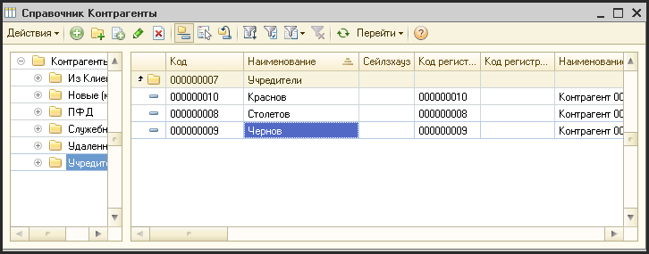

На экране появляется рабочее окно со списком контрагентов.

#### Форма редактирования контрагента

При нажатии на кнопку появляется форма создания нового элемента справочника «Контрагенты». Для редактирования существующего контрагента необходимо нажать на кнопку ,и появится форма редактирования информации о данном контрагенте.

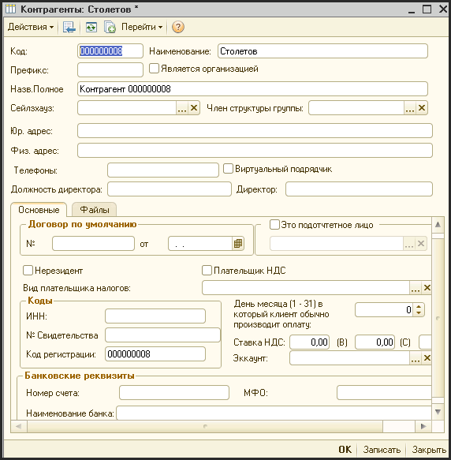

| **Наименование поля** | **Описание** |
| --- | --- |
| Код | Порядковый номер в справочнике. |
| Наименование | Наименование контрагента в системе. |
| Префикс | Трехбуквенное сокращение для контрагента, используется для составления номера проекта |
| Полн. название | Полное наименование контрагента |
| Сейлзхауз | Если подрядчик входит в какой-либо сейлзхауз, то его нужно указать в этом поле. Выбор из справочника «Сейлзхаузы». |
| Член структуры группы | Ссылка на структурное подразделение группы. |
| Юр. адрес | Юридический адрес контрагента |
| Физ. адрес | Физический адрес контрагента |
| Телефоны | Возможные телефоны контрагента. |
| Виртуальный подрядчик | Флаг. Если установлен, то данный контрагент является виртуальным подрядчиком. |
| Должность директора | ??? |
| Директор | ФИО Директора ??? |
| **Закладка «Основные»** | Основная информация о контрагенте. |
| Поле «Договор по-умолчанию» | Указывается номер и дата Договора для вставки по-умолчанию в документы??? |
| Это подотчетное лицо | Флаг. Если установлен ??? ниже поле выбор из списка справочника ??? |
| Нерезидент | Флаг. Если установлен, то данный контрагент является нерезидентом. |
| Плательщик НДС | Флаг. Если установлен, то данный контрагент является плательщиком НДС. |
| Вид плательщика налогов | ??? |
| ИНН | Идентификационный налоговый номер |
| № Свидетельства | Номер свидетельства о регистрации |
| Код регистрации | Код ЕДРПОУ |
| День месяца (1 - 31), в который клиент обычно производит оплату | Указывается число месяца, в которое обычно данный контрагент (Клиент) осуществляет оплату. |
| Ставка НДС |     |
| Эккаунт | ФИО эккаунта, ответственного за работу с данным контрагентом. |
| Поле «Банковские реквизиты» | В данном поле указываются банковские реквизиты : Номер расчетного счета, Наименование банка, МФО банка. |
| **Закладка «Файлы»** | Список файлов (документов), касающихся данного контрагента. Указывается описание содержимого файла, каталог, где хранится файл и путь к файлу. |

### Статьи учета

Справочник «Статьи учета» предназначен для хранения всех статей затрат и доходов, используемых в Системе. Этот справочник является основной аналитикой структуры затрат и доходов финансового результата.

#### Рабочее окно справочника «Статьи учета»

Рабочее окно справочника «Виды затрат» открывается при выборе меню «Справочники / Статьи учета».

В левой части окна располагается окно навигации по группам справочника, а в правой части - список статей учета текущей группы.

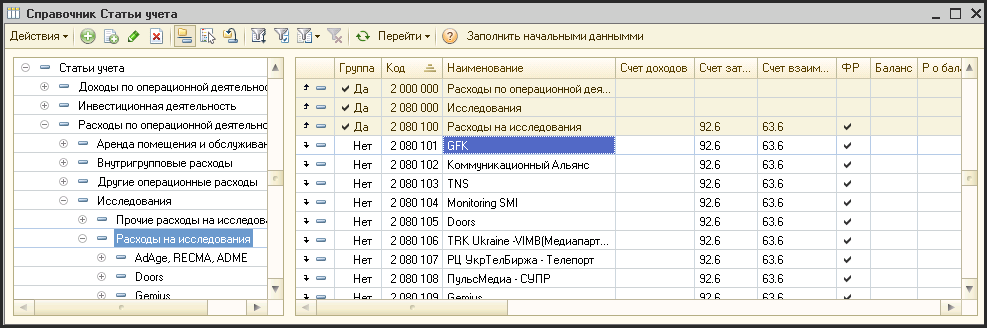

Для добавления новой строки необходимо нажать на кнопку , для редактирования существующей строки - кнопку .

#### Форма редактирования

При нажатии на кнопку появляется форма создания нового элемента справочника «Статьи учета». Для редактирования существующей статьи необходимо нажать на кнопку ,и появится форма редактирования информации о данной статье учета.

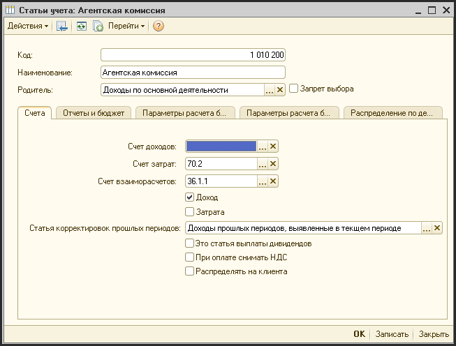

| **Наименование поля** | **Описание** |
| --- | --- |
| Код | Порядковый номер в справочнике. |
| Наименование | Наименование статьи учета в Системе. |
| Родитель | Группа статей учета, в которую входит данная статья учета |
| Запрет выбора | Флаг. Если установлен - статью выбирать нельзя. |
| **Закладка «Счета»** | Информация о счетах учета данной статьи. |
| Счет доходов | Счет дохода (выбирается из справочника «План счетов») - счет, на который начисляются доходы по этой статье |
| Счет затрат | Счет затраты (выбирается из справочника «План счетов») - счет, на который начисляются затраты по этой статье. |
| Счет взаиморасчетов | Счет взаиморасчетов (выбирается из справочника «План счетов») - счет, на который начисляются взаиморасчеты по этой статье. |
| Доход | Флаг. Если установлен, то данная статья доходная. |
| Затрата | Флаг. Если установлен, то данная статья затратная. |
| Статья корректировок прошлых периодов | Статья корректировок прошлых периодов. Выбирается из справочника «Статьи учета». |
| Это статья выплаты дивидендов | Флаг. Указывает на статью выплаты дивидендов. |
| При оплате снимать НДС | Флаг. Если установлен, то при оплатах с суммы снимается НДС ??? |
| Распределять на клиента | Флаг. Если установлен, то ??? |
| **Закладка «Отчеты и бюджет»** | В данной закладке указывается участвует ли данная статья в построении отчетов «Баланс», «Финансовый результат» и «Движение денежных средств» и является ли капитальной затратой. |
| Флаг «Выделять внутригрупповые» | ??? |
| Баланс | Флаг. Если установлен, то данная статья используется при построении отчета «Баланс» ??? |
| Статья баланса | Соответствующая статья для баланса. Выбор из справочника «Статьи регулярных отчетов» |
| ФР | Флаг. Если установлен, то данная статья используется при построении отчета «Финансовый результат». |
| Статья баланса | Соответствующая статья для отчета ФР. Выбор из справочника «Статьи регулярных отчетов». |
| ДДС | Флаг. Если установлен, то данная статья используется при построении отчета «Движение денежных средств» |
| Статья ДДС | Соответствующая статья для отчета ДДС. Выбор из справочника «Статьи регулярных отчетов». |
| Направление расчета | ??? |
| Это капитальная затрата | Флаг. Если установлен, данная статья учитывается, как капитальная затрата. |
| Статья амортизации капитальных затрат | Статья амортизации капитальных затрат. Выбор из справочника «Статьи учета» |
| Типовой срок полезного использования по этой капитальной затрате | ??? |
| **Закладка «Параметры расчета бюджета ОХР»** | Содержит параметры расчета при формировании бюджета ОХР |
| Период | Дата |
| Организация | Организация |
| Контрагент | Контрагент |
| %В |  |
| %С |  |
| %налогов |  |
| М1 - М12 | ??? Смещение месяцев при оплатах. Могут принимать такие значения: |
| %1 - %12 |  |
| **Закладка «Параметры расчета бюджета по ЗП»** | Содержит параметры расчета при формировании бюджета по заработной плате |
| Период | Дата |
| Организация | Организация |
| % оплаты на карточку |  |
| %НДФЛ |  |
| %ЕСН |  |
| М А1 - М А6 | ??? Смещение месяцев при оплатах |
| %1 - %6 | ??? |
| М С1 - М С6 | ??? Смещение месяцев при оплатах. |
| %1 - %6 |  |
| Дата оплаты А | Дата ??? |
| Дата оплаты С | ??? |
| Дата оплаты налогов | Дата оплаты налогов по ЗП |
| **Закладка «Распределение по департаментам»** | Содержит информацию о процентном распределении ЗП по департаментам |
| Алгоритм распределения | Алгоритм распределения ЗП по департаментам. Может быть: - Фиксированный процент - Доля в выручке - Количество сотрудников - Равномерное распределение |
| Период | Дата |
| Организация | Организация |
| Департамент | Департамент организации |
| Процент распределения | Процент распределения |

### Виды платежей

Справочник «Виды платежей» предназначен для хранения списка видов платежей, использующихся в системе. Этот справочник используется в документе «Платежи» и позволяет правильно заполнять реквизиты этого документа.

#### Рабочее окно справочника «Виды платежей»

Рабочее окно справочника «Виды платежей» открывается при выборе меню «Справочники / Виды платежей».

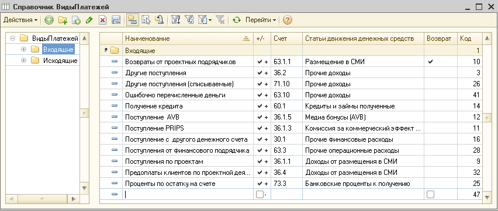

Для добавления новой строки необходимо нажать на кнопку , появится новая строка, в колонки которой необходимо ввести следующие реквизиты:

| **Наименование колонки** | **Описание** |
| --- | --- |
| Наименование | Наименование вида платежа |
| +/- | Направление платежа (входящий или исходящий). |
| Счет | Счет, который заполняется в реквизит «Счет» документа «Платежи» |
| Статьи движения денежных средств | Статья учета по данному виду платежа. Используется для построения отчетов «Движение денежных средств» |
| Возврат | Флаг. Если установлен, то данный вид платежа используется для учета возвратов денежных средств. |
| Код | Порядковый номер в справочнике. |

### Проектные клиенты

Проектные клиенты - это клиенты, по которым создаются проекты в системе. Проектные клиенты не являются юридическими лицами. По проектным клиентам можно проводить аналитику проектов в разрезе каждого клиента.

#### Рабочее окно справочника «Проектные клиенты»

Рабочее окно справочника «Проектные клиенты» открывается при выборе меню «Справочники / Проектные клиенты».

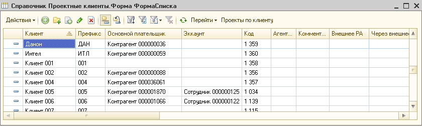

#### Форма редактирования

При нажатии на кнопку появляется форма создания нового элемента справочника «Проектные клиенты». Для редактирования существующего Клиента необходимо нажать на кнопку ,и появится форма редактирования информации о данном Клиенте.

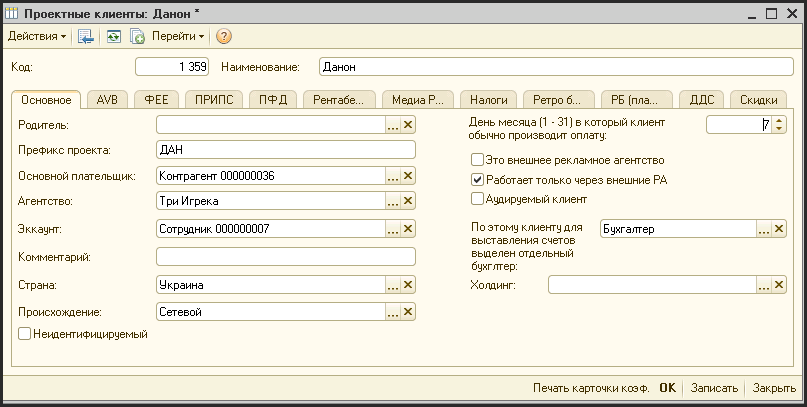

| **Наименование поля** | **Описание** |
| --- | --- |
| Код | Порядковый номер в справочнике. |
| Наименование | Наименование клиента (не обязательно его юридическое наименование) |
| **Закладка «Основное»** | Содержит основную информацию о Клиенте для построения проектов в Системе |
| Родитель | Выбор из справочника «Проектные клиенты» |
| Префикс проекта | Трехбуквенный префикс для идентификации проектов клиента. |
| Основной плательщик | Наименование контрагента из справочника «Контрагенты», являющегося основным плательщиком по данному проектному клиенту. |
| Агентство |     |
| Эккаунт | Сотрудник, ответственный за работу с данным клиентом. Выбирается из справочника «Сотрудники». |
| Комментарий |     |
| Страна |     |
| Происхождение | Пояснение, описание. |
| Неидентифицируемый | Флаг. Если установлен??? |
| День месяца (1 - 31), в который клиент обычно производит оплату | Указывается число месяца, в которое обычно данный контрагент (Клиент) осуществляет оплату. |
| Это внешнее РА |     |
| Работает только через внешние РА |     |
| Аудируемый клиент |     |
| Отдельный бухгалтер |     |
| Холдинг |     |
| **Закладка «**AVB**»** | Информация о проценте AVB по данному клиенту.  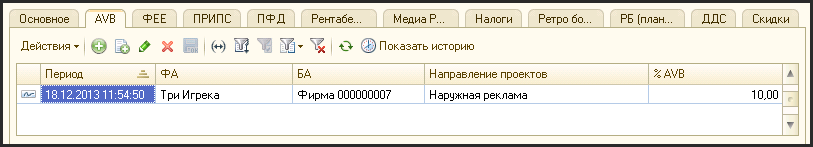 |
| % AVB | % Суперкомиссии от подрядчиков, используется при формировании бюджетов по проектам и при предварительном начислении АВБ за период (если по проектным работам не заполнена затратная часть). |
| Период | Дата и время с которой актуальны проценты в в данной строке. Время должно быть 00.00.00 |
| ФА  | Фронтальное агентство, по работам которого действует процент в этой строке. Если не выбрано - процент действует для тех фронтальных агентств, для которых не установлен собственный процент. |
| БА  | Баинговое агентство, по работам которого действует процент в этой строке. Если не выбрано - процент действует для тех баинговых агентств, для которых не установлен собственный процент. |
| Направление проектов | Вид медиа, по которому действует процент в этой строке. Если не выбрано - процент действует для тех видов СМИ, для которых не установлен собственный процент. |
| **Закладка «ФЕЕ»** | Информация о проценте ФЕЕ по данному клиенту.   |
| Период | Дата и время с которой актуальны проценты в в данной строке. Время должно быть 00.00.00. |
| ФА  | Фронтальное агентство, по работам которого действует процент в этой строке. Если не выбрано - процент действует для тех фронтальных агентств, для которых не установлен собственный процент. |
| Направление проектов | Вид медиа, по которому действует процент в этой строке. Если не выбрано - процент действует для тех видов СМИ, для которых не установлен собственный процент. |
| % fee | Процент комиссии по проектам (в процентах). |
| **Закладка «ПРИПС»** | Информация о проценте ПРИПС по данному клиенту.  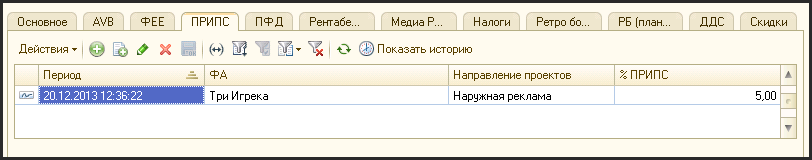 |
| Период | Дата и время с которой актуальны проценты в в данной строке. Время должно быть 00.00.00. |
| ФА  | Фронтальное агентство, по работам которого действует процент в этой строке. Если не выбрано - процент действует для тех фронтальных агентств, для которых не установлен собственный процент. |
| Направление проектов | Вид медиа, по которому действует процент в этой строке. Если не выбрано - процент действует для тех видов СМИ, для которых не установлен собственный процент. |
| % ПРИПС | Дополнительное вознаграждение (суперкомиссия), которое выплачивает клиент рекламному агентству за достижение определенных результатов.  Для каждого клиента можно установить % PRIPS.  Если размер вознаграждения в рамках работ для одного клиента различный в зависимости от выполненных работ, тогда можно указать % PRIPS для каждого направления проектов. |
| **Закладка «ПФД»** | Информация о проценте ПФД по данному клиенту.  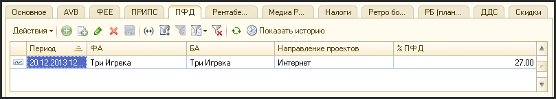 |
| Период | Дата и время с которой актуальны проценты в в данной строке. Время должно быть 00.00.00. |
| ФА  | Фронтальное агентство, по работам которого действует процент в этой строке. Если не выбрано - процент действует для тех фронтальных агентств, для которых не установлен собственный процент. |
| БА  | Баинговое агентство, по работам которого действует процент в этой строке. Если не выбрано - процент действует для тех баинговых агентств, для которых не установлен собственный процент. |
| Направление проектов | Вид медиа, по которому действует процент в этой строке. Если не выбрано - процент действует для тех видов СМИ, для которых не установлен собственный процент. |
| % ПФД | Процент комиссии в процентах. Используются для корректировки распределения медиаразницы между фронтальным и баинговым агентством. |
| **Закладка «Рентабельность»** | Информация о границах рентабельности по данному клиенту. Определяется верхний и нижний предел рентабельности работы с клиентом по направлениям. От этого коэффициента зависит только цвет строки с проектом в списке проектов (красный или черный).  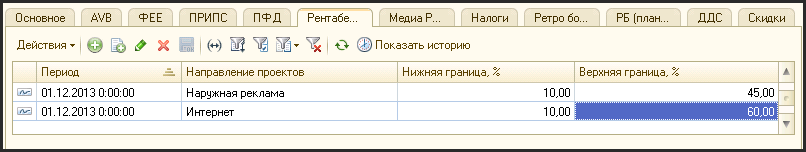 |
| Период | Дата и время с которой актуальны проценты в в данной строке. Время должно быть 00.00.00. |
| Направление проектов | Вид медиа, по которому действует процент в этой строке. Если не выбрано - процент действует для тех видов СМИ, для которых не установлен собственный процент. |
| Нижняя граница % | Нижняя граница рентабельности для данного клиента по выбранному направлению. |
| Верхняя граница % | Верхняя граница рентабельности для данного клиента по выбранному направлению. |
| **Закладка «МедиаРазница»** | Информация о проценте медиаразницы по данному клиенту.  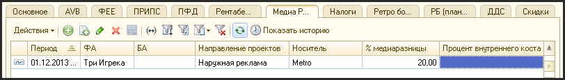 |
| Период | Дата и время с которой актуальны проценты в данной строке. Время должно быть 00.00.00. |
| ФА  | Фронтальное агентство, по работам которого действует процент в этой строке. Если не выбрано - процент действует для тех фронтальных агентств, для которых не установлен собственный процент. |
| БА  | Баинговое агентство, по работам которого действует процент в этой строке. Если не выбрано - процент действует для тех баинговых агентств, для которых не установлен собственный процент. |
| Направление проектов | Вид медиа, по которому действует процент в этой строке. Если не выбрано - процент действует для тех видов СМИ, для которых не установлен собственный процент. |
| Носитель | Носитель рекламы |
| % медиаразницы | ???Средний процент рентабельности при работе с клиентом по направлению. Данные коэффициенты используются при формировании бюджетов по проектам и при предварительном расчете себестоимости размещения за период (если по проектным работам не заполнена затратная часть). |
| Процент внутреннего коста | ??? |
| **Закладка «Налоги»** | Информация о проценте налогов по данному клиенту.  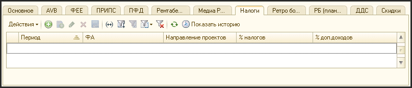 |
| Период | Дата и время с которой актуальны проценты в данной строке. Время должно быть 00.00.00. |
| ФА  | Фронтальное агентство, по работам которого действует процент в этой строке. Если не выбрано - процент действует для тех фронтальных агентств, для которых не установлен собственный процент. |
| Направление проектов | Вид медиа, по которому действует процент в этой строке. Если не выбрано - процент действует для тех видов СМИ, для которых не установлен собственный процент. |
| % налогов | Данные коэффициенты определяют базу налогообложения, по которой идут взаиморасчеты с клиентом (есть НДС или нет). Эти коэффициенты используются для проектного бюджетирования (для расчетов оборота с налогами и бюджетирования ДДС). |
| % доп. доходов | ??? |
| **Закладка «Ретро бонусы»** | Информация о ретробонусах по данному клиенту. Определяется шкала ретробонусов по данному клиенту по различным сейлзхаузам. Эти коэффициенты используются при начислении ретробонусов.  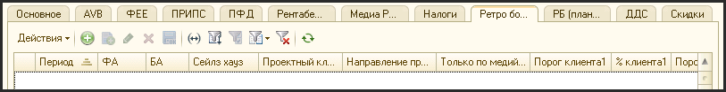 |
| Период | Дата и время с которой актуальны проценты в данной строке. Время должно быть 00.00.00. |
| ФА  | Фронтальное агентство, по работам которого действует процент в этой строке. Если не выбрано - процент действует для тех фронтальных агентств, для которых не установлен собственный процент. |
| БА  | Баинговое агентство, по работам которого действует процент в этой строке. Если не выбрано - процент действует для тех баинговых агентств, для которых не установлен собственный процент. |
| Сейлз хауз | Сейлзхауз (обязательный параметр), для которого рассчитываются ретробонусы. |
| Проектный клиент | Клиент (обязательный параметр), по которому рассчитываются ретробонусы |
| Направление проектов | Вид медиа, по которому действует процент в этой строке. Если не выбрано - процент действует для тех видов СМИ, для которых не установлен собственный процент. |
| Только по медийному обороту |     |
| Порог клиента1 - Порог клиента 6 | Медийный оборот, по достижению которого применяется «Процент клиента 1» - «Процент клиента 6». |
| Процент клиента1 - Процент клиента6 | ??? |
| Порог подрядчика1 - Порог подрядчика6 | Баинговый оборот, по достижению которого применяется «Процент подрядчика 1» - «Процент подрядчика 6». |
| Процент подрядчика1 - Процент подрядчика6 | ??? |
| **Закладка «РБ (плановые)»** | Информация о ретробонусах (плановых) по данному клиенту.  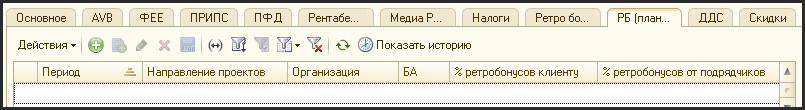 |
| Период | Дата и время с которой актуальны проценты в данной строке. Время должно быть 00.00.00. |
| Направление проектов | Вид медиа, по которому действует процент в этой строке. Если не выбрано - процент действует для тех видов СМИ, для которых не установлен собственный процент. |
| Организация |     |
| БА  | Баинговое агентство, по работам которого действует процент в этой строке. Если не выбрано - процент действует для тех баинговых агентств, для которых не установлен собственный процент. |
| % ретробонусов клиенту | ??? |
| % ретробонусов от подрядчиков | ??? |
| **Закладка «ДДС»** | Информация о движении денежных средств по данному клиенту. Определяется группа коэффициентов, которые используются для автоматического формирования бюджета ДДС на основании бюджета проектных работ. Редактируются в отдельной форме «Коэффициенты расчета расчёта ДДС По проекту…», которая открывается нажатием кнопки . **См. Инструкцию по заполнению коэффициентов по Клиенту.** ???  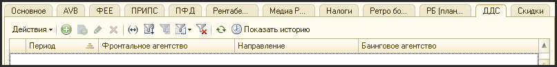 |
| Период | Дата и время с которой актуальны проценты в данной строке. Время должно быть 00.00.00. |
| Фронтальное агентство | Фронтальное агентство, по работам которого действует процент в этой строке. Если не выбрано - процент действует для тех фронтальных агентств, для которых не установлен собственный процент. |
| Направление | Вид медиа, по которому действует процент в этой строке. Если не выбрано - процент действует для тех видов СМИ, для которых не установлен собственный процент. |
| Баинговое агнентство | Баинговое агентство, по работам которого действует процент в этой строке. Если не выбрано - процент действует для тех баинговых агентств, для которых не установлен собственный процент. |
| **Закладка «Скидки»** | Информация о скидках по данному клиенту.  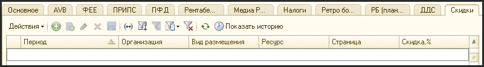 |
| Период | Дата и время с которой актуальны проценты в данной строке. Время должно быть 00.00.00. |
| Организация |     |
| Вид размещения |     |
| Ресурс |     |
| Страница |     |
| Скидка % | Процент скидки |

### Проектные справочники

Группа «Проектные справочники» включает справочники, которые используются при работе с проектами.

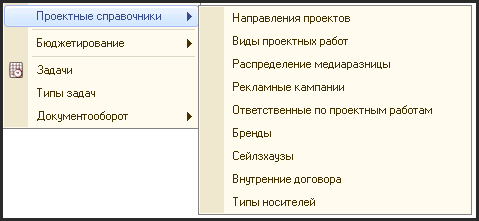

### Направления проектов

Направления проектов - это виды медиа, где размещается рекламы.

#### Рабочее окно справочника «Направления проектов»

Рабочее окно справочника «Направления проектов» открывается при выборе меню «Справочники / Проектные справочники / Направления проектов», либо при заполнении соответствующего поля в других формах системы.

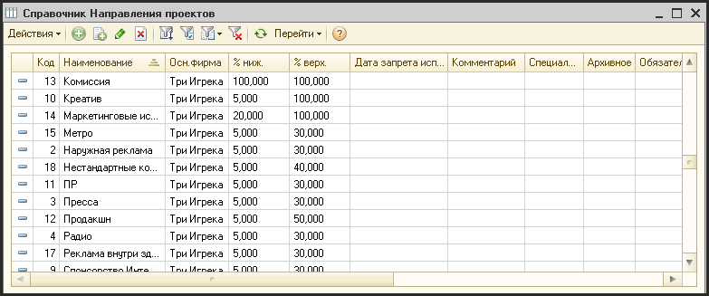

#### Форма редактирования

При нажатии на кнопку появляется форма создания нового элемента справочника «Направления проектов». Для редактирования существующего направления необходимо нажать на кнопку ,и появится форма редактирования информации о данном направлении проекта.

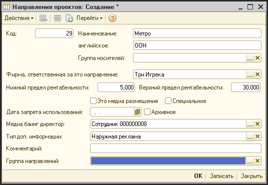

| **Наименование колонки** | **Описание** |
| --- | --- |
| Код |     |
| Наименование | Наименование направления проекта |
| английское | ??? |
| Группа носителей | Наименование группы носителей. Выбор из справочника «Группы носителей» |
| Фирма, ответственная за это направление | Фирма, которая является исполнителем по этому направлению (для группового и холдингового учета) |
| Нижний предел рентабельности | Нижний предел рентабельности для данного направления |
| Верхний предел рентабельности | Верхний предел рентабельности для данного направления |
| Это медиа-размещение | Флаг. Если флаг установлен, то это размещение на медиа-носителях, если нет , то это другие виды работ. |
| Специальное | Флаг. Если установлен, то ??? |
| Дата запрета использования | Дата запрета использования ??? |
| Архивное | Флаг. Если установлен, то ??? |
| Медиа баинг директор | Сотрудник, являющийся медиа баинг директором по данному направлению. Выбор из справочника «Сотрудникик» |
| Тип доп. информации | Выбор из списка ??? |
| Комментарий |     |
| Группа направлений | Наименование группы направлений. Выбор из справочника «Группы направлений» |

##### Справочник «Носители»

Справочник «Носители» открывается:

- при нажатии на кнопку «Открыть подчиненный справочник» в рабочем окне справочника «Направления проектов»;

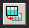

- при нажатии на кнопку «Носители» в форме редактирования направления проекта.

Для добавления новой строки необходимо нажать на кнопку , затем ввести следующие реквизиты:

| **Наименование колонки** | **Описание** |
| --- | --- |
| Наименование | Наименование медиа носителя, на котором выполняется размещение рекламы |
| Комментарий |     |

### Виды проектных работ

Справочник «Виды проектных работ» предназначен для определения видов работ, которые указываются в бюджете проектов.

#### Рабочее окно справочника «Виды проектных работ»

Рабочее окно справочника «Виды проектных работ » открывается при выборе меню «Справочники / Проектные справочники / Виды проектных работ», либо при заполнении соответствующего поля в других формах системы.

Для добавления новой строки необходимо нажать на кнопку , затем ввести следующие реквизиты:

| **Наименование колонки** | **Описание** |
| --- | --- |
| Вид работы | Наименование вида работ |
| Направление | Направление проектной деятельности |
| Вид дохода | Статья доходов по этому виду работ |
| Вид дохода комиссии | ??? |
| Вид затрат | Статья затрат по этому виду работ |
| Финансовая | Флаг. Если установлен, то данная работа является финансовой. |
| Код | Уникальный код вида работ |
| Группа видов работ | Наименование группы видов работ. Выбор из справочника «Группы видов работ». |
| Организация | Наименование организации. ??? |
| Расчет суммы дохода по внутреннему косту. | Флаг. Если установлен, сумма дохода по данному виду работ рассчитывается по внутреннему косту. ??? |

### Распределение медиаразницы

Рабочее окно справочника «Распределение медиаразницы » открывается при выборе меню «Справочники / Проектные справочники / Распределение медиаразницы».

Для добавления новой строки необходимо нажать на кнопку , затем ввести следующие реквизиты:

| **Наименование колонки** | **Описание** |
| --- | --- |
| Период | Дата и время с которой актуальны проценты в данной строке. Время должно быть 00.00.00. |
| Организация | ??? |
| БА  | Баинговое агентство, по работам которого действует процент в этой строке. Если не выбрано - процент действует для тех баинговых агентств, для которых не установлен собственный процент. |
| Проектный клиент | Клиент, по которому рассчитывается медиаразница |
| Направление проектов | Вид медиа, по которому действует процент в этой строке. Если не выбрано - процент действует для тех видов СМИ, для которых не установлен собственный процент. |
| % распределения | Процент рапределения медиаразницы (в процентах) ??? |
| % доп. комиссии | ??? |

### Рекламные кампании

Справочник «Рекламные кампании» позволяет группировать проекты.

Если от клиента был получен заказ на размещение рекламы на нескольких медианосителях, то в системе необходимо создать рекламную кампанию и сгруппировать в ней проекты.

#### Рабочее окно справочника «Рекламные кампании»

Рабочее окно справочника «Рекламные кампании» открывается при выборе меню «Справочники / Проектные справочники / Рекламные кампании».

В рабочем окне «Рекламные кампании» можно отфильтровать значения справочника по эккаунту и по клиенту.

#### Форма новой рекламной кампании

При нажатии на кнопку появляется форма создания нового элемента справочника «Рекламные кампании». Для редактирования существующей кампании необходимо нажать на кнопку ,и появится форма редактирования информации о данной кампании.

| **Наименование колонки** | **Описание** |
| --- | --- |
| Код |     |
| Организация | Фирма, которая отвечает за данную рекламную кампанию |
| Наименование | Наименование рекламной кампании |
| Проектный клиент | Проектный клиент |
| Бренды | Бренд или список брендов данной кампании |
| Осн. направление | Основное направление рекламной кампании |
| Эккаунт | Ответственный за данную кампанию сотрудник |
| Дата начала: | Дата начала кампании |
| Дата завершения: | Дата окончания кампании |
| Описание проекта | Текстовое описание кампании |

??? В нижней части окна расположен список проектов, входящих в данную рекламную кампанию. Список формируется автоматически.

Для того чтобы отобразить принадлежность проекта к определенной рекламной кампании, необходимо указать ее название в консоли проекта в соответствующем поле:

### Ответственные по проектным работам

Справочник «Ответственные по проектным работам» предназначен для определения всех ответственных по проектным работам, которые указываются в проектах.

#### Рабочее окно справочника «Ответственные по проектным работам»

Рабочее окно справочника «Ответственные по проектным работам» открывается при выборе меню «Справочники / Проектные справочники / Ответственные по проектным работам».

Для добавления новой строки необходимо нажать на кнопку , затем ввести следующие реквизиты:

| **Наименование колонки** | **Описание** |
| --- | --- |
| ФА  | Фронтальное агентство |
| БА  | Баинговое агентство |
| Направление | Направление проектной деятельности |
| Клиент | Клиент |
| Ответственный | Сотрудник , ответственный за данное направление. Выбор из справочника «Сотрудники» |

### Бренды

Справочник «Бренды» предназначен для хранения информации о брендах, рекламой которых занимается данное рекламное агентство.

#### Рабочее окно справочника «Бренды»

Рабочее окно справочника «Бренды» открывается при выборе меню «Справочники / Проектные справочники / Бренды», либо при заполнении в консоли проекта поля «Бренды».

На экране появляется рабочее окно со списком элементов справочника.

При нажатии на кнопку в списке появляется новая строка, в которой необходимо указать наименование и владельца бренда (компанию-заказчика рекламы данного бренда). Можно указать и категорию клиента из справочника «Категории клиентов».

### Сейлзхаузы

Справочник «Сейлзхаузы» содержит информацию о группах компаний, которые занимаются продажей рекламных площадей на определенных носителях.

#### Рабочее окно «Сейлзаузы»

Рабочее окно справочника «Сейлзхаузы» открывается из меню «Справочники / Проектные справочники / Бренды» или при нажатии на кнопку в поле Сейлзхауз формы редактирования информации о контрагенте, которая вызывается из справочника «Контрагенты».

На экране появляется рабочее окно со списком элементов справочника «Сейлзхаузы». В крайней левой части окна располагается окно навигации по группам справочника, в средней - список всех сейлзхаузов, в правой - контрагенты, входящие в выбранный сейлзхауз.

Для добавления нового сейлзхауза нажмите кнопку на панели инструментов справочника «Сейлзхаузы». В результате в таблице появится новая строка, в которую необходимо ввести наименование нового сейлзхауза.

##### Подчиненный справочник % AVB

% AVB - это суперкомиссия за размещение рекламы от подрядчиков, используются при формировании бюджетов по проектам и при предварительном начислении АВБ за период (если по проектным работам не заполнена затратная часть)..

Подчиненный справочник «% AVB» появляется при нажатии на кнопку «Перейти» панели инструментов справочников «Проектные клиенты», «Сейлзхаузы» и «Направления проектов» и выборе элемента «% AVB» из выпадающего списка «Перейти».

Справочник «% AVB» содержит историю изменений процента суперкомиссии.

| **Наименование колонки** | **Описание** |
| --- | --- |
| Период | Дата изменения AVB |
| Организация |  |
| Проектный клиент | Наименование клиента. Выбор из справочника «Проектные клиенты» |
| Направление проектов | Вид медиа, который оплачивает сейлзхауз |
| Сейлзхауз | Сейлзхауз, в который входит данный клиент |
| % AVB | Суперкомиссия за размещение рекламы. |
| Форма оплаты АВБ | Одна из форм оплаты: А - безналичный расчет В - оффшор С - наличный расчет |
| М1 - М6 | Смещение месяцев при оплатах АВБ. Могут принимать такие значения: |
| Т1 - Т6 | ??? |
| %1 - %6 | Процент от суммы, который будет оплачен или засчитан. |

Для добавления нового изменения %АВБ нажмите кнопку на панели инструментов справочника «% AVB». В результате в таблице появится новая строка, в которую необходимо ввести новые данные. Для редактирования существующего значения «% AVB» необходимо на панели инструментов справочника нажать кнопку , выбрав предварительно строку для редактирования.

