# Проекты

> **Описание:** Центральная глава системы. Описывает работу со справочником «Проекты» — основным инструментом финансового документооборота рекламного агентства. Детально рассматривается: список и консоль проекта, создание и редактирование бюджетов, графики входящих и исходящих платежей, закрытие работ и проекта, начисление дополнительных доходов и затрат (AVB, PRIPS, PFD).

## Содержание

- [Список проектов](#список-проектов)
- [Консоль проекта](#консоль-проекта)
- [Использование зачётов в работах](#использование-зачетов-в-работах)
- [Установка курсов валют в работах](#установка-курсов-валют-в-работах)
- [Порядок перевода проекта в работу](#порядок-перевода-проекта-в-работу)
- [Порядок закрытия работ в консоли проекта](#порядок-закрытия-работ-в-консоли-проекта)
- [Порядок корректировки и утверждения проекта](#порядок-корректировки-и-утверждения-проекта)
- [Порядок закрытия проекта](#порядок-закрытия-проекта)
- [Начисление и корректировка дополнительных доходов и затрат по проектам](#начисление-и-корректировка-дополнительных-доходов-и-затрат-по-проектам)
- [Корректировка проектных бюджетов по закрытым периодам](#корректировка-проектных-бюджетов-по-закрытым-периодам)
- [Создание и внесение актов по работам](#создание-и-внесение-актов-по-работам)

---

Справочник «Проекты» является основным элементом всей системы документооборота и финансового учета основной операционной деятельности рекламного агентства. В каждом элементе справочника сосредоточена информация о характеристиках проекта, его бюджете и графике платежей.

## Список проектов

Открыть список проектов можно следующими способами:

- в меню справочник выбрать пункт «Проекты»;
- нажать на кнопку «Проекты» на панели инструментов.

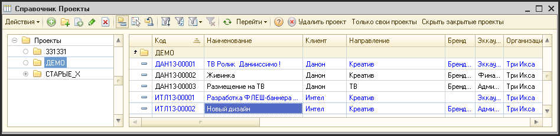

Эта форма позволяет отбирать проекты по эккаунту, по клиенту, по бренду и т.д. Для этого необходимо нажать на кнопку «Отборы и сортировка» . Откроется окно с параметрами отбора:

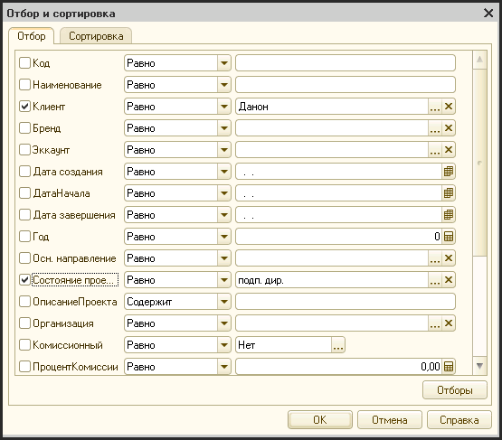

Вы можете задать свои параметры отбора и нажать на кнопку «ОК», в итоге вы получите список проектов, с заданными параметрами. Чтобы отключить отбор, надо нажать на кнопку «Отключить отбор» . Также можно задать отбор по значению в колонке, для этого выберите строку в нужной колонке со значением, по которому вы хотите отобрать проекты и нажмите кнопку .

Проекты в списке выделяются различными цветами, в зависимости от их состояния:

- синим - новый проекты;
- черным - проекты, находящиеся в работе;
- розовым - проекты, находящиеся на корректировке или на утверждении;
- серым - закрытые проекты.

### Создание групп

Право на создание групп проектов имеют только финансовый директор и финансовый менеджер.

Добавить группы в справочник можно, только если установлен флаг «Добавить группы» (доступен только финансовому директору и финансовому менеджер).

Для добавления группы в список проектов необходимо:

- Установить флаг «Добавить группу».
- Нажать на кнопку «Новая группа» на панели инструментов списка групп.

В результате в списке появится группа, которой система присваивает порядковый номер автоматически. Пользователь может изменить номер вручную.

Так же при установленном флаге «Добавить группу» можно менять параметры проекта прямо в таблице.

**Внимание!!!** Эта функция очень опасна, т.к. позволяет проводить операции в обход установленного регламента и может нарушить целостность данных.

## Консоль проекта

Основным инструментом работы с проектом является «Консоль проекта», которой пользователь (в зависимости от своих полномочий) может редактировать все элементы проекта.

**Описание реквизитов шапки нового проекта:**

| **Реквизит** | **Описание** |
| --- | --- |
| Проект № | Уникальный номер документа |
| Редактировать | Флаг, переводящий консоль проекта в режим редактирования |
| Наименование | Наименование проекта |

Ниже шапки проекта находится та информация о проекте, какая закладка в данный момент активна: «Общий», «Бюджет» или «Отчеты».

### Общая информация о проекте

Общая информация о проекте выводится на закладке консоли проекта «Основные»:

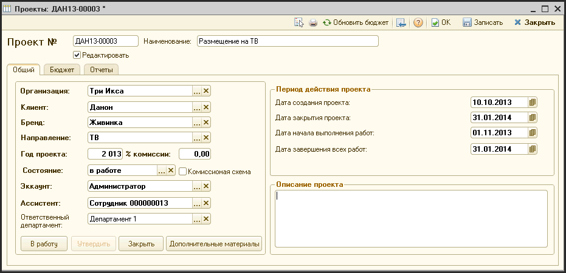

**Описание реквизитов табличной части проекта:**

| **Реквизит** | **Описание** |
| --- | --- |
| Организация | Фирма, которая выполняет работы по проекту |
| Клиент | Заказчик услуг. При выборе клиента система проверяет, заполнено ли поле «Префикс» у данного клиента. Это трехсимвольное значение, которое используется для идентификации проекта, например, ДАН. Если этот поле не заполнено, система не позволит выбрать такого клиента. |
| Бренд | Наименование рекламируемого бренда. Если нужный бренд в списке отсутствует, эккаунт может его создать. |
| Направление | Направление проекта. Выбор из справочника «Направления проектов» |
| Год проекта | Год, к которому относится проект |
| % комиссии | % агентской комиссии рекламного агентства |
| Состояние | Статус проекта Может принимать значения: |
| Эккаунт | ФИО эккаунта проекта. |
| Ассистент | Ассистент эккаунта |
| Ответственный департамент | Наименование департамента организации , ответственного за проект |
| Дата создания проекта | Дата создания проекта в системе |
| Дата закрытия проекта | Дата закрытия проекта в системе |
| Дата начала выполнения работ | Дата, с которой планируется начало выполнения работ по проекту |
| Дата завершения всех работ | Дата, до которой планируется окончание работ по проекту |
| Описание проекта | Краткое описание проекта |

**Описание дополнительных кнопок в форме:**

| **Реквизит** | **Описание** |
| --- | --- |
| В работу | Кнопка, которая позволяет перевести проект в работу  см. [Порядок перевода проекта в работу](#_Порядок_перевода_проекта) |
| Утвердить | Утверждает проект. Данная кнопка позволяет начать процесс утверждения проекта, находящегося в состоянии корректировка.  См. [Инициация процесса утверждения проекта](#_Инициация_процесса_утверждения) |
| Закрыть | Закрывает проект. При этом система проводит большое количество проверок невозможность закрытия проекта.  См. [Порядок закрытия проекта](#_Порядок_закрытия_проекта) |
| Дополнительные материалы | Открывается окно «Хранилище дополнительной информации». Поле «Объект» автоматически заполнено номером данного проекта, ниже список путей к файлам с дополнительной информацией по данному проекту. |

### Бюджет проекта

В закладке «Бюджет» консоли проекта отображается список всех работ по данному проекту.

- Если срок выполнения еще не наступил, строка с работой будет выделена желтым цветом.
- Если срок выполнения наступил, но работа не выполнена (не начислены затраты), то строка будет выделена красным цветом.
- Если работа выполнена (начислены затраты) - зеленым.

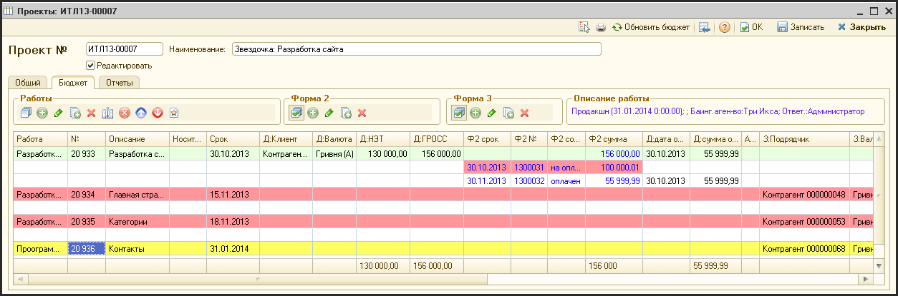

Для занесения в Систему информации о бюджете проекта, установите флаг «Редактировать» в консоли проекта. В результате станут доступными для использования кнопки блоков «Работы», «Формы 2» и «Формы 3».

**Кнопки блоков «Работы», «Формы 2» и «Формы 3»:**

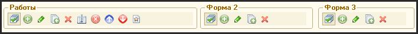

_Флажки в блоках позволяют свернуть/развернуть соответствующие колонки таблицы._

**_Группа кнопок «Работы» -_** _это кнопки, отвечающие за операции с работами._

**_Группа кнопок «Формы 2»_** _- это кнопки, отвечающие за работу с входящими платежами._

**_Группа кнопок «Формы 3»_** _- отвечающие за исходящие платежи._

**Описание кнопок блоков «Работы», «Формы 2» и «Формы 3»:**

| **Кнопка** | **Описание** |
| --- | --- |
|  | Изм фильтр работа |
|  | Новая работа. Создание новой работы по проекту |
|  | Изменить работу. Открывается форма редактирования работы |
|  | Копировать работу. Копирование работы |
|  | Удалить работу. Удаление работы |
|  | Импорт бюджета. Импорт бюджета проекта из файла. |
|  | Распровести форму. Отмена проведение некоторой формы 2 или 3 из соответствующего графика платежей. Данная функция доступна только финансовому директору или финансовому менеджеру. |
|  | Закрыть работу. Фиксация факта выполнения работы  см. [Порядок закрытия работ в консоли проекта](#_Порядок_закрытия_работ) |
|  | Открыть работу. ??? |
| ??? | Отменить закрытие. Отмена закрытия работы  см. [Порядок закрытия работ в консоли проекта](#_Порядок_закрытия_работ) |
|  | Изменить общую информацию о работе. |
|  | Изм фильтр |
|  | Новая Ф2. Создание новой Формы 2 |
|  | Изменить Ф2. Внесение изменений в выбранную Форму 2 |
|  | Копировать Ф2. Создание новой формы 2 копированием выбранной. |
|  | Удалить Ф2. Удаление выбранной формы 2. |
|  | Новая Ф3. Создание новой Формы 3 |
|  | Изменить Ф3. Внесение изменений в Форму 3 |
|  | Копировать Ф3. Создание новой формы 3 копированием выбранной. |
|  | Удалить Ф3. Удаление Формы 3 |

**Описание колонок бюджета проекта**

| **Наименование колонки** | **Описание** |
| --- | --- |
| **Информация о работе** |  |
| Работа | Выполняемая работа по проекту |
| № | Номер работы в системе |
| Описание | Дополнительная текстовая информация по работе |
| Носитель | Медиа-носитель, на котором производится размещение по данной работе. |
| Срок | Срок выполнения работы. |
| **Информация о доходной части** |  |
| Д:Клиент | Контрагент, который выступает плательщиком по данной работе |
| Д:Валюта | Валюта, в которой будут производиться взаиморасчеты с плательщиком по этой работе |
| Д:NET | Сумма работы без налогов |
| Д:Gross | Сумма работы с налогами (сумма к оплате) |
| **Информация по Ф2** |  |
| Ф2 срок | Срок оплаты по Ф2 |
| Ф2 № | Номер Ф2 |
| Ф2 сост. | Состояние формы, показывает на каком этапе обработки находится форма |
| Ф2 Сумма | Сумма Ф2 (в валюте работы) |
| Д:Дата | Дата последнего платежа по этой форме. Соответствующая ячейка данной колонки автоматически заполняется только при наличии оплат по этой Ф2. |
| Д:Сумма | Сумма платежей по этой форме (в валюте расчетов с клиентом). Соответствующая ячейка данной колонки заполняется автоматически только при наличии оплат по этой Ф2. |
| Акт | Флаг наличия подписанного с клиентом акта выполненных по этой работе |
| **Информация о затратной части** |  |
| З:Подрядчик | Подрядчик по этой работе |
| З:Валюта | Валюта взаиморасчетов с подрядчиком |
| З: NET | Сумма работ, выполняемых подрядчиком (без налогов). В валюте расчетов с подрядчиком |
| З:Gross | Сумма работ подрядчика с налогами (к оплате). В валюте расчетов с подрядчиком. |
| **Информация по Ф3** |  |
| Ф3 № | Номер Ф3 |
| Ф3 сост. | Состояние формы |
| Ф3 Сумма | Сумма Ф3 (в валюте работы) |
| Ф3 срок | Срок оплаты |
| З:Дата оплаты | Последняя дата оплаты по этой Ф3 |
| З:Сумма | Сумма платежей по этой форме (в валюте расчетов с подрядчиком). Соответствующая ячейка данной колонки заполняется автоматически только при наличии оплат по этой Ф3. |
| Акт | Флаг наличия подписанного с подрядчиком акта выполненных по этой работе |
| Ответственный | Сотрудник, ответственный за взаимодействие с подрядчиком по этой работе |
| Ассистент | Ассистент ответственного |
| Закр. | Состояние выполнения работы: см. [Порядок закрытия работ в консоли проекта](#_Порядок_закрытия_работ) |

### Отчеты

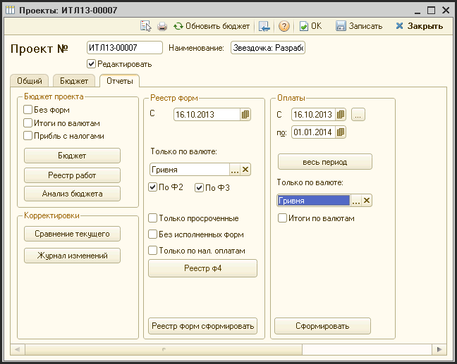

#### Бюджет проекта

Данный отчет выводит информацию о бюджете проекта и его фактическом исполнении.

Отчет разбит на три части:

- описание доходного бюджета;
- описание затратного бюджета;
- расчет прибыльности и рентабельности.

**Реквизиты отчета:**

| **Реквизит** | **Описание** |
| --- | --- |
| Без форм | Выводить отчет без детализации по формам |
| Итоги по валютам | Все итоги в доходном и затратном бюджете выводить как в базовой валюте, так и в валютах взаиморасчетов |
| Прибыль по налогам | ??? |

#### Анализ бюджета

Данный отчет позволяет проанализировать финансовому директору правильность создания бюджета проекта:

- доходы соответствуют затратам;
- норма рентабельности находится в установленных рамках;
- исходящие платежи не превышают входящие.

Для создания отчета, необходимо нажать на кнопку «Анализ бюджета». Никакие дополнительные реквизиты по данному отчету вводить не нужно.

#### История корректировок

Данный отчет позволяет отслеживать историю изменений внесенных в бюджет проекта. Сразу вызываются изменения бюджета в сравнении с последним утверждением проекта. Однако, затем можно сравнить текущий бюджет со всеми утверждениями, начиная с самого первого.

Никакие дополнительные реквизиты по данному отчету в консоли проекта не вводятся.

#### Реестр форм

Отчет «Реестр форм» отображает реестр всех форм 2 и 3, зарегистрированных по этому проекту и отслеживает динамику их обработки. В дополнении к этапам «оплачено / не оплачено» , этот отчет рассматривает этапы «необработанная форма / на обработке / обработана, ожидает исполнения / исполнена».

Этот отчет дает возможность проводить гибкую фильтрацию реестра форм. Во-первых, можно отфильтровывать формы определенного вида, во-вторых, можно анализировать формы на предмет «просрочено / не просрочено». Так же есть возможность выбирать формы только по одной валюте.

**Реквизиты отчета:**

| **Реквизит** | **Описание** |
| --- | --- |
| По Ф2 | Выводить в реестре Ф2 |
| По Ф3 | Выводить в реестре Ф3 |
| С даты | Если в этом поле, помимо форм, по которым еще не было оплат или были только частичные оплаты, будут выводиться полностью оплаченные формы начиная с даты, введенной в поле «С даты» по текущую дату. |
| Только просроченные | Выводить тол ко неоплаченные формы, срок оплаты которых уже наступил |
| Без исполненных форм | Не выводить полностью оплаченные формы |
| Только по нал. оплатам | Выводить формы, только по форме оплаты «Поток С» |
| Только в валюте | Выводить формы только в указанной валюте |

#### Оплаты по проекту

Отчет «Оплаты по проекту» выводит информацию о платежах, которые были сделаны по проекту за определенный период. Кнопка «уст. период» позволяет выбрать период платежей в более удобной форме ввода. Кнопка «весь период» автоматически рассчитывает и задает период в течении которого были хоть какие-либо движения по проекту. Также возможно задать отдельную валюту, и отчет будет формироваться только по ней.

| **Реквизит** | **Описание** |
| --- | --- |
| Период с … по …. | Период за который выводится отчет по оплатам по проекту |
| уст. Период ??? | позволяет установить период в более удобной форме, чем вручную |
| Весь период | Устанавливает период с самого первого документа по данному проекту, по самый последний |
| Только по валюте | Будут выводиться оплаты только в указанной валюте |
| Итоги по валютам | Разворачивать итоги по валютам |

#### План платежей

План платежей позволяет просмотреть данные о плановых оплатах по проекту. Период всегда начинается с текущей даты

**Реквизиты**

| **Реквизит** | **Описание** |
| --- | --- |
| Период с … по … | Период за который выводится отчет |
| уст. период | позволяет установить период в более удобной форме, чем вручную |
| весь период | устанавливает период с текущей даты, по самый последний документ, зарегистрированный по данному проекту |
| Только в валюте | Выводить только плановые оплаты в указанной валюте |
| Только утвержденные | Выводить только оплаты по утвержденным Ф2 и Ф3 |
| С просроченными | Выводить не оплаченные Ф2 и Ф3 срок оплаты уже наступил |

### Административные

Закладка «Административные» доступна только администратору системы.

На закладке присутствуют две кнопки:

- Все формы - вывод всех документов, которые ссылаются на данный проект.

### Многопользовательский режим

Система позволяет нескольким сотрудником одновременно работать с одним проектом, при этом каждый сотрудник может редактировать только те разделы информации, по которым он является ответственным.

Однако, редактировать информацию о проекте может только один сотрудник.

Для редактирования проекта нужно перейти в режим редактирования.

Для того чтобы войти режим редактирования, пользователь должен отметить чекбокс «Редактирование» в верхней части консоли проекта:

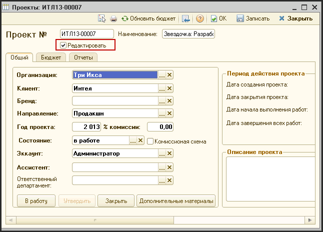

Если в этот момент с данной консоли в режиме редактирования находятся другой пользователь, система предупредит о невозможности входа в режим редактирования, а в окне сообщений будет выведена фамилия пользователя, который в данный момент находится в режиме редактирования.

### Роли пользователей при редактировании проекта

Типовой проект редактируется двумя должностными единицами:

- Эккаунтом проекта - это сотрудник, который отвечает за взаимодействие с клиентом и поэтому он является ответственным за доходную часть бюджета проекта и за выполнение всего проекта целиком. Поэтому, эккаунт может редактировать общую информацию о проекте, доходную часть бюджета проекта и график входящих платежей по проекту (форм 2);
- Баер - сотрудник, который отвечает за взаимодействие подрядчиками, средствами которых производится размещение рекламы на медиа-носителях или выполнению других работ. В рамках проекта возможно ситуация, когда за часть работ отвечает один баер, а другую часть другой. Каждый баер видит только те работы, по которым он является ответственным. В консоли проекта баер имеет доступ на редактирование затратной части бюджета и графика исходящих платежей (форм 3).

У эккаунта и баера могут быть ассистенты. Доступ ассистента эккаунта полностью аналогичен доступу эккуаунта к проекту. Доступ ассистента ответственного по работе, полностью аналогичен доступу ответственного.

Эккаунт и баер могут быть привилегированными. ???

Привилегированный эккаунт может видеть не только доходную часть бюджета проекта, но и затратную, но редактировать может только доходную часть.

Аналогично привилегированный баер может видеть не только затратную часть бюджета, но и доходную, но редактировать может только затратную часть.

Другие должностные лица, работающие над проектами в Системе:

- Начальник клиентского отдела - способен видеть все доходные части проектов, созданных эккаунтами, входящими в его отдел.
- Начальник подразделения медиа-отдела - способен просматривать проекты, ответственными за которые являются сотрудники его подразделения, то есть его подчиненные.
- Финансовый директор (ФД), Медиа-директор (МД), Медиа-баинг-директор (МБД) - все перечисленные сотрудники способны видеть в Системе все проекты. Кроме того, ФД может редактировать все проекты. А финменеджер???

### Создание нового проекта

Для создания нового проекта нужно нажать кнопку на панели инструментов окна списка проектов или нажать клавишу «Insert» на клавиатуре.

После этого, на экране появится консоль редактирования проекта. До первого сохранения проекта в консоли доступна закладка только общей информации. Остальные закладки появятся после сохранения проекта и повторного открытия консоли.

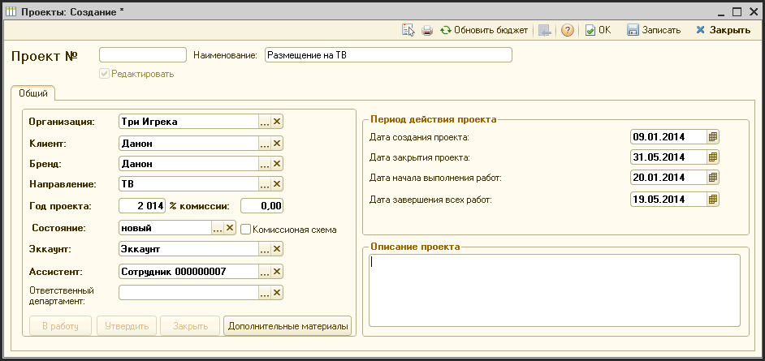

При создании проекта, поле «Проект №» пустое, которое при первом сохранении будет заполнено кодом, сформированным из префикса клиента, года, к которому относится проект, и порядкового номера проекта в рамках текущего года.

Для того чтобы проект корректно сохранился, нужно заполнить все поля формы. Заголовки обязательных для заполнения полей выделены жирным шрифтом.

Когда все поля проекта заполнены, необходимо нажать кнопку «ОК», после чего проекту будет присвоен уникальный код, данный проект сохранится, и консоль редактирования проекта закроется.

В окне Справочника «Проекты» появляется новая строка:

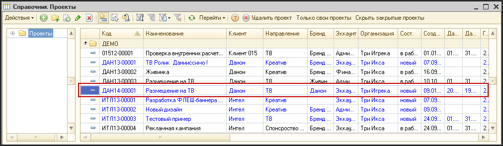

Для сохранения данных, введенных в консоль уже существующего проекта можно, или:

- нажать кнопку «ОК» - при этом проект сохранится, а консоль закроется;
- нажать кнопку «Сохранить» - при этом изменения сохраняться, но консоль останется открытой;
- нажать кнопку «Закрыть», и если в консоль после ее открытия вносились какие-либо изменения, Система все равно выведет запрос о сохранении проекта;
- нажать комбинацию клавиш «Ctrl+S» - что аналогично нажатию кнопки «Сохранить» на консоли проекта.

После сохранения и повторного открытия проекта в консоли появляются закладки:

- Основные;
- Бюджет;
- Отчеты;
- Административные (закладка доступна только администратору). ???

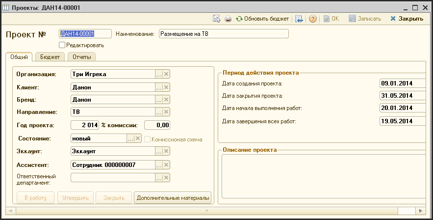

Также, в консоли проекта появляется флаг «Редактировать». Редактирование консоли проекта при работе с ней нескольких пользователей описано в разделе «[Многопользовательский режим](#_Многопользовательский_режим)».

### Редактирование бюджета проекта

Для добавления новой работы в бюджет проекта необходимо нажать кнопку в блоке «Работы». Появится форма редактирования новой работы:

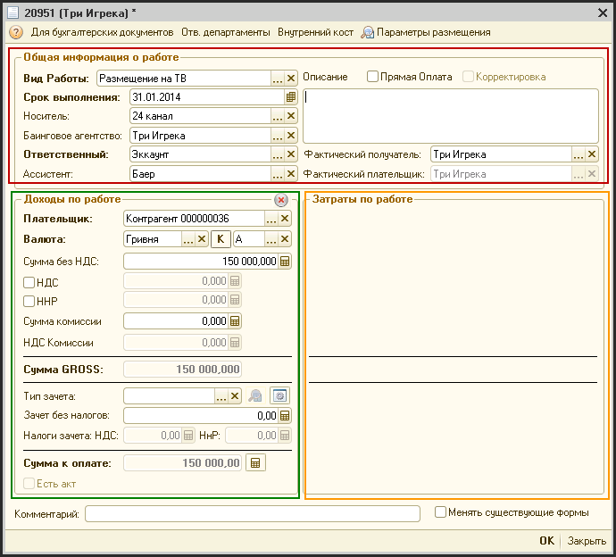

Форма проектной работы делится на три части:

- Общая информация о работе, в которой описываются характеристики выполняемой работы, назначается Ответственный и Ассистент ответственного.
  - Ответственный - это сотрудник, который будет отвечать за затратную часть работы. Сейчас у эккаунта нет доступа к затратной части. Но если он назначит себя ответственным, при следующем входе в данную работу он сможет заполнить затратную часть.
  - Так же ответственному можно назначить ассистента, который может выполнять все функции ответственного.
- Доходы по работе описывают плательщика, форму оплаты и сумму доходов по данной работе
- Затраты по работе описывают подрядчика, форму оплаты и сумму затрат по данной работе.Сейчас затраты скрыты, т.к. по-умолчанию, эккаунт не имеет доступа к затратам.

После заполнения нужно нажать на кнопку «ОК».

При повторном открытии работы, если эккаунт назначил себя ответственным, он может заполнить затратную часть работы.

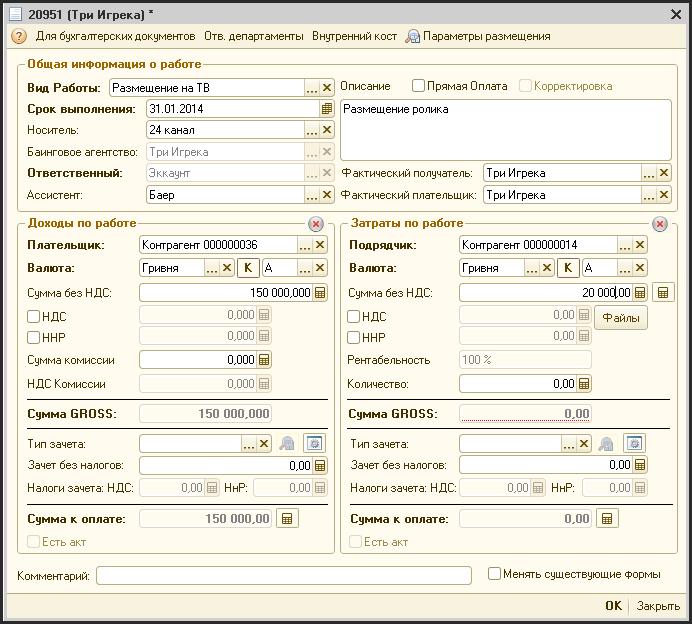

**Описание реквизитов работы по проекту:**

| **Реквизит** | **Описание** |
| --- | --- |
| **Общая информация о работе** |     |
| Вид работы | Наименование вида работы по проекту |
| Прямая оплата | Флаг. Статус работы «Прямая оплата», означает, что все расчеты с подрядчиком клиент осуществляет напрямую. Агентство только контролирует и управляет процессом взаимодействия между клиентом и подрядчиком.  См. [Прямые оплаты](#_Прямые_оплаты) |
| Корректировка | ??? |
| Фин. | Данный флаг может устанавливать только финансовый директор. Если он установлен, эту работу может видеть только финансовый директор и директор компании. |
| Срок выполнения | Дата, до которой должна быть выполнена работа |
| Носитель | Наименование носителя, на котором будет размещаться реклама |
| Баинговое агентство | ??? |
| Ответственный | ФИО ответственного |
| Ассистент | Ассистент ответственного |
| Описание | Дополнительное текстовое описание данной работы |
| Фактический получатель | ??? |
| Фактический плательщик | ??? |
| **Доходы по работе** |     |
| Плательщик | Заказчик услуг (плательщик по данной работе) |
| Валюта | Валюта расчетов с клиентом и форма оплаты |
| Сумма (без НДС) | Сумма работы без налогов |
| НДС | НДС по сумме работы |
| НнР | Налог на рекламу по этой работе. |
| Сумма комиссии | Сумма агентской комиссии |
| НДС комиссии | НДС по агентской комиссии |
| Сумма GROSS | ??? |
| Тип зачета | ??? |
| Зачет без налогов | ??? |
| Налоги зачета НДС | ??? |
| НнР | ??? |
| Сумма к оплате | ??? |
| Есть акт | Устанавливается, если в бухгалтерии уже есть подписанный клиентом акт выполненных работ по этой работе |
| **Затраты по работе** |     |
| Подрядчик | Наименование подрядчика |
| Валюта | Валюта расчетов с подрядчика |
| Сумма без НДС | Сумма работы подрядчика без налогов |
| НДС | НДС по сумме работ |
| НнР | Налог на рекламу |
| Файлы | ??? |
| Рентабельность | ??? |
| Количество | ??? |
| Сумма GROSS | ??? |
| Тип зачета | ??? |
| Зачет без налогов | ??? |
| Налоги зачета НДС | ??? |
| НнР | ??? |
| Сумма к оплате | ??? |
| Есть акт | Устанавливается, если в бухгалтерии уже есть подписанный клиентом акт выполненных работ по этой работе |
| Менять существующие формы | Установив данный флаг, можно поменять значения не только в работе, но и в Ф2 и Ф3, которые входят в график платежей этой работы (см. [Одновременное изменение работы и форм, подчиненных данной работе](#_Одновременное_изменение_работы)) |
| Комментарий |     |

Затратную часть бюджета проекта заполняет Ответственный (обычно Баер)**,** назначенный эккаунтом, он выполняет следующие действия:

- Открывает справочник «Проекты».
- Открывает проект, созданный эккаунтом.
- Переходит на закладку «Бюджет» консоли проекта.
- Устанавливает флаг «Редактировать».
- Открывает работу по проекту. Он может открыть только ту работу, по которой он является ответственным.
- Заполняет блок «Затраты по работе»:

_Область окна работы по проекту, относящаяся к доходам, у Ответственного обычно скрыта, но если Ответственный является привилегированным пользователем системы, то он может видеть доходную часть работы._

- Нажимает кнопку «Сохранить».

Если за выполнение одной работы компания платит разными валютами, то баеру следует создать новую работу, в которой заполнить только затратную часть. Для этого необходимо:

- На закладке «Бюджет» проекта выделить работу, оплата которой выполняется в разных валютах;
- Нажать кнопку «Копировать работу»;
- В появившейся форме работы по проекту заполнить затратную часть, которая будет оплачиваться в другой валюте.

#### Несколько видов расчетов по одной работе

Обычно форма расчетов доходов и затрат совпадает. Но возможны случаи, когда необходимо заплатить за работу, внесенную в бюджет проекта, двумя видами расчетов. Тогда Баеру необходимо выполнить следующие действия:

- Открыть вкладку «Бюджет» проекта.
- Перейти в режим редактирования.
- Создать новую работу.
- Заполнить общую информацию о работе характеристиками из работы, за которую требуется заплатить двумя видами расчетов.
- В поле «Описание» указать «Дополнительная оплата…».
- Заполнить затратную часть.
- Сохранить работу.

У данной работы доходная часть отсутствует.

Аналогичные действия выполняет эккаунт в случае, когда надо занести в систему информацию о доходах по работе, получаемых несколькими способами. Эккаунту необходимо выполнить следующие действия:

- Открыть вкладку «Бюджет» проекта.
- Перейти в режим редактирования.
- Создать новую работу.
- Заполнить общую информацию о работе характеристиками из работы, оплата за которую осуществляется двумя видами расчетов.
- В поле «Описание» указать «Дополнительная оплата…».
- Заполнить доходную часть.
- Сохранить работу.

У данной работы затратная часть отсутствует.

#### Ввод сумм работы обратным счетом

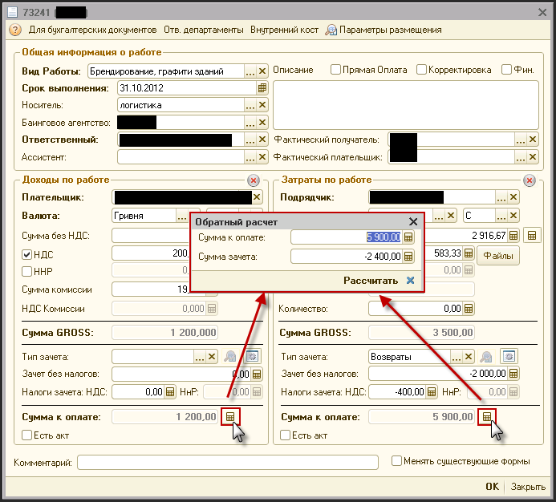

- Есть возможность введения суммы ГРОСС, после чего заполнит все поля (НЭТ, комиссий и налогов) обратным счетом
- Если заполнен тип зачета, то в появившейся можно указать сумму к оплате по этой работе и указать сумму ГРОСС зачета

#### Корректировка бюджета по закрытым периодам

В работе рекламного агентства возможны случаи, когда период закрыт, финансовый результат за период зафиксирован, но выясняется, что работы по проекту закрыты не на ту сумму. Корректировать суммы по работам, относящимся к закрытым периодам, в системе невозможно. Поэтому эккаунту необходимо выполнить следующие действия:

- Открыть вкладку «Бюджет» проекта.
- Перейти в режим редактирования.
- Создать новую работу (за текущий месяц).
- Заполнить общую информацию о работе характеристиками из работы, сумму которой требуется откорректировать.
- В поле «Описание» указать «Корректировка за &lt;указать период, за который производится корректировка&gt;».
- Если корректируется только доходная часть, то в поле «Ответственный» эккаунт указывает себя.
- Если требуется корректировка не только доходной, но и затратной части, то в поле «Ответственный» указывается ФИО баера.
- Баер после получения сообщения в системе корректирует затратную часть работы по проекту.

Если корректировка выполняется в отрицательную сторону, то в доходную и затратную части работы вносятся суммы с отрицательным знаком.

#### Прямые оплаты

Если рекламное агентство выступает в роли управляющего взаимодействиями клиента с подрядчиком, то в систему необходимо заносить данные о прямых оплатах. Доходная и затратная части такой работы будут равны.

В этом случае при создании работы следует установить чекбокс «Прямая оплата»:

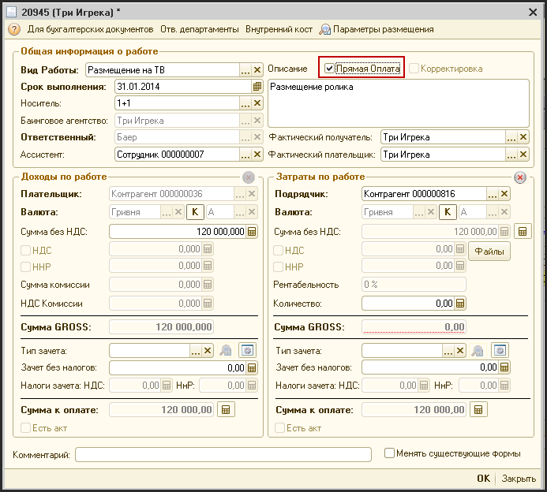

Если флаг «Прямые оплаты» установлен, то поля «Сумма комиссии» и «НДС комиссии» не заполняются.

Ответственный баер получает системное сообщение о создании новой работы. В работе заполняет доходную часть.

По прямым оплатам невозможно создавать Ф2 и Ф3, т.к. оплата происходит напрямую от клиента подрядчику, минуя рекламное агентство.

Для занесения в систему информации о комиссии, полученной за выполнение данной работы, эккаунт создает новую работу, где ответственным указывает себя. Затем создает по этой работе Ф2, где вводит только сумму процента комиссии.

#### Одновременное изменение работы и форм, подчиненных данной работе

Если по работе уже созданы Ф2 или Ф3, система блокирует редактирование реквизитов, которые уже были скопированы в созданные формы. Это реквизиты:

- Контрагент
- Валюта и форма оплаты
- Флаги «НДС» и «ННР».

Однако, имеется возможность группового внесения изменений во все формы, относящиеся к данной работе. Для этого в форме редактирования работы имеется флаг «Менять существующие формы». После этого становятся доступными для редактирования следующие реквизиты:

- Контрагент
- Валюта оплаты
- Форма оплаты
- флаг «НДС»;
- флаг «ННР».

При сохранении работы изменения автоматически переносятся в соответствующие Форму 2 и Форму 3.

Ограничения:

- все формы должны быть новыми и не находится в состоянии утверждения;
- по формам не должно быть оплат;
- формы должны принадлежать только этой работе.

### Редактирование графика входящих платежей

Форма 2 (Ф2) представляет собой заявку на входящий платеж.

Проектные Формы 2 позволяют сформировать график входящих платежей по проектам.

Формы 2 и 3 создаются из консоли проекта при заполнении бюджета.

**Доступ на создание Формы 2:**

Эккаунт текущего проекта и ассистент эккаунта проекта.

Начальник клиентского отдела (в котором работает эккаунт) - только на просмотр.

Финансовый директор - полный доступ.

Бухгалтер (только по форме оплаты «А» и возможно редактирование только информации по выставленному счету)

Директор, медиа-директор, медиа-баинг-директор (только просмотр).

Формы 2 бывают двух типов:

- «проектные» - которые созданы из консоли проекта и жестко привязаны к бюджету проекта и являются частью запланированного графика платежей по проекту;
- «свободные» - которые создаются из соответствующих журналов и используются для планирования платежей по непроектным операциям (другие доходы и затраты, транзитные оплаты, и т.д.). Кроме того, «свободные» формы могут являются заявками на оплату по проекту, однако это так называемые «небюджетируемые оплаты», т.е. оплаты по доходам, которые не бюджетируются в консоли проекта. Например, оплаты по AVB или PRIPS связанных с конкретным проектом и т.п.

#### Создание и редактирование Ф2

Для создания Ф2 из консоли проекта:

- откройте закладку «Бюджет»;
- перейдите в режим редактирования;
- выберите работу, для которой необходимо создать заявку на входящий платеж (Форму 2);
- нажмите кнопку на панели инструментов «Формы 2» или клавиши Shift+Insert (!!! См. клавиатурные сокращения):

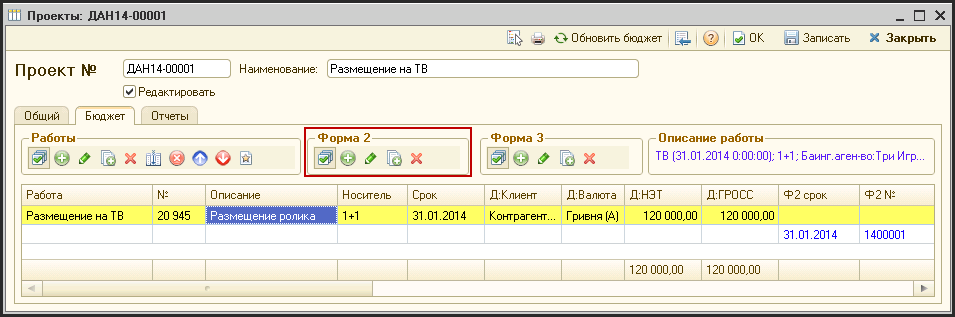

В результате будет открыта Форма 2:

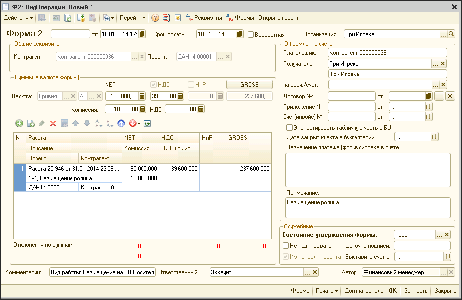

В область «Суммы (в валюте формы)» переносятся суммы работы, по которой создается Форма 2. Переносятся только те суммы, на которые еще не были созданы Ф2 по данной работе.

**Описание реквизитов общей части документа:**

| **Реквизит** | **Описание** |
| --- | --- |
| Форма 2 | Уникальный номер документа |
| от  | Дата документа |
| Срок оплаты | Дата, до которой должен быть осуществлен платеж. Автоматически заполняется текущей датой. |
| Возвратная | Флаг. Если установлен , то данная форма является возвратной. |
| Организация | Фирма, по которой начисляется платеж |
| Контрагент | Контрагент проекта |
| Проект | Название проекта, к которому будет осуществлен платеж |

**Описание реквизитов области «Суммы (в валюте формы)»:**

| **Реквизит** | **Описание** |
| --- | --- |
| Валюта | Валюта оплаты из справочника «Валюты». |
| Форма оплаты | Форма оплаты по данной заявке. Может быть:  А - оплата по бухгалтерии;  В - оплата через оффшорный счет;  С - оплата наличными |
| NET | Сумма без налогов, которая оплачивается |
| НДС | Сумма НДС |
| НнР | Сумма налога на рекламу |
| Gross | Итоговая сумма к оплате по данной форме |
| Комиссия | Сумма агентской комиссии |
| НДС Комиссии | НДС по агентской комиссии |

**Описание реквизитов табличной части документа:**

| **Реквизит** | **Описание** |
| --- | --- |
| Работа | Наименование работ, по которым создается Форма 2 |
| NET | Сумма без налогов по работе к оплате |
| Комиссия | Сумма агентской комиссии по работе |
| НДС | Сумма НДС по работе |
| НДС комиссии | Сумма НДС по агентской комиссии |
| НнР | Сумма налога на рекламу по работе |
| Gross | Итоговая сумма по работе к оплате |
| Отклонения по суммам | Общие суммы по форме всегда должны быть равны сумме всех табличных данных. Поэтому, форма не может быть сохранена, пока в поле отклонения есть хотя бы одно ненулевое значение.  Для того чтобы быстро заполнить общие суммы на основании табличных данных нужно нажать кнопку «Итог из таблицы» |

**Описание реквизитов области «Оформление счета»:**

| **Реквизит** | **Описание** |
| --- | --- |
| Плательщик | Юридическое наименование плательщика. Может быть заполнено бухгалтерией |
| Получатель | Юридическое наименование фирмы, которое будет получателем по данному платежу (может отличаться от юридического наименования фирмы) |
| На расч. счет | Расчетный счет организации (указывается , если выбрана Форма оплаты «А») |
| Договор №… от… | Номер и дата договора |
| Приложение №… от… | Номер и дата приложения к договору |
| Счет (инвойс) №… от… | Номер и дата счета |
| Экспортировать табличную часть в БУ | Флаг. Если установлен, то в 1С Бухгалтерию экспортируется табличная часть для оформления счета. ??? |
| Дата закрытия акта в бухгалтерии | ??? |
| Назначение платежа (формулировка в счете) | Формулировка счета, который должен быть выставлен клиенту |
| Примечания | В поле автоматически указывается: |

**Описание реквизитов области «Служебные»:**

| **Реквизит** | **Описание** |
| --- | --- |
| Состояние утверждения формы | Статус документа  Статус документа меняется в зависимости от этапа прохождения этого документа по цепочке документооборота |
| Не подписывать | Доступно только для финансового директора. Позволяет оформлять формы в обход стандартной схемы документооборота.  Внимание! Использование данной функции крайне нежелательно |
| Цепочка подписи | Служебная информация. Показывает цепочку документооборота, которая используется для данного документа |
| Из консоли проекта | Данный флаг показывает, является ли эта форма проектной или свободной |
| Выставить счет с | Дата, которой бухгалтеру необходимо выставить счет по данной форме 2 |
| Ответственный | Сотрудник, ответственный за данную форму |

**Описание дополнительных кнопок в форме: ???**

| **Реквизит** | **Описание** |
| --- | --- |
| Итог из таблицы | Переносит данные из таблицы в соответствующие суммы шапки документа??? |
| Форма | При нажатии открывается окно для просмотра с заполненным бланком формы 2. Вверху окна кнопки, позволяющие сохранить этот документ в файл или распечатать. |
| Печать | При нажатии появляется меню:  \- Форма  \- Форма свернутая  \- По умолчанию |
| Доп материалы | При нажатии открывается окно «Хранилище дополнительной информации», где хранятся ссылки на файлы с дополнительной информацией по данной форме. В этом окне также можно сохранить новую ссылку на какую-либо новую информацию по данной форме. |

При создании Формы 2 таблица области «Суммы (в валюте формы)» заполняется данными из строки проекта, к которой привязана данная форма.

#### Оформление возвратных форм 2 ???

Возвратные Ф2 оформляются, как обычные Ф2. Отличие состоит в том, что все суммы в возвратной форме с отрицательным знаком.

Возвратные Ф2 - это заявки, которые оформляются на возврат денежных средств, поступивших от клиента, при этом

### Редактирование графика исходящих платежей

Форма 3 (Ф3) - заявка на исходящий платеж.

Проектные формы 3 позволяют сформировать график платежей по проектам.

Формы 3 создаются из консоли проекта при заполнении бюджета.

**Доступ на создание Формы 3:**

Ответственный по работе и его ассистент - полный доступ.

Начальник отдела, в котором работает ответственный по работе (только просмотр)

Финансовый директор (полный доступ).

Бухгалтер (только для формы оплаты «А» и только на просмотр)

Директор, медиа-директор, медиа-баинг-директор (только просмотр).

Формы 3 бывают двух типов:

- «проектные» - которые созданы из консоли проекта и жестко привязаны к бюджету проекта и являются частью запланированного графика платежей по проекту;
- «свободные» - которые создаются из соответствующих журналов и используются для планирования платежей по непроектным операциям (операционные затраты, выплата заработной платы и т.д.). Кроме того, «свободные» формы могут являются заявками на оплату по проекту, однако это так называемые «небюджетируемые оплаты», т.е. оплаты по затратам, которые не бюджетируются в консоли проекта. Например, оплаты по PFD, оплата командировочных расходов, связанных с конкретным проектом и т.п.

#### Создание и редактирование Ф3

Для создания Ф3 из консоли проекта:

- откройте закладку «Бюджет»;
- перейдите в монопольный режим;
- выберите работу, для которой необходимо создать заявку на исходящий платеж (Форму 3);
- нажмите кнопку на панели инструментов «Формы 3» или клавиши Ctrl+Insert (!!! См. клавиатурные сокращения):

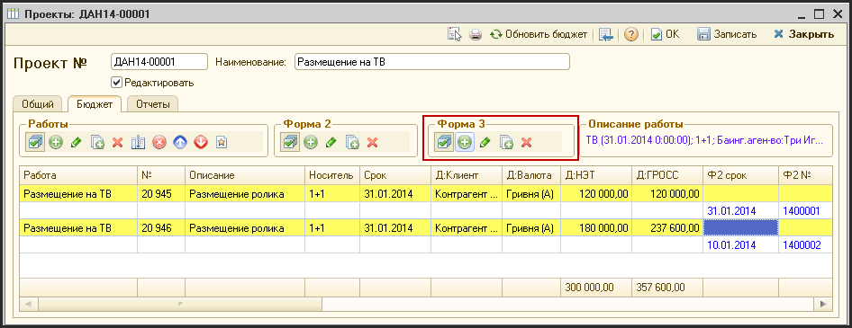

В результате будет открыта Форма 3:

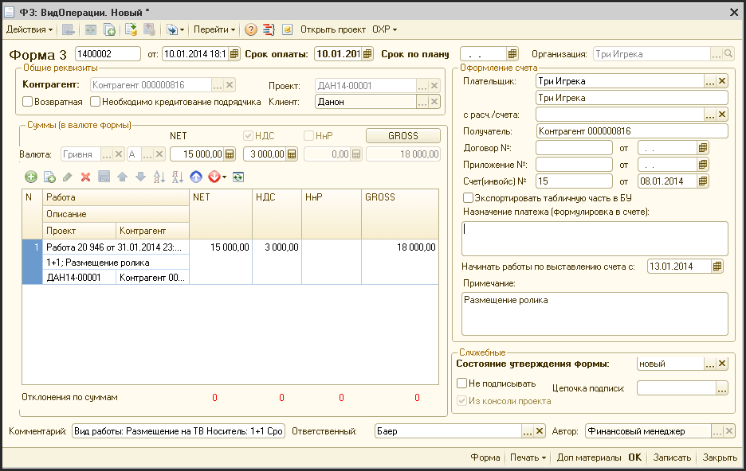

В область «Суммы (в валюте формы)» переносятся суммы работы, по которой создается Форма 3.

**Описание реквизитов общей части документа:**

| **Реквизит** | **Описание** |
| --- | --- |
| Форма 3 | Уникальный номер документа |
| от  | Дата документа |
| Срок оплаты | Дата, до которой должен быть осуществлен платеж |
| Срок по плану |     |
| Организация | Фирма, по которой начисляется платеж |
| Контрагент | Контрагент проекта |
| Проект | Название проекта, к которому будет осуществлен платеж |
| Возвратная | Флаг. Если установлен, то данная форма возвратная. |
| Необходимо кредитование подрядчика | Флаг. Установлен, если это предоплата за работу. ??? |
| Клиент | Клиент по данному проекту. |

**Описание реквизитов области «Суммы (в валюте формы)»:**

| **Реквизит** | **Описание** |
| --- | --- |
| Валюта | Валюта оплаты |
| NET | Сумма без налогов, которая оплачивается |
| НДС | Сумма НДС |
| НнР | Сумма налога на рекламу |
| Gross | Итоговая сумма к оплате по данной форме |

**Описание реквизитов табличной части документа:**

| **Реквизит** | **Описание** |
| --- | --- |
| Работа | Наименование работ, по которым создается Форма 3 |
| NET | Сумма без налогов по работе к оплате |
| НДС | Сумма НДС по работе |
| НнР | Сумма налога на рекламу по работе |
| Gross | Итоговая сумма по работе к оплате |

**Описание реквизитов области «Оформление счета»:**

| **Реквизит** | **Описание** |
| --- | --- |
| Плательщик | Организация -плательщик по проекту ??? |
| Получатель | Контрагент-получатель платежа |
| С расч/счета | Расчетный счет организации (указывается, если выбрана Форма оплаты «А») |
| Договор №… от… | Номер и дата договора |
| Приложение №… от… | Номер и дата приложения к договору |
| Счет (инвойс) №… от… | Номер и дата счета |
| Назначение платежа (формулировка в счете) | Формулировка счета, который должен быть выставлен клиенту |
| Примечания | В поле автоматически указывается: |

**Описание реквизитов области «Служебные»:**

| **Реквизит** | **Описание** |
| --- | --- |
| Состояние утверждения формы | Статус документа.  Статус документа меняется в зависимости от этапа прохождения этого документа по цепочке документооборота |
| Не подписывать | Доступно только для финансового директора. Позволяет оформлять формы в обход стандартной схемы документооборота.  Внимание! Использование данной функции крайне нежелательно |
| Цепочка подписи | Служебная информация. Показывает цепочку документооборота, которая используется для данного документа |
| Из консоли проекта | Данный флажок показывает, является ли эта форма проектной или свободной |
| Ответственный | Сотрудник, ответственный за данную форму |

**Описание дополнительных полей в форме:**

| **Реквизит** | **Описание** |
| --- | --- |
| Комментарий |     |
| Ответственный |     |
| Автор |     |

**Описание дополнительных кнопок в форме:**

| **Реквизит** | **Описание** |
| --- | --- |
| Итог из таблицы | Переносит данные из таблицы в соответствующие суммы шапки документа ??? |
| Форма | При нажатии открывается окно для просмотра с заполненным бланком формы 3. Вверху окна кнопки, позволяющие сохранить этот документ в файл или распечатать. |
| Печать | При нажатии появляется меню:  \- Форма  \- Форма свернутая  \- По умолчанию |
| Доп материалы | При нажатии открывается окно «Хранилище дополнительной информации», где хранятся ссылки на файлы с дополнительной информацией по данной форме. В этом окне также можно сохранить новую ссылку на какую-либо новую информацию по данной форме. |

При создании Формы 3 таблица области «Суммы (в валюте формы)» заполняется данными из строки проекта, к которой привязана данная форма.

#### Оформление возвратных форм 3 ???

Возвратные Ф3 оформляются, как обычные Ф3. Отличие состоит в том, что все суммы в возвратной форме с отрицательным знаком.

Возвратные Ф3 - это заявки, которые оформляются на возврат денежных средств, заплаченных ранее подрядчикам.

### Привязка проектных Формы 2 или Формы 3 к нескольким работам

Если клиент оплачивает одним платежом несколько работ по проекту, тогда требуется привязать Форму 2 к нескольким строкам. Для этого выполните следующие действия:

- В Форме 2 нажмите кнопку ;

- В появившемся окне со списком работ по данному проекту выберите работу (работы), к которой вы хотите привязать данную Форму 2,

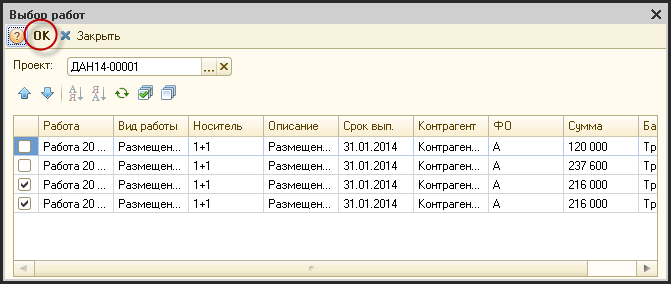

- Когда выбор завершен - нажмите кнопку «ОК».

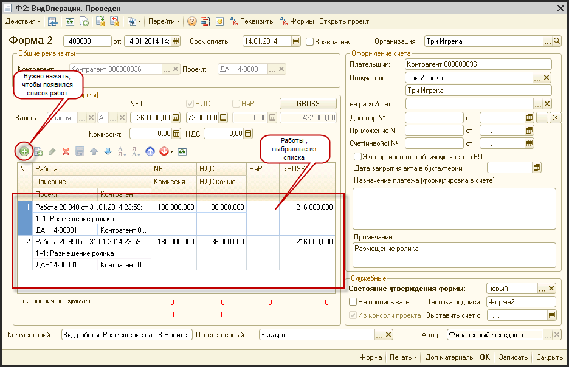

В результате Форма 2 будет привязана к нескольким работам по проекту, при этом в колонке «Ф2 №» бюджета проекта будет указан одинаковый номер Формы 2:

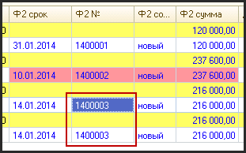

Если требуется создать исходящий платеж сразу по нескольким работам, необходимо создать Форму 3, при этом выполнить аналогичные действия, как при создании Формы 2 по нескольким работам.

Ограничения выбора работ:

- нельзя выбрать одну и ту же работу в одной форме более одного раза;
- при добавлении работы в Ф2 можно выбрать только те работы, у которых с первой работой одинаковые такие параметры:
  - Плательщик;
  - Валюта;
  - Форма оплаты;
  - Ставка НДС;
  - Ставка ННР;
- при добавлении работы в Ф3 можно выбрать только те работы, у которых с первой работой одинаковые такие параметры:
  - Подрядчик;
  - Валюта;
  - Форма оплаты;
  - Ставка НДС;
  - Ставка ННР;
  - Ответственный.

### Удаление Формы 2 или Формы 3, привязанной к нескольким работам

Если необходимо удалить Форму 2, привязанную к нескольким работам по проекту:

- В списке работ по проекту выделите нужную Ф2;
- Нажмите кнопку («Удалить Ф2») в блоке Формы 2 или используйте комбинацию клавиш Shift+Delete (!!!см. Клавиатурные сокращения);

- Подтвердите намерение удалить Ф2.

В результате появится окно:

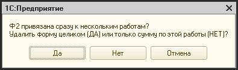

Да - Форма 2 будет удалена из всех работ;

Нет - Будет удалена только сумма по текущей работе;

Отмена - Отменяет действие.

Аналогично удаляется Форма 3, привязанная к нескольким работам.

### Ограничения при работе с Формой 2 и Формой 3

- Система не позволит ввести Форму 2 и Форму 3 с суммой больше, чем по данной работе.
- Система позволяет вводить возвратные Формы 2 и 3, то есть с отрицательным знаком.???

### Клавиатурные сокращения при работе с Формами 2 и 3 из консоли проекта

Для удобства создания Формы и Формы 3 из консоли проекта используйте клавиатурные сокращения.

Таблица на вкладке «Бюджет» содержит информацию:

- о работах по проекту (черный шрифт);
- по входящим платежам Форма 2 (синим шрифтом);
- по исходящим платежам Форма 3 (зеленый шрифт).

Таблица «Бюджет» разделена на три области, относящиеся к работам, Формам 2 и Формам 3.

При использовании клавиатурных сокращений важно, в какой части таблицы находится курсор. Одна и та же клавиша может выполнять действие с различными элементами таблицы в зависимости от нахождения курсора.

Клавиши, которые выполняют действия на вкладке «Бюджет» проекта:

- Enter - редактирование элемента;
- Insert - создание нового элемента;
- Delete - удаление элемента.

Например, если курсор находится в области Форм 2 (синий шрифт), то при нажатии клавиши «Enter» текущая Форма 2 откроется на редактирование.

Следующие клавиатурные сокращения действуют независимо от нахождения курсора:

- Shift+Enter - редактирование Ф2;
- Shift+Insert - создание новой Ф2;
- Shift+Delete - удаление Ф2;
- Ctrl+Enter - редактирование Ф3;
- Ctrl+Insert - создание новой Ф3;
- Ctrl+Delete - удаление Ф3.

Следующие клавиши выполняют действие с работой по проекту, если курсор находится в области Работ (черный шрифт):

- Enter - редактирование работы;
- Insert - создание новой работы;
- Delete - удаление работы.

## Использование зачетов в работах

Для того, чтобы не создавать отдельные документы и формы, для оформления зачетов, в форму работы добавлены дополнительные поля:

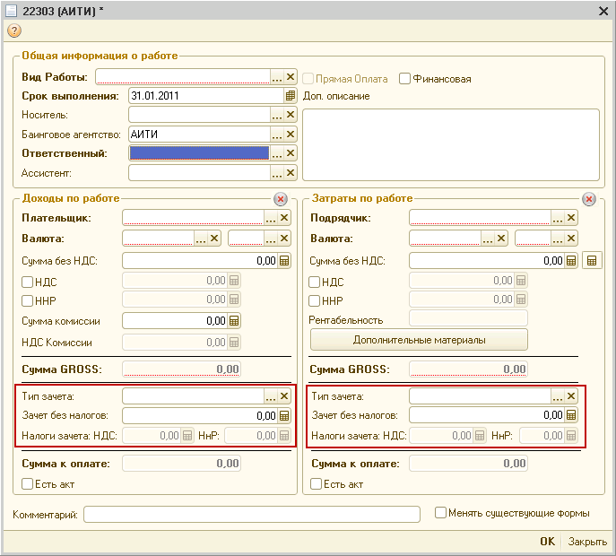

В этих полях указывается, какая сумма из "Суммы ГРОСС" будут зачтены при оплате.

После указания суммы зачета, рассчитывается "Сумма к оплате", на которую и нужно создать формы.

Зачеты можно указывать как по доходам, так и по затратам. Для проведения зачета, необходимо обязательно указывать тип зачета, для того чтобы система знала за счет каких начислений делать зачет по работе.

Типы зачета по доходам:

- Предоплата - зачет сумм предоплат клиента. Предоплатой считается оплаты клиентом которые не могут быть отнесены на конкретный проект, т.к. еще с клиентом не согласованы бюджеты и оплата производится "вперед".
- Ретробонусы - зачет сумм начисленных клиенту ретробонусов в счет оплаты за размещение. Если на клиента начисляются ретробонусы, часть или вся сумма ретробонусов может быть зачитана как оплата за фактические размещения.

Типы зачета по затратам:

- Предоплата - зачет сумм предоплат подрядчику. Иногда производится закупка времени и рекламных площадей не под конкретные проекты. Производятся - "баерские закупки", которые позволяют получить дополнительные скидки от подрядчиков.
- Ретробонусы - зачет сумм начисленных подрядчиком ретробонусов в счет оплаты за размещение. Если подрядчик начисляет ретробонусы, часть или вся сумма ретробонусов может быть зачитана как оплата за фактические размещения.
- АВБ - зачет сумм начисленной подрядчиком суперкомисии в счет оплаты за размещение.

Указание зачетов прямо в работе позволяет:

- не создавать Ф3 или Ф2 для проведения операций зачета;
- не создавать документы "Зачеты АВБ" и "Взаимозачеты".

Всю информацию по зачетам теперь можно указывать в работе непосредственно.

**Особенности по созданию форм**

Формы №2 и №3 теперь должны создаваться не на полные суммы работ (Сумма ГРОСС), а на "Сумму к оплате".

Чтобы было удобнее сравнивать суммы выставленных форм с оставшейся, к консоли проекта в таблице бюджета теперь выводятся не суммы ГРОСС, а суммы к оплате

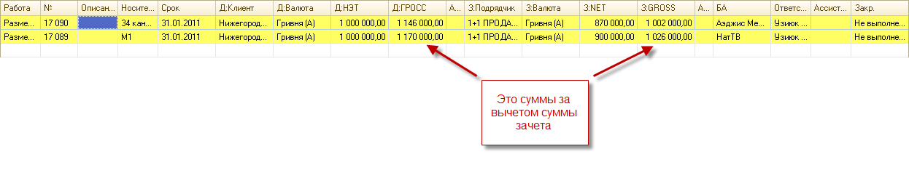

В отчете "Бюджет проекта" добавлена дополнительная колонка "Сумма к оплате"

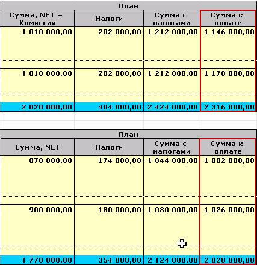

Эта колонка позволяет сравнивать сумму выставленных форм и еще невыставленные сумму.

Так же были добавлены дополнительные колонки в отчет "Реестр проектных работ":

- В группе доходов:
  - Сумма зачета, НЭТ
  - НДС по зачету
  - ННР по зачету
  - Сумма зачета, ГРОСС
  - Тип зачета
  - В колонке "К оплате клиентом" выводить сумму за вычетом зачетов
- В группе затрат:
  - Сумма зачета, НЭТ
  - НДС по зачету
  - ННР по зачету
  - Сумма зачета, ГРОСС
  - Тип зачета
  - В колонке "К оплате подрядчику" выводить сумму за вычетом зачетов

## Установка курсов валют в работах

### Схема работы

Предположим:

- Системный курс Евро = 10 грн
- Клиенту выставлена смета работ на сумму 10000 грн
- Клиент будет платить в Евро с налогами (по форме «А»). Но по курсу 11 грн
- т.е. клиенту нужно выставить Ф2 на сумму 909,09 + НДС = 1090,91 евро

**Существующая схема:**

Дт 36.1.1 Кт 70.1 909,09евро 9090,9грн

Дт 36.1.1 Кт 64.1 181,82евро 1818,2 грн

В итоге финансовый результат по работе 9090,9 грн, хотя изначально с клиентом договаривались на 10000 грн. Это искажает картину и сложно для сверки

**Новая схема:**

Дт 36.1.1 Кт 70.1 909,09евро 9090,9грн

Дт 93.8 Кт 70.1 0 евро 909,1грн

Дт 36.1.1 Кт 64.1 181,82евро 1818,2 грн

В итоге доход по работе 10000 грн, как и договаривались с клиентом, но появляется дополнительные финансовые затраты пои проекту в размере 909,1 грн, которые отражаются в финансовой деятельности.

Во всех проектных отчетах будет фигурировать сумма дохода 10000 грн, что облегчает сверку с клиентом.

Возьмем тот же пример, но курс евро для клиента не 11 грн, а 9 грн. Получаем:

Дт 36.1.1 Кт 70.1 1111,11евро 11111,1грн

Дт 93.8 Кт 70.1 0 евро -1111,1грн

Дт 36.1.1 Кт 64.1 222,22евро 2222,2 грн

Т.е. тут возникает финансовый доход по проектам

Возникающие курсовые доходы или затраты относятся:

- По доходам на фронтальное агентство
- По затратам на баинговое агентство

### Порядок установки курса работы

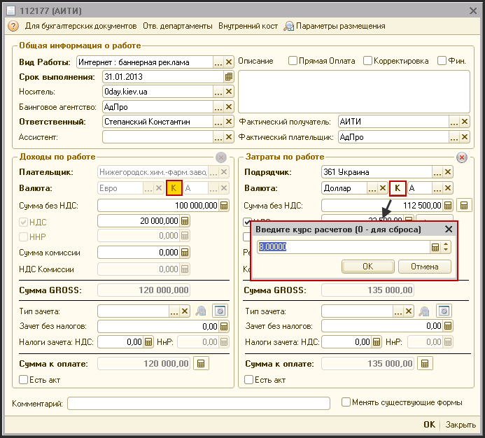

- Чтобы установить новый курс, нужно кликнуть на кнопке «К» между полями «Валюта» и «Форма оплаты»
- По-умолчанию в открывающемся окне устанавливается текущий курс на дату выполнения работы.
- Если для дохода или затраты установлен курс в этой работе, фон кнопки «К» подкрашивается оранжевым
- Для того чтобы сбросить установку курса - нужно установить нулевой курс.
- При пересчете затрат по норма рентабельности - используются указанные в работе курсу (если они не равны 0)

### Влияние на отчетность

В следующих отчетах для расчетов используется установленный в работе курс:

- Бюджет проекта
- Анализ бюджета проекта
- Реестр проектных работ
- Детализация по проектным работам
- Отчет по оборотам и доходам
- Внутренние оплаты
- Внутренние оплаты для бухгалтерии
- Реестр проектных работ для бухгалтерии

В обработке по созданию Ф4 по Ф2 так же используется курс работы, который установлен для доходов.

## Порядок перевода проекта в работу

Перевод проекта в работу выполняет эккаунт, который создал данный проект в системе.

Перевести в работу можно только проект с заполненными доходной и затратной частями.

Для перевода проекта в работу эккаунт должен выполнить следующие действия:

- Эккаунт создает новый проект. Новый проект получает статус «Новый» и строка с информацией по данному проекту в справочнике «Проекты» выделяется синим шрифтом. Пока проект новый, по нему нельзя проводить оплаты и закрывать работы.
- Эккаунт заносит в бюджет все необходимые работы и заполняет доходную часть и графики входящих платежей (создает формы 2 ).
- Система предупреждает ответственных, назначенных по этим работам, что им необходимо заполнить затратную часть проекта
- Ответственные заполняют затратную часть бюджета и графики исходящих платежей.
- После того, как ответственные подтверждают, что затратный бюджет заполнен, эккаунт входит в консоль проекта, переходит в режим редактирования и нажимает кнопку «В работу».
- Система предлагает сохранить проект и отправить на утверждение
- Отвечаем на все сообщения «Да», если хоть один ответ «Нет» - перевод на утверждение отменяется и проект становится недоступным для редактирования до момента его утверждения или отклонения утверждения
- При всех положительных ответах проект переводится в состояние «На утверждении» и проект передается на утверждение «Директору компании» (можно настроить утверждение другими должностными лицами).
- После утверждения директором проекта, он переводится в состояние «В работе» и строка с информацией по данному проекту в справочнике «Проекты» меняет цвет шрифта на черный. Теперь с проектом можно начинать работать (создавать и подписывать Ф2 и Ф3, закрывать работы и пр.).
- Перед утверждением эккаунт должен проверить, что бюджет введен полностью и правильно.

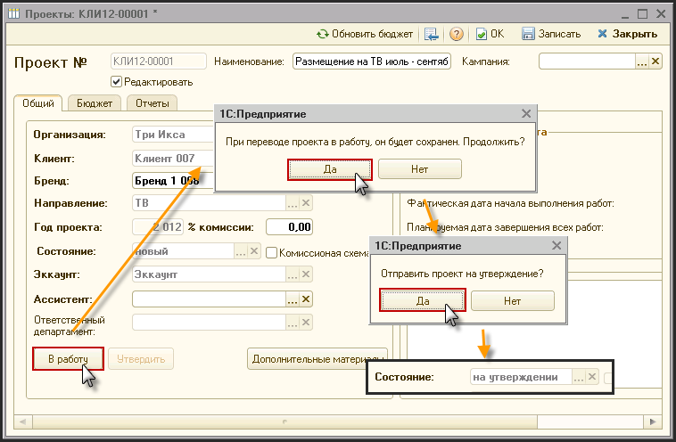

После того, как проект будет переведен в работу, эккаунт и все ответственные получат извещения в консоли сообщений.

## Порядок закрытия работ в консоли проекта

Каждую работу по проекту в системе закрывают поочередно:

- Ответственный (баер);
- Эккаунт;
- ФД. ???

При этом:

- Ответственный (баер) подтверждает факт выполнения работы.
- Эккаунт подтверждает, что работа может быть закрыта.
- ФД выполняет проверку и закрывает работу. ???

Закрытая работа выделяется на закладке «Бюджет» консоли проекта зеленым цветом. В колонке «Закр.» указывается состояние закрытия: ???

НЕТ - работа не закрыта ФД;

ДА - работа закрыта ФД.

Закрытие работы в системе происходит следующим образом:

- Баер открывает закладку «Бюджет» консоли проекта.
- Переходит в режим редактирования.
- Выделяет выполненную работу, которую следует закрыть.
- Нажимает кнопку «Закрыть работу» .

- Система направляет сообщение эккаунту о необходимости подтверждения закрытия работы.

**Внимание!** Если закрывается работа, содержащая только доходную часть, то подтверждение эккаунта не требуется. В этом случае информационное сообщение эккаунту не поступает.

- Эккаунт выполняет проверку, затем нажимает кнопку «Закрыть работу» на закладке «Бюджет» консоли проекта.

- После подтверждения эккаунтом в колонке «Закр.» проекта отобразится состояние «ЭМ».
- Система направляет сообщение ФД о завершении работы.
- ФД переходит в консоль проекта и нажимает кнопку «Закрыть работу» на закладке «Бюджет».

- Система информирует всех ответственных о закрытии работы.
- В колонке «Закр.» бюджета проекта отобразится состояние «ДА».

Работа окончательно закрывается только после закрытия ее Финансовым директором. В момент закрытия работы производятся начисления доходов и затрат по этой работе.

Отменить закрытие работы может только ФД. ???

Отмена закрытия работы происходит следующим образом:

- ФД открывает закладку «Бюджет» консоли проекта.
- Переходит в режим редактирования.
- Нажимает кнопку «Отменить закрытие» .

- В колонке «Закр.» система изменяет состояние на «НЕТ».
- Система направляет сообщения ответственным лицам сообщения об отмене закрытия проекта ФД.
- После отмены закрытия работы ответственные лица повторяют процесс подтверждения закрытия (см. описание выше).

## Порядок корректировки и утверждения проекта

В процессе работы над проектом, время от времени возникает необходимость во внесении изменений как в бюджет проекта, так и в графики платежей и закрытий.

Так как процесс корректировки проекта достаточно сложен и может привести к переводу проекта в состояние «корректировка» с последующим его переутверждением, нужно стараться минимизировать количество операций по корректировке и вносить максимально точную проверенную информацию уже во время создания проекта.

### Основные правила корректировки

Пользователь, в рамках своих полномочий, может менять как бюджет проекта, так и графики оплат и закрытий. Однако, система постоянно контролирует правильность внесенной информации и может, или запретить пользователю внесение некоторых изменений, или перевести проект в состояние «корректировка», которое требует переутверждения проекта.

Система запрещает внесение таких изменений:

- новая сумма по графику оплат больше суммы работы;
- новая сумма работы меньше суммы введенного графика оплат;
- нельзя удалить работу, если по этой работе уже есть формы;

Условия перевода проекта на корректировку описаны в «Регламенте финансового документооборота» (п. 6 «Порядок корректировки проекта»). ???

### Перевод проекта в состояние «корректировка» ???

Независимо от того, кто редактирует проект: эккаунт или ответственный, если система обнаружила отклонения от перечисленных выше условий, при попытке сохранения она запросит, переводить ли проект в состояние корректировки:

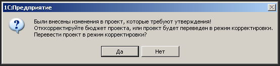

Если пользователь выберет «Нет», он должен так откорректировать проект, чтобы условия перевода проекта в корректировку не соблюдались и только после этого сохранить проект.

Если пользователь выберет «Да», проект будет сохранен и переведен в состояние «корректировка». О переводе в состояние «корректировка» будут уведомлены все ответственные по затратным работам и эккаунт проекта.

Состояние проекта «корректировка» аналогично состоянию «новый». Пользователи могут вносить в него любые изменения до момента отправки на утверждение. Все операции по формам проекта (оплаты и закрытия) приостанавливаются.

### Переутверждение проекта ???

Проект, находящийся в состоянии «на корректировке» обязательно должен быть переутвержден. Переутвердить проект может только эккаунт этого проекта. Для этого он должен:

- Открыть консоль проекта;
- Перейти в режим редактирования;
- Нажать кнопку «Утвердить».

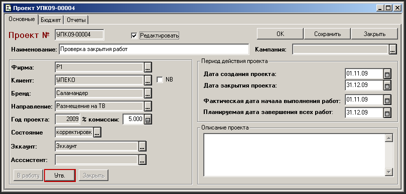

Система проверит проект на соблюдение условий полноты, и если они соблюдены, отправит проект по стандартной цепочке утверждения (см. «Регламент финансового документооборота»).

Редактирование проекта, который находится на утверждении, невозможно.

Любые операции по формам проекта приостанавливаются.

Для того, чтобы было удобнее отслеживать что именно было изменено в проекте, должностное лицо, которое по Регламенту должно утвердить проект может запустить отчет просмотра корректировки проекта. Отчет о корректировке можно получить в консоли проекта на закладке «Отчеты»:

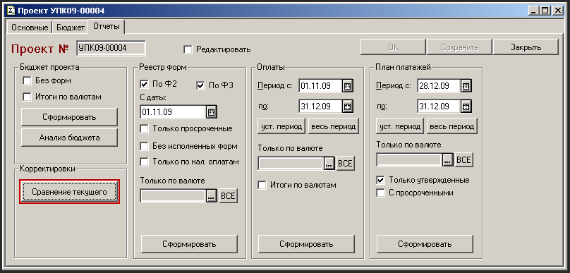

Нажав кнопку «Сравнение текущего», можно получить отчет о текущей корректировке.

Данный отчет доступен только ФД.

Все изменения, сделанные в проекте, выделяются красным цветом, а внизу указывается старое значение:

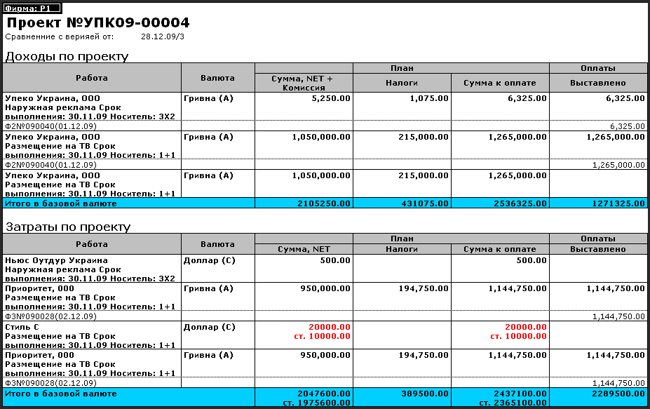

Процесс утверждения производится с помощью консоли подписи

После прохождения проекта по цепочке утверждения, корректировка утверждается, и проект переводится в состояние «в работе».

## Порядок закрытия проекта

После того как все работы по проекту выполнены, все оплаты проведены и все акты получены, эккаунт может закрывать проект (все условия закрытия проекта описаны в «Регламенте финансового документооборота»).

Подготовка к закрытию проекта:

- Статус проекта должен быть «в работе».
- Все проектные работы должны быть «закрыты».
- По данному проекту не должно быть никаких задолженностей.

Закрывать проект может как ответственный экаунт-менеджер, так и финансовый менеджер. Закрывается проект только в статусе «в работе».

Для закрытия проекта - заходим в проект и нажимаем кнопку «Закрыть» внизу окна проекта. Система проверяет проект на наличие задолженностей - проектные работы и заявки на платеж должны быть закрыты и оплачены соответственно.

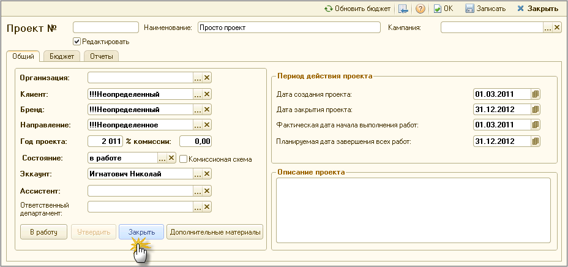

Если закрытие проекта невозможно, Система после проверки выполнения всех условий для закрытия проекта в окне сообщений выдаст детальную расшифровку причин, по которым нельзя закрыть проект.

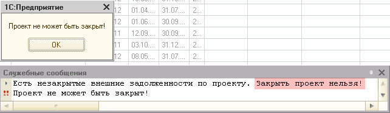

Если все работы закрыты и платежи оплачены корректно, то в системном сообщении будет оповещение, что проект успешно закрыт.

## Начисление и корректировка дополнительных доходов и затрат по проектам

### AVB

% AVB - это дополнительная суперкомиссия за размещение рекламы на определенных носителях. Набор типов носителей находится у сейлзхауза.

Для начисления AVB используется документ «Расчет AVB по проектам».

Доступ к документу:

Финансовый директор. ???

Путь к журналу документа: «Журналы - Документы по проектам - Начисление AVB».

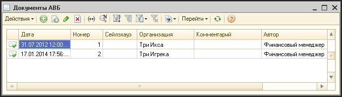

Для создания документа «Начисление AVB » нажмите кнопку . Откроется форма

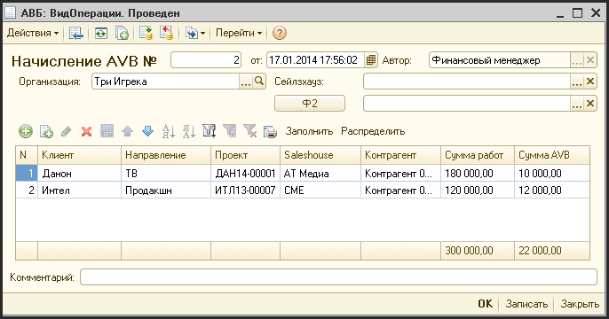

**Описание реквизитов шапки документа:**

| **Реквизит** | **Описание** |
| --- | --- |
| №   | Уникальный номер документа |
| от  | Дата начисления AVB. Обычно, последний день месяца. |
| Автор | Создатель данного документа |
| Организация | Фирма, по которой начисляются доходы по AVB. |
| Сейлзхаус | Название сейлзхауза |
| Ф2  | ??? |
| Комментарий | Дополнительная информация о данном начислении. |

**Описание реквизитов табличной части документа:**

| **Реквизит** | **Описание** |
| --- | --- |
| Клиент | Заказчик рекламы |
| Направление | Вид медиа-носителя, на котором производилось размещение по проекту. |
| Проект | Название проекта |
| Saleshouse | Название сейлзхауза |
| Контрагент | Основной контрагент по сейлсхаузу - это контрагент, с которым ведется основная доля взаиморасчетов по данному сейлсхаузу. Данный реквизит может меняться на того контрагента, с которым обычно осуществляются расчеты по AVB. |
| Сумма работ | Сумма размещения через указанный сейлзхауз. |
| Сумма AVB | Сумма суперкомиссии. Значение суммы AVB рассчитывается в зависимости от установленного значения % AVB в справочнике «Сейлзхаузы» |

**Описание дополнительных кнопок в форме: ???**

| **Реквизит** | **Описание** |
| --- | --- |
| Рассчитать | Заполняет таблицу значениями из текущих проектов |

Расчет AVB нужно проводить только после того, как все работы по проектам за отчетный период закрыты. Иначе, может возникнуть ситуация, когда некоторые работы не будут учтены в реквизите «Сумма работ», и сумма AVB будет рассчитана неправильно.

#### Корректировка AVB

Корректировка AVB проводится в двух случаях:

- если меняется процент AVB и нужно пересчитать суммы за предыдущие периоды задним числом;
- если в конце года известны окончательные суммы AVB, которые будут выплачены сейлсхаузами, и все начисления за год нужно привести к этим суммам.

Внимание! В любом случае все дополнительные доходы или затраты по корректировке будут относиться на период проведения этого документа.

Путь к журналу документа: «Журналы - Документы по проектам - Корректировка AVB».

Документ «Корректировка AVB» создается с помощью кнопки «Новая строка». Откроется форма:

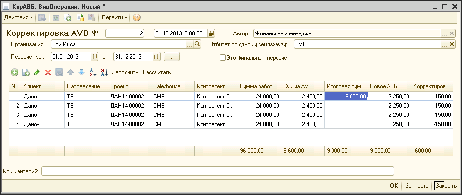

**Описание реквизитов шапки документа:**

| **Реквизит** | **Описание** |
| --- | --- |
| №   | Уникальный номер документа |
| от  | Дата корректировки AVB. Обычно это последний день текущего отчетного периода. |
| Автор | Создатель данного документа |
| Отбирать по одному сейлзхаузу | Название сейлзхауза , по которому будут выведены документы корректировки AVB. |
| Организация | Фирма, по которой корректируется AVB |
| Пересчет за период с… по… | Период, за который производится корректировка сумм AVB |
| Финальный пересчет за год | Флаг. Устанавливается, если требуется выполнить пересчет AVB за весь год. |
| Комментарий | Дополнительная информация о данной корректировке |

**Описание реквизитов табличной части документа:**

| **Реквизит** | **Описание** |
| --- | --- |
| Клиент | Заказчик рекламы |
| Направление | Вид медиа-носителя |
| Проект | Название проекта |
| Saleshouse | Название сейлзхауза |
| Контрагент | Основной контрагент по сейлзхаузу |
| Сумма работ | Сумма размещения через этот сейлсхауз. Заполняется автоматически при нажатии кнопки «Заполнить». |
| Сумма AVB | Сумма суперкомиссии, начисленной за период, который указан в шапке документа. Заполняется автоматически при нажатии кнопки «Заполнить». |
| Итоговая сумма | В этой колонке в любой строке необходимо указать финальную сумму AVB, на которую нужно вывести начисления AVB за указанный период. Затем нажать кнопку «Рассчитать» и автоматически по каждой строке заполнятся колонки «Новое AVB» и «Корректировка». Указывается одна сумма на каждый сейлхауз, а система при процедуре перерасчета распределяет эту сумму между проектами. |
| Новое AVB | Новая сумма начисления AVB на основании нового процента или введенной торговой суммы |
| Корректировка | Разница между значениями в полях «Сумма AVB» и «Новое AVB». |

**Описание дополнительных кнопок в форме:**

| **Реквизит** | **Описание** |
| --- | --- |
| Заполнить | Заполняет суммы размещения через сейлзхаузы за указанный в шапке период, а также суммы начисленных AVB за этот период. |
| Рассчитать | Производит перерасчет колонок «Новое AVB» и «Корректировка» на основании новых процентов или введенных в колонку «Итоговая сумма» финальных сумм по сейлсхаузам. |

### PRIPS

Начисления PRIPS показывают сумму дополнительных выплат клиентами рекламному агентству помимо суммы, которую они платят за размещение рекламы и агентской комиссии. Это заранее оговоренное вознаграждение за достижение положительного результата.

Значение % PRIPS устанавливается в справочнике «Проектные клиенты». Для каждого направления проектов может быть задано свое значение % PRIPS.

Доступ к документу:

Финансовый директор. ???

Путь к журналу документа: «Журналы - Документы по проектам - Начисление ПРИПС».

Для создания документа «Расчет ПРИПС по проектам» нажмите кнопку «Новая строка», затем выберите вид документа «ПРИПС».

В новом документе нужно указать последнюю дату месяца, за который производится начисление ПРИПС.

Далее нужно нажать на кнопку «Рассчитать», которая производит расчет сумм доходов по клиентам и расчет ПРИПС.

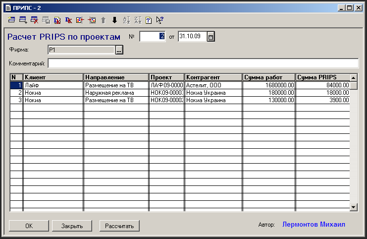

**Описание реквизитов шапки документа:**

| **Реквизит** | **Описание** |
| --- | --- |
| №   | Уникальный номер документа |
| от  | Дата начисления PRIPS. Обычно, последний день месяца. |
| Фирма | Фирма, по которой начисляются доходы по PRIPS. |
| Комментарий | Дополнительная информация о данном начислении. |

**Описание реквизитов табличной части документа:**

| **Реквизит** | **Описание** |
| --- | --- |
| Клиент | Заказчик рекламы |
| Направление | Вид медиа-носителя, на котором производилось размещение по проекту. |
| Проект | Название проекта |
| Контрагент | Основной контрагент, с которым ведутся расчеты. Берется из справочника «Проектные клиенты» из реквизита «Основной плательщик».  Данный реквизит может меняться на того контрагента, с которым обычно осуществляются расчеты по PRIPS. |
| Сумма работ | Сумма валовых доходов по клиентам |
| Сумма PRIPS | Сумма дополнительной премии. Значение суммы PRIPS рассчитывается в зависимости от установленного значения % PRIPS в справочнике «Проектные клиенты» |

**Описание дополнительных кнопок в форме:**

| **Реквизит** | **Описание** |
| --- | --- |
| Рассчитать | Заполняет таблицу значениями из текущих проектов |

Расчет PRIPS нужно проводить только после того, как все работы по проектам за отчетный период закрыты. Иначе, может возникнуть ситуация, когда некоторые работы не будут учтены в реквизите «Сумма работ», и сумма PRIPS будет рассчитана неправильно.

#### Корректировка PRIPS

Корректировка PRIPS проводится, если в конце года известны окончательные суммы PRIPS, которые будут выплачены клиентами, и все начисления за год нужно привести к этим суммам.

**Внимание!** В любом случае все дополнительные доходы или затраты по корректировке будут относиться на период проведения этого документа.

Документ «Корректировка PRIPS» создается с помощью кнопки «Новая строка» в журнале «Начисление PRIPS». Вид документа - «КорПРИПС».

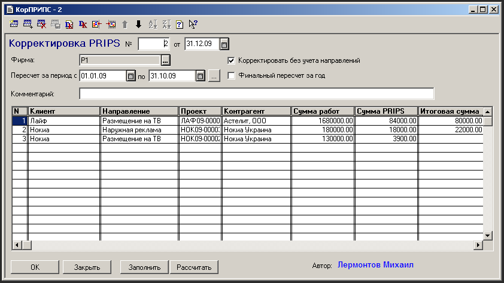

**Описание реквизитов шапки документа:**

| **Реквизит** | **Описание** |
| --- | --- |
| №   | Уникальный номер документа |
| от  | Дата корректировки PRIPS. Обычно это последний день текущего отчетного периода. |
| Фирма | Фирма, по которой корректируется PRIPS |
| Пересчет за период с… по… | Период, за который производится корректировка сумм PRIPS |
| Корректировать без учета направлений | В зависимости от этого флага происходит расчет значения в поле «Итоговая сумма».  Если флаг не установлен, то итоговые суммы нужно вносить по каждому виду носителя, на котором производилось размещение для клиента.  Если флаг установлен, то можно установить в одной строке общую сумму ПРИПС по клиенту и система автоматически распределит эту сумму по всем проектам клиента. |
| Финальный пересчет за год | Флаг устанавливается, если требуется выполнить пересчет PRIPS за весь год |
| Комментарий | Дополнительная информация о данной корректировке |

**Описание реквизитов табличной части документа:**

| **Реквизит** | **Описание** |
| --- | --- |
| Клиент | Заказчик рекламы |
| Направление | Вид медиа-носителя |
| Проект | Название проекта |
| Контрагент | Основной контрагент, с которым ведутся расчеты. Берется из справочника «Проектные клиенты» из реквизита «Основной плательщик». |
| Сумма работ | Сумма валового дохода по проекту. |
| Сумма PRIPS | Сумма PRIPS, начисленная за период, который указан в шапке документа. |
| Итоговая сумма | В этой колонке указывается финальная сумма, на которую нужно вывести начисления PRIPS за указанный период. Указывается одна сумма на каждого клиента, а система при процедуре перерасчета распределяет эту сумму между проектами. |
| Новое PRIPS | Новая сумма начисления PRIPS на основании нового процента или введенной торговой суммы |
| Корректировка | Разница между значениями в полях «Сумма PRIPS» и «Новое PRIPS». |

**Описание дополнительных кнопок в форме:**

| **Реквизит** | **Описание** |
| --- | --- |
| Заполнить | Заполняет суммы по проектам за указанный в шапке период, а также суммы начисленных PRIPS за этот период. |
| Рассчитать | Производит перерасчет колонок «Новое PRIPS» и «Корректировка» на основании новых процентов или введенных в колонку «Итоговая сумма» финальных сумм по клиентам. |

### PFD

ПФД - это стимулирование клиента или резерв на развитие.

Рекламное агентство выплачивает сумму ПФД клиенту за определенное время работы.

Доступ к документу:

Финансовый директор;

Генеральный директор.

Путь к журналу документа: «Журналы - Документы по проектам - Начисление ПФД».

Для создания документа «Начисление ПФД» в Журнале документов ПФД нажмите кнопку «Новая строка».

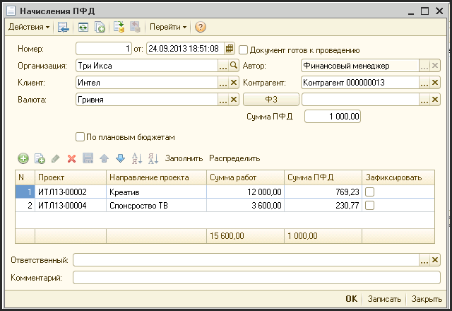

**Описание реквизитов шапки документа:**

| **Реквизит** | **Описание** |
| --- | --- |
| Номер | Уникальный номер документа |
| от  | Дата начисления PFD. Обычно, последний день месяца. |
| Документ готов к проведению | Флаг. ??? |
| Организация | Фирма, по которой начисляются доходы по PFD. |
| Клиент | Наименование клиента - заказчика рекламы |
| Контрагент | Фактический получатель суммы PFD. Не всегда совпадает с основным контрагентом, может быть физическим лицом. |
| Валюта | Валюта, в которой осуществляется оплата |
| Ф3  | Форма 3, которая привязывается к данному документу «Начисления ПФД». |
| Сумма ПФД | Вводится сумма, выплачиваемая по всем проектам данного клиента за указанную дату. |
| По плановым бюджетам | Флаг. ??? |
| Комментарий | Дополнительная информация о данном начислении. |

**Описание реквизитов табличной части документа:**

| **Реквизит** | **Описание** |
| --- | --- |
| Проект | Номер проекта в справочнике «Проекты» |
| Направление | Вид медиа-носителя, на котором производилось размещение по проекту. |
| Сумма работ | Сумма работ по проекту |
| Сумма PFD | Сумма к оплате, распределенная по проектам |
| Зафиксировать | Флаг. ??? |

**Описание дополнительных кнопок в форме:**

| **Реквизит** | **Описание** |
| --- | --- |
| Заполнить | При нажатии на кнопку заполняется табличная часть начисления ПФД. В таблицу попадают все проекты указанного клиента за указанную дату. |
| Распределить | При нажатии на кнопку система распределяет значение, указанное в поле «Сумма ПФД», по всем проектам в таблице «Начисление ПФД». |

## Корректировка проектных бюджетов по закрытым периодам

После закрытия периода внесение в него изменений невозможно. Но что делать если такие корректировки были обнаружены?

### Корректировка бюджета проекта

Для корректировки бюджета проекта, необходимо создать новую работу в проекте прошлого года, бюджет которого Вы хотите откорректировать и в установить флаг «Корректировка»:

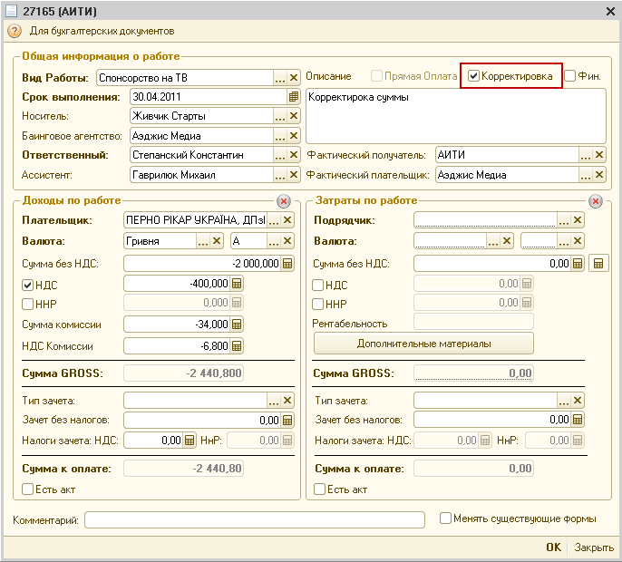

Право на установку этого параметра имею только финансовые менеджеры фронтального агентства.

Особенности работ по корректировке:

- Суммы могут быть и отрицательные
- Несмотря на то, что проект прошлого года срок выполнения нужно ставить дату текущего года.

После сохранения корректировочной работы, они в бюджете проекта будет выделена красным шрифтом.

#### Просмотр корректировочных работ в отчетах

Корректировочные работы не относятся к проектной деятельности отчетного периода, поэтому они:

- Не попадают в отчет «Сводный отчет по проектам»
- Не попадают в отчет «Отчет по оборотам и доходам»
- По-умолчанию не выводятся в отчете «Детализация по проектным работам».

В отчет «Детализация по проектным работам» корректировочные работы выведуться, если установить флаг «Выводить корректировки»

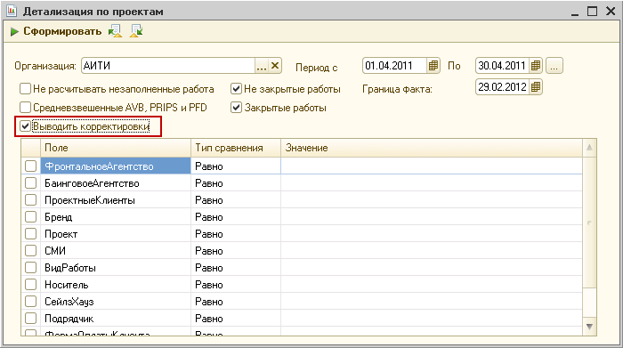

В форме отчета добавлена дополнительная колонка «Корр.» в которой знаком «Х» отмечаются корректировочные работы.

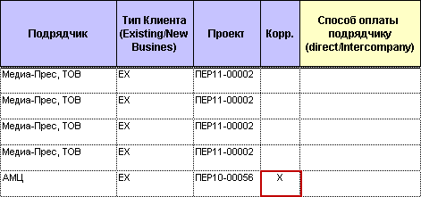

### Корректировка дополнительных начислений

#### Корректировка АВБ

Корректировку дополнительных доходов по проектам рассмотрим на корректировке АВБ:

- Корректировка производится с помощью документа «Операционный доход», а не документа «Корректировка АВБ»
- Используется счет доходов 71.10
- Используется статья учета 2150050

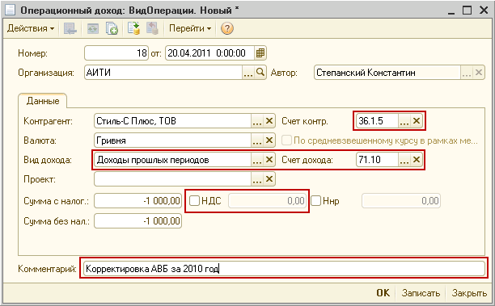

- Выбирает правильный счет взаиморасчетов (для АВБ это 36.1.5)
- Выбирается правильная статья доходов (2150050) и правильный счет доходов (71.10)
- АВБ учитывается без НДС, поэтому птички «НДС» и «НнР» не должный быть установлены
- Обязательно нужно подробно записать комментарий, чтобы потом можно было понять, откуда взялась эта операция

#### Корректировка ПФД

Корректировку дополнительных затрат по проектам рассмотрим на корректировке ПФД:

- Корректировка производится с помощью документа «Начисление затраты», а не документа «Начисление ПФД»
- Используется счет доходов 91.10
- Используется статья учета 2150100

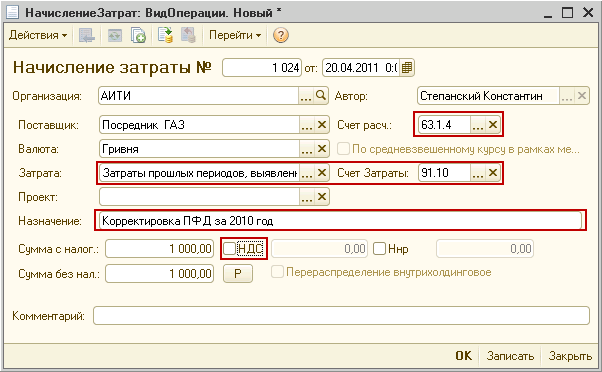

- Выбирает правильный счет взаиморасчетов (для ПФД это 63.1.4)
- Выбирается правильная статья доходов (2150100) и правильный счет доходов (91.10)
- ПФД учитывается без НДС, поэтому птички «НДС» и «НнР» не должный быть установлены
- Обязательно нужно подробно записать комментарий, чтобы потом можно было понять, откуда взялась эта операция

## Создание и внесение актов по работам

Внесением информации о выставлении или поступлении актов выполненных работ занимаются бухгалтера компаний (а по транзитным платежам - финансовым менеджером).

После закрытия Ф2 или Ф3 (по валюте ГРН-БН) система информирует соответствующего бухгалтера, что были закрыты формы, по которым нужно внести информацию о факте создания или поступления акта выполненных работ.

Факт выставления или получения акта выполненных работ фиксируется бухгалтером в специальной консоли выставления актов выполненных работ. Для открытия этой консоли нужно выбрать пункт меню «Подписи - Консоль внесения актов».

Изначально консоль не заполнена. Сначала необходимо выбрать параметры отбора форм. Формы фильтруются по таким параметрам:

По контрагенту

По периоду выполнения работ

По принадлежности к клиентам или подрядчикам

По фирме.

После заполнения всех параметров отбора, нужно нажать кнопку «Заполнить».

При установленной «птичке» «Только без акта», в список попадут те работы, по которым еще не был получен акт.

Если акт по указанной форме создан (для Ф4) или получен (для Ф5), то бухгалтер должен поставить «птичку» в колонке «П» напротив нужной формы:

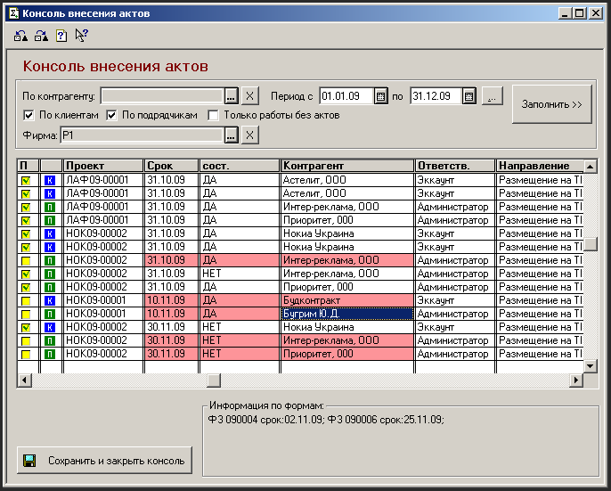

Отметка означает, что акт поступает от клиента. Отметка - акт поступает от подрядчика.

В блоке «Информация по формам» указывается:

Список форм по работе;

Ссылки на счета.

После проставления отметок о получении актов, нужно нажать кнопку «Сохранить и закрыть консоль», после закрытия консоли все отмеченные в ней формы будут помечена как формы с актами.

Эккаунт проекта, по которому был получен акт, получит в системе информационное сообщение.

В консоли проекта факт получения актов отображается в табличной части закладки «Бюджет». В колонках «А.» у работ, по которым были получены акты, будет установлен знак «+»:

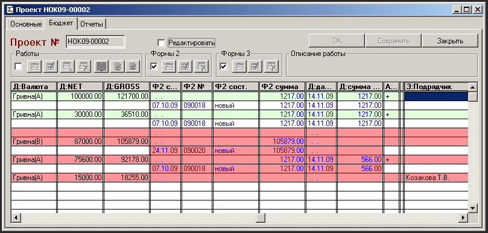

Если бухгалтер ошибочно ввел акт, он может зайти в консоль актов и убрать «птичку», установленную ошибочно.

