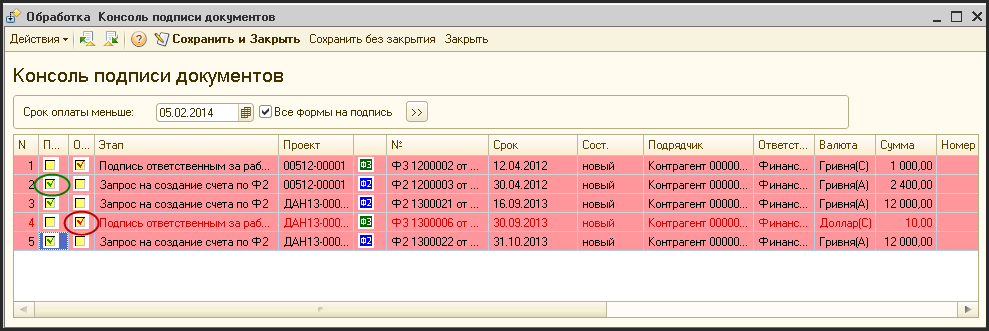
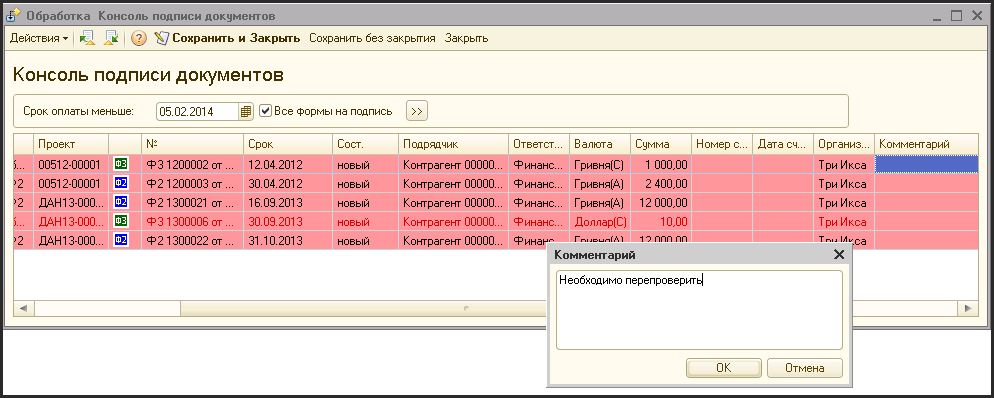

# Консоль подписей

> **Описание:** Описывает процесс утверждения документов (проектов, Форм №2 и №3) через консоль подписей. Рассматривается: цветовая индикация сроков, порядок подписания и отклонения документов, добавление комментариев и обязательные поля при подписании.

## Содержание

- [Подписание документов](#подписание-документов)

---

В соответствии с Регламентом финансового документооборота документы вида:

- Утверждение проекта;
- Форма №2;
- Форма №3;

перед тем как вступить в силу, должны пройти специальную процедуру утверждения. Для этого, в системе имеет специальную консоли подписи, которая позволяет подписывать формы и проекты. В результате подписи, формы и проекты меняют свое состояние.

Подпись может иметь два состояния: первое - это принятие документа и передача его в дальнейшую обработку; второе - отклонение документа и передача его на предыдущий уровень утверждения.

Как постановка документов на подпись, так и сам факт подписи сопровождается генерацией соответствующих сообщений (задач) для сотрудников, вовлеченных в процесс утверждения этого документа.

## Подписание документов

Для подписи документа, нужно выбрать пункт меню «Подписи - Консоль подписей». На экране откроется окно консоли подписей.

В консоли имеется своя система цветового выделения строк с документами. Документы, по которым срок подписи еще не наступил, не выделяются никаким цветом. Документы, срок подписи по которым наступил, выделяются желтым цветом. Документы, срок подписи которых просрочен, выделяются красным цветом.

Изначально, при открытии, в консоль попадают только документы, срок подписи которых уже наступил (и просроченные документы).

По документам:

- утверждение проекта;
- заявка юр. документ;
- бюджет

сроком подписи считается дата их первого проведения.

Для форм №2, система считает, что срок подписания наступил, если до срока оплаты осталось 7 дней.

Для форм №3, система считает, что срок подписания наступил, если до срока оплаты осталось 5 дней.

Если вы хотите сместить этот период, вы можете изменить дату установленную изначально в консоли и нажать кнопку . Кроме того можно выбрать чекбокс «Все формы на подпись» и нажать кнопку , после чего будут выведены все формы которые имеются на подпись, независимо от срока оплаты.

Для подписи выбранного документа, нужно сделать двойной щелчок мышью в колонке «П» ( «Подписать») напротив выбранного для подписи документа. Или можно активизировать ячейку в колонке «П», напротив выбранного документа и нажать клавишу «Enter». После этого в чекбоксе появится зеленая «птичка».

Для отклонения документа нужно произвести те же операции, но только с ячейкой в столбце «О» (от «Отклонить»). При этом «птичка» будет не зеленая, а красная.

Система не позволит выбрать чекбоксы сразу в двух столбцах. Если по документу был отмечен чекбокс в колонке «П», а потом пользователь выбирает чекбокс в колонке «О», то «птичка» в колонке «П» будет убрана.

Кроме самой подписи, Вы можете добавлять комментарии по каждому документу. При отклонении документа, заполнение поля «Комментарий» обязательно.

Для того чтобы добавить комментарий, нужно сделать двойной щелчок по ячейке, находящейся в колонке «Комментарий», напротив документа, подпись или отклонение которой вы хотите прокомментировать. Или можно активизировать нужную ячейку в колонке «Комментарий» и нажать клавишу «Enter». На экране появится окно ввода текста.

После ввода текста комментария нужно нажать кнопку «ОК».

Текст комментария будет добавлен во все задачи, которые будут созданы по подписанию или отклонению документа.

Для того, чтобы принять решение, подписывать или отклонять форму, Вы должны получить детальную информацию об этой форме и о проекте. Для того чтобы открыть консоль формы (или другой документ), нужно выбрать двойным щелчком или нажатием клавиши «Enter» в строке с формой в колонках, которые содержат информацию о форме («№», «Срок», «сост.», «Подрядчик», «Валюта», «Сумма», «Неопл.»). Форма откроется в режиме «только просмотр». Если сделать двойной щелчок или нажать клавишу «Enter» на ячейке, которая находится в колонке «Проект», откроется консоль проекта.

Если в выбранной строке находится не форма а утверждение проекта, при двойном щелчке или нажатии клавиши «Enter» появиться отчет о корректировке проекта.

После того, как все необходимые подписи и отклонения были поставлены, Вы должны нажать кнопку «Сохранить и закрыть консоль». Система изменит состояние всех подписанных и отклоненных форм, и разошлет всем ответственным за эти формы сотрудникам сообщения об изменении состояния по их формам (или утверждении проекта).

Если при сохранении подписей система обнаружит, что по некоторым подписанным документам не заполнены обязательные для подписи поля, она отменит сохранение и предложит заполнить эти поля.

Для Ф2 таким полем является поле «Назначение платежа».

Для Ф3 - номер и дата счета, назначение платежа;

Для заявки на юр.документы (при подписи юристом) - номер и дата оригинального документа.

