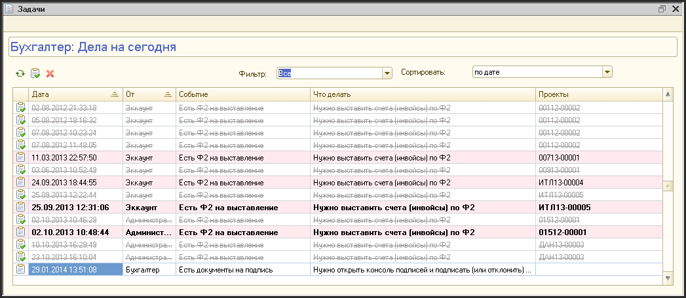
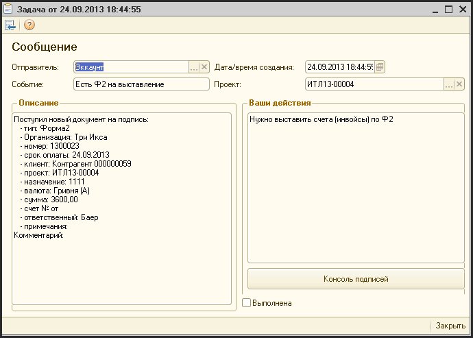

# Консоль задач

> **Описание:** Глава описывает подсистему нотификаций и консоль задач системы АУРА 3. Рассматривается: принцип работы системы событий и задач, интерфейс консоли задач, просмотр деталей задачи, управление статусом (выполнение, удаление) и обновление списка задач.

## Содержание

- [Система нотификации](#система-нотификации)
- [Консоль задач](#консоль-задач)

---

Одной из целей при разработке данной системы, ставилась цель - минимизировать количество контактов по финансовому документообороту вне данной системы.

Для достижения этой цели, была разработана подсистема обработки событий и генерации задач.

## Система нотификации

Основной принцип действия это подсистемы состоит в том, что пользователь системы проводит некоторую операцию, которую подсистема воспринимает как некоторое событие. Подсистема нотификации анализирует это событие и, в зависимости от его типа, формирует сообщения для всех сотрудников, которые должны быть проинформированы об этом событии.

Предполагается, что каждое такое сообщение требует некоторой реакции от получившего это сообщение сотрудника. Поэтому, этот сообщение показывается получателю как некоторая задача, состоящая из двух частей: первая - это описание события, которое породило эту задачу и, вторая - это предписание, как нужно отреагировать на это событие.

Задачи генерируются не только при возникновении некоторых событий в системе. Так же при каждом старте системы, она анализирует текущее состояние дел по задачам поставленным перед сотрудником и информирует его о необходимости обратить внимание на те или иные задачи. Так система может информировать эккаунта о наличии просроченных форм, или о необходимости подписать или закрыть некоторые формы по его проектам и т.п. В этом случае отправителем задачи будет являться сам сотрудник.

## Консоль задач

При начале работы системы сразу открывается консоль задач.

Консоль задач стоит из таблицы со списком задач. В верхней части консоли находится панель инструментов для управления и фильтрации задач. По-умолчанию, выбираются все необработанные задачи, которые отсортированы по дате и времени возникновения.

Непрочитанные задачи выделяются в таблице жирным шрифтом. Задачи, которые поступили и не были обработаны в день поступления, отмечаются фоном розового цвета. Строчки с обработанными задачами перечеркнуты и цвет шрифта у них - серый.

**Обновление задач**

В процессе работы системы, постоянно появляются новые задачи. Для того чтобы обновить список задач в открытой консоли можно или закрыть-открыть консоль, или обновить ее содержимое. Для этого нужно или на панели инструментов консоли нажать кнопку или нажать клавишу «F5». После чего список обновиться, а активной задачей станет последняя поставленная задача.

**Просмотр задачи**

Для просмотра детальной информации по задаче необходимо или сделать двойной щелчок мышью по строке с выбранной задачей, или сделать активной ячейку в нужной строке и нажать клавишу «Enter». После этого на экране появиться окно с информацией о задаче.

В заголовке задачи указывается отправитель, дата и время создания задачи, наименование события, в ответ на которое была сформирована задача и, если это задача по конкретному проекту, то номер этого проекта.

Ниже, в левой части окна находится описание события или группы однородных событий, по которым была сформирована эта задача. В правой части окна находится поле, в котором находится рекомендованные действия, которые вы должны произвести, чтобы выполнить эту задачу.

Ниже этого поля находится кнопка с описанием действия, которое будет выполнено при ее нажатии. Это действие зависит от типа произошедшего события и может отличаться у разных задач (например, по событию «Есть формы Ф4 на закрытие» действием является открытие консоли соответствующего проекта, а для события «Есть проекты на утверждение», действием является открытие консоли утверждения проектов).

Если в форме описания задачи Вы пометите чекбокс «Выполнена», то после закрытия этой формы в консоли задач, эта задача будет отмечена как завершенная.

**Завершение задач**

В консоли задач можно сразу помечать текущую задачу как завершенную. Для этого нужно или нажать на панели инструментов консоли кнопку или нажать клавишу «F10». После этого задача будет помечена как завершенная (шрифт измениться на серый перечеркнутый). Чтобы отменить завершение задачи, нужно повторно нажать на кнопку или на клавишу «F10».

**Удаление задачи**

Удалить можно только завершенную задачу. Для этого нужно или нажать на панели инструментов консоли кнопку или нажать клавишу «Delete».

