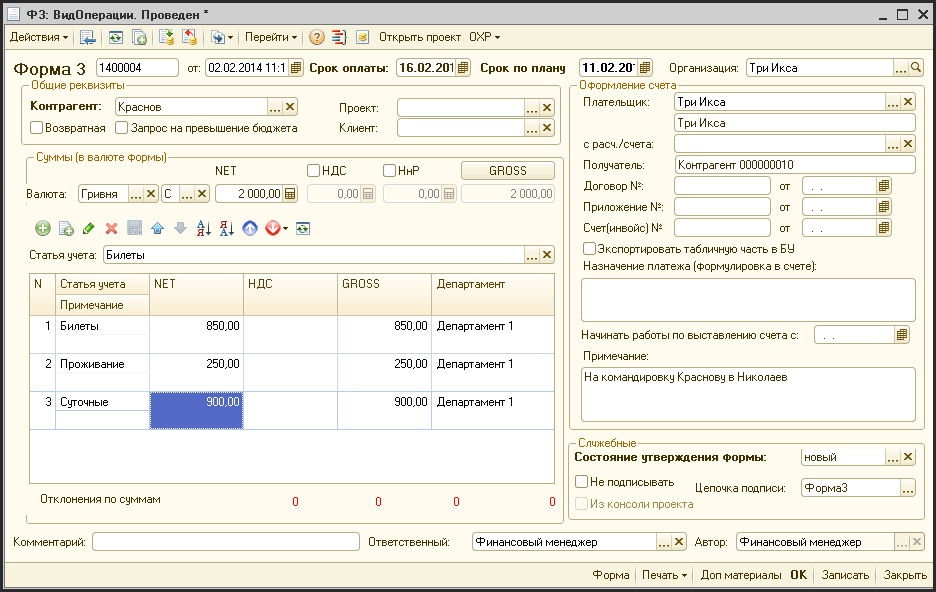
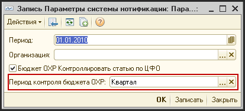
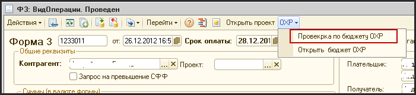
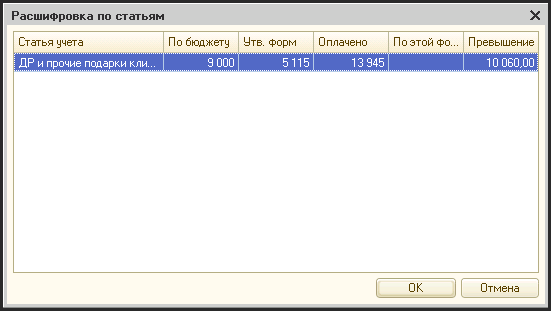
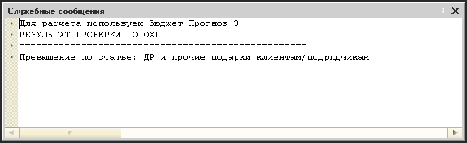

# Ввод и редактирование непроектных форм 2 и 3

> **Описание:** Описание непроектных Форм 2 и 3 — документов для фиксации непроектных платежей. Рассматриваются: примеры применения (заявки на оплату АХР, командировочные и др.), полный перечень реквизитов непроектной Формы 3 и процесс её утверждения. Процесс редактирования аналогичен проектным формам.

---

Формы 2 и 3 могут быть созданы не только в консоли проекта, но и из соответствующих журналов документов. В последнем случае Формы 2 и 3 будут непроектными.

Непроектные Формы 2 и 3 используются для фиксации в графике платежей непроектных платежей.

Примерами не проектных Ф2, которые могут составляться являются заявки на выставление счетов клиентам на оплату ПРИПС или на выставление счетов подрядчиков на оплату АВБ. Оплаты по ПРИПС и АВБ не являются жестко привязанными к бюджетам проектов, поэтому для того, чтобы контролировать и планировать процесс этих входящих платежей, создание соответствующих Ф2 необходимо.

Непроектные Формы 3 имеют более широкое применение. Это заявки на выполнение исходящих платежей по всем административно-хозяйственным затратам. Например, сотрудник выписывает заявку на выдачу ему денег на командировку, или начальник ИТ-отдела создает заявку на оплату за услуги телекоммуникаций.

В случае, когда сотрудник пишет заявку на выдачу денежных средств на командировку, он так же в Ф3 может указать проект, в связи с которым возникла необходимость в этой командировке. В этом случае данная оплата и последующее начисление затрат будет «небюджетируемое», т.е. не входящая в утвержденный бюджет проекта.

Следует минимизировать количество непроектных платежей, которые не относятся к бюджету проекта.

Непроектная Форма 3 представляет собой заявку на оплату. В непроектной Форме 3 отсутствует табличная часть:

Поля небюджетируемой Ф3:

| Реквизит | Описание |
| --- | --- |
| Форма 3 \[ \] | Уникальный номер документа |
| от  | Дата и время документа |
| Срок оплаты | Дата, до которой должен быть осуществлен платеж |
| Срок по плану | Планируемая дата платежа |
| Организация | Фирма, по которой начисляется платеж |
| Контрагент | Контрагент платежа |
| Проект | Название проекта, к которому относится платеж (если надо) |
| Клиент | Клиент проекта, если платеж привязывается к проекту |
| Возвратная | Флаг. Если установлен, то форма возвратная |
| Запрос на превышение бюджета | Флаг. Если установлен, то система проверит затраты проекта на превышение бюджета ??? |
| Статья учета | Виды услуг или работ, которые подрядчик будет выполнять |
| Валюта | Валюта оплаты |
| NET | Сумма без налогов, которая оплачивается |
| НДС | Сумма НДС |
| НнР | Сумма налога на рекламу |
| Gross | Итоговая сумма к оплате по данной форме |
| Плательщик | Клиент по проекту |
| Получатель | Контрагент-получатель платежа |
| Договор №… от… | Номер и дата договора |
| Приложение №… от… | Номер и дата приложения к договору |
| Счет (инвойс) №… от… | Номер и дата счета |
| Экспортировать табличную часть в БУ | Флаг. Если установлен - экспорт данных для создания счета в бухгалтерский учет. ??? |
| Назначение платежа (формулировка в счете) | Формулировка счета, который должен быть выставлен клиенту |
| Примечания | Дополнительная информация по этой форме |
| Состояние утверждения формы | Статус документа.  Статус документа меняется в зависимости от этапа прохождения этого документа по цепочке документооборота |
| Не подписывать | Доступно только для финансового директора. Позволяет оформлять формы в обход стандартной схемы документооборота.  Внимание! Использование данной функции крайне нежелательно |
| Цепочка подписи | Служебная информация. Показывает цепочку документооборота, которая используется для данного документа |
| Из консоли проекта | Данный флажок показывает, является ли эта форма проектной или свободной  В случае непроектной Ф3, этот флажок всегда будет сброшен |
| Комментарий | Комментарий |
| Ответственный | Сотрудник, ответственный за данную форму |
| Автор | Создатель документа |

**Описание дополнительных кнопок в форме:**

| **Реквизит** | **Описание** |
| --- | --- |
| Итог из таблицы | Переносит данные из таблицы в соответствующие суммы шапки документа ??? |
| Форма | При нажатии открывается окно для просмотра с заполненным бланком формы 3. Вверху окна кнопки, позволяющие сохранить этот документ в файл или распечатать. |
| Печать | При нажатии появляется меню:  \- Форма  \- Форма свернутая  \- По умолчанию |
| Доп материалы | При нажатии открывается окно «Хранилище дополнительной информации», где хранятся ссылки на файлы с дополнительной информацией по данной форме. В этом окне также можно сохранить новую ссылку на какую-либо новую информацию по данной форме. |

Процесс редактирования непроектных Ф2 и Ф3 абсолютно аналогичен процессу редактирования проектных форм, включая процесс утверждения и порядок оформления возвратных форм.

При утверждении непроектной Ф3 АХ-менеджер может проверить соответствие это Ф3 утвержденному бюджету.

В настройках системы можно указать за какой период нужно проверять бюджет. Возможные значения:

- месяц - система будет проверять бюджетные и фактические значения за месяц формы
- квартал - за квартал

Настройка устанавливается в пункте меню «Операции - Настройки системы - Параметры бюджетирования»:

Для проверки Ф3 в форме Ф3 нужно в панели инструментов выбрать пункт «ОХР - Проверка по бюджету ОХР»:

Система выведет таблицу с проверкой по каждой статье учета, которая встречается в этой Ф3:

- Статья учета
- По бюджету - сумма запланированная по Бюджету ОХР на период утверждения Ф3
- Утв. форм - сколько утверждены, но не оплаченных Ф3 по данной статьей
- Оплачено - сколько было оплачено по этой Статье за период утверждения Ф3
- По этой форме - сумма Ф3 (если форма утверждена или оплачена, эта колонка не заполняется. т.к. эта сумма учитывается или в колонке «Утв. форм» или «Оплачено»)
- Превышение = (По бюджеты - Утв. Форм - Оплачено - По этой форме)\*(-1)
  - Если значение превышения положительное - значит бюджет превышен

О превышении бюджета так же сообщается в окне сообщений:

Из Ф3 так же можно открыть список бюджетов, по которым осуществлялась проверка. Для этого нужно выбрать пункт меню «ОХР - Открыть бюджет ОХР».

После выбора этого пункта меню - откроется журнал Бюджетов ОХР отфильтрованный по тем, которые используются для контроля данной Ф3.

