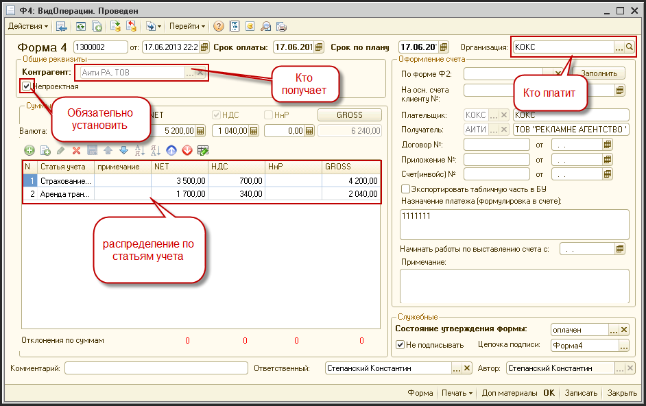
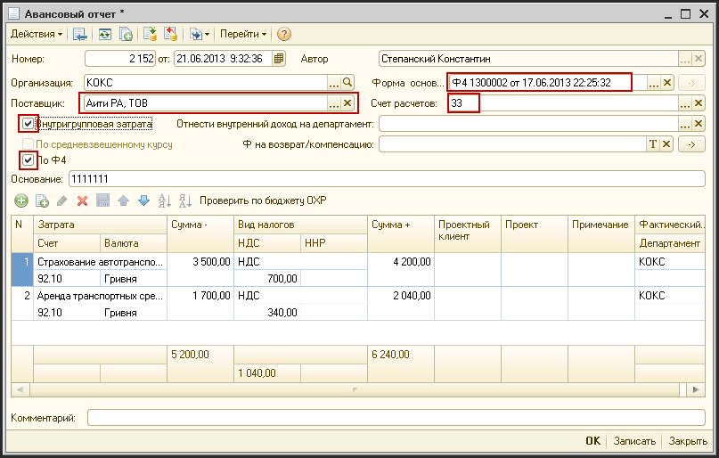
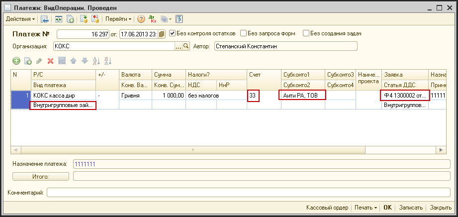
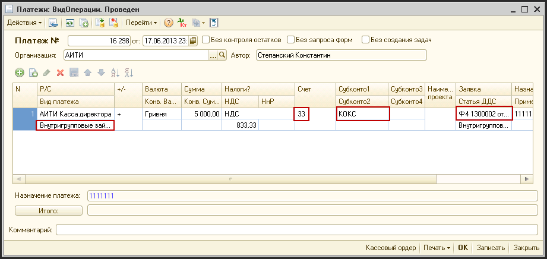
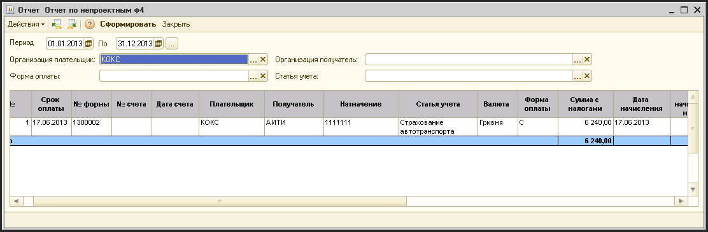

# Непроектные Ф4

> **Описание:** Глава посвящена непроектным Формам 4 — внутригрупповым платежам между компаниями холдинга. Описывается: создание непроектной Ф4, оформление авансового отчёта на основании Ф4, исходящая и входящая оплата по непроектной Ф4, а также формирование отчёта по непроектным Ф4.

## Содержание

- [Создание непроектной Ф4](#создание-непроектной-Ф4)
- [Создание на основании Ф4 документа «Авансовый отчет»](#создание-на-основании-Ф4-документа-авансовый-отчет)
- [Исходящая оплата непроектной Ф4](#исходящая-оплата-непроектной-Ф4)
- [Входящая оплата по непроектной Ф4](#входящая-оплата-по-непроектной-Ф4)
- [Отчет по непроектным Ф4](#отчет-по-непроектным-Ф4)

---

## Создание непроектной Ф4

Непроектные Ф4 создаются так же как и проектные (пункт меню «Журнал - Формы 4»)

- обязательно нужно установить флаг «Непроектная»

## Создание на основании Ф4 документа «Авансовый отчет»

- Выбираем получателя (конманию группы)
- Выбираем счет 33
- Ставим птички «Внутригрупповая затрата» и «По Ф4»
- Выбираем Ф4
- Система заполняет документ на основании

## Исходящая оплата непроектной Ф4

- Выбираем исходящий вид платежа «Внутригрупповые займы» (чтобы установился счет 33)
- Выбираем получателя (члена группы)
- Выбираем Ф4

## Входящая оплата по непроектной Ф4

- Выбираем входящий вид платежа «Внутригрупповые займы» (чтобы установился счет 33)
- Выбираем плательщика (члена группы)
- Выбираем Ф4

## Отчет по непроектным Ф4

- Выбираем пункт меню «Отчеты - Оперативные - Отчеты по ОХР - Отчет по непроектным Ф4»

- выбираем период - сроки оплаты Ф4
- выбираем реквизиты отбора
- нажимаем кнопку «Сформировать»
- при двойном щелчке на колонках с суммами оплат и начислений можно получить список документов, по которым были начисления и оплаты по этому Ф4

