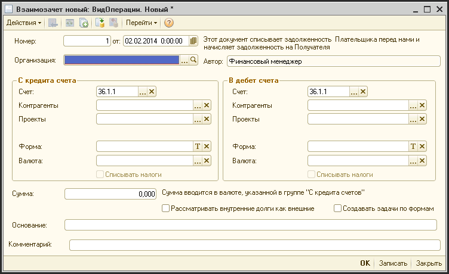

# Взаимозачеты

> **Описание:** Описывает документ «Взаимозачёты» — инструмент для преобразования задолженностей между контрагентами. Показывается описание реквизитов документа (дебет и кредит счёта, контрагенты, валюты, суммы) и типовый пример зачёта АВБ в счёт оплаты по проекту. Доступно только финансовому директору и финансовому менеджеру.

## Содержание

- [Типовой пример: Зачет начисленного АВБ в счет оплаты по проекту](#типовой-пример-зачет-начисленного-авб-в-счет-оплаты-по-проекту)

---

В процессе хозяйственной деятельности часто возникает необходимость в проведении операции взаимозачета, когда задолженность по одному контрагенту нужно преобразовать в задолженность по другому и т.п.

Для проведения таких операций в системе существует документ «Взаимозачеты».

Доступ к этому документу имеет только финансовый директор и финансовый менеджер.

Для создания документа «Взаимозачеты» нужно выбрать пункт меню «Журналы - Вспомогательные документы - Взаимозачеты». Для добавления нового документа нажмите кнопку на панели инструментов журнала или нажать клавишу «Insert» на клавиатуре. После этого на экране появиться форма ввода документа «Взаимозачеты»:

**Описание реквизитов документа:**

| **Реквизит** | **Описание** |
| --- | --- |
| Номер | Уникальный номер документа (заполняется автоматически и, обычно, ручное редактирование не требуется) |
| от  | Дата списания ошибок округления |
| Организация | Фирма, по которой проводится эта операция |
| **Группа «В кредит счета»** | **Группа реквизитов, списания с дебетового сальдо** |
| Счет | Счет учета, с дебета которого списывается сальдо |
| Контрагенты | Контрагент |
| Проекты | Проект (если надо) |
| Форма | В этом поле можно выбрать Ф2 или Ф3. Если поле заполнено, то система при проведении документа сформирует дополнительные проводки, аналогичные проводкам при проведении оплаты (исходящей) по форме. |
| Валюта | Валюта, в которой списывается сальдо. |
| **Группа «В дебет счета»** | **Группа реквизитов, начисления на дебетовое сальдо** |
| Счет | Счет учета, с кредита которого списывается сальдо |
| Контрагенты | Контрагент |
| Проекты | Проект (если надо) |
| Форма | В этом поле можно выбрать Ф2 или Ф3. Если поле заполнено, то система при проведении документа сформирует дополнительные проводки, аналогичные проводкам при проведении оплаты (входящей) по форме |
| Валюта | Валюта, в которой начисляется дебетовое сальдо |
| Сумма | Сумма операции в валюте, указанной в группе «В кредит счета» |
| Рассматривать внутренние долги, как внешние | Флаг, если установлен, то ??? |
| Создавать задачи по формам | Флаг, если установлен, то системой формируются задачи |
| Основание | Комментарий по документу |

## Типовой пример: Зачет начисленного АВБ в счет оплаты по проекту

Часто суперкомиссия, которая начисляется подрядчиком, засчитывается как оплата подрядчику за проектные работы.

В этом случае нужно так заполнить реквизиты документа «Взаимозачеты»:

| **Реквизит** | **Описание** |
| --- | --- |
| Номер |     |
| от  | Дата, когда признается факт зачета. Для проекта это будет дата оплаты |
| Организация | Фирма, по которой проводится эта операция |
| **Группа «В кредит счета»** | **Группа реквизитов, списания с дебетового сальдо** |
| Счет | 36.1.5 |
| Контрагенты | Подрядчик, от которого была получена суперкомиссия |
| Проекты |     |
| Форма |     |
| Валюта | Валюта начисления суперкомиссии |
| **Группа «В дебет счета»** | **Группа реквизитов, начисления на дебетовое сальдо** |
| Счет | 63.1.1 |
| Контрагенты | Подрядчик по работе |
| Проекты | Проект по которому начисляется взаимозачет |
| Форма | Ф3 по которой будет проведен зачет и по которому будет зарегистрирована оплата |
| Валюта | Валюта формы |
| Сумма | Сумма зачета в валюте начисления суперкомиссии |
| Основание | Комментарий по документу |

