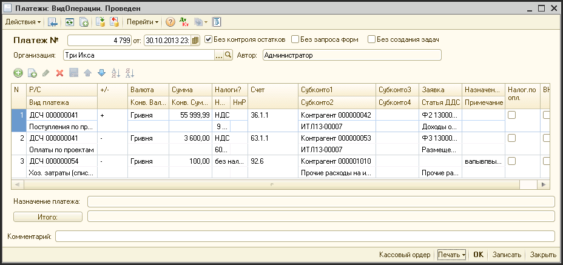

# Платежи

> **Описание:** Описывает документ «Платежи» — основной инструмент регистрации всех движений денежных средств. Описываются реквизиты шапки и табличной части документа, разделение прав доступа, а также типовые операции: приход от клиента, исходящая оплата, конвертация валюты и начисление затрат.

## Содержание

- [Типовые операции](#типовые-операции)
  - [Приход по проекту от клиента](#приход-по-проекту-от-клиента)
  - [Оплата по проекту](#оплата-по-проекту)
  - [Быстрая конвертация](#быстрая-конвертация)
  - [Отражение операции по выплате бухгалтерской зарплаты](#отражение-операции-по-выплате-бухгалтерской-зарплаты)
  - [Быстрое начисление затрат по платежу](#быстрое-начисление-затрат-по-платежу)

---

Данный документ фиксирует все движения денежных средств в системе, за исключением выплаты заработной платы.

Путь к журналу документа: «Журналы - Платежи».

Один документ платеж создается на одну выписку с расчетного счета или на один день кассовых операций по кассе.

Имеется возможность в одном документе «Платеж» делать движения по разным денежным счетам, но это неудобно с точки зрения контроля

Доступ к документу:

- Финансовый директор;
- Бухгалтер (только по безналичным платежам);
- Директор, генеральный директор (только просмотр);
- Финансовый менеджер.
- Кассир (только по своим кассам).

**Описание реквизитов шапки документа:**

| **Реквизит** | **Описание** |
| --- | --- |
| №   | Уникальный номер документа |
| от  | Дата проведения платежей |
| Без контроля остатков | Если выбрать этот реквизит, система не будет проверять достаточность денежных средств для проведения платежей, что потенциально может привести к возникновению отрицательных остатков по денежных счетам |
| Без запроса форм | Если выбрать этот реквизит, система не будет требовать обязательного заполнения реквизита табличной части «Заявка» по платежам, где заполнение этого реквизита в нормальных условиях является обязательным |
| Без создания задач | Если выбрать этот реквизит, при проведении документа не будут формироваться задачи по оплатам по формам. Это может понадобиться, если возникнет необходимость перепроведения документа без информирования об этом пользователей, по чьим формам в этом документе были оплаты |
| Организация | Фирма, по которой проводятся платежи |
| Автор | Создатель документа |
| Комментарий | Текстовая строка для облегчения идентификации документа в журнале документов |

**Описание реквизитов табличной части документа:**

| **Реквизит** | **Описание** |
| --- | --- |
| Р/С | Денежный счет (расчетный счет или касса), по которому проводится платеж |
| Вид платежа | Вид платежа. Выбор этого реквизита позволяет системе автоматически заполнить нужные параметры строки документа (направление платежа, счет учета и состав аналитик по платежам) |
| +/- | Направление платежа «+» - приход, «-» - расход |
| Валюта | Валюта, в которой производится оплата |
| Конв. валюта | Валюта, которая используется для операции конвертации |
| Сумма | Сумма платежа в валюте платежа |
| Конв. сумма | Это поле становиться доступным, когда проводится операция преобразование из одной валюты в другую. Например, нужно поменять 100 долларов США на рубли. Выбирается вид платежа «Перенос со счета на счет» в группе «Исходящие». С качестве расчетного счета выбираем «Касса ДОЛ», в качестве «Субконто1» - «Касса РУБ». В поле сумма вносим сумму 100. Если поле «Конв.сумма» не заполнять, то система проведет конвертацию по внутрисистемному курсу. Однако, на практике, курсы обмена могут быть разными, поэтому в поле «Конв.сумма» можно указать сумму фактически полученных рублей при обмене, а система автоматически рассчитает доходы или затраты по операционной курсовой разнице В конв. валюте |
| Налоги | Указывается, какие налоги входят в сумму оплаты: В зависимости от этого реквизита рассчитываются реквизиты «НДС» и «НнР» |
| НДС | Сумма НДС |
| ННР | Сумма налога на рекламу |
| Счет | Счет учета, с которым будет корреспондировать счет учета выбранного денежного счета. В зависимости от значения в этом реквизите устанавливается состав и доступность аналитик (Субконто1, Субконто2, Субконто3, Субконто4) |
| Субконто… | Аналитики для выбранного счета учета. Система требует обязательного заполнения хотя бы первого субконто |
| Заявка | В этом реквизите нужно выбрать форму, по которой проводится платеж. Если это входящий платеж, то это форма №2. Если это исходящий платеж, то это форма №3. Если предварительно был заполнен реквизит «Субконто1», то система позволит выбрать соответствующую форму только по этому контрагенту. |
| Назначение платежа | Суть операции. Для расчетных счетов, в этот реквизит должна вноситься информация, находящаяся в банковкой выписке |
| Налог. по оплате | Если = «Да», то налоги начисляются по оплате. |

**Описание кнопок:**

| **Реквизит** | **Описание** |
| --- | --- |
| Кнопка «Итого» | Показывает начальный остаток по выбранному счету, приход по документу, расход по документу и конечный остаток |
| Кассовый ордер | При нажатии открывается окно для просмотра с заполненным бланком кассового ордера. В зависимости от того исходящий это платеж или входящий, кассовый ордер будет расходным или приходным. Вверху окна кнопки, позволяющие сохранить этот документ в файл или распечатать. |
| Печать | При нажатии появляется меню печатных форм:  \- Кассовый ордер  \- По умолчанию |

## Типовые операции

### Приход по проекту от клиента

Пример заполнения реквизитов

| **Реквизит** | **Значение** |
| --- | --- |
| Р/С | Расчетный счет (касса), на который осуществлен платеж |
| Вид платежа | В справочнике «Виды платежей» в группе «Входящие» выбирается вид платежа «Приход по проекту» |
| +/- | Автоматически устанавливается в «+» |
| Заявка | Сразу заполняется заявка (Ф2) по которой осуществлен приход. Чтобы ограничить список Ф2, только Ф2 по определенному контрагенту, можно сначала выбрать этого контрагента в поле «Субконто1». Чтобы ограничить список Ф2, только формами по одному проекту, можно так же заполнить поле «Субконто2». После выбора заявки, система автоматически заполнить поля: |

В случае, если документ «Платежи» создан на основании импорта или из «клиент-банка», или из бухгалтерских кассовых ордеров, и поля сумма и назначение и Субконто1 уже заполнены, нужно только выбрать правильный вид платежа и правильную заявку.

### Оплата по проекту

Пример заполнения реквизитов

| **Реквизит** | **Значение** |
| --- | --- |
| Р/С | Расчетный счет (касса), с которого будет осуществлена оплата |
| Вид платежа | В справочнике «Виды платежей» в группе «Исходящие» выбирается вид платежа «Оплата по проекту» |
| +/- | Автоматически устанавливается в «-» |
| Заявка | Сразу заполняется заявка (Ф3) по которой осуществлена оплата. Чтобы ограничить список Ф3, только Ф3 по определенному контрагенту, можно сначала выбрать этого контрагента в поле «Субконто1». Чтобы ограничить список Ф3, только формами по одному проекту, можно так же заполнить поле «Субконто2». После выбора заявки, система автоматически заполнить поля: |

В случае, если документ «Платежи» создан на основании импорта или из «клиент-банка», или из бухгалтерских кассовых ордеров, и поля сумма и назначение и Субконто1 уже заполнены, нужно только выбрать правильный вид платежа и правильную заявку.

### Быстрая конвертация

В документе «Платежи» можно провести быструю операцию конвертации. Она аналогична операции переносу денежных средств со счета на счет, только в качестве конечного расчетного счета или кассы выбирается счет с валютой, отличной от исходной.

Пример заполнения реквизитов

| **Реквизит** | **Значение** |
| --- | --- |
| Р/С | Расчетный счет (касса), с которого будет осуществлена оплата |
| Вид платежа | В справочнике «Виды платежей» в группе «Исходящие» выбирается вид платежа «Перенос со счета на счет» |
| +/- | Автоматически устанавливается в «-» |
| Валюта | Валюта суммы |
| Конв. валюта | Валюта конв. суммы |
| Субконто1 | Выбирается счет или касса на который придут средства в другой валюте |
| Сумма | Заполняется сумма, которая списывается с исходного счета |
| Конв. сумма | Заноситься сумма, которая придет на конечный счет (уже в валюте этого счета) |

После проведения документа система самостоятельно рассчитает и начислит возникшие курсовые разницы, по отношению к текущему курсу системы.

Если реквизит «Конв. сумма» не заполнять, то на конечный счет будет зачисленная сумма, рассчитанная на основании системного курса.

### Отражение операции по выплате бухгалтерской зарплаты

При импорте операций выплаты заработной платы по бухгалтерии (по расходным кассовым ордерам и банковским выпискам при перечислении на карточку), финансовый менеджер все эти операции должен отражать как перенос денежных средств с реальных счетов и касс на специальные зарплатные счета.

Фактическая фиксация выплаты зарплаты осуществляется финансовым директором путем создания и проведения документов «Выплата зарплаты».

### Быстрое начисление затрат по платежу

Часть затрат, за которые производятся оплаты может быть начислен в том же самом периоде, когда была произведена оплата. В этом случае, чтобы не нагромождать огромное количество лишних документов, финансовый менеджер при разнесении движений денежных средств, может в момент проведения документа «Платежи» сразу указать системе, формировать проводки по начислению затрат.

Пример заполнения реквизитов

| **Реквизит** | **Значение** |
| --- | --- |
| Р/С | Расчетный счет (касса), с которого будет осуществлена оплата |
| Вид платежа | В справочнике «Виды платежей» в группе «Исходящие» выбирается вид платежа «Хозяйственные затраты» |
| +/- | Автоматически устанавливается в «-» |
| Субконто1 | Выбирается контрагент |
| Субконто2 | Выбирается статья затрат |
| Сумма | Заполняется сумма оплаты |
| Назначение платежа | В назначении платежа помимо сути оплаты, нужно обязательно указать контрагента, которому была проведена оплата, чтобы потом проще было анализировать данные |

