# Использование «кривых платежей»

> **Описание:** Описывает механизм «кривых платежей» — схем, при которых одно агентство проводит платежи фактически от имени другого. Описывается: планирование схем оплат, создание т2 и т3 по входящим/исходящим кривым платежам, особенности вязки форм в документе «Платежи» и бюджетирование схем оплат.

## Содержание

- [Что такое «кривой платеж»?](#что-такое-кривой-платеж)
- [«Кривые платежи» по проектам](#кривые-платежи-по-проектам)
- [«Кривые платежи» по непроектной деятельности](#кривые-платежи-по-непроектной-деятельности)
- [Особенности привязки форм по «кривым платежам» в документе «Платежи»](#особенности-привязки-форм-по-кривым-платежам-в-документе-платежи)
- [Бюджетирование схем оплат](#бюджетирование-схем-оплат)
- [Кривые платежи в СФФ](#кривые-платежи-в-сфф)
- [Изменения в обработках по формам](#изменения-в-обработках-по-формам)

---

## Что такое «кривой платеж»?

«Кривой платеж» - это входящий или исходящий платеж, который проводится или принимает агентством за другое агентство.

Кривые платежи могут быть:

- Входящими - например, фактическим фронтальным агентством по проектам клиента является «Навигатор», а официальный договор и денежные средства клиент перечисляет на расчетные счета агентства «АММ»;
- Исходящими - например, баинговым агентством по работе с каналом «Макси ТВ» является агентство «Нац ТВ», а фактические оплаты осуществляет агентство «Аэджис Медиа».
- Внутренними - например, есть работа по размещению на телеканале «Макси ТВ». Фронтальное агентство «АИТИ», баинговое агентство «Нац ТВ». Но т.к. оплаты подрядчику осуществляет «Аэджис медиа», то «АИТИ» должно проводить внутреннюю оплату не агентству «Нац ТВ», агентству «Аэджис медиа».

Иными словами, система «кривых платежей» позволяет одним агентствам использовать денежные активы других.

Сокращения, используемые в этой инструкции:

- ФА - фронтальное агентство - агентство, которое работает с клиентом пои проекту;
- БА - баинговое агентство - агентство, которое работает с подрядчиками по проекту;
- ПЧ - получатель - агентство, которое получает денежные средства от клиента по проекту
- ПТ - плательщик - агентство, которое осуществляет исходящие платежи подрядчикам по проекту

Обратите внимание:

- Кривые платежи имеет смысл использовать только для оплат по форме «А»
- Если по проекту планируются кривые платежи, ОБЯЗАТЕЛЬНО согласуйте это с Вашим финансовым менеджером

## «Кривые платежи» по проектам

Возьмем пример:

- Клиент: «Альфа-банк»
- Вид работы: Размещение на телеканале «Макси ТВ»
- Фронтальное агентство (ФА): Навигатор
- Баинговое агентство (БА): НацТВ
- Получателем денежных средств от клиента (ПЧ) будет агентство «АИТИ», т.к. на момент подписания договора с клиентом у компании «Навигатор», еще не было расчетного счета
- Плательщиком подрядчику будет агентство «Аэджис», т.к. на момент выполнения работ, договор с «Максимум адвертайзинг» еще не был переоформлен на «Нац ТВ»

### Планирование схем оплат в бюджетах проектов

Описать схему кривых оплат можно уже прямо при формировании бюджета проекта. Для этого в форме работы добавлены два поля «Фактический получатель» и «Фактический плательщик»:

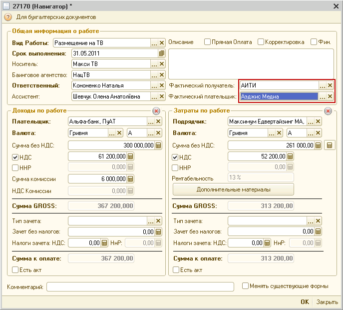

По-умолчанию в этих полях устанавливаются ФА и БА. Но при формировании проекта уже известна схема оплаты, можно сразу указать правильных плательщика и получателя. В нашем случае это «АИТИ» и «Аэджис».

Эти поля в работе носят рекомендательный характер и при составлении Ф3 или Ф2 можно выбрать других плательщиков и получателей. Однако, правильное указание этих данных при формировании проекта позволяет избежать ошибок при создании форм и проведении оплат.

### Создание и редактирование Ф2 по входящему «кривому платежу»

В форме редактирования Ф2 под наименованием «Получатель» теперь не одно, а два поля. Первое для выбора агентство, которое фактически будет получать денежные средства, а второе для указания полного наименования этого агентства:

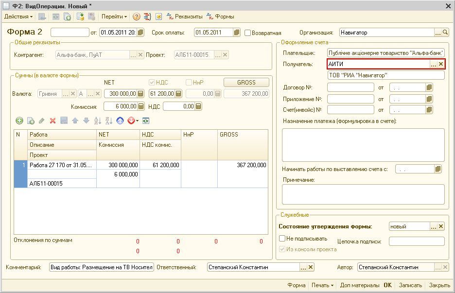

По-умолчанию в поле «Получатель» устанавливается агентство, которое указано в поле «Фактический получатель» работы из бюджета проекта. Однако, вы можете ручную поменять это значение, если фактически получатель будет другим.

После подписи ответственного за Ф2, система отправит эту форму на главного бухгалтера фактического плательщика, не агентства, которое является фронтальным по данному проекту.

### Создание и редактирование Ф3 по исходящему «кривому платежу»

В форме редактирования Ф3 под наименованием «Плательщик» теперь не одно, а два поля. Первое для выбора агентство, которое фактически будет платить подрядчику, а второе для указания полного наименования этого агентства:

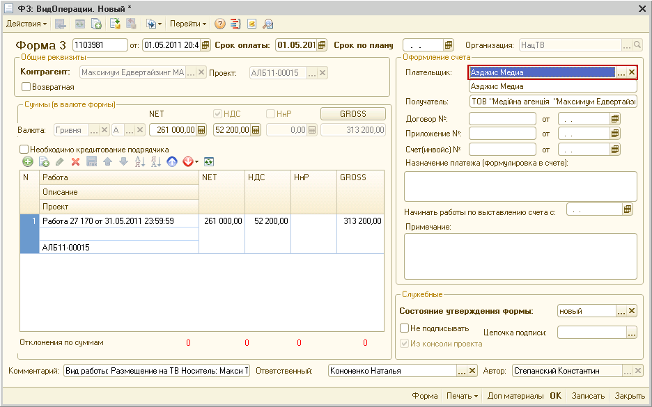

По-умолчанию в поле «Плательщик» устанавливается агентство, которое указано в поле «Фактический плательщик» работы из бюджета проекта. Однако, вы можете ручную поменять это значение, если фактически получатель будет другим.

Если в процессе утверждения по Ф3 запрашивается кредитование. Подтверждает кредитование директор баингового агентства.

Утвержденная Ф3 попадает в реестр платежей фактического плательщика, а не баингового агентства.

### Создание Ф4 по «кривым платежам»

Т.к. система «кривых платежей» делает взаиморасчеты по проектам достаточно запутанными, рекомендуется четко привязывать каждую Ф4 к отдельной Ф2. Это позволит более четко отслеживать внутренние расчеты по проектам.

Для этого в форме редактирования Ф4 добавлено поле «Форма 2» на основании которой создана Ф4.

Для создания Ф4 на основании Ф2 нужно:

- Создать новую Ф4
- Выбрать Ф2 на основании которого эта Ф4 должна быть создана:

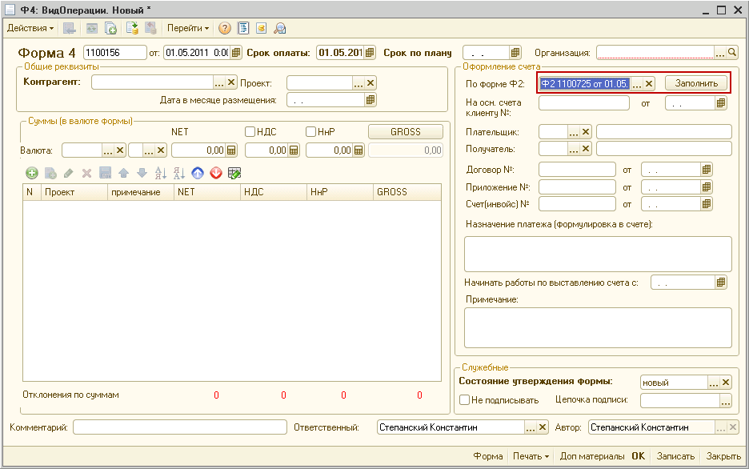

- Нажать на кнопку «Заполнить»
- На экране появится форма заполнения Ф4 со всеми необходимыми заполненными параметрами:

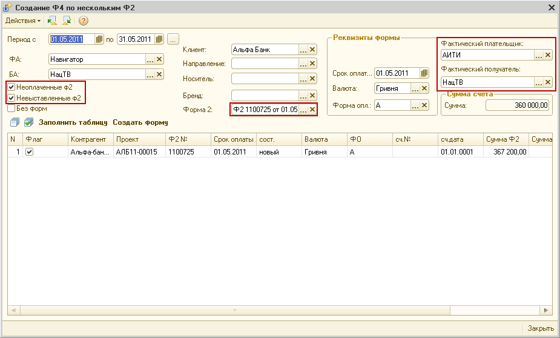

- Нажать на кнопку «Заполнить таблицу»
- Нажать на кнопку «Создать форму»
- Окно формы заполнения Ф4 закроется и в форме редактирования Ф4 будут заполнены все необходимые реквизиты:

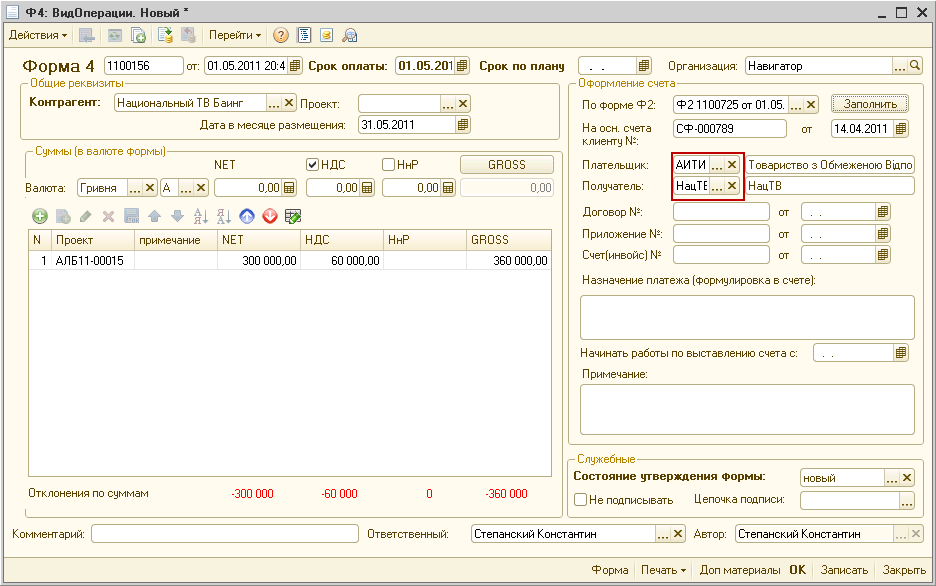

Обратите внимание: справа от надписей «Плательщик» и «Получатель» не по одному, а по два поля. В первом поля можно указать соответствующее агентство, а во втором полное наименование

### Изменения в проектных отчетах

- Отчет «Реестр проектных работ»: Добавлены две колонки «Фактический получатель» и «Фактический плательщик»
- Отчет «Реестр проектных форм»: Добавлена колонка «Фактический плательщик/получатель»
- Отчет «Оплаты по проектам»: Добавлена колонка «С/на счет организации», в котором указывается фактический плательщик или получатель.
- В отчетах «Реестр платежей» и «Реестр исходящих платежей», если одно агентство платит за другое около наименования плательщика или получателя в скобках указывается за кого оно платит

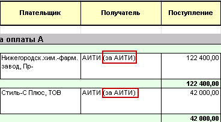

## «Кривые платежи» по непроектной деятельности

По непроектным платежам так же можно использовать «кривые платежи», однако на данный момент видимой необходимости в этом нет. Поэтому, если возникла необходимость в этом, ОБЯЗАТЕЛЬНО согласуйте это с вашим финансовым менеджером.

Для оформления входящего кривого платежа, в Ф2 нужно правильно заполнить поле «Получатель».

Для оформления исходящего кривого платежа, в Ф3 нужно правильно заполнить поле «Плательщик».

## Особенности привязки форм по «кривым платежам» в документе «Платежи»

При выборе форм в документе «Платежи» при привязке платежей, система будет фильтровать формы не по полу «Организация», а по полям «Плательщик» или «Получатель», в зависимости от направления платежа.

Например Ф3 описанная в п.2.3 этой инструкции будет отбираться при заполнении платежей по агентству «Аэджис», а не «Нац ТВ».

## Бюджетирование схем оплат

### Бюджетирование «кривых платежей» по проектам

Если в процессе бюджетирования заранее известно, что оплаты будут проходить не по тем агентствам, которые будут фронтальными или баинговыми по проектам по бюджетируемому клиенту, можно это сразу указать в бюджете. Это позволит построить более правильный бюджет движения денежных средств.

Например при бюджетировании клиента «Альфа-банк» было изначально известно, что первые три месяца входящие платежи будут идти не на агентство «Навигатор», а не агентство «АИТИ». Бюджете можно указать:

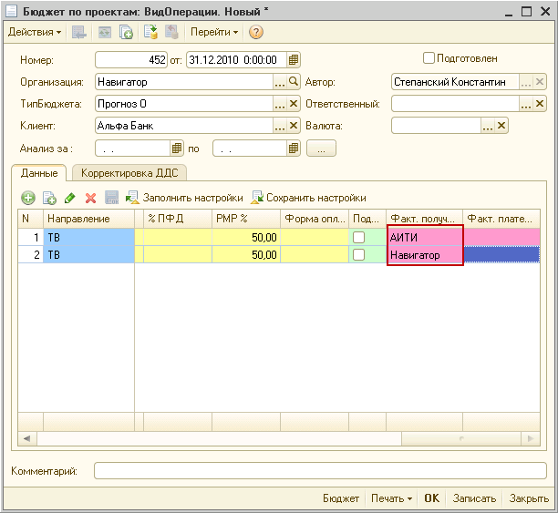

- Создаем две строчки
- В первой строке заполняем суммы только за рри первых месяца и в колонке «Факт.получатель» указываем «АИТИ»
- Во второй строке заполняем суммы с апреля по декабрь и в колонке «Факт. получатель» указываем «Навигатор» (хотя можно и не указывать, тогда система по умолчанию возьмет значение из поля «Организация»)

При проведении бюджета входящая сумма за первые три месяца будет отнесена на бюджет ДДС АИТИ, а не Навигатора.

## Кривые платежи в СФФ

- При заполнении СФФ по созданным формам, будет учитываться не значение поля «Организация» в форме, а значение из поля «Плательщик» для Ф3 или Ф4 и «Получатель» для Ф3 или Ф4 (в зависимости от направления оплаты).
- При заполнению СФФ по проектным бюджетам без форм, данные о схеме оплаты берутся из новых реквизитов проектной работы «Фактический плательщик» и «Фактический получатель»
- В форму СФФ добавлена дополнительная колонка «За организацию», в которой указано за какую организацию совершается этот платеж

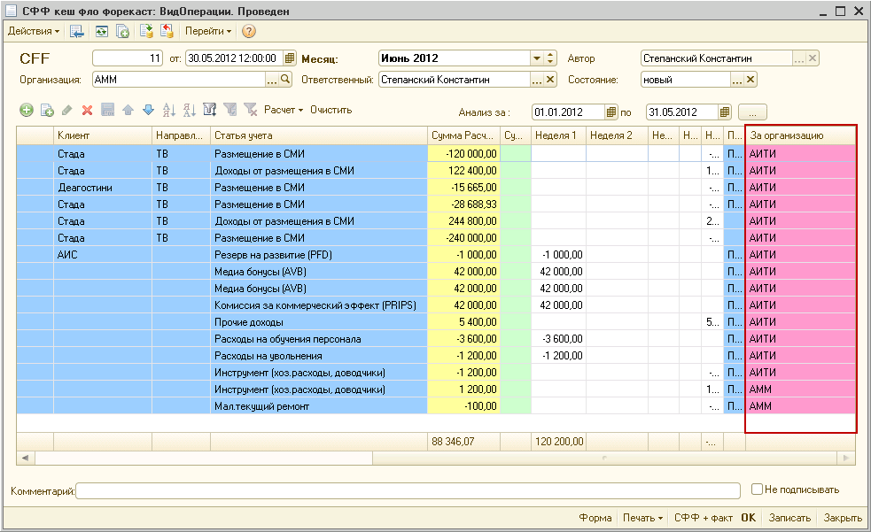

- В форму детального отчета по СФФ добавлена колонка «Оплата за агентство».

## Изменения в обработках по формам

- В обработку «Замена реквизитов по Ф2» добавлено поле «Новый фактический получатель». При установке нового значения, в этом поле в форме будет заменен реквизит «Получатель»

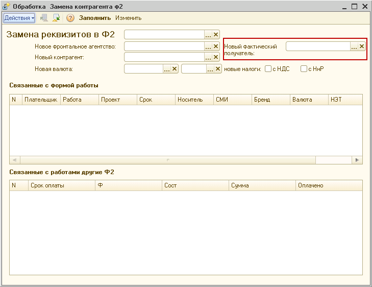

- В обработку «Замена реквизитов по Ф3» добавлено поле «Новый фактический плательщик». При установке нового значения, в этом поле в форме будет заменен реквизит «Плательщик»
- В обработки «Создание сложной Ф2» и «Создание сложной Ф3» добавлены поля «Фактический получатель» и «Фактический плательщик» соответственно:

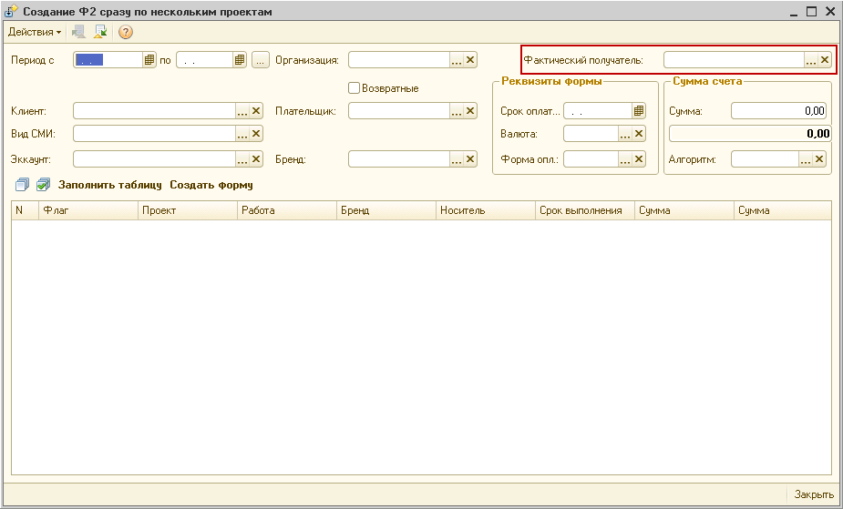

- В обработку «Заполнение затратных бюджетов» добавлено поле «Фактический плательщик» для групповой установки нового фактического плательщика по работам:

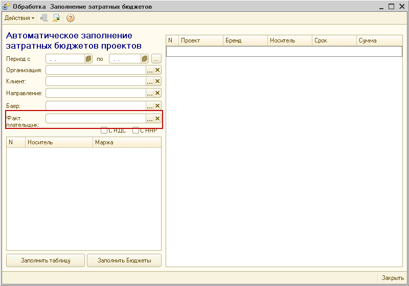

