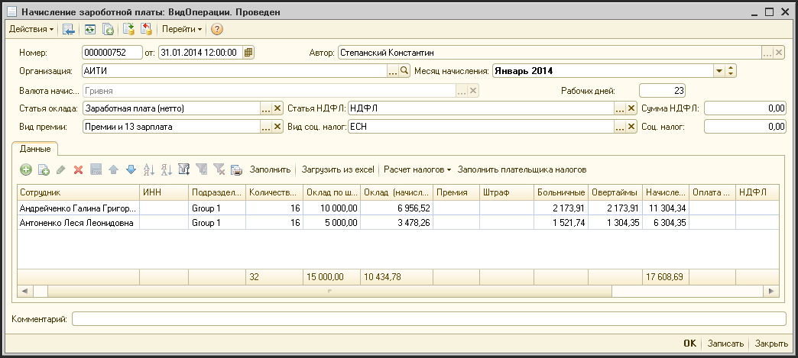
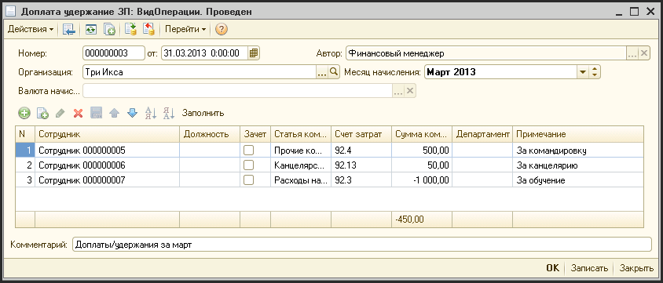
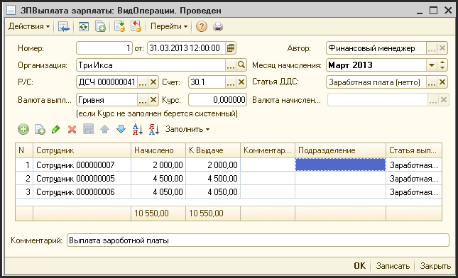
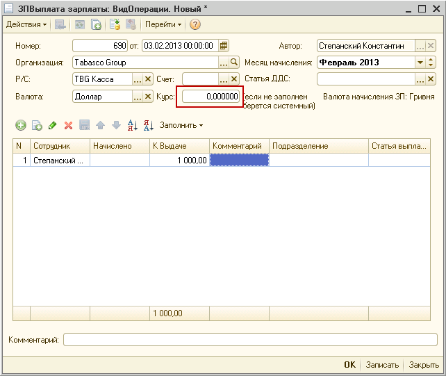
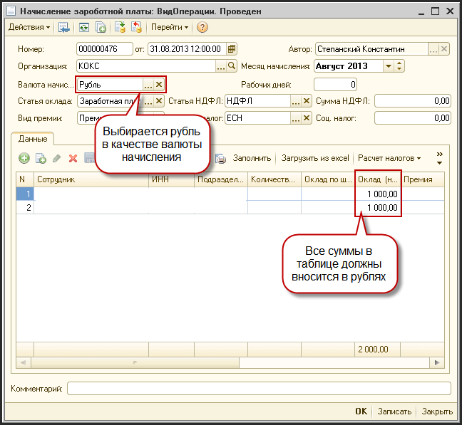
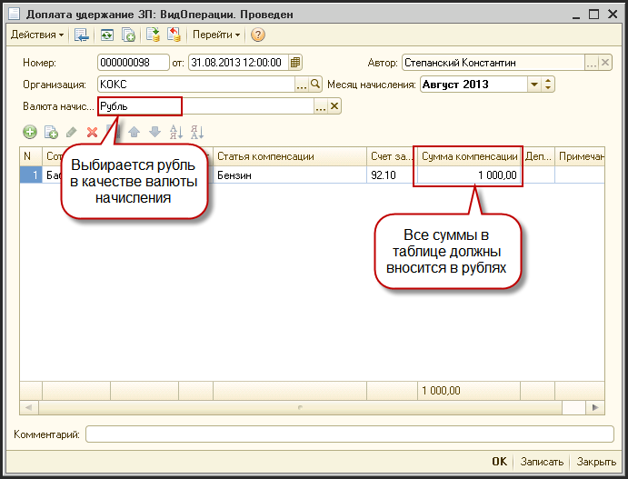
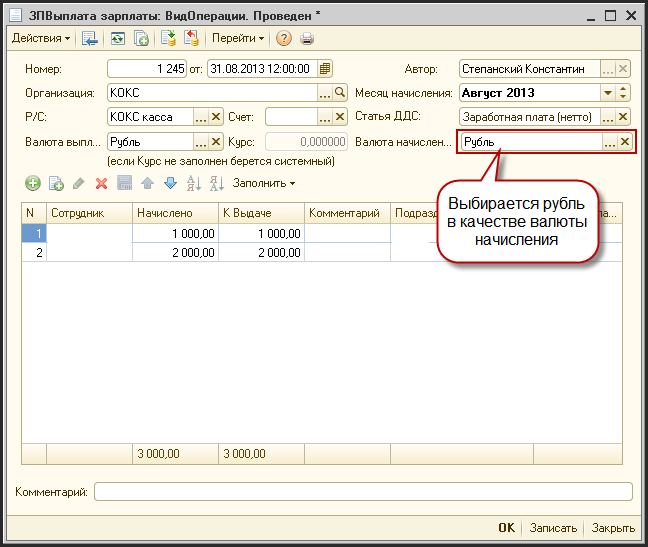

# Заработная плата

> **Описание:** Глава описывает полный цикл управления заработной платой в системе. Рассматривается: документ начисления зарплаты (оклад, овертаймы, больничные, налоги), компенсации и доплаты, выплата зарплаты, а также особенности начисления в иностранной валюте.

## Содержание

- [Начисление зарплаты](#начисление-зарплаты)
- [Компенсации по ЗП](#компенсации-по-зп)
- [Выплата зарплаты](#выплата-зарплаты)
- [Начисление и выплата зарплаты в валюте, отличной от основной](#начисление-и-выплата-зарплаты-в-валюте-отличной-от-основной)

---

## Начисление зарплаты

Данный документ производит начисление заработной платы.

Доступ к документу:

- Финансовый директор;
- Директор, генеральный директор (только просмотр);
- Финансовый менеджер.

Путь к журналу документа: «Журналы - Зарплата - Начисление ЗП».

Для создания нового документа начисления ЗП надо нажать кнопку . Для редактирования существующего документа - кнопка .

**Описание реквизитов шапки документа:**

| **Реквизит** | **Описание** |
| --- | --- |
| Номер | Уникальный номер документа |
| от  | Дата и время начисления (обычно это последний день месяца, за который производится начисление) |
| Автор | Создатель документа |
| Организация | Фирма, по которой начисляется зарплата |
| Месяц начисления | Выбор из списка месяца, за который производится начисление. |
| Валюта начисления | Валюта начисления. ??? |
| Рабочих дней | Количество рабочих дней в данном месяце |
| Статья оклада | Статья затрат, соответствующая затрате по начислению оклада (заполняется автоматически из константы) |
| Статья НДФЛ | Статья НДФЛ, соответствующая затрате по начислению НДФЛ (заполняется автоматически из константы) |
| Сумма НДФЛ | Сумма НДФЛ |
| Вид премии | Статья затрат, соответствующая затрате по начислению премии (заполняется автоматически из константы) |
| Вид соц. Налог | Статья ЕСН, соответствующая затрате по начислению ЕСН (заполняется автоматически из константы) |
| Соц. налог | Сумма соц. налога |
| Комментарий | Дополнительный комментарий по документу |

**Описание реквизитов табличной части документа:**

| **Реквизит** | **Описание** |
| --- | --- |
| Сотрудник | Сотрудник, по которому начисляется зарплата |
| ИНН | Индивидуальный налоговый номер сотрудника |
| Подразделение | Подразделение, в котором работает сотрудник |
| Количество рабочих часов | Количество рабочих дней |
| Оклад по штатному расписанию | Управленческий оклад сотрудника по штатному расписанию |
| Оклад (начислено) | Начисленная сумма оклада |
| Премия | Дополнительные премии |
| Штраф | Штрафные вычеты из ЗП |
| Компенсация за отпуск | Компенсация за отпуск |
| Больничные | Начисленная сумма больничных (если есть) |
| Овертаймы | Начисленная сумма овертаймов (если есть) |
| Начислено | Общая сумма начисления |
| Оплата на карточку | Сумма, перечисляемая на карточку сотрудника |
| НДФЛ | Сумма НДФЛ |
| Соц. Налог | Сумма ЕСН |
| Комментарий | Комментарий |
| Не затраты на персонал | Флаг. Установлен, если данное начисление не нужно относить на Затраты на персонал ??? |
| Плательщик налогов | ??? |

- При заполнении документа «Начисление ЗП» система проводит такие расчеты:
  - В шапке заполняется количество рабочих дней в месяце начисления - эти данные берутся из фонда рабочего времени
  - для каждого сотрудника рассчитывается количество рабочих дней которые он проработал в этом месяце
    - вычитаются больничные и отпуск за свой счет
    - есди сотрудник принят в или уволен в середине месяца - считаются только те дни в которые он работал
  - Оклад по шататному расписанию - оклад, который указан в справочнике «Сотрудники» (см. [Настройка окладов сотрудников](#_Настройка_окладов_сотрудников))
  - Оклад начисленный = «Оклад по штату» / «Общее количество рабочих дней» \* «Количество дней проработанных сотрудником»
  - Премия - сумма берется из таблицы «Бонусы» (см. [Настройка окладов сотрудников](#_Настройка_окладов_сотрудников))
  - Штраф - вносится вручную если есть
  - Больничные - считаются на основании приказов на больничные и настроек расчета оплаты больничных
  - Овертаймы - заполняются овертаймы.
    - Система рассчитывает стоимость часа работы сотрудника и умножает на количество часов овертайма и на коэффициент оплаты овертаймов
  - Начислено = «Оклад начисленный» + «Премия» - «Штраф» + «Больничные» + «Овертаймы»

## Компенсации по ЗП

Для начисления какой-либо компенсации сотруднику (доплаты или удержания) используют документ «Доплата Удержание ЗП».

Доступ к документу:

- Финансовый директор;
- Директор, генеральный директор (только просмотр);
- Финансовый менеджер.

Путь к журналу документа: «Журналы - Зарплата - Доплата Удержание ЗП».

Для создания нового документа Доплаты Удержания ЗП надо нажать кнопку . Для редактирования существующего документа - кнопка .

Для автоматического заполнения информации по выбранному сотруднику предварительно вносится информация по компенсациям или удержаниям по данному сотруднику в справочнике «Сотрудники» во вкладке «Компенсации». (см. [Настройка окладов сотрудников](#_Настройка_окладов_сотрудников) ).

**Описание реквизитов шапки документа:**

| **Реквизит** | **Описание** |
| --- | --- |
| Номер | Уникальный номер документа |
| от  | Дата начисления Доплаты / Удержания |
| Автор | Создатель документа |
| Организация | Фирма, по которой начисляются компенсации |
| Валюта | Валюта, в которой начисляются компенсации |
| Месяц начисления | Последний день месяца, за который производится начисление |

**Описание реквизитов табличной части документа:**

| **Реквизит** | **Описание** |
| --- | --- |
| Сотрудник | Сотрудник, которому начисляются компенсации |
| Должность | Должность, занимаемая сотрудником |
| Зачет | Флаг. Если установлен, то ??? |
| Статья компенсации | Статья учета, на которую относится данная компенсация |
| Счет затрат | Счет компенсации в плане счетов |
| Сумма компенсации | Сумма доплаты/удержания в валюте начисления компенсации |
| Департамент | Департамент, в котором работает сотрудник |

## Выплата зарплаты

Данный документ фиксирует выплату заработной платы.

Доступ к документу:

- Финансовый директор;
- Директор, генеральный директор (только просморт);
- Финансовый менеджер.

Путь к журналу документа: «Журналы - Зарплата - \\выплата зарплаты».

**Описание реквизитов шапки документа:**

| **Реквизит** | **Описание** |
| --- | --- |
| Номер | Уникальный номер документа |
| от  | Дата выплаты |
| Автор | Создатель документа |
| Организация | Фирма, по которой выплачивается зарплата |
| Месяц начисления | Месяц, за который производится выплата |
| Р/С | Касса (или расчетный счет) с которого производится выплата зарплаты |
| Счет | Счет затрат из Плана счетов |
| Валюта | Валюта, в которой выплачивается зарплата |
| Курс | Курс валюты по отношению к базовой валюте (если курс не заполнен - берется системный) |
| Валюта начисления | Валюта, в которой начислена ЗП |

**Описание реквизитов табличной части документа:**

| **Реквизит** | **Описание** |
| --- | --- |
| Сотрудник | Сотрудник, которому производится выплата |
| Начислено | Начисленная сумма за указанный месяц (заполняется автоматически при нажатии кнопки «Заполнить») |
| К выдаче | Сумма к выдаче |
| Комментарий | Комментарий |
| Подразделение | Подразделение, в котором работает сотрудник |
| Статья выплаты ЗП | Статья выплаты ЗП из Плана счетов |

**Описание дополнительных кнопок в форме:**

| **Реквизит** | **Описание** |
| --- | --- |
| Заполнить | Заполняет сальдо на счете учета задолженности по ЗП на момент выплаты (с учетом компенсаций и удержаний) |

В документе «Выплата ЗП» есть реквизит «Курс»:

- Это поле становится доступным, если выбрана валюта отличная от основной.
- Если в данном поле «0», то для проводок используется системный курс.
- Если в поле внести курс, по которому производится выплата, то система спишет со счета, на котором учитываются расчеты с персоналом по оплате труда, сумму по курсу указанному в шапке документа, при этом сформировав проводки по курсовой разнице.

Например:

Если основная валюта «Гривня», и курс системы 8.00, а в документе в поле «Курс» указать курс 9.00, то:

- С кассы спишется 1000 долларов по курсу 8.00 = 8000.00 грн
- Со счета, на котором учитываются расчеты с персоналом по оплате труда, спишется 1000 долларов по курсу 9.00 = 9000.00 грн
- при этом будет начислена положительная курсовая разница в размере 1000.00 грн.

## Начисление и выплата зарплаты в валюте, отличной от основной

Данная инструкция показывает способ начисления и выплаты ЗП в валюте, отличной от основной валюты учета «Гривня».

- При начислении ЗП

- При начислении дополнительных компенсаций и удержаний

- При выплате ЗП

- в отчете по ЗП есть возможность отбирать движения по валюте, а также выбирать, в какой валюте выводить суммы в отчете.

