# Операции с необоротными активами

> **Описание:** Глава рассматривает все виды операций с основными средствами (ОС) и нематериальными активами (НМА). Описываются: покупка и ввод в эксплуатацию, начисление амортизации, добавление компонентов, списание, продажа и перемещение ОС. Также рассматривается автоматическая установка сроков полезного использования и пороговых значений стоимости.

## Содержание

- [Покупка ОС](#покупка-ос)
- [Автоматическая установка сроков полезного использования ОС](#автоматическая-установка-сроков-полезного-использования-ос)
- [Автоматическая установка флага «Сразу списать» при покупке ОС](#автоматическая-установка-флага-сразу-списать-при-покупке-ос)
- [Начисление амортизации ОС](#начисление-амортизации-ос)
- [Добавление компонентов к ОС](#добавление-компонентов-к-ос)
- [Списание ОС](#списание-ос)
- [Продажа ОС](#продажа-ос)
- [Перемещение ОС](#перемещение-ос)

---

Под термином «Необоротные активы» понимаются основные средства и нематериальные активы.

## Покупка ОС

Документ «Покупка ОС» производит ввод в эксплуатацию ОС (НМА).

Доступ к документу:

- Финансовый директор;
- Директор, генеральный директор (только просморт);
- Финансовый менеджер.

Путь к журналу документа: «Журналы - Основные средства - Покупка ОС».

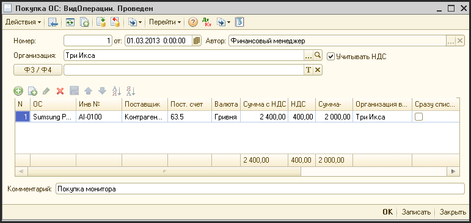

**Описание реквизитов шапки документа:**

| **Реквизит** | **Описание** |
| --- | --- |
| Номер | Уникальный номер документа (заполняется автоматически) |
| от  | Дата покупки ОС(НМА) (ввода в эксплуатацию) |
| Автор | Создатель документа |
| Организация | Фирма, которой ставится на баланс ОС (НМА) |
| Учитывать НДС | Флаг. Если флаг установлен, то расчеты с поставщиком ведутся с учетом НДС |

**Описание реквизитов табличной части документа:**

| **Реквизит** | **Описание** |
| --- | --- |
| ОС (НМА) | Элемент справочника «Основные средства». Перед созданием данного документа необходимо внести данное основное средство в справочник «Основные средства». |
| Инв. № | Инвентарный номер, установленный в справочнике |
| Поставщик | Контрагент, поставивший ОС (НМА) |
| Пост. счет | Счет взаиморасчетов с поставщиком |
| Валюта | Валюта взаиморасчетов с поставщиком |
| Сумма с НДС | Стоимость ОС (НМА) с НДС (в валюте взаиморасчетов) |
| НДС | Сумма НДС |
| Сумма | Стоимость ОС (НМА) без НДС (в валюте взаиморасчетов) |
| Организация владелец | Организация, в которой будет числиться ОС (НМА) |
| Сразу списывать | Флаг. Если установлен , то стоимость покупаемого основного средстве не будет амортизироваться, а будет сразу списывается на затраты организации в периоде проведения документа. |

## Автоматическая установка сроков полезного использования ОС

- Значение автоматической установки сроков полезного использования можно установить в двух местах:
  - В настройках системы по пункту меню «Операции - Настройки системы - Параметры по необоротным активам»
    - В форме редактирования параметров есть поле «Срок полезного использования по-умолчанию»

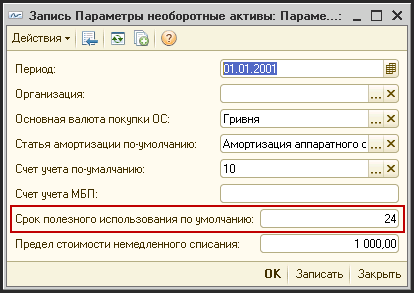

- - - Этот срок устанавливается по-умолчанию при создании объекта справочника «Основные средства»

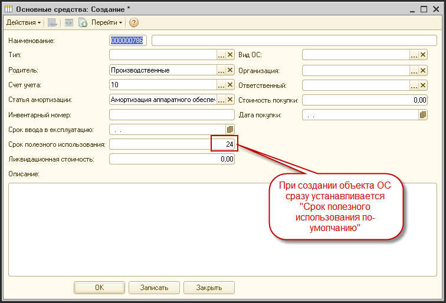

- - Второй способ позволяет установить срок полезного использования в зависимости от вида ОС и от его начальной стоимости
        - Для настройки таблицы сроков нужно выбрать пункт меню «Операции - Настройки системы - Вспомогательные - Сроки полезного использования ОС»
        - В таблице нужно заполнить, какие сроки полезного использования должны устанавливаться для определенных видов ОС

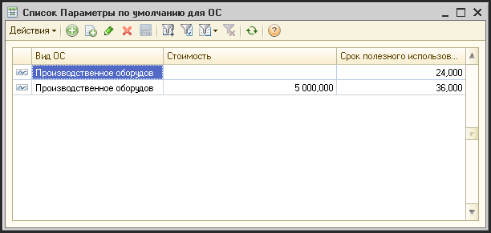

- - - Колонки:
            - Вид ОС - вид ОС, для которого действует этот срок
            - Стоимость - минимальная стоимость ОС, для которого начинает действовать этот срок полезного использования
      - На рисунке пример. Если это производственное оборудование со стоимостью до 5000 грн - срок использования 24 месяца, если больше - 36
      - Эти данные используются при создании объектов ОС, в справочнике «Основные средства»

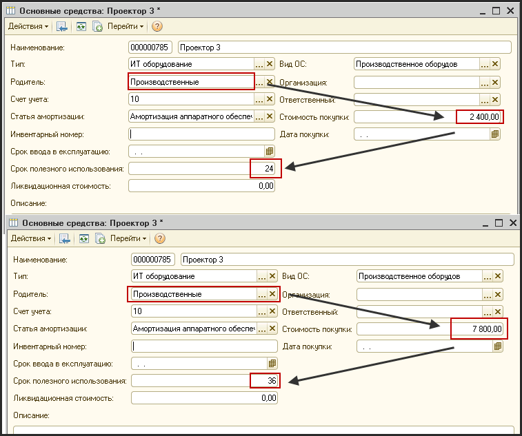

## Автоматическая установка флага «Сразу списать» при покупке ОС

- В системе можно установить предельную стоимость ОС, меньше которой ОС будут автоматически списываться сразу на затраты:
  - В настройках системы по пункту меню «Операции - Настройки системы - Параметры по необоротным активам»
    - В форме редактирования параметров есть поле «Предел стоимости немедленного списания»

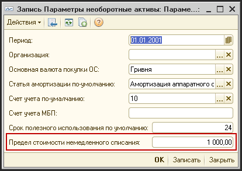

- - - При создании документа покупка ОС, если введенная стоимость меньше или равна установленному в настройках пределу, система автоматически в документе поставит птичку «Сразу списать на затраты»

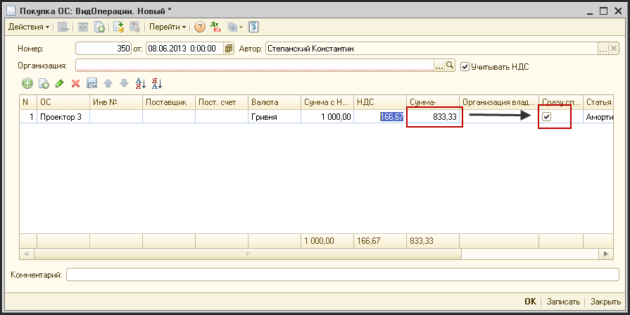

## Начисление амортизации ОС

Документ производит начисление управленческой амортизации на ОС (НМА), находящиеся в эксплуатации фирмы.

Доступ к документу:

- Финансовый директор;
- Директор, генеральный директор (только просмотр);
- Финансовый менеджер.

Путь к журналу документа: «Журналы - Основные средства - Начисление амортизации ОС».

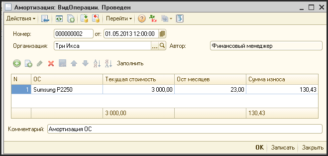

**Описание реквизитов шапки документа:**

| **Реквизит** | **Описание** |
| --- | --- |
| №   | Уникальный номер документа (заполняется автоматически и, обычно, ручное редактирование не требуется) |
| от  | Дата ввода начисления амортизации (обычно последний день месяца) |
| Организация | Фирма, по которой будет начислена амортизации |
| Автор | Создатель документа |

**Описание реквизитов табличной части документа:**

| **Реквизит** | **Описание** |
| --- | --- |
| ОС (НМА) | Основное средство |
| Ост. мес. | Количество месяцев, которое осталось эксплуатировать ОС (НМА) до полного износа (используется для прямолинейного алгоритма расчета амортизации) |
| Тек. стоимость | Текущая балансовая стоимость по управленческому учету |
| Сумма износа | Сумма начисленной за этот период амортизации |

**Описание дополнительных кнопок в форме:**

| **Реквизит** | **Описание** |
| --- | --- |
| Заполнить | Автоматически заполняется таблица всеми доступными для амортизации ОС. |

Список амортизируемых ОС заполняется двумя способами:

_1) Вручную._

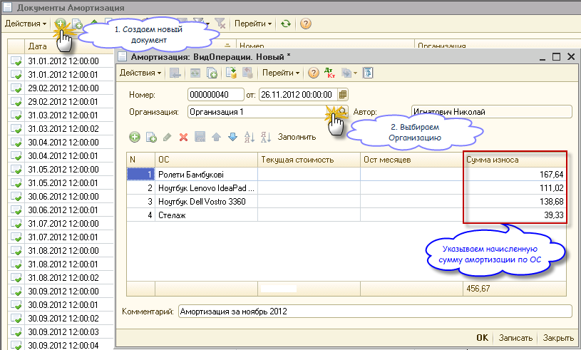

Данный метод удобно использовать, если учет ОС в системе в полной мере не ведется, но отчетности необходимо отображать затраты по амортизации ОС.

_2) Автоматически._

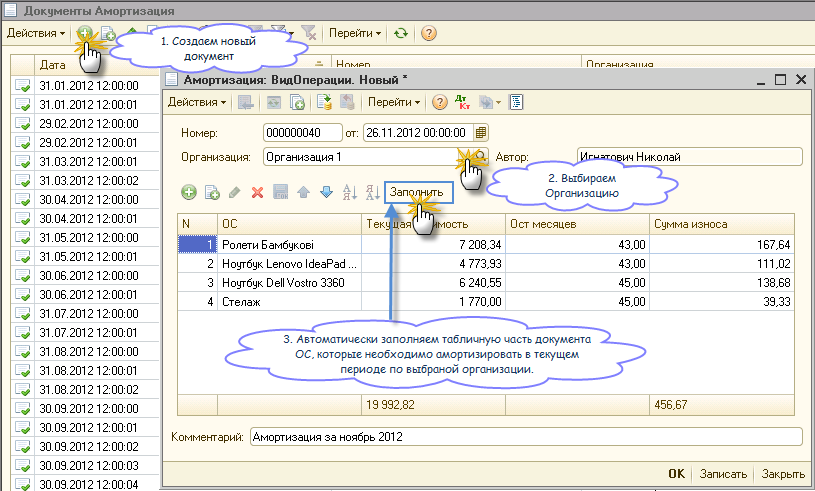

Документ производит автоматический расчет амортизации. Для этого нужно нажать кнопку «Заполнить» в панели инструментов документа.

После автоматического заполнения всех доступных для амортизации ОС можно отредактировать табличную часть документа, убрав ненужные строки.

Расчет амортизации производится на основании трех реквизитов необоротного актива:

- - начальная стоимость;
    - дата ввода в эксплуатацию;
    - срок полезного использования актива (в месяцах).

## Добавление компонентов к ОС

Документ «Добавление компонентов к ОС (НМА)» производит увеличение балансовой стоимости основного средства за счет модернизации или ремонта, произведенного третьими лицами.

Доступ к документу:

- Финансовый директор;
- Директор, генеральный директор (только просмотр);
- Финансовый менеджер.

Путь к журналу документа: «Журналы - Основные средства - Добавление компонентов к ОС».

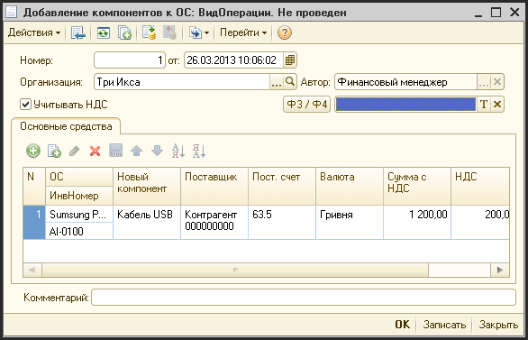

**Описание реквизитов шапки документа:**

| **Реквизит** | **Описание** |
| --- | --- |
| Номер | Уникальный номер документа (заполняется автоматически) |
| от  | Дата когда были добавлены новые компоненты к ОС (НМА) |
| Организация | Фирма, на чьем балансе находятся модернизируемые ОС (НМА) |
| Автор | Создатель документа |
| Учитывать НДС | Флаг. Если установлен, то расчеты с поставщиком выдуться с учетом НДС |
| Ф3/Ф4 | ??? |

**Описание реквизитов табличной части документа:**

| **Реквизит** | **Описание** |
| --- | --- |
| ОС (НМА) | Элемент справочника «Основные средства» |
| Инв. № | Инвентарный номер, установленный в справочнике |
| Новый компонент | Текстовое описание дополнительного оборудования установленного в ОС (НМА) или описание ремонта проведенного по этому ОС (НМА) |
| Поставщик | Контрагент, поставивший дополнительные компоненты |
| Пост. счет | Управленческий счет взаиморасчетов с поставщиком |
| Валюта | Валюта взаиморасчетов с поставщиком |
| Сумма с НДС | Стоимость дополнительного оборудования (ремонта) с НДС |
| НДС | Сумма НДС |
| Сумма - | Сумма без НДС |

## Списание ОС

Для списания ОС используется операция «Акт списания ОС».

Документ «Акт списания ОС» производит полное списание балансовой стоимости ОС (НМА) на затраты.

Доступ к документу:

- Финансовый директор;
- Директор, генеральный директор (только просмотр);
- Финансовый менеджер.

Путь к журналу документа: «Журналы - Основные средства - Акт списания ОС».

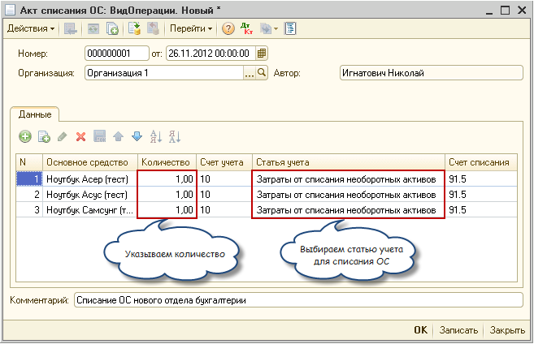

**Описание реквизитов шапки документа:**

| **Реквизит** | **Описание** |
| --- | --- |
| Номер | Уникальный номер документа (заполняется автоматически и, обычно, ручное редактирование не требуется) |
| от  | Дата списания ОС (НМА) |
| Организация | Фирма, ОС (НМА) которой списываются |
| Автор | Создатель документа |

**Описание реквизитов табличной части документа:**

| **Реквизит** | **Описание** |
| --- | --- |
| Основное средство | ОС (НМА), которое должно быть списано |
| Количество | Количество списываемого ОС (НМА) |
| Счет учета | Счет учета ОС (НМА) из управленческого Плана счетов |
| Статья учета | Статья учета для списания ОС (НМА) |
| Счет списания | Счет списания ОС (НМА) из управленческого плана счетов |

Документ списывает всю балансовую стоимость указанных ОС (НМА).

## Продажа ОС

Документ «Продажа ОС (НМА)» проводит операцию продажу ОС (НМА).

Доступ к документу:

- Финансовый директор;
- Директор, генеральный директор (только просмотр);
- Финансовый менеджер.

Путь к журналу документа: «Журналы - Основные средства - Продажа ОС».

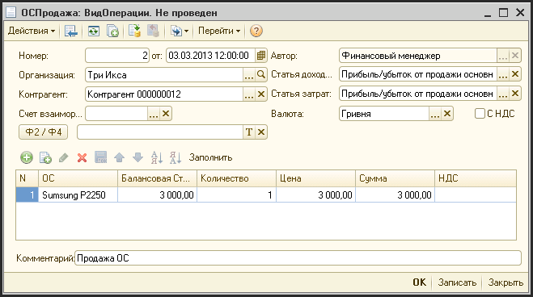

**Описание реквизитов шапки документа:**

| **Реквизит** |     | **Описание** |
| --- |     | --- |
| Номер |     | Уникальный номер документа (заполняется автоматически) |
| от  |     | Дата когда были добавлены новые компоненты к ОС (НМА) |
| Автор |     | Создатель документа |
| Организация |     | Фирма, ОС (НМА) которой продаются |
| Контрагент |     | Контрагент, которому продается ОС (НМА) |
| Статья доходов |     | Статья, на которую будет учитываться доход от продажи ОС |
| Статья затрат |     | Статья, на которую будет учитываться убыток от продажи ОС (если продажная цена ниже остаточной балансовой стоимости) |
| Счет взаимор. |     | ??? |
| Валюта |     | Валюта взаиморасчетов с покупателем |
| с НДС | Флаг. Если флаг установлен, то расчеты с поставщиком ведуться с учетом НДС |     |
| Ф2/Ф4 | ??? |     |
| Комментарий |     | Дополнительная текстовая информация |

**Описание реквизитов табличной части документа:**

| **Реквизит** | **Описание** |
| --- | --- |
| ОС  | ОС (НМА), которое продается. |
| Инв. № | Инвентарный номер, установленный в справочнике |
| Балансовая стоимость | Текущая балансовая стоимость ОС (НМА) (в рублях). Заполняется после нажатия кнопки «Заполнить бал. стоимость» |
| Количество |     |
| Цена |     |
| Сумма | Цена продажи ОС (НМА) в валюте взаиморасчетов |
| НДС | Сумма НДС |
| Сумма - | Сумма без НДС |

После заполнения «шапки» документа, формируем список продаваемых ОС:

_1) Вручную._

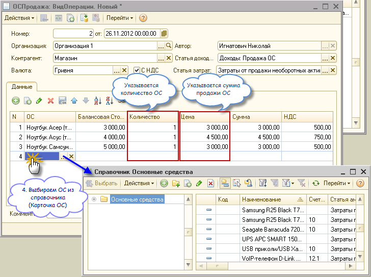

_2) Автоматически._

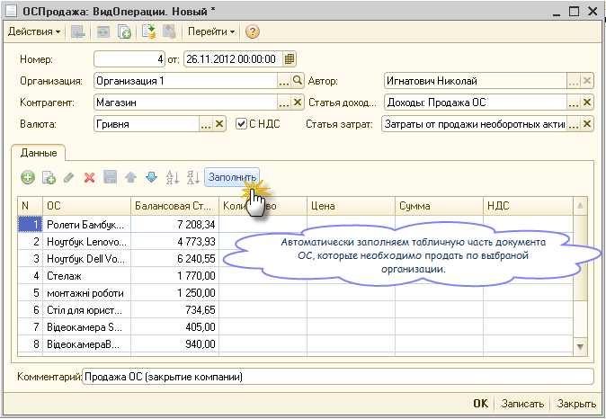

После автоматического заполнения всех доступных для продажи ОС можно отредактировать табличную часть документа, убрав ненужные строки.

## Перемещение ОС

Документ «Перемещение ОС (НМА)» используется для регистрации в системе факта перемещения ОС (НМА) внутри фирмы.

Доступ к документу:

- Финансовый директор;
- Директор, генеральный директор (только просмотр);
- Финансовый менеджер.

Путь к журналу документа: «Журналы - Основные средства - Перемещение ОС».

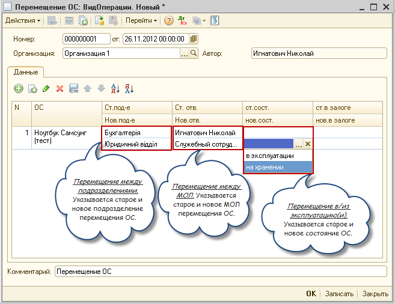

Перемещение может быть между:

- подразделениями организации;
- МОЛ;
- состояниями ОС - ввод в эксплуатации или вывод на хранение.

**Описание реквизитов шапки документа:**

| **Реквизит** | **Описание** |
| --- | --- |
| Номер | Уникальный номер документа (заполняется автоматически) |
| от  | Дата когда были добавлены новые компоненты к ОС (НМА) |
| Организация | Фирма, ОС (НМА) которой продаются |
| Автор | Создатель документа |
| Комментарий | Дополнительная информация по этому перемещению |

**Описание реквизитов табличной части документа:**

| **Реквизит** | **Описание** |
| --- | --- |
| ОС (НМА) | Перемещаемое ОС (НМА) |
| Ст. подразделение | Старое подразделение. Подразделение, в котором ранее использовалось ОС (НМА) |
| Нов. подразделение | Новое подразделение. Подразделение, в которое передается ОС (НМА) |
| Ст. отв. | Старый ответственный. Сотрудник, ранее ответственный за эксплуатацию ОС (НМА) |
| Нов. отв. | Новый ответственный. Сотрудник, на которого возлагается ответственность за ОС (НМА) после перемещения |
| Ст. сост. | Старое состояние ОС (НМА) |
| Нов. сост. | Новое состояние ОС (НМА) |
| Ст. в залоге | Старое в залоге. Флаг нахождения ОС (НМА) в залоге, до перемещения |
| Нов. в залоге | Новое в залоге. Флаг нахождения ОС (НМА) в залоге, после перемещения |

