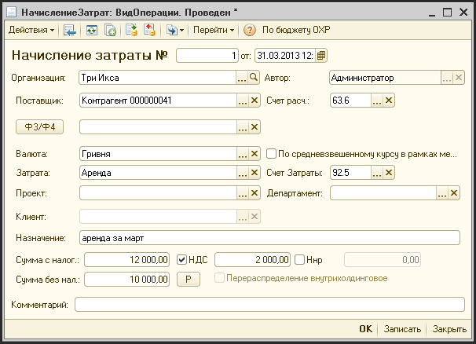

# Начисление затрат

> **Описание:** Описывает документ «Начисление затрат» — инструмент для операционных затрат по непроектной деятельности или дополнительных затрат на проекты. Приводится перечень реквизитов шапки документа с пояснениями, права доступа и путь к журналу документа.

---

Документ «Начисление затрат» производит начисление операционных затрат по непроектной деятельности, или начисления дополнительных затрат на проекты.

Доступ к документу:

- Финансовый директор;
- Директор, генеральный директор (только просмотр);
- Финансовый менеджер.

Путь к журналу документа: «Журналы - Затраты - Начисление затрат».

**Описание реквизитов шапки документа:**

| **Реквизит** | **Описание** |
| --- | --- |
| №   | Уникальный номер документа |
| от  | Дата начисления затраты |
| Организация | Фирма, по которой начисляется затрата |
| Автор | Создатель документа |
| Ф3/Ф4 | К данному начислению можно привязать форму (Ф3 или Ф4) |
| Поставщик | Контрагент, который является поставщиком услуг или сотрудник, который произвел эту затрату.  Перед заполнением этого поля система выдает список, какой тип будет иметь это поле \*(контрагенты или сотрудники) |
| Счет расч. | Счет взаиморасчетов с подрядчиком |
| Валюта | Валюта взаиморасчетов |
| По средневзвешенному курсу в рамках месяца | Флаг. Если установлен, то затрата начисляется по средневзвешенному курсу |
| Затрата | Статья затрат, на которую производится начисление |
| Счет затраты | Счет учета затраты (заполняется автоматически при выборе статьи затраты) |
| Проект | Если это дополнительная затрата по проекту, указать проект, на который списывается эта затрата |
| Департамент | Департамент , который отвечает за затрату |
| Назначение | Доп. Информация по этой затрате |
| Сумма с налогами | Сумма начисляемой затраты (с НДС и ННР) |
| НДС | Если флаг установлен, в поле указывается сумма НДС |
| НнР | Если флаг установлен, в поле указывается сумма налога на рекламу |
| Р   | Кнопка расчета суммы с налогами на основании суммы безх налогов |
| Перераспределение внутрихолдинговое | Флаг. Если установлен ??? |
| Сумма без нал. | Сумма без НДС и НнР |

