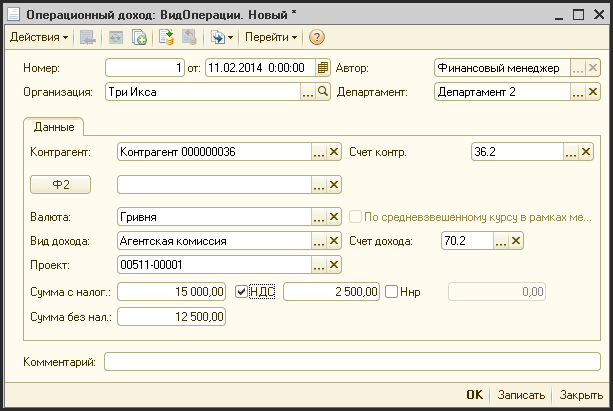

# Начисление доходов

> **Описание:** Описывает документ «Операционный доход» — инструмент для начисления операционных доходов по непроектной деятельности или дополнительных доходов по проектам. Приводится перечень реквизитов шапки документа: контрагент, валюта, вид дохода, проект, сумма с налогами. Доступно финансовому директору и менеджеру.

---

Документ «Операционный доход» производит начисление операционных доходов по непроектной деятельности, или начисления дополнительных доходов по проектам.

Доступ к документу:

- Финансовый директор;
- Директор, генеральный директор (только просморт);
- Финансовый менеджер.

Путь к журналу документа: «Журналы - Операционные доходы».

**Описание реквизитов шапки документа:**

| **Реквизит** | **Описание** |     |
| --- | --- |     |
| Номер | Уникальный номер документа |     |
| от  | Дата начисления затраты |     |
| Автор | Создатель документа |     |
| Организация | Фирма, по которой начисляется доход |     |
| Контрагент | Контрагент, который является получателем услуг |     |
| Счет контр. | Счет взаиморасчетов с контрагентом (обычно 36.2) |     |
| Валюта | Валюта взаиморасчетов |     |
| По средневзвешенному курсу в рамках месяца | Флаг. Если флаг установлен, то затрата начисляется по средневзвешенному курсу |     |
| Вид дохода | Статья доходов, на которую производится начисление |     |
| Счет дохода | Счет учета дохода (заполняется автоматически при выборе статьи дохода) |     |
| Проект | Если это дополнительный доход по проекту, ссылка на проект, на который начисляется этот доход |     |
| Сумма с налогами |     | Сумма начисляемой затраты (с НДС и ННР) |
| НДС |     | Если флаг установлен, в поле указывается сумма НДС |
| НнР |     | Если флаг установлен, в поле указывается сумма налога на рекламу |
| Р   |     | Кнопка расчета суммы с налогами на основании суммы безх налогов |
| Сумма без нал. |     | Сумма без НДС и НнР |
| Комментарий | Текстовое описание сути предоставляемой услуги |     |

