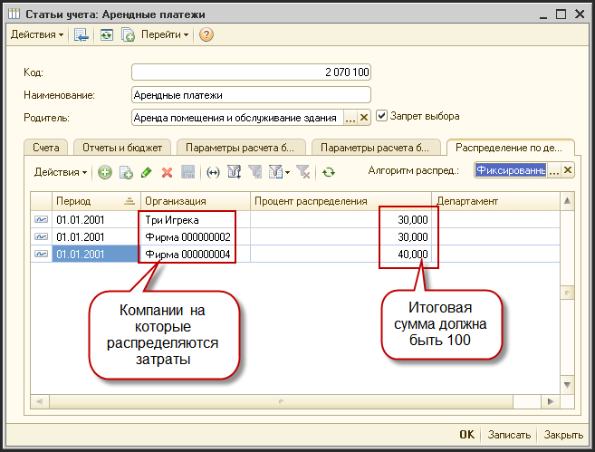
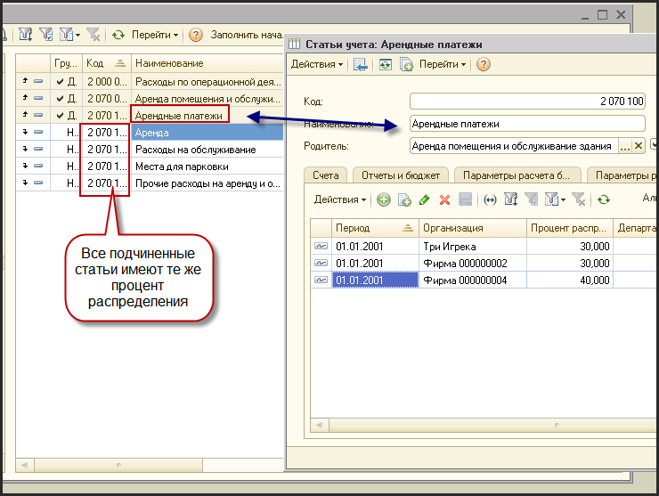
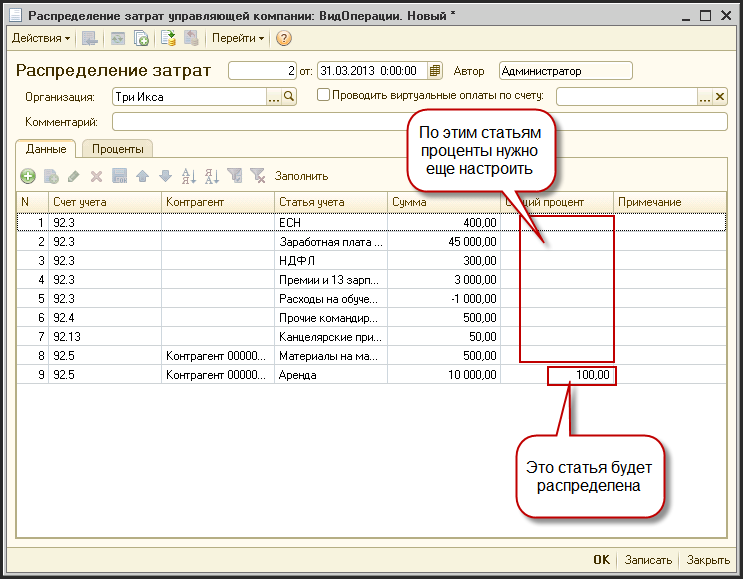
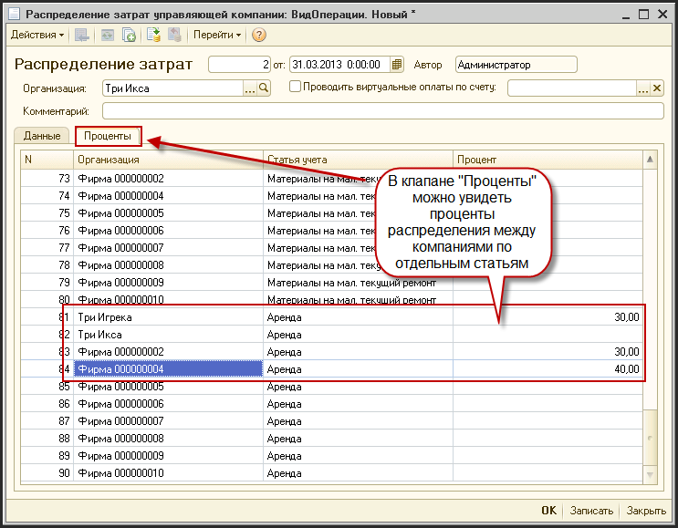

# Распределение затрат управляющей компании

> **Описание:** Описывает механизм автоматического распределения затрат управляющей компании холдинга по предприятиям-членам. Рассматривается: настройка процентов распределения в справочнике «Статьи учёта» (с поддержкой групповых статей) и проведение документа распределения затрат.

## Содержание

- [Установка процентов распределения](#установка-процентов-распределения)
- [Распределение затрат](#распределение-затрат)

---

## Установка процентов распределения

- Для того чтобы автоматически распределять затраты управляющей компании по членам холдинга, необходимо указать процент распределения затрат в справочнике «Статьи учета»
- Для этого нужно:
  - открыть справочник «Справочник - Статьи учета»
  - Выбрать нужную статью
  - перейти на закладку «Распределение по департаментам»

- - указать процентное распределение между компаниями холдинга
        - период - дата с которого действует это распределение. Т.о. образом проценты могут меняться во времени
        - Организация - организация для которой указывается процент
        - Департамент - не заполняем
        - Процент распределения - процент затрат, который относится к выбранной организации. Нужно заполнять строки так, чтобы общий процент на определенную дату всегда составлял 100%
        - Для того чтобы не заполнять проценты для каждой статьи в отдельности, можно определить процент распределения для групповой статьи. Все подчиненные статьи будут иметь тот же процент распределения
            - например, можно установить процент распределения для групповой статьи «Арендные платежи» и все подчиненные статьи будут иметь тот же процент распределения

## Распределение затрат

- Документ распределение затрат формируется уже после того как все затраты по управляющей компании внесены, начислены и проверены
- Открывается документ «Журнал - Затраты - Распределение затрат управляющей компании»
- Создается документ последним днем отчетного месяца, по управляющей компании
- Нажимаем кнопку «Заполнить»
- Выводится список всех затрат управляющей компании по статьям

- Проверяем чтобы у всех статей, которые должны распределяться на компании группы в колонке «Общий процент» стояло значение 100%
  - если нет, нужно проверить настройку распределения в статьях учета

- После проведение затраты из таблицы согласно процента распределения будет разнесены по компаниям группы

