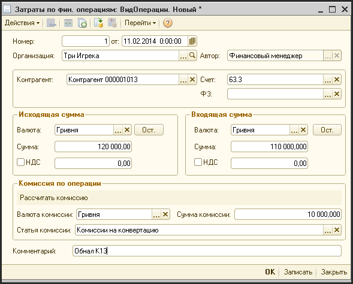

# Финансовые операции

> **Описание:** Глава описывает документ «Затраты по финансовым операциям» для операций конвертации валют и обналичивания. Приводится описание реквизитов (входящая/исходящая суммы, комиссия), права доступа и порядок заполнения документа.

## Содержание

- [Операции с финансовым подрядчиком](#операции-с-финансовым-подрядчиком)

---

## Операции с финансовым подрядчиком

Документ «Затраты по финансовым операциям» производит начисление затрат по финансовым операциям, проводимым фирмой с помощью внешнего подрядчика. С помощью данного документа можно провести операцию конвертации или обналичивания.

Доступ к документу:

- Финансовый директор;
- Финансовый менеджер.

Путь к журналу документа: «Журналы - Фин. операции - Затраты по фин. операциям».

**Описание реквизитов шапки документа:**

| **Реквизит** | **Описание** |
| --- | --- |
| Номер | Уникальный номер документа |
| от  | Дата проведения операции |
| Автор | Создатель документа |
| Организация | Фирма, по которой начисляется затраты |
| Контрагент | Контрагент, который проводит финансовую операцию или денежный счет организации (необходимо при заполнении поля сначала выбрать тип: Контрагенты или Денежные счета) |
| Счет учета | Счет взаиморасчетов с подрядчиком (обычно это 63.3) |
| Группа «Исходящая сумма» - сумма, которую фирма перечислила подрядчику |     |
| Валюта | Валюта перечисления |
| Кнопка «ОСТ» | Дебетовое сальдо на счете «Расчеты с подрядчиками по финансовой деятельности» по этому контрагенту в выбранной валюте |
| Сумма | Сумма перечисления |
| НДС | Флаг. Если флаг установлен, в поле указывается сумма НДС |
| Группа «Входящая сумма» - сумма, которая была передана подрядчиком фирме по завершению финансовой операции за вычетом комиссии и курсовой разницы |     |
| Валюта | Валюта прихода от подрядчика |
| Кнопка «ОСТ» | Кредитовое сальдо на счете «Расчеты с подрядчиками по финансовой деятельности» по этому контрагенту в выбранной валюте |
| Сумма | Сумма, переданная подрядчиком |
| Группа «Комиссия по операции» |     |
| Валюта комиссии | Валюта комиссии |
| Сумма комиссии | Сумма комиссии |
| Статья комиссии | Статья комиссии. Заполняется автоматически. |
| Комментарий |     |

Если это документ конвертации, необходимо заполнить исходящую и входящую сумму (группу реквизитов «Комиссия по операции» при этом заполнять не надо), после чего нажать кнопку «ОК» и система автоматически рассчитает курс и затраты или доходы по операции конвертации.

Если это операция обналичивания, то валюты всех групп реквизитов должны совпадать. Надо заполнить входящую сумму, исходящую сумму и нажать кнопку «Рассчитать». В этом случае, система рассчитает сумму комиссии и заполнит ею соответствующее поле в группе «Комиссии по операции»..

