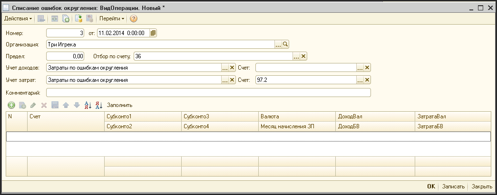

# Списание остатков округления

> **Описание:** Описывает документ «Списание ошибок округления» — инструмент для автоматического списания мелких курсовых ошибок, возникающих в мультивалютной среде при пересчёте сумм. Приводится описание реквизитов шапки и табличной части документа, доступ финансового директора и менеджера, а также порядок заполнения таблицы.

---

В мультивалютной среде, при пересчете сумм из валюты в валюту иногда возникает ситуация зависания сальдо на счетах учета в размере одной - двух копеек. Для автоматического списания этих остатков существует документ «Списание ошибок округления».

Доступ к этому документу имеет только финансовый директор и финансовый менеджер.

Для создания документа «Списание ошибок округления» нужно выбрать пункт меню «Журналы - Вспомогательные документы - Списание ошибок округления». Для добавления нового документа нажмите кнопку на панели инструментов журнала или нажать клавишу «Insert» на клавиатуре. После этого на экране появиться форма ввода документа «Списание ошибок округления»:

**Описание реквизитов шапки документа:**

| **Реквизит** | **Описание** |
| --- | --- |
| Номер | Уникальный номер документа (заполняется автоматически и, обычно, ручное редактирование не требуется) |
| от  | Дата списания ошибок округления |
| Организация | Организация, по которой ведется учет в этой системе |
| Предел | Предел ниже которого сальдо на счету считается ошибкой округления |
| Отбор по счету | Счет, по которому ищем ошибки округления (указываем , если необходимо) |
| Учет доходов | Статья доходов, куда списывать ошибку округления |
| Счет | Счет, соответствующий статье доходов |
| Учет затрат | Статья затрат, куда списывать ошибку округления |
| Счет | Счет, соответствующий статье затрат |
| Комментарий | Дополнительная информация по этому документу |

**Описание реквизитов табличной части документа:**

| **Реквизит** | **Описание** |
| --- | --- |
| Счет | Счет учета, на котором храниться сальдо ниже установленного предела |
| Субконто1 | Первая аналитика по счету учета |
| Субконто2 | Вторая аналитика по счету учета |
| Валюта | Валюта, в которой хранится валютное сальдо |
| Доход вал. | Кредитовое валютное сальдо на счету |
| Доход БВ | Кредитовое сальдо в гривне |
| Затрата вал. | Дебетовое валютное сальдо на счету |
| Затрата БВ | Дебетовое сальдо в гривне |

Табличная часть заполняется автоматически после нажатия кнопки «Заполнить». Пользователь может убрать строки, которые нужно оставить на сальдо. Однако, нежелательно делать какие-либо ручные изменения в табличной части. Это может привести к искажению остатков на счетах.

