# Бюджетирование

> **Описание:** Обзорная глава по всем видам бюджетирования в системе. Рассматривается: общий порядок бюджетирования, типы и версии бюджетов, клиентские бюджеты (настройка коэффициентов, создание, планирование ДДС), бюджеты ОХР и персонала, бюджет финансовых операций, корректировки ДДС и плановый баланс.

## Содержание

- [Общий порядок бюджетирования](#общий-порядок-бюджетирования)
- [Клиентские бюджеты](#клиентские-бюджеты)
- [Бюджеты ОХР](#бюджеты-охр)
- [Бюджет по персоналу](#бюджет-по-персоналу)
- [Бюджет финансовых операций](#бюджет-финансовых-операций)
- [Корректировка планового ДДС](#корректировка-планового-ддс)
- [Ручная бюджетная операция](#ручная-бюджетная-операция)
- [Подготовка планового баланса](#подготовка-планового-баланса)

---

## Общий порядок бюджетирования

### Типы бюджетов

Предусмотрены такие типы клиентских бюджетов:

| **Тип** | **Дата документа "Бюджет по проектам"** | **Период планирования** | **Период подготовки** |
| --- | --- | --- | --- |
| Прогноз 0, Год | 31.12.(Год-1) | январь.Год - декабрь.Год | октябрь-декабрь.(Год-1) |
| Прогноз 1, Год | 31.03.Год | апрель-декабрь.Год | март.Год |
| Прогноз 2, Год | 30.06.Год | июль-декабрь,Год | июнь.Год |
| Прогноз 3, Год | 30.09.Год | октябрь-декабрь.Год | сентябрь.Год |

_Год - год бюджетирования_

### Версии бюджетов

- Все бюджетные документы формируют проводки по бюджетному плану счетов
- Первой аналитикой каждого бюджетного счета является аналитика «Версия бюджета»
- Эта аналитика разделяет разные версии бюджетов в одном периоде
- Версии бюджета - это отдельный справочник, который нужно заполнять до формирования бюджета, иначе бюджетные документы проводится не будут.
- пункт меню: «Справочник - Бюджетирование - Версии бюджета»:

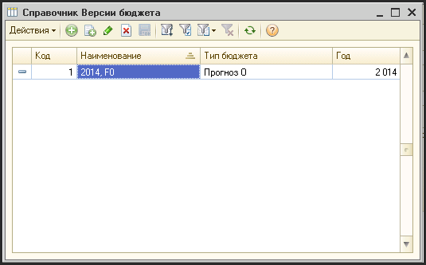

### Порядок построения бюджета

- Подготовка к бюджетированию
  - Эккаунт-директора пересматривают коэффициенты по клиентам
  - Финансовые менеджеры вносят корректировки в клиентские коэффициенты
  - АХ-менеджер пересматривает коэффициенты ДДС по ОХР бюджетам

## Клиентские бюджеты

### Порядок создания клиентских бюджетов

Клиентские бюджеты создают и корректируют клиентские менеджеры, которые работают с этим клиентом.

Клиентские бюджеты по сквозным работам (когда размещением для фронтального агентства занимается баинговое агентство) создает эккаунт фронтального агентства, с указанием соответствующего баингового агенства. В бюджет баингового агентства данные по этому клиенту поступят автоматически.

За проведение клиентских бюджет отвечают финансовые менеджеры соответствующих фронтальных агентств:

- Эккаунт помечают бюджет как подготовленный
- Система информирует финансового менеджера о необходимости провести клиентский бюджет
- Финансовый менеджер проверяет правильность составления бюджета
- Финансовый менеджер проводит бюджет
- При необходимости финансовый менеджер так же корректирует коэффициенты в карточке клиента.

### Настройка параметров бюджетирования по клиенту

#### Типы коэффициентов по проектному клиенту

Т.к. при бюджетировании и при построении предварительной отчетности точно не известны многие параметры проектных бюджетов, в системе используется алгоритмы расчета на основании коэффициентов.

По проектному клиенту можно установить такие типы коэффициентов:

- АВБ (суперкомиссия от подрядчиков) - данные коэффициенты используются при формировании бюджетов по проектам и при предварительном начислении АВБ за период (если по проектным работам не заполнена затратная часть)
- ФЕЕ (процент комиссии по проектам) - используется при проектном бюджетировании.
- ПРИПС (суперкомиссия от клиентов) - используется при проектном бюдетировании.
- ПФД (ССО) - данные коэффициенты используются при формировании бюджетов по проектам и при предварительном начислении ПФД за период (если по проектным работам не заполнена затратная часть). Так же данные проценты используются для корректировки распределения медиаразницы между фронтальным и баинговым агенством.
- Рентабельность - определяет верхний и нижний предел рентабельности работы с клиентом по направлениям. От этого коэффициента зависит только цвет строки с проектом в списке проектов (красный или черный).
- Медиаразницы - средний процент рентабельности при работе с клиентом по направлению. Данные коэффициенты используются при формировании бюджетов по проектам и при предварительном расчете себестоимости размещения за период (если по проектным работам не заполнена затратная часть).
- Налоги - эти коэффициенты определяют базу налогообложения, по которой идут взаиморасчетов с клиентом (есть НДС или нет). Данные коэффициенты используются проектного бюджетирования (для расчетов оборота с налогами и бюджетирования ДДС)
- Ретробонусы - данные коэффициенты определяют шкалу ретробонусов по данному клиенту по различным сейлзхаузам. Эти коэффициенты используются при начислении ретробонусов.
- ДДС - группа коэффициентов, которые используются ждля автоматического формирования бюджета ДДС на основании бюджета проектных работ.

#### Карточка коэффициентов по клиенту

В форме редактирования клиента внизу есть кнопка «Печать карточки коэф.».

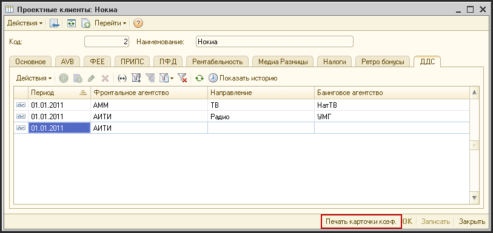

При нажатии на кнопку появляется отчет «Карточка клиентских коэффициентов»:

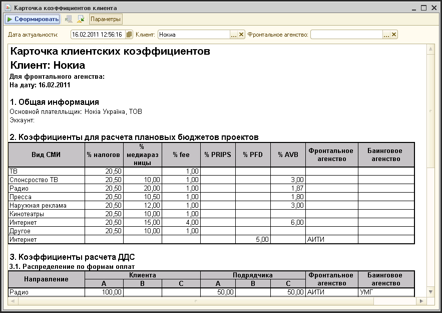

В данной карточке можно менять дату актуальности коэффициентов, самого клиента и фильтровать по определенному фронтальному агентству (в список попадут коэффициент актуальные только для этого фронтального агентства).

#### Заполнение коэффициентов

Право на редактирование коэффициентов по клиентам имеет пользователя с ролью «СПР».

Коэффициенты:

- АВБ
- ПРИПС
- ПФД
- ФЕЕ
- Медиаразницы
- Налоги

могут сохраняться из проектных бюджетов. При этом данные коэффициенты будут привязаны к фронтальному агентству, баинговому агентству и направлению (по строке проектного бюджета).

Так же эти коэффициенты могут загружаться в проектные бюджеты (колонки с желтым фоном):

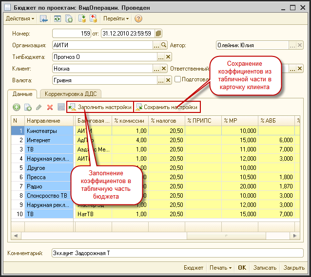

При сохранении коэффициентов, они будут установлены с начала следующего за датой бюджета дня.

##### АВБ (суперкомиссия от подрядчиков)

В отличии от процентов АВБ, которые устанавливаются для конкретных сейлзхаузов на конкретные направления, данные коэффициенты будут использоваться для проектного бюджетирования или для работ с незаполненной затратной частью, когда еще не известно какой конкретный подрядчик будет выполнять работу.

Коэффициент по АВБ редактируются прямо в таблице.

- Период - дата и время с которой актуальны проценты в в данной строке. Время должно быть 00.00.00
- ФА - фронтальное агентство, по работам которого действует процент в этой строке. Если не выбрано - процент действует для тех фронтальных агентств, для которых не установлен собственный процент;
- БА - баинговое агентство, по работам которого действует процент в этой строке. Если не выбрано - процент действует для тех баинговых агентств, для которых не установлен собственный процент;
- Направление проектов -вид СМИ, по которого действует процент в этой строке. Если не выбрано - процент действует для тех видов СМИ, для которых не установлен собственный процент;
- % АВБ - процент АВБ (в процентах)

При поиске нужного процента система ищет по принципу максимального совпадения:

- Сначала чтобы совпадали и ФА и БА и Направление
- Потом только пара параметров
- Потом один
- И потом ищет процент со всеми пустыми параметрами

##### ФЕЕ (процент комиссии)

Процент комисии редактируются прямо в таблице.

- Период - дата и время с которой актуальны проценты в в данной строке. Время должно быть 00.00.00
- ФА - фронтальное агентство, по работам которого действует процент в этой строке. Если не выбрано - процент действует для тех фронтальных агентств, для которых не установлен собственный процент;
- Направление проектов -вид СМИ, по которого действует процент в этой строке. Если не выбрано - процент действует для тех видов СМИ, для которых не установлен собственный процент;
- % фее - процент комиссии (в процентах)

При поиске нужного процента система ищет по принципу максимального совпадения:

- Сначала чтобы совпадали и ФА и Направление
- Потом только ФА
- Потом только направление
- И потом ищет процент со всеми пустыми параметрами

##### ПРИПС (суперкомиссия от клиентов)

Процент ПРИПС редактируются прямо в таблице.

- Период - дата и время с которой актуальны проценты в в данной строке. Время должно быть 00.00.00
- ФА - фронтальное агентство, по работам которого действует процент в этой строке. Если не выбрано - процент действует для тех фронтальных агентств, для которых не установлен собственный процент;
- Направление проектов -вид СМИ, по которого действует процент в этой строке. Если не выбрано - процент действует для тех видов СМИ, для которых не установлен собственный процент;
- % ПРИПС - процент комиссии (в процентах)

При поиске нужного процента система ищет по принципу максимального совпадения:

- Сначала чтобы совпадали и ФА и Направление
- Потом только ФА
- Потом только направление
- И потом ищет процент со всеми пустыми параметрами

##### ПФД (ССО)

На просмотр данная информация доступна только для финансовых менеджеров, директоров соответствующих компаний и эккаунтов, которые имеют доступ к начислению ПФД по этому клиенту.

Процент ПФД редактируются прямо в таблице.

- Период - дата и время с которой актуальны проценты в в данной строке. Время должно быть 00.00.00
- ФА - фронтальное агентство, по работам которого действует процент в этой строке. Если не выбрано - процент действует для тех фронтальных агентств, для которых не установлен собственный процент;
- Направление проектов -вид СМИ, по которого действует процент в этой строке. Если не выбрано - процент действует для тех видов СМИ, для которых не установлен собственный процент;
- % ПФД - процент комиссии (в процентах)

При поиске нужного процента система ищет по принципу максимального совпадения:

- Сначала чтобы совпадали и ФА и Направление
- Потом только ФА
- Потом только направление
- И потом ищет процент со всеми пустыми параметрами

##### Рентабельность

- Период - дата и время с которой актуальны проценты в в данной строке. Время должно быть 00.00.00
- Направление проектов -вид СМИ, по которого действует процент в этой строке. Если не выбрано - процент действует для тех видов СМИ, для которых не установлен собственный процент;
- Нижняя граница - нижняя граница рентабельности по данному клиенту-направлениею;
- Верхняя граница - верхняя граница рентабельности по этому клиенту-направлениею

##### Медиа разницы

Коэффициент по МР редактируются прямо в таблице.

- Период - дата и время с которой актуальны проценты в в данной строке. Время должно быть 00.00.00
- ФА - фронтальное агентство, по работам которого действует процент в этой строке. Если не выбрано - процент действует для тех фронтальных агентств, для которых не установлен собственный процент;
- БА - баинговое агентство, по работам которого действует процент в этой строке. Если не выбрано - процент действует для тех баинговых агентств, для которых не установлен собственный процент;
- Направление проектов -вид СМИ, по которого действует процент в этой строке. Если не выбрано - процент действует для тех видов СМИ, для которых не установлен собственный процент;
- % МР - процент АВБ (в процентах)

При поиске нужного процента система ищет по принципу максимального совпадения:

- Сначала чтобы совпадали и ФА и БА и Направление
- Потом только пара параметров
- Потом один
- И потом ищет процент со всеми пустыми параметрами

##### Налоги

Процент налогов редактируются прямо в таблице.

- Период - дата и время с которой актуальны проценты в в данной строке. Время должно быть 00.00.00
- ФА - фронтальное агентство, по работам которого действует процент в этой строке. Если не выбрано - процент действует для тех фронтальных агентств, для которых не установлен собственный процент;
- Направление проектов -вид СМИ, по которого действует процент в этой строке. Если не выбрано - процент действует для тех видов СМИ, для которых не установлен собственный процент;
- % ПФД - процент комиссии (в процентах)

При поиске нужного процента система ищет по принципу максимального совпадения:

- Сначала чтобы совпадали и ФА и Направление
- Потом только ФА
- Потом только направление
- И потом ищет процент со всеми пустыми параметрами

##### Ретробонусы

- Период - дата и время с которой актуальны проценты в в данной строке. Время должно быть 00.00.00
- ФА - фронтальное агентство, по работам которого действует процент в этой строке. Если не выбрано - процент действует для тех фронтальных агентств, для которых не установлен собственный процент;
- БА - баинговое агентство, по работам которого действует процент в этой строке. Если не выбрано - процент действует для тех баинговых агентств, для которых не установлен собственный процент;
- Сейлзхауз (обязательный параметр) - сейлзхауз, для которого рассчитываются ретробонусы.
- Клиент (обязательный параметр) - клиент по которому рассчитываются ретробонусы
- Направление проектов -вид СМИ, по которого действует процент в этой строке. Если не выбрано - процент действует для тех видов СМИ, для которых не установлен собственный процент;
- Порог клиента 1 - медийный оборот по достижению которого применяется «Процент клиента 1»
- …
- Порог клиента 6 - медийный оборот по достижению которого применяется «Процент клиента 6»
- Порог подрядчика 1 - баинговый оборот по достижению которого применяется «Процент подрядчика 1»
- …
- Порог подрядчика 6 - баинговый оборот по достижению которого применяется «Процент подрядчика 6»

##### ДДС (коэффициенты расчета ДДС по клиенту)

Коэффициентов по расчету ДДС по проектам очень много, в строке их редактировать неудобно, поэтому коэффициенты по ДДС редактируются в отдельной форме:

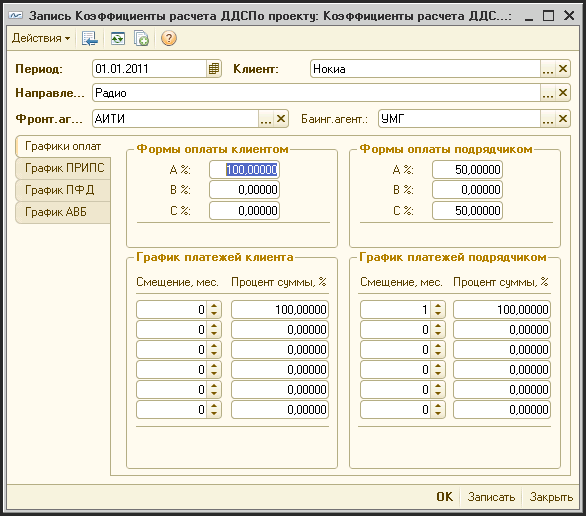

- Период - дата и время с которой актуальны проценты в в данной строке. Время должно быть 00.00.00
- ФА - фронтальное агентство, по работам которого действуют проценты в этой строке. Если не выбрано - проценты действуют для тех фронтальных агентств, для которых не установлен собственные проценты;
- БА - баинговое агентство, по работам которого действуют проценты в этой строке. Если не выбрано - проценты действуют для тех баинговых агентств, для которых не установлен собственные проценты;
- Клиент (обязательный параметр) - клиент по которому рассчитываются проценты
- Направление проектов -вид СМИ, по которого действуют проценты в этой строке. Если не выбрано - проценты действуют для тех видов СМИ, для которых не установлены собственные проценты;
- Закладка «График оплат»:
  - Формы оплаты клиентом - определяют распределяют входящие оплаты от клиента по формам оплаты. Общая сумма процентов должна быть равна 100 иначе строка не сохранится
  - Формы оплаты подрядчиком - определяют распределяют входящие оплаты от клиента по формам оплаты. Общая сумма процентов должна быть равна 100 иначе строка не сохранится
  - График платежей клиента - определяет смещение оплат от клиента по сравнению с периодом размещения и процент оплат в указанный месяц. Итоговая сумма процентов не должна превышать 100%. Если сумма меньше 100%, то остаток относится на месяц размещения. По особенностям заполнения смещения см. [Заполнение смещений по месяцам в графика платежей](#_Заполнение_смещений_по_месяцам%20в%20гр)
  - График платежей подрядчика - определяет смещение оплат подрядчику по сравнению с периодом размещения и процент оплат в указанный месяц. Итоговая сумма процентов не должна превышать 100%. По особенностям заполнения смещения см. [Заполнение смещений по месяцам в графика платежей](#_Заполнение_смещений_по_месяцам%20в%20гр)
- Закладка «График ПРИПС» - определяет распределение оплат ПРИПС по отношению к месяцу начисления:
  - Смещение мес. - смещение месяцев по отношению к месяцу начисления. По особенностям заполнения смещения см. [Заполнение смещений по месяцам в графика платежей](#_Заполнение_смещений_по_месяцам%20в%20гр).
  - Тип оплаты - может принимать два значения:
    - Оплата - ПРИПС будет выплачен агентству
    - Зачет - сумма начисленного ПРИПС пойдет в счет уменьшения платежей клиента
  - Процент суммы - процент суммы, который будет оплачен или засчитан
- Закладка «ПФД»
  - График выплаты ПФД (аналогично ПРИПС)
  - Параметры выплаты ПФД
    - По сумме оплат - ПФД выплачивается по сумме оплат за период
    - По сумме начислений - ПФД выплачивается по сумме клиентского оборота за период
- Закладка «График АВБ» - определяет распределение оплат АВБ по отношению к месяцу начисления:
  - Смещение мес. - смещение месяцев по отношению к месяцу начисления. По особенностям заполнения смещения см. [Заполнение смещений по месяцам в графика платежей](#_Заполнение_смещений_по_месяцам%20в%20гр).
  - Тип оплаты - может принимать два значения:
    - Оплата - АВБ будет выплачен баинговому агентству
    - Зачет - сумма начисленного АВБ пойдет в счет уменьшения счетов о т подрядчика
  - Процент суммы - процент суммы, который будет оплачен или засчитан

#### Заполнение смещений по месяцам в графика платежей

Поля «Смещение мес» могут принимать такие значения:

- 0 - оплата производится в месяце начисления
- \-1 … -12 - предоплата за указанное количество месяцев от даты начисления
- 1 … 12 - постоплата по истечению указанного количества месяцев от даты начисления
- 101 … 112 - оплата в конкретном месяце (номер месяца определяется по двум последним цифрам)
- ННККОО - пятизначное или шестизначное число. Определяет начисления за какой период оплачиваются в каком месяце:
  - НН - начало периода, может принимать значение от 1 до 12
  - КК - конец периода, может принимать значение от 01 до 12
  - ОО - месяц оплаты, может принимать значение от 01 до 12
  - Например:
    - 10607 - начисления с января по июнь будут оплачены в июле
    - 80907 - начисления за август и сентябрь должны быть предоплачены июле
  - Желательно не сочетать этот тип смещения с другими.
  - НН не может быть больше КК
  - НН и КК не могут быть меньше 01 и больше 12
  - ОО может быть больше 12, что указывает на оплату следующим годом
  - Если используется этот тип смещения, итоговое значение по процетам может быть больше 100%. Например: первая запись 10607 = 100%, 71212 = 100%. Это значит что 100% начислений за первое полугодие будет оплачено в июле и 100% начислений за второе полугодие будет оплачено в декабре

### Создание нового бюджета по клиенту

1\. Открываем журнал проектных бюджетов (пункт меню "Бюджетирование - Клиентские бюджеты", у финансовых менеджеров пункт меню "Журналы - Бюджетиорование - Клиенсткие бюджеты")

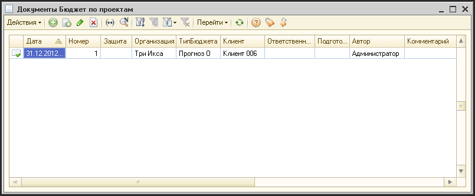

2\. Создаем новый документ "Проектный бюджет"

2.1. Заполняем реквизиты шапки:

- "от" - дата ввода бюджета, в зависимости от типа вводимого бюджета нужно устанавливать правильную дату. Значения которые нужно устанавливать см. в колонке "Дата документа "Бюджет по проекта" в таблице типов бюджета (см. [Типы клиентских бюджетов](#_Типы_клиентских_бюджетов)). В зависимости от установленной даты будет установлено количество колонок с месяцами в табличной части.
- "Организация" - агентство, которая работает с клиентом
- "Тип бюджета" - тип бюджета который вносится (см. [Типы клиентских бюджетов](#_Типы_клиентских_бюджетов))
- "Клиент" - клиент по которому заполняется бюджета
- "Ответственный за бюджет" - автоматически заполняется текущий пользователь. Финансовый менеджер может менять значение в этом поле.
- "Валюта" - валюта бюджетирования. Валюта, в которой будут указываться суммы в табличной части.
- Департамент - департамент, который отвечает за этот бюджет
- "Основание" - дополнительная информация по этому бюджету.

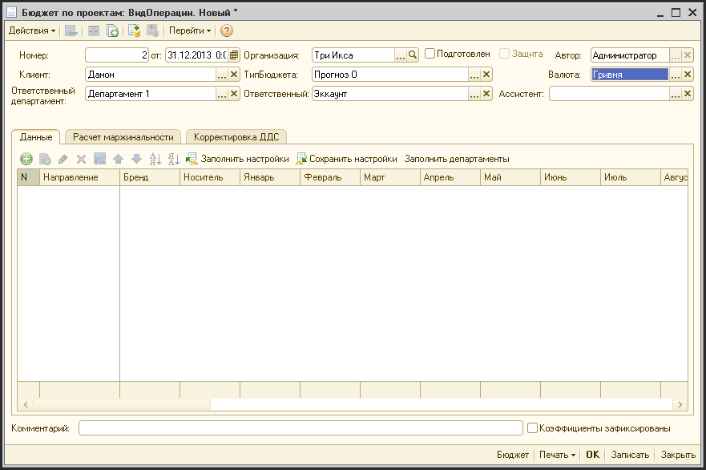

2.2. Заполняем табличную часть бюджета. Заполняется сумма НЭТ на каждый месяц бюджетирования (без налогов и комиссии в валюте бюджета, указанной в шапке документа) на каждый вид СМИ.

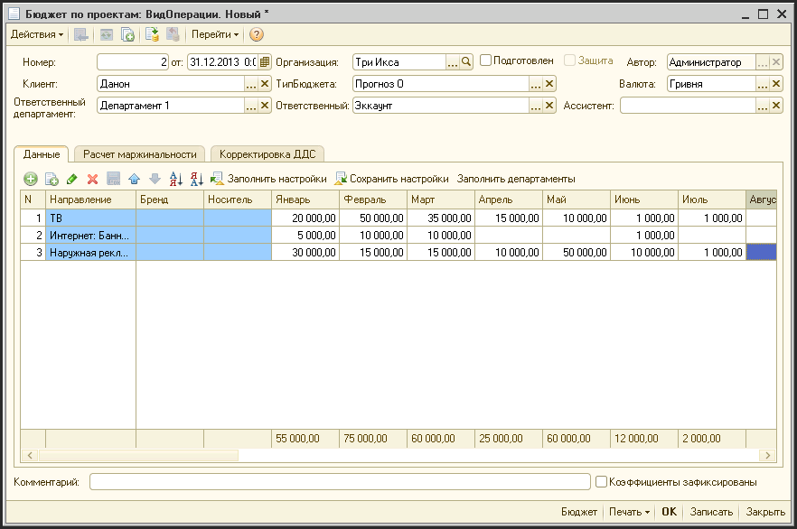

2.3. Настраиваем таблицу коэффициентов котопрыеи находятся в колонках справа от колонок с суммами

Можно настроить такие параметры:

- Баинговая компания - по умолчанию заполняется организация, однако, если это сквозной проект, когда с клиентом работает одно агенство, а с подрядчиком другое - здесь нужно выбирать оргнизацию, которая работает с подрядчиком
- % комиссии - процент агентской комиссии
- % налогов - процент налогов, для расчета сумм с налогами. Обычно указывается значение 18 (НДС)
- % АВБ - процент АВБ, который обычно начисляется по этому направлению по этому клиенту (экспертная оценка, на основании предыдущих размещений)
- % ПРИПС - процент суперкомиссий, которые клиент платит при достижении установленных в договоре результатов.
- % МР - маржинальнойсть разещения/услуг. Здесь указывается общая маржинальность размещения/услуг по этому направлению. Процент между медийныйм оборотом (сумма НЭТ клиента) и баинговым оборотом (суммой НЭТ на подрядчиков).
- % ПФД (доступ имеет только финансовый менеджер) - процент ПФД
- РМР % - процент распределения прибыли между фронтальным и баинговым агентствами
- % РБ клиенту - процент ретробонусов, которые возвращаются клиенту
- % РБ от подрядчиков - процент ретробонусов, которые получаются от подрядчика

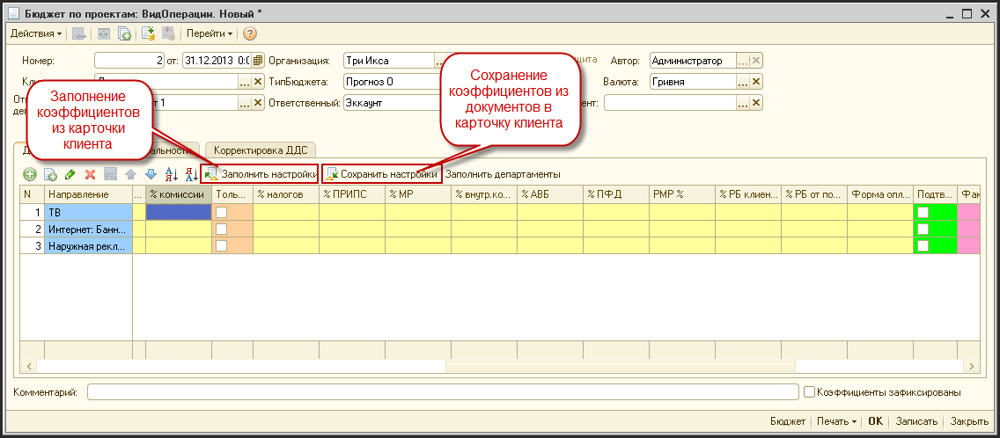

2.4. После заполнения бюджетов по всем направлениям и настройки процентов, можно проконтролировать правильность заполнения, создав отчет по этому бюджету. Для этого нужно нажать на кнопку "Печать".

2.5. Сохраняем бюджет. При первом сохранении бюджет не проводится.

### Проведение бюджета по клиенту

Провести бюджет может только финансовый менеджер фронтального агентства.

Эккаунт, который подготовил бюджет должен в бюджете отметить флаг "Подготовлен".

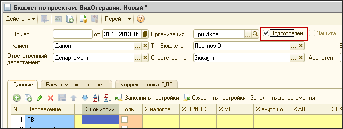

После сохранения система проинформирует финансового менеджера фронтального агентства о необходимости провести клиентский бюджет.

### Создание копии бюджета по клиенту

При создании корректировок по бюджетам для уменьшения объема ручного ввода информации необходимо пользоваться механизмом копирования документов.

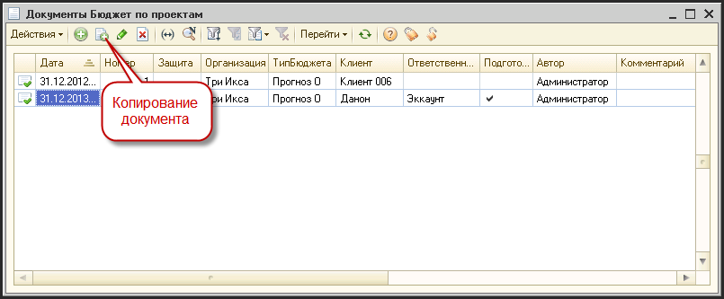

Создав бюджет типа "Прогноз 0" в декабре, можно скопировать его в конце марта, поменять дату и откорректировать только нужные суммы - создать бюджет по «Прогнозу 1».

### Планирование движений денежных средств по клиентским бюджетам

#### Настройка параметров расчета ДДС

Коэффициентов по расчету ДДС по проектам очень много, в строке их редактировать неудобно, поэтому коэффициенты по ДДС редактируются в отдельной форме:

- Период - дата и время с которой актуальны проценты в в данной строке. Время должно быть 00.00.00
- ФА - фронтальное агентство, по работам которого действуют проценты в этой строке. Если не выбрано - проценты действуют для тех фронтальных агентств, для которых не установлен собственные проценты;
- БА - баинговое агентство, по работам которого действуют проценты в этой строке. Если не выбрано - проценты действуют для тех баинговых агентств, для которых не установлен собственные проценты;
- Клиент (обязательный параметр) - клиент по которому рассчитываются проценты
- Направление проектов -вид СМИ, по которого действуют проценты в этой строке. Если не выбрано - проценты действуют для тех видов СМИ, для которых не установлены собственные проценты;
- Закладка «График оплат»:
  - Формы оплаты клиентом - определяют распределяют входящие оплаты от клиента по формам оплаты. Общая сумма процентов должна быть равна 100 иначе строка не сохранится
  - Формы оплаты подрядчиком - определяют распределяют входящие оплаты от клиента по формам оплаты. Общая сумма процентов должна быть равна 100 иначе строка не сохранится
  - График платежей клиента - определяет смещение оплат от клиента по сравнению с периодом размещения и процент оплат в указанный месяц. Итоговая сумма процентов не должна превышать 100%. Если сумма меньше 100%, то остаток относится на месяц размещения. По особенностям заполнения смещения см. [Заполнение смещений по месяцам в графика платежей](#_Заполнение_смещений_по_месяцам%20в%20гр)
  - График платежей подрядчика - определяет смещение оплат подрядчику по сравнению с периодом размещения и процент оплат в указанный месяц. Итоговая сумма процентов не должна превышать 100%. По особенностям заполнения смещения см. [Заполнение смещений по месяцам в графика платежей](#_Заполнение_смещений_по_месяцам%20в%20гр)
- Закладка «График ПРИПС» - определяет распределение оплат ПРИПС по отношению к месяцу начисления:
  - Смещение мес. - смещение месяцев по отношению к месяцу начисления. По особенностям заполнения смещения см. [Заполнение смещений по месяцам в графика платежей](#_Заполнение_смещений_по_месяцам%20в%20гр).
  - Тип оплаты - может принимать два значения:
    - Оплата - ПРИПС будет выплачен агентству
    - Зачет - сумма начисленного ПРИПС пойдет в счет уменьшения платежей клиента
  - Процент суммы - процент суммы, который будет оплачен или засчитан
- Закладка «ПФД»
  - График выплаты ПФД (аналогично ПРИПС)
  - Параметры выплаты ПФД
    - По сумме оплат - ПФД выплачивается по сумме оплат за период
    - По сумме начислений - ПФД выплачивается по сумме клиентского оборота за период
- Закладка «График АВБ» - определяет распределение оплат АВБ по отношению к месяцу начисления:
  - Смещение мес. - смещение месяцев по отношению к месяцу начисления. По особенностям заполнения смещения см. [Заполнение смещений по месяцам в графика платежей](#_Заполнение_смещений_по_месяцам%20в%20гр).
  - Тип оплаты - может принимать два значения:
    - Оплата - АВБ будет выплачен баинговому агентству
    - Зачет - сумма начисленного АВБ пойдет в счет уменьшения счетов о т подрядчика
  - Процент суммы - процент суммы, который будет оплачен или засчитан

#### Порядок формирования бюджета ДДС по клиентским бюджетам

- движения ДДС формируются автоматически при проведении клиентского бюджета
- для расчета ДДС используются коэффициенты установленные для клиента в клапане «ДДС» карточки редактирования информации о клиенте
- если для клиента не заданы параметры ДДС, система считает, что доходы и затраты оплачиваются в месяц начисления

#### Корректировка ДДС клиентских бюджетов

- При формировании бюджета ДДС система формирует только те движения которые будут сформированы в результате запланированных в этом бюджете начислений
  - например, если бюджетируется Прогноз 2 (на второе полугодие), то стандартный бюджет сформирует движения ДДС на второе полугодие только по плановым бюджетам с июля по декабрь
  - однако, во втором полугодии будут так же оплаты по проектам первого полугодия, которые так же нужно учесть
- для учета движений ДДС, которые не относятся к периоду планировании в документе «Бюджет по проектам» есть закладка «Корректировка ДДС»:

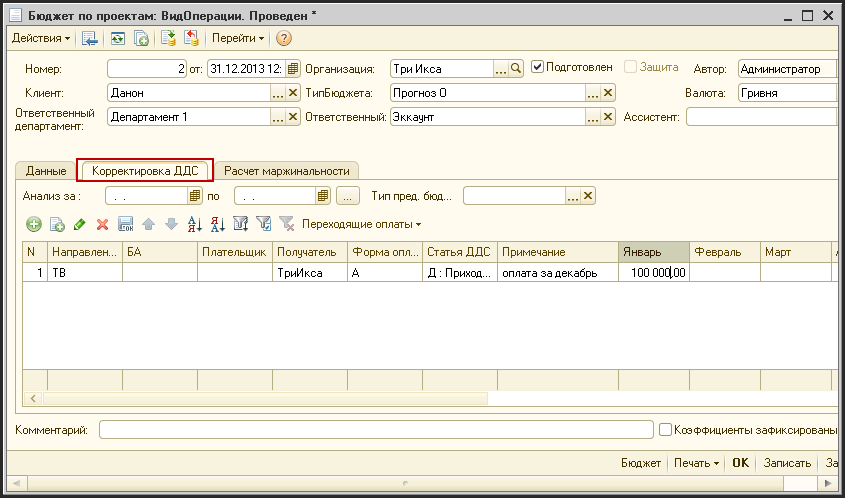

- эту таблицу можно заполнить вручную:
  - Направление - направление, по которому проводится оплата
  - БА - баинговое агентство, важно для корректировок оплат подрядчикам и внутригрупповых оплат
  - Плательщик - внутренний контрагент, который осуществляет оплату или подрядчику или другому внутреннему контрагенту
  - Получатель - внутренний контрагент, которому приходят деньги от клиента или которому осуществляется внутренняя оплата
  - Форма оплаты
  - Статья ДДС - выпадающий список:
    - Д: Приход от клиента - приход от клиента
    - Д: Приход комиссии от клиента - приход комиссии от клиента
    - Д: Получение ПРИПС - приход суперкомиссииот клиента
    - Д: Получение АВБ - приход АВБ от подрядчиков
    - З: Внутренний расход - перечисление денег между фронтальным и баинговым агентствами
    - Д: Внутренний приход - не используется
    - З: Оплата ПФД - выплата клиентского вознаграждения
    - З: Оплата подрядчику - оплата подрядчику
  - Примечания
  - Январь - Декабрь - суммы корректировок в периоде бюджетирования
    - в суммах важен знак
      - если нужно уменьшить сумму клиентского прихода в каком то из месяцев бюджетирования по приходной статье вносится отрицательное значение
      - оплата подрядчику указывается как отрицательная сумма, если сумма по статье «З: плата подрядчику» будет положительной, система будет считать это уменьшением оплаты подрядчику

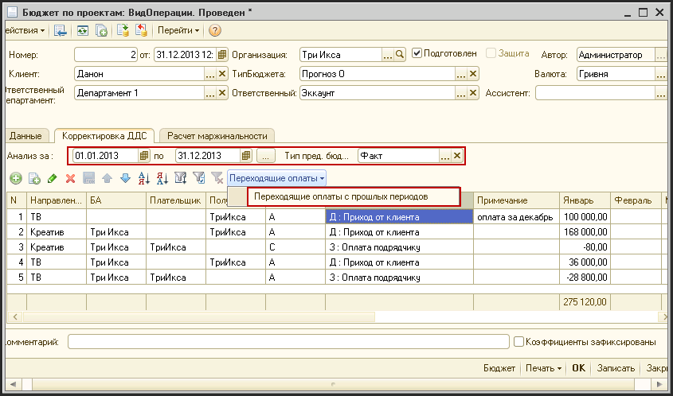

- при больших дробных оборотах в рамках холдинга зачастую может быть очень сложно вручную заполнить эту таблицу.
- Для автоматически заполнения существует алгоритм автоматического заполнения
- Для запуска этого алгоритма необходимо:
  - заполнить период анализа - это период за который анализируются данные прошлых периодов, чтобы отсечь старые данные. Нужно заполнять последние 3 - 6 месяцев за которые есть фактические данные
  - Тип пред бюджета - заполняется для Прогноза 0. Т.к. Прогноз формируется еще тогда, когда нет фактических данных последнего квартала, поэтому нужно указать, данные какого брать для расчета ДДС последнего квартала. Во всех остальных случаях достаточно указать «Факт»
  - После заполнения параметров, нужно выбрать функцию «Переходящие оплаты с прошлых периодов»
    - Порядок заполнения:
      - сначала, если в коэффициентах ДДС есть предоплаты - система уменьшит суммы оплат по периоду планирования на сумму предоплат
      - потом учтутся неоплаченные формы, которые попадают в период планирования и период анализа по работам периода анализа
      - потом система рассчитает суммы о работам периода анализа, по которым еще не созданы формы и отнесет их на основании коэффициентов ДДС по клиенту
      - все просроченные оплаты, которые должны были проведены до периода планирования отнесутся на на первый месяц планирования

## Бюджеты ОХР

### Настройка ЦФО

- Справочник «ЦФО» содержит шаблоны бюджетов ОХР
- разделение на ЦФО предполагает условное разделение в холдинге по видам затрат
  - Например,
    - ИТ
    - Хозяйственные
    - Транспорт
    - HR
    - Финансовые
    - пр.
- в рамках холдинга к одному ЦФО может быть привязано несколько организаций
  - Например, начальник ИТ отдела в холдинге обслуживает все компании холдинга
  - В этом случае создается один ЦФО «ИТ», к которому привязывается все организации холдинга
  - В этом случае начальник ИТ отдела создает один документ «Бюджет ОХР» и заполняет ИТ-затраты по всем компаниям холдинга в одном документе
- Для редактирования справочника нужно выбрать пункт меню «Справочники - Бюджетирование - ЦФО»
- Право на редактирование - АХ- менеджер.

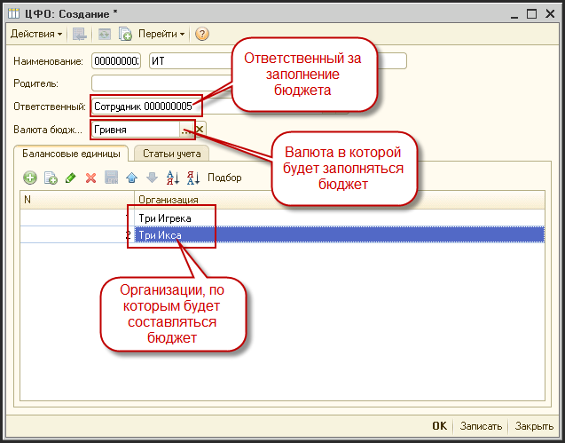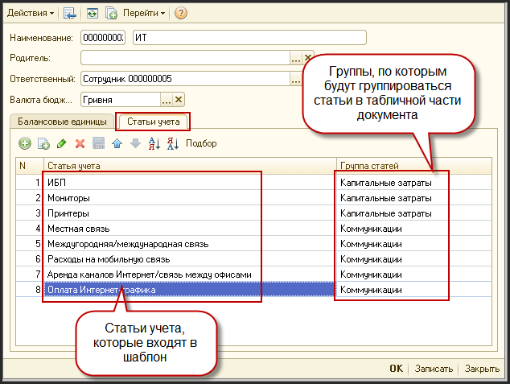

### Заполнение бюджета ОХР

- Для создания бюджета ОХР нужно выбрать пункт меню:
  - Для финансовых менеджеров: «Журнал - Бюджетирование - Бюджет ОХР»
  - Для ответственных: «Бюджетирование - Бюджет ОХР»
- Доступ к документу:
  - на редактирование - ответственный по ЦФО, финансовый менеджер, АХ-менеджер
  - на просмотр - директор компании (по свои компаниям)

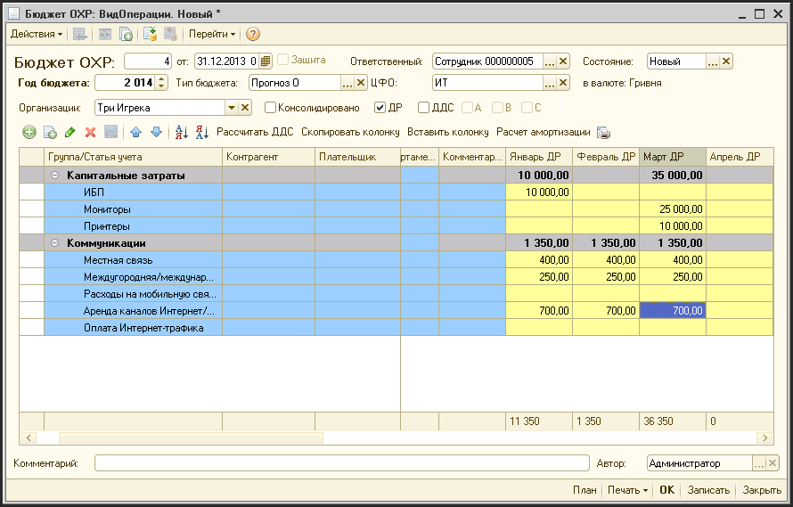

Описание реквизитов:

- Заголовок документа:
  - Дата - последняя дата перед периодом планирования
  - Ответственный - сотрудник, который ответственный за ЦФО
  - Состояние - состояние Бюджета ОХР
    - Изначально - «Новый»
    - После того как ответственный внесет данные он должен поменять состояние на «Подготовлен»
  - Год бюджетирования
  - Тип бюджета
  - ЦФО - после выбора ЦФО:
    - заполняется таблица из шаблона
    - заполняется список «Организации»
    - Устанавливается валюта бюджета
  - Организации - список организаций, которые привязаны к ЦФО
    - при смене организации меняется содержимое табличной части
    - в документе хранятся отдельно бюджеты по всем входящим организациям
  - Консолидировано - если флаг установлен, в таблице выводится суммарные данные консолидировано по всем организациям входящим в ЦФО, но редактирование таблицы блокируется
  - ДР - при установке показываются суммы начислений по статьям учета
  - ДДС - показывать колонки по движению денежных средств
    - А - показывать колонки по движению по форме «А»
    - Б - показывать колонки по движению по форме «Б»
    - Ц - показывать колонки по движению по форме «Ц»
- Описание функций панели инструментов
  - Рассчитать ДДС - заполняет данные о ДДС по бюджету ОХР на основании [Настройка параметров расчета ДДС по ОХР бюджету](#_Настройка_параметров_расчета_ДДС%20по)
  - Скопировать колонку - копирует в буфер обмена данные текущей колонки
  - Вставить колонку - вставляет скопированные данные из буфера в текущую колонку
  - Расчет амортизации - см. [Расчет амортизации](#_Расчет_амортизации)
- Описание колонок табличной части:
  - Статья учета
  - Контрагент - поставщик услуг. Необязательное.
  - Плательщик - указывается другая организация, если за эту организацию платит другая организация холдинга. Необходимо для правильного построения бюджета ДДС
    - например, если за аренду платит только одна компания холдинга
  - Департамент - заполняется, если ведется разделение финансового результата по департаментам
  - Комментарий
  - Январь ДР - Декабрь ДР - суммы начислений помесячно
  - Январь А - Декабрь А - суммы ДДС по форме «А»
  - Январь Б - Декабрь Б - суммы ДДС по форме «Б»
  - Январь Ц - Декабрь Ц - суммы ДДС по форме «Ц»
  - Итог - итоговая колонка по начисления
  - Итог ДДС - итоговая колонка по ДДС
- При сохранении бюджета ОХР ответственным - система не формирует проводок по бюджету
- Проводки и движения формируются автоматически при сохранении бюджета финансовым менеджером или АХ-менеджером
- Проводки по ДДС формируются автоматически - независимо от того, заполнены они были в таблице или нет.
- В таблице данных по ДДС справочные, проводки по ним не формируются.

### Настройка параметров расчета ДДС по ОХР бюджету

- Для расчета ДДС по бюджетам ОХР так же используются коэффициенты
- Для этого коэффициенты заполняются для справочника «Статьи учета»

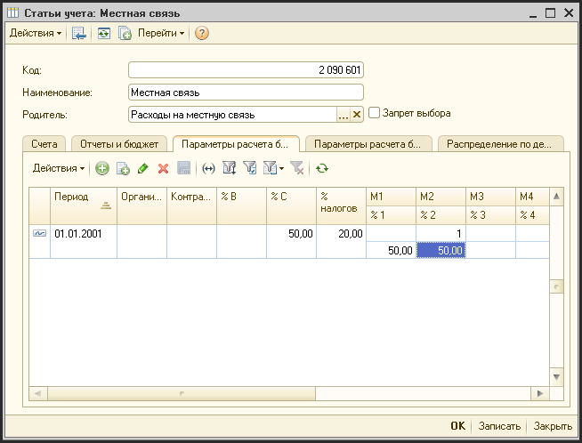

- Все коэффициенты по расчету бюджета ОХР находятся в клапане «Параметры расчета бюджета ОХР»
  - Период - дата с которой актуальны эти параметры
    - параметры могут меняться во времени, поэтому по каждой статье можно вести журнал изменения коэффициентов
  - Организация - система позволяет устанавливать разные коэффициенты для разных организаций
  - Контрагент - если это значение не пустое, система. если в бюджете ОХР поставить конкретного поставщика будет применять коэффиценты, которые специфичны исключительно для него
  - % Б - процент оплаты по форме «Б»
  - % Ц - процент оплаты по форме «Ц»
  - все остальное считается оплата по форме «А»
  - % налогов - процент налогов по оплатам по форме «А» (процент НДС)
  - М(1..12) - количество месяцев смещения оплаты
  - % (1..12) - процент оплаты в указанном месяце от общей суммы начисления
- Для сокращения объемов работ по заполнению коэффициентов в системе реализован механизм наследования коэффициентов
  - Если 20 статей учета находятся в одной группе, коэффициенты можно назначить всей группе и тогда при расчете ДДС по бюджету ОХР эти коэффициенты будут применяться для всех подчиненных группе статей

### Бюджетирование капитальных инвестиций

- В документе «Бюджет ОХР» можно не только бюджетировать затраты, но так же бюджетировать капитальные инвестиции на покупку ОС
- Для этого существуют специальные статьи учета, которые определены как статьи капитальных инвестиций

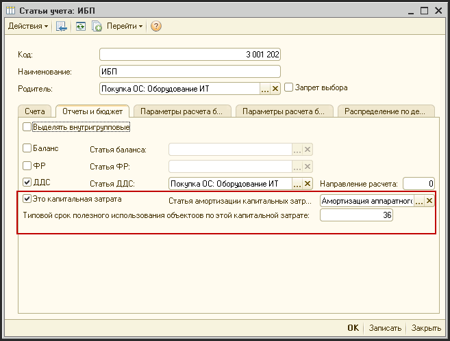

- В бюджете ОХР по таким статьм не начисляются плановые затраты, а увеличивается остаток ОС
- В такой статье должны быть заполнены такие параметры:
  - Флаг «Эта капитальная затрата»
  - Статья амортизации - будет использоваться для расчета амортизации
  - Типовой срок полезного использования - будет использоваться для расчета амортизации

### Расчет амортизации

- В бюджете ОХР есть функция «Расчет амортизации»
- Порядок работы этой функции:
  - Выбирается строка со статьей амортизации
  - Выбирается функция - «Расчет амортизации»
  - Система рассчитывает амортизацию по ОС, которые были на начало периода планирование + капитальные инвестиции, которые были запланированы на этот период бюджетирование
  - Расчет амортизации нужно проводить только после того как будут запланированы все капитальные инвестиции

## Бюджет по персоналу

### Порядок бюджетирования

- Создает и заполняет бюджет директор агентства
- Менеджер по оплате труда (Мацера Анна) проверяет и проводит бюджет
- Доступ на редактирование коэффициентов по бюджету оплаты труда имеет менеджер по оплат труда (Мацера Анна)

### Коэффициенты для расчета параметров зарплаты

Для расчета таких дополнительных параметров бюджета оплаты труда:

- Процент оплаты на карточку
- Процент налогов НДФЛ и ЕСН
- График платежей

создан дополнительный регистр.

Право на редактирование этого справочника имеет менеджер по оплате труда.

Для его редактирования нужно открыть справочник «Организации», выбрать агентство, коэффициенты по которому Вы хотите установить, нажать на кнопку «Перейти» и выбрать «Параметры расчета »

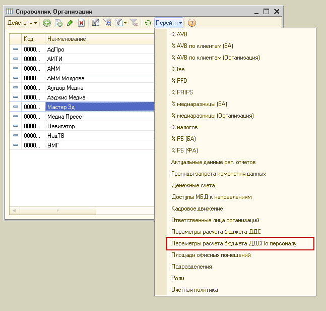

В открывшемся окне нужно внести коэффициенты расчета:

- Период - дата с которой актуальны данные коэффициенты
- Организация - заполняется автоматически. Агентство, для которого актуальны данные коэффициенты
- Статья учета - статья учета затрат на персонал для которой действуют эти коэффициенты. Здесь следует указывать всего две статьи: «Зарплата (нетто)» и «Премии и бонусы»
- % оплаты на карточку - примерный процент, суммы, которая оплачивается сотруднику на карточку (т.е. по бухгалтерскому учету)
- % НДФЛ - процент подоходного налога (по отношению к сумме выплачиваемой на карточку).
- % ЕСН - общий процент подоходного налога (по отношению к сумме выплачиваемой на карточку).
- М Ахх (где хх = от 1 до 12) -смещение оплат по форме «А» по отношению к месяцу начисления (см. [Заполнение смещений по месяцам в графика платежей](#_Заполнение_смещений_по_месяцам%20в%20гр))
- М Схх (где хх = от 1 до 12) -смещение оплат по форме «С» по отношению к месяцу начисления (см. [Заполнение смещений по месяцам в графика платежей](#_Заполнение_смещений_по_месяцам%20в%20гр))
- %1 … %12 (под МАхх) - процент от суммы начисления (оплаты на карточку и налогов, т.е. тех сумм которые оплачиваются по бухгалтерии), который относится на месяц указанный в параметре «М Ахх»
- %1 … %12 (под МАхх) - процент от суммы начисления (по форме «С»), который относится на месяц указанный в параметре «М Схх»

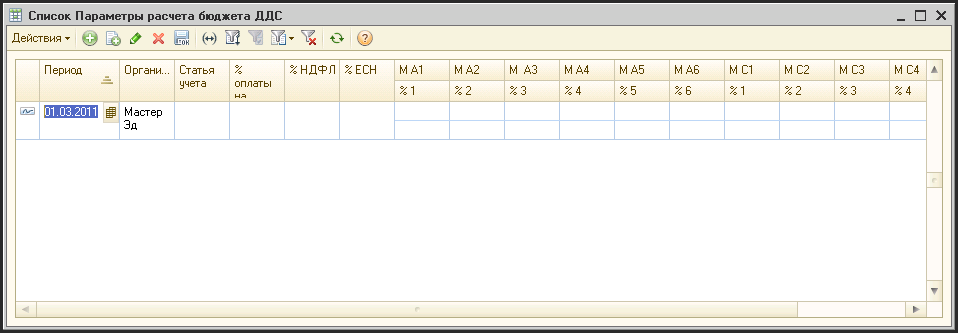

Данные коэффициенты необходимо определить для каждой организации.

### Работа с документом «Бюджетирование оплаты труда»

Для создания директором бюджета по оплате труда необходимо выбрать пункт меню «Бюджетирование - Бюджет по оплате труда»

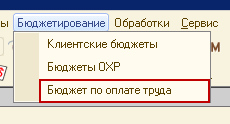

Осле этого открывается список бюджетов по персоналу. Директор может открывать бюджеты только по своему агентству.

После создания нового бюджета открывается форма редактирования бюджета по оплате труда:

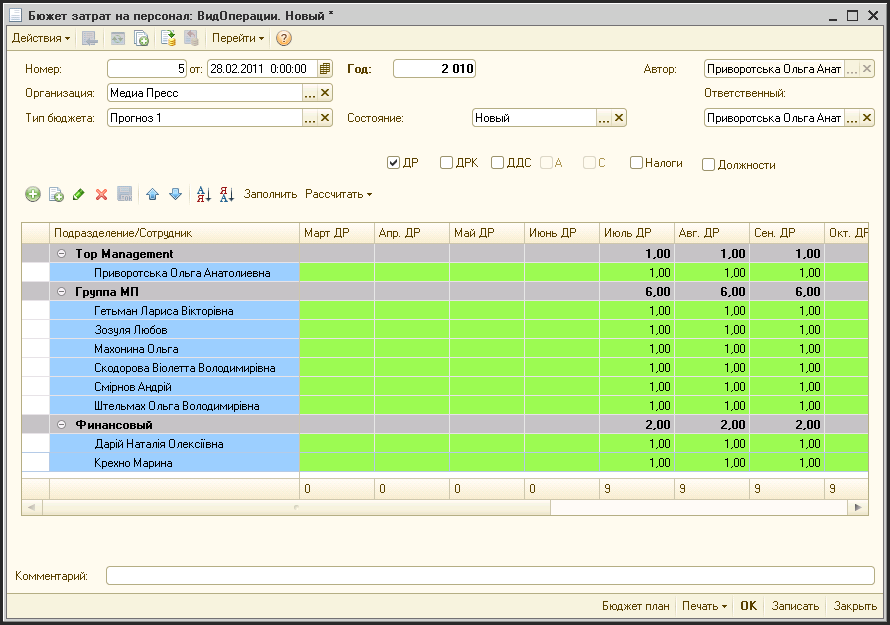

Должны устанавливаться такие даты для бюджетов:

- Для прогноза 0 = 31.12.&lt;предыдущий год&gt;
- Для прогноза 1 = 28.02.&lt;год бюджетирования&gt;
- Для прогноза 2 = 30.06.&lt; год бюджетирования &gt;
- Для прогноза 3 = 30.09.&lt; год бюджетирования &gt;

Заполняются реквизиты шапки бюджета:

- Год - год бюджетирования
- Организация - агентство по которому производится бюджетирование
- Тип бюджета - Прогноз 0, Прогноз 1, Прогноз 2 и Прогноз 3. Другие типы выбирать нельзя.
- Ответственный - автоматически устанавливается текущий пользователь
- Состояние - Новый

При выборе организации, система автоматически загружает структуру подразделений в рамках которых необходимо бюджетировать оплату труда.

С помощью кнопки «Заполнить» можно заполнить текущее штатное расписание (принятых на работу сотрудников) на дату ввода бюджета.

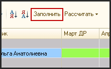

Т.к. колонок в табличной части доста точно много, но не все они нужны одновременно, в форме редактирования бюджета находится набор флажков для управления отображения колонок в таблице:

- ДР - ежемесячные начисления оплаты труда по сотруднику
- ДРК - сумма оплаты на карточку
- ДДС - отображает колонки по движению денежных средств:
  - А - бухгалтерские оплаты
  - С - управленческие оплаты
- Налоги - отображать колонки НДФЛ и ЕСН, а так же ДДС по НДФЛ и ДДС по ЕСН (если включен флаг «ДДС»)
- Должности - включает дополнительные колонки с должностями сотрудников и полем комментария.

Описание колонок табличной части:

- Подразделение/сотрудник - содержит ФИО сотрудника
- Класс должности - классификации должности сотрудника по московской классификации
- Должность - полное наименование должности сотрудника
- Тип - штатный/внештатны/аутсорсер
- Статья учета - статья учета по которой начисляется оплата труда. Могут быть выбраны только две статьи (именно для этих статей должны быть определены коэффициенты расчета см. [Коэффициенты для расчета параметров зарплаты](#_Коэффициенты_для_расчета_параметров)):
  - Заработная плата (нетто) - устанавливается по-умолчанию
  - Премии и 13 зарплата
- Комментарий - произвольное текстовое поле
- ХХХ ДР - начисления оплаты труда за месяц ХХХ
- ХХХ карт. - сумма оплаты на карточку за месяц ХХХ
- ХХХ НДФЛ - сумма начисленного подоходного налога за месяц ХХХ
- ХХХ ЕСН - сумма начисленных социальных налогов за месяц ХХХ
- ХХХ А - оплата в месяце ХХХ по форме «А»
- ХХХ С - оплата в месяце ХХХ по форме «С»
- ХХХ ДДС НДФЛ - оплата подоходного налога в месяце ХХХ
- ХХХ ДДС ЕСН - оплата социальных налогов в месяце ХХХ

#### Типовой порядок редактирования бюджета

Все суммы вводятся в гривнах.

- **Функции директора:**
  - Создает новый документ
  - Заполняем шапку бюджета
  - Заполняем таблицу из штатного расписания с помощью кнопки «Заполнить»
  - Проверяем правильность заполнения сотрудников по должностям и подразделениям (если Вы обнаружили отклонения, обратитесь к менеджеру по оплате труда Мацере Анне)
  - Добавляем вакансии в конкретные подразделения, если планируется рост штата. Для этого мы используем служебного сотрудника «Вакансия», при этом необходимо правильно указать должность и класс должности этого сотрудника
  - Оставляем включенной только птичку «ДР»
  - Вносим помесячно информацию об оплатах
  - Меняется состояние с «Новый» на «Подготовлен». Сохраняется документ
  - Информируется менеджер по оплате труда, что бюджет подготовлен
- Функции менеджера по оплате труда:
- Рассчитываем суммы оплат на карточку. Для этого нажимаем кнопку «Рассчитать» и выбираем пункт меню «Рассчитать оплаты на карточку на весь период»

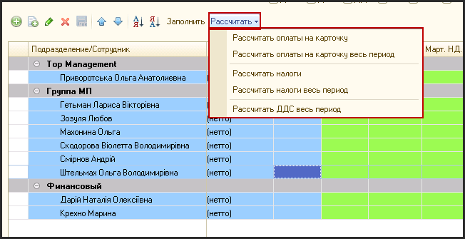

- Проверяем, что суммы оплат на карточку заполнены правильно. Для этого включаем флажок «ДРК» и при необходимости корректируем информацию
- Аналогично рассчитываем налоги:
  - Выбираем функцию «Рассчитать - Рассчитать налоги на весь период»
  - Включаем флажок «Налоги» и проверяем правильность начисления. При необходимости можем подправить коэффициенты или вручную подправить налоги в самой таблице.
- Заполняем плановые оплаты:
  - Выбираем функцию «Рассчитать - Рассчитать ДДС за весь период»
  - Если система выдает сообщение «Не найдены коэффициенты ДДС!» - значит по организации или указанной в таблице статье учета не установлены коэффициенты расчета ДДС. Обязательно нужно их установить (см. [Коэффициенты для расчета параметров зарплаты](#_Коэффициенты_для_расчета_параметров))
  - Включаем флажки «ДДС», «А» и «С». Просматриваем правильность заполнения. При необходимости корректируем вручную или можем откорректировать коэффициенты и перезаполнить ДДС.
  - Для более детального анализа можем сформировать печатную форму бюджета, которая повторяет структуру колонок табличной части. Печатную форму можно выгрузить в Эксель и более детально проанализировать.
- Если все нормально, меняем состояние на «Принят» и проводим бюджет.
- После проведения бюджет становится недоступным для изменения.

Рекомендуется бюджет на ежемесячную оплату и бюджет на премии создавать в отдельных документах.

#### Печатная форма бюджета

Для более удобного анализа информации в документе предусмотрена возможность формирование печатной формы таблицы бюджета для распечатки или выгрузки в эксель. Количество колонок в печатной форме так же зависит о т установки флажков в шапке бюджета.

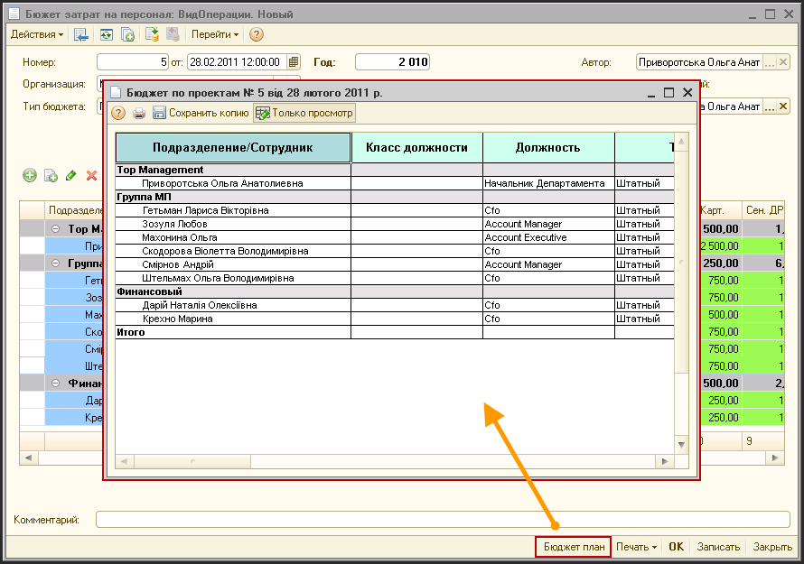

### Заполнение смещений по месяцам в графика платежей

Поля «Смещение мес» могут принимать такие значения:

- 0 - оплата производится в месяце начисления
- \-1 … -12 - предоплата за указанное количество месяцев от даты начисления
- 1 … 12 - постоплата по истечению указанного количества месяцев от даты начисления
- 101 … 112 - оплата в конкретном месяце (номер месяца определяется по двум последним цифрам)
- ННККОО - пятизначное или шестизначное число. Определяет начисления за какой период оплачиваются в каком месяце:
  - НН - начало периода, может принимать значение от 1 до 12
  - КК - конец периода, может принимать значение от 01 до 12
  - ОО - месяц оплаты, может принимать значение от 01 до 12
  - Например:
    - 10607 - начисления с января по июнь будут оплачены в июле
    - 80907 - начисления за август и сентябрь должны быть предоплачены июле
  - Желательно не сочетать этот тип смещения с другими.
  - НН не может быть больше КК
  - НН и КК не могут быть меньше 01 и больше 12
  - ОО может быть больше 12, что указывает на оплату следующим годом
  - Если используется этот тип смещения, итоговое значение по процетам может быть больше 100%. Например: первая запись 10607 = 100%, 71212 = 100%. Это значит, что 100% начислений за первое полугодие будет оплачено в июле и 100% начислений за второе полугодие будет оплачено в декабре.

### Служебные типы сотрудников

- **ВАКАНСИЯ:** Если на период бюджетируются сотрудники, которые еще не приняты на работу. нужно создать в справочнике «Сотрудники» специальные служебные элементы и установить у них флаг «Это вакансия»

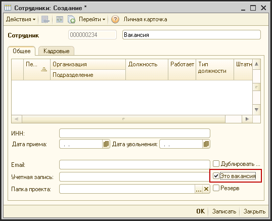

- - Для одного прогноза для каждой вакансии нужно выбирать отдельный элемент справочника с установленным флагом «Это вакансия», поэтому, имеет смысл создать набор элементов «Вакансия 1» … «Вакансия 10» и использовать их в бюджетах.
    - Необходимость использования разных элементов справочника «Сотрудники» обусловлено необходимостью расчета количества сотрудников.
    - Если в вашей форме финансового результата не используется информация о количестве сотрудников, можно использовать один элемент «Вакансия».
- РЕЗЕРВ:
  - если создать служебного сотрудника с флагом «Резерв» и использовать его при бюджетировании то:
    - данный служебный сотрудник не будет считаться в общем количестве сотрудников
    - однако его затраты будут правильно разносится по финансовому результату
    - использование «резерва» имеет смысл только если в структуре финансового результата используется информация о количестве сотрудников

### Заполнение бюджетов по премиям и бонусам

- Для того чтобы было удобно работать с бюджетами по персоналу рекомендуется создавать отдельный документ по оплате труда и отдельный документ по начислению премий и бонусов

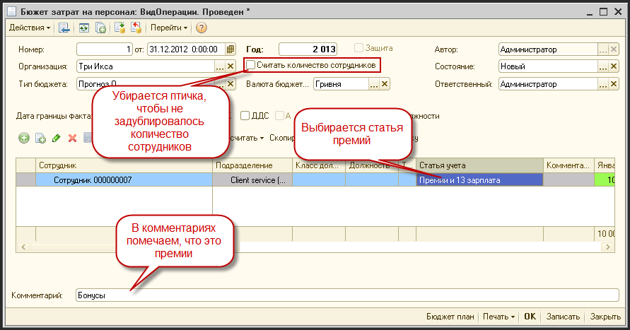

## Бюджет финансовых операций

## Корректировка планового ДДС

- Корректировка планового ДДС может понадобится для таких случаев:
  - оплата НДС в бюджет - т.к. НДС это налог расчетный а не начисляемый, он не планируется в бюджете ОХР. Поэтому его оплаты планируются в документе «Корректировка планового ДДС»
  - движения по кредитным средствам
  - инвестирование
  - переброс денежных средств с одних денежных активов на другие
  - внутренние взаиморасчеты по финансовой помощи и прочим операциям
  - ручная корректировок движений, которые были автоматически сформированы бюджетными документами (Бюджет по проектам, Бюджет ОХР, Бюджет по персоналу)
- Порядок корректировки:
  - выбираем пункт меню: «Бюджетирование - Корректировка планового ДДС»

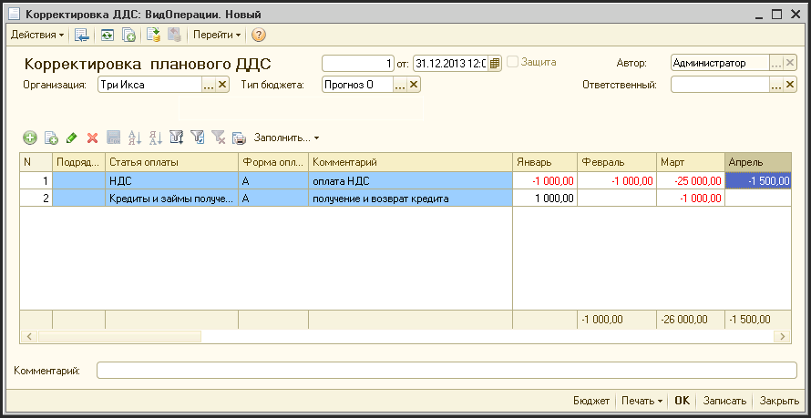

- - Описание реквизитов документа:
        - заголовок документа:
            - Дата - да день до начала периода планирования
            - Тип бюджета
        - описание колонок табличной части:
            - Подрядчик - заполнение необязательно. Обязательно заполнять, если это внутригрупповой платеж, тогда нужно указать внутреннего контрагента.
            - Статья оплаты - статья ДДС платежа
            - Комментарий
            - Январь - Декабрь - помесячная разбивка сумм. Исходящий платеж со знаком «-».
            - Клиент - для проектных оплат
            - Направление - для проектных оплат
            - Счет зачета - не используется (теперь должна использоваться Ручная бюджетная операция)
            - Это аванс - не используется
            - Вторая оплата - используется для внутригрупповых расчетов. Если флаг установлен система генерирует зеркальные проводки по оранизации, которая соответствует выбранному внутреннему контрагенту

## Ручная бюджетная операция

- Все бюджетные документы формируют проводки по бюджетному плану счетов, который полностью соответствует основному операционному плану счетов. Отличие состоит только в тоом, что первой аналитикой в этом плане счетов и идет [Версия бюджетов](#_Версии_бюджетов), которая определяет версию сохраненных данных
- В процессе подготовки прогнозного баланса может возникнуть необходимость в проведении ручного перераспределения плановых остатков с одной статьи баланса на другую. Примеры:
  - Проведение зачетов по внутренней задолженности
  - Перевод долгов в сомнительные
  - Формирование резервов
- Для проведения ручных корректировок по бюджетному плану счетов нужно выбрать пункт меню «Журнал - Бюджетирование - Вспомогательные Операция бюджетная»:

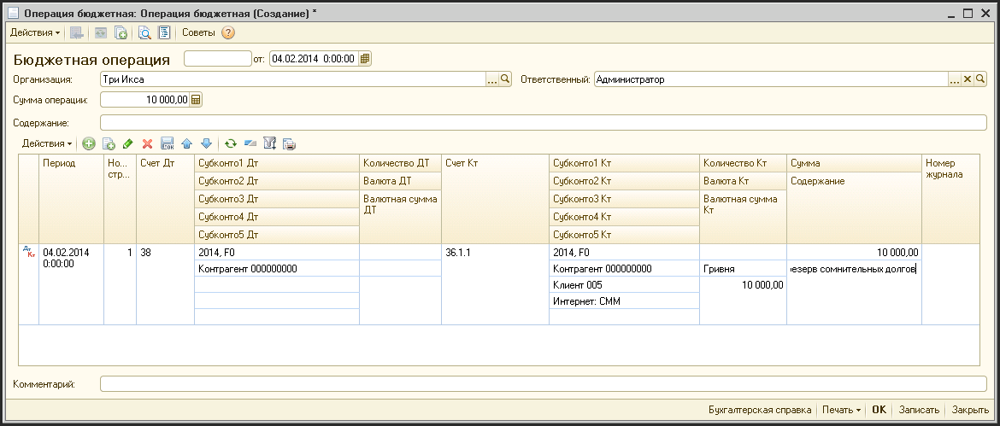

- Обратите внимание:
  - Всегда первой аналитикой устанавливается версия бюджета

## Подготовка планового баланса

### Условия формирования

- Общие условия:
  - Должны быть полностью составлены проверены и утверждены все другие бюджеты:
    - Проектные бюджеты
    - Бюджеты ОХР
    - Бюджеты по зарплате
  - По всем бюджетам должны быть правильно сформированы бюджеты ДДС
  - Проведены все необходимые корректировки по бюджетам ДДС
- Для прогноза 0:
  - Загружается в регулярные данные фактический баланс на 30.09.ГОД
  - Заполняется плановый баланс о прогнозу 3
  - Только после этого заполняется плановый баланс по прогнозу 0 на базе декабрьского планового баланса по прогнозу 3
- Для всех остальных прогнозов:
  - Загружается в регулярные данные фактический баланс за месяц предыдущий началу периода прогнозирования
  - Заполняется плановый баланс по прогнозу на основании фактических данных

### Документ «Плановый баланс»

Для расчета и сохранения информации о плановом балансе предназначен документ «Плановый баланс» (пункт меню «Журнал - Бюджетирование - Плановый баланс»).

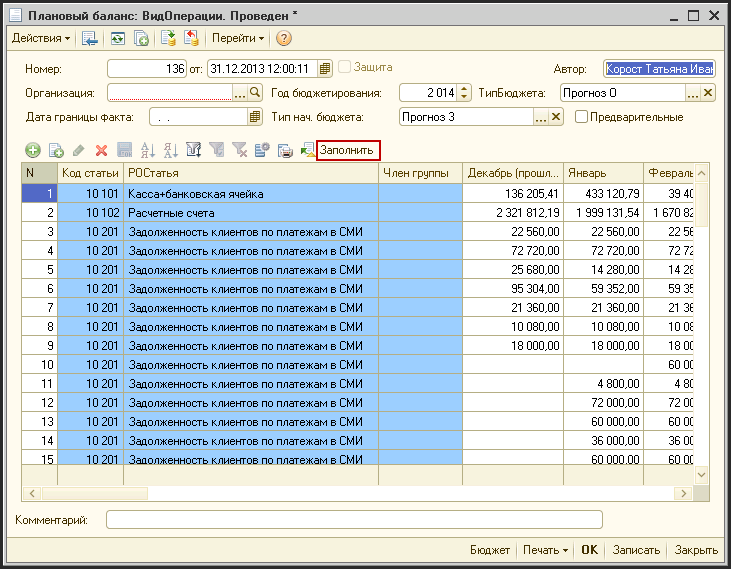

Описание реквизитов шапки:

- Дата - устанавливается дата за день до начала периода бюджетирования
- Организация - организация, по которой строится баланс
- Год бюджетирования
- Тип бюджета - тип бюджета, по которому строится баланс
- Тип нач. бюджета - тип бюджета или факт на основании которого строится этот плановый баланс. Система выберет выгруженные регулярные данные (НЕ ПРЕДВАРИТЕЛЬНЫЕ) по выбранному типу бюджету за последний месяц перед началом периода бюджетирования. Может быть выбран «Факт» - в этом случае будут браться фактические данные (но они должны быть предварительно выгруженные в регулярные данные)

После заполнении я реквизитов шапки, нужно нажать на кнопку «Заполнить» и система рассчитает все суммы по Баланам за каждый месяц бюджетирования.

Первая колонка со значениями - это всегда значения предыдущего периода, которые являются начальными для расчета баланса.

