# Отчеты

> **Описание:** Глава описывает все доступные отчёты системы. Разделяется на три группы: регламентированные финансовые отчёты (Баланс, Отчёт о прибылях и убытках, Движение денежных средств), оперативные отчёты по проектной деятельности (свод, бюджет, реестры форм и работ), а также реестр платежей.

## Содержание

- [Регламентированные финансовые отчеты](#регламентированные-финансовые-отчеты)
  - [Баланс предприятия](#баланс-предприятия)
  - [Отчет о прибылях и убытках](#отчет-о-прибылях-и-убытках)
  - [Движение денежных средств](#движение-денежных-средств)
- [Оперативные отчеты](#оперативные-отчеты)
  - [Сводный отчет по проектам](#сводный-отчет-по-проектам)
  - [Бюджет проекта](#бюджет-проекта)
  - [Реестр проектных форм](#реестр-проектных-форм)
  - [Оплаты по проектам](#оплаты-по-проектам)
- [Реестр платежей](#реестр-платежей)

---

## Регламентированные финансовые отчеты

Это отчеты, которые формируются по окончанию некоторого отчетного периода и используются для анализа результатов деятельности компании за этот период.

### Баланс предприятия

Этот отчет формирует баланс предприятия. Отчет показывает состояние активов и пассивов предприятия. Доступ к этому отчету имеют только директор и финансовый директор компании. Для создания отчета, нужно выбрать пункт меню «Отчеты - Финансовые отчеты - Баланс». Появится окно ввода параметров отчета:

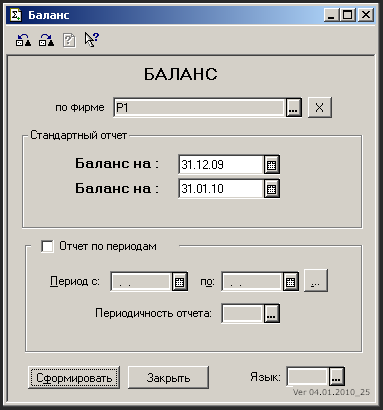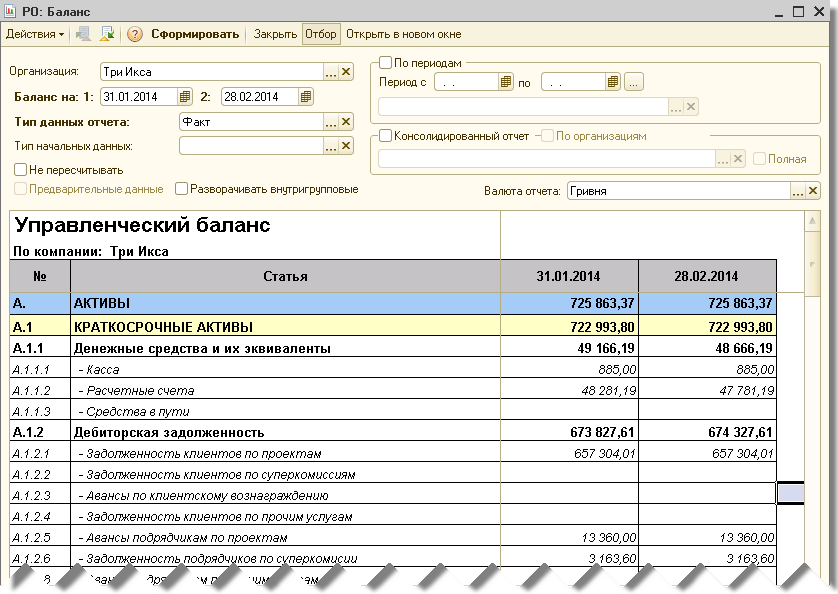

По умолчанию отчет строится по двум датам: на конец текущего месяца, и на конец предыдущего. Однако можно создать отчет за более длительный период, например за год с разбивкой помесячно. Для этого нужно отметить чекбокс «Отчет по периодам», ввести первую дату (дату, находящуюся в первом месяце, за который вы ходите получить отчет), ввести вторую дату (дату в последнем месяце), далее нужно выбрать периодичность. Периодичности бывают такие:

- месяц - помесячный отчет (наиболее часто используемый период);
- квартал - поквартальный отчет;
- год - годовой отчет (если в периоде более одного года).

После заполнения всех параметров нужно нажать кнопку «Сформировать».

Отчет считается сформированным правильно, если в самой нижней строке отчета (под строкой с суммой всех пассивов) нет красной строки разницы между активами и пассивами. Если эта разница есть, значит в том периоде, где возникла эта разница, не закрыты все доходы и затраты. Нужно для этого периода перепровести документ «ЗакрытиеМесяца».

Прямо из формы отчета вы можете получать детализацию по статьям баланса. Для этого нужно два раза щелкнуть мышью по ячейке у которой строка соответствует нужной статье баланса, а столбец соответствует периоду, за который вы хотите проанализировать статью. В качестве детализации появляется отчет «Оборотно-сальдовая ведомость» по счетам учета, которые формируют выбранную статью баланса.

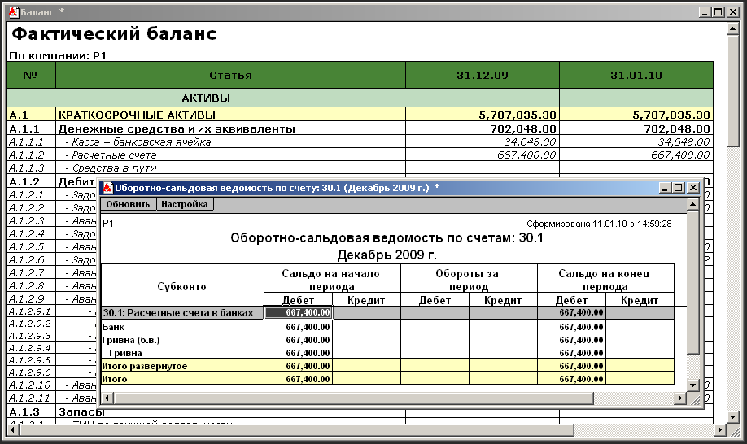

### Отчет о прибылях и убытках

Этот отчет формирует финансовый результат, который получила компания за определенный период. Он выводит как бюджетные, так и фактические данные. При совместном выводе плановых и фактических показателей, выводится дополнительный столбец за каждый период, который считает отклонение фактических параметров от плановых. Доступ к формированию этого отчета имеет только директор и финансовый директор компании.

Данный отчет может быть сформирован в двух видах: как отчет о прибылях и убытках за определенный период, и как отчет о выполнении бюджета. Отличие этих отчетов состоит в том, что в режиме отчета о выполнения бюджета, в нижней части отчета добавляется секция, которая отображает статьи, которые по своей сути являются элементами отчета о движении денежных средств, но бюджетируются совместно с доходами и затратами. Это бюджет закупки ОС.

Для создания отчета, нужно выбрать пункт меню «Отчеты - Финансовые отчеты - Финансовый результат». Появиться окно ввода параметров отчета:

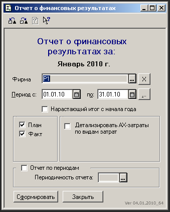

**Описание реквизитов отчета:**

| Фирма | Фирма, по которой делается отчет |
| --- | --- |
| Период | Период, за который делается отчет |
| Нарастающий итог с начала года | Если этот флаг установлен, то помимо суммы за указанный период, будет сформирован еще один столбец, в котором будут суммы с начала года по последнюю дату периода. |
| План | Выводить плановые значения из бюджета |
| Факт | Выводить фактические значения |
| Исключить внутренние доходы и затраты | Исключить из отчета все внутренние доходы и затраты |
| Отчеты по периодам | Если этот флаг отмечен, то активизируется поле «Периодичность отчета» |
| Периодичность отчета | Задает, на какие периоды разбивать отчет |

Прямо из формы отчета вы можете получать детализацию по статьям доходов и затрат. Для этого нужно два раза щелкнуть мышью по ячейке, у которой строка соответствует нужной статье, а столбец соответствует периоду, за который вы хотите проанализировать статью. В качестве детализации появляется отчет «Оборотно-сальдовая ведомость» по счетам учета, которые формируют выбранную статью отчета.

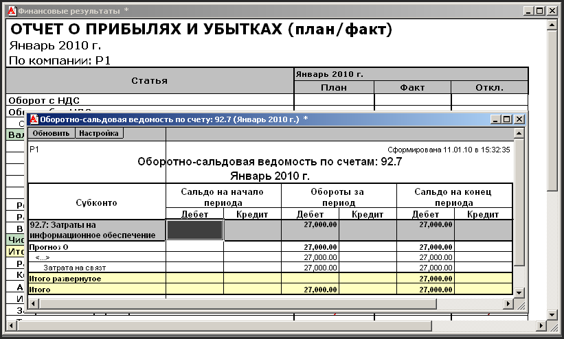

### Движение денежных средств

Этот отчет предназначен для анализа движений денежных средств компании. Доступ к этому отчету имеет только директор и финансовый директор компании.

Для создания отчета, нужно выбрать пункт меню «Отчеты - Финансовые отчеты - Движение денежных средств». Появиться окно ввода параметров отчета:

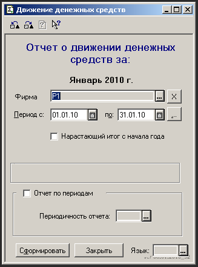

**Описание реквизитов отчета:**

| Фирма | Фирма, по которой делается отчет |
| --- | --- |
| Период | Период, за который делается отчет |
| Нарастающий итог с начала года | Если этот флаг установлен, то помимо суммы за указанный период, будет сформирован еще один столбец в котором будут суммы с начала года по последнюю дату периода. |
| Отчет по периодам | Если этот флаг отмечен, то активизируется поле «Периодичность отчета» |
| Периодичность отчета | Задает, на какие периоды разбивать отчет |
| Предварительный бюджет | Отчет по плановым значениям будет формироваться на основании предварительных значений |
| Язык | ??? |

Прямо из отчета вы можете получать детализацию по статьям. Для этого нужно два раза щелкнуть мышью по ячейке, у которой строка соответствует нужной статье, а столбец соответствует периоду, за который вы хотите проанализировать статью. В качестве детализации появляется отчет «Журнал проводок» по счетам, которые корреспондируют с денежными счетами и которые формируют выбранную статью отчета.

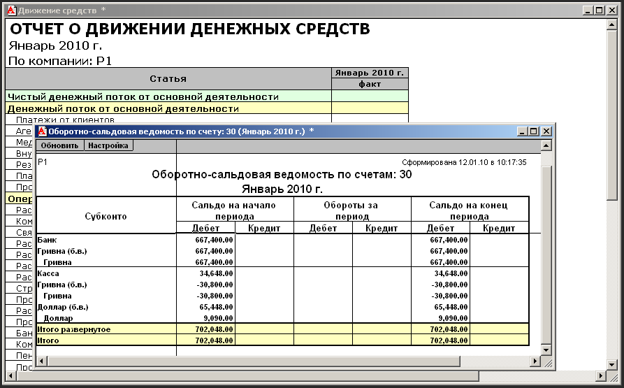

## Оперативные отчеты

Оперативные отчеты - это отчеты, которые используются в процессе оперативной деятельности компании и могут быть сформированы на любой момент времени. В основном, это отчеты по проектной деятельности.

### Сводный отчет по проектам

Этот отчет предназначен для формирования сводной информации по всем проектам, зарегистрированным в системе. Отчет выводит информацию о плановых и фактических показателях выполнения проекта. Доступ к этому проекту имеют:

- директор, финансовый директор - ко всем проектам в системе;
- начальник отдела по работе с клиентами - ко всем проектам;
- эккаунт - только к своим проектам.

Для создания отчета, нужно выбрать пункт меню «Отчеты - Оперативные отчеты - Свод по проектам». Появится окно ввода параметров отчета с активной закладкой «Простой фильтр»:

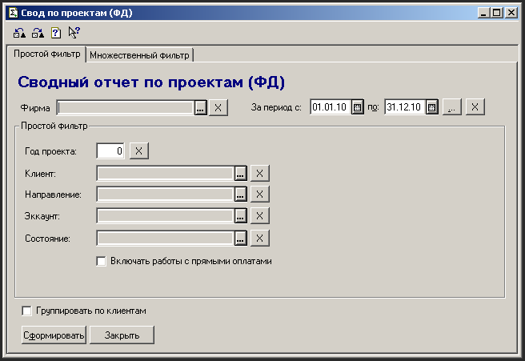

**Описание реквизитов закладки отчета «Простой фильтр»:**

| Фирма | Фирма, по которой делается отчет |
| --- | --- |
| За период | Период, за который делается отчет |
| Год проекта | Отбирает проекты только за указанный год |
| Клиент | Если поле заполнено, то выводить проекты только по этому клиенту |
| Направление | Если поле заполнено, то выводит проекты только по выбранному направлению |
| Эккаунт | Если поле заполнено, то выводит проекты только по выбранному эккаунту |
| Состояние | Выводит проекты только с указанным состоянием (новый, в работе или завершен) |
| Включать работы с прямыми оплатами | ??? В отчет будут включены работы с прямыми оплатами |
| Группировать по клиентам | ??? |

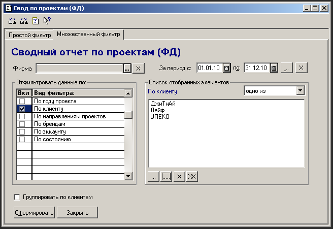

**Описание реквизитов закладки отчета «Множественный фильтр»:**

| Фирма | Фирма, по которой делается отчет |
| --- | --- |
| За период | Период, за который делается отчет |
| Отфильтровать данные по: | По году проекта  По клиенту  По направлениям проектов  По брендам  По эккаунтам  По состоянию |
| Список отобранных элементов |     |
| Группировать по клиентам | ??? |

После формирования отчета, можно получить отчет «Бюджет проекта» по одному проекту двойным щелчком по строке по этому проекту.

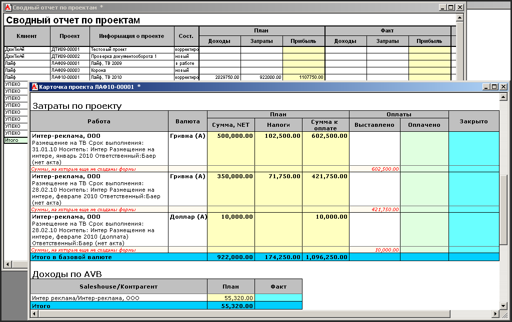

### Бюджет проекта

Этот отчет предназначен для вывода детальной информации как по плановым показателям проекта, так и по его фактическому выполнению. Доступ к этому отчету имеют:

- директор, финансовый директор, директор по работе с клиентами - могут формировать отчет по всем проектам;
- начальник отдела по работе с клиентами - может формировать по всем проектам своего подразделения;
- эккаунт - может формировать только по своим проектам;
- сотрудник подразделения - внутреннего подрядчика - может формировать только по тем проектам, в затратной части которых есть работы, по которым он является ответственным. В отчете выводиться информация только по этим работам;
- начальник подразделения - внутреннего подрядчика - может формировать только по тем проектам, в затратной части которых есть работы, по которым ответственными являются сотрудники его подразделения. В отчете выводиться информация только по этим работам;

Для создания отчета, нужно выбрать пункт меню «Отчеты - Оперативные проекты - Бюджет проекта».

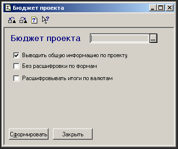

**Описание реквизитов отчета:**

| Проект | Проект, по которому выводиться отчет |
| --- | --- |
| Выводить общую информацию по проекту | Если флаг установлен, то в заголовке отчета выводиться общая информация по проекту, если нет, то в отчете есть только табличные части. |
| Без расшифровки по формам | Если флаг установлен, то отчет выводиться без расшифровки работ по формам. |
| Расшифровать итоги по валютам |     |

### Реестр проектных форм

Этот отчет предназначен для вывода реестра форм с указанием, на каком этапе обработки эти формы находятся. Этот отчет удобен для отслеживания обработки форм.

Доступ к этому отчету имеют:

- директор, финансовый директор, директор по работе с клиенатми - по всем формам в системе;
- начальник отдела по работе с клиентами - по всем формам проектов своего подразделения;
- эккаунт - только по формам своих проектов;
- сотрудник подразделения - внутреннего подрядчика - только по Ф3 по своим работам;
- начальник подразделения - внутреннего подрядчика - только по Ф3 по работам, которые выполняют сотрудники его подразделения;

Для создания отчета, нужно выбрать пункт меню «Отчеты - Оперативные отчеты - Реестр проектных форм». Появится окно ввода параметров отчета:

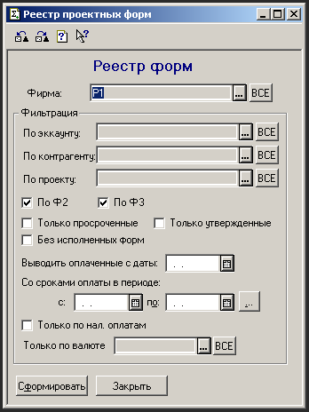

**Описание реквизитов отчета:**

| Фирма | Фирма, по которой анализируются формы |
| --- | --- |
| По эккаунту | Выводить формы только по проектам выбранного эккаунта |
| По контрагенту | Выводить формы только по одному контрагенту |
| По проекту | Выводить формы по выбранному проекту |
| По Ф2 | Выводить формы №2 |
| По Ф3 | Выводить формы №3 |
| Только просроченные | Выводить только формы, срок оплаты (для Ф2 и Ф3) уже истек, а они до сих пор не исполнены |
| Без исполненных форм | Не выводить исполненные формы |
| Только утвержденные | Выводить только утвержденные формы |
| Выводить оплаченные с даты |     |
| Со сроками оплаты в периоде |     |
| Только по нал. оплатам | Выводить формы только с наличными валютами |
| Только по валюте | Выводить только по выбранной валюте |

### Оплаты по проектам

Этот отчет предназначен для вывода отчета по фактически произведенным оплатам по проектам.

Доступ к этому проекту имеют:

- директор, финансовый директор - по всем проектам, зарегистрированным в системе;
- начальник отдела по работе с клиентами - по всем проектам своего подразделения;
- эккаунт - только по своим проектам;
- сотрудник подразделения - только по своим Ф3;
- начальник подразделения - только по Ф3 своих подчиненных;

Для создания отчета, нужно выбрать пункт меню «Отчеты - Оперативные отчеты - Оплаты по проектам». Появится окно ввода параметров отчета:

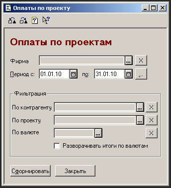

**Описание реквизитов отчета:**

| Фирма | Фирма, по которой выводится отчет |
| --- | --- |
| Период | Период за который будет выводиться отчет. |
| По контрагенту | Выводить информацию по платежам (входящим и исходящим) по выбранному контрагенту |
| По проекту | Выводить информацию только по выбранному проекту |
| По валюте | Выводить только по выбранной валюте |
| Разворачивать итоги по валютам |     |

## Реестр платежей

Этот отчет выводит информацию о плановых и фактических платежах за указанный период. С помощью этого отчета финансовый департамент компании имеет возможность планировать движение денежных средств и анализировать плановые остатки денежных средств.

Доступ к этому проекту имеют только финансовый менеджер, финансовый директор и генеральный директор.

Для создания отчета, нужно выбрать пункт меню «Отчеты - Оперативные отчеты - Реестр платежей». Появиться окно ввода параметров отчета:

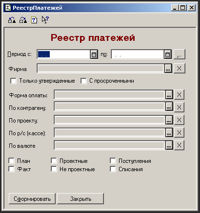

**Описание реквизитов отчета:**

| Период | Период, за который будет выводиться отчет. |
| --- | --- |
| Фирма | Фирма, по которой выводиться отчет |
| Только утвержденные | При выводе плановых платежей выводить информацию только по формам, которые имеют состояние «на оплате» |
| С просроченными | Выводить просроченные плановые платежи |
| Форма оплаты |     |
| По контрагенту |     |
| По проекту |     |
| По р/с (кассе) |     |
| По валюте | Выводить движения только по выбранной валюте |
| План | Выводить плановые платежи (по неоплаченным формам и графикам погашения кредитов) |
| Факт | Выводить фактические платежи |
| Проектные |     |
| Не проектные |     |
| Поступления |     |
| Списания |     |

