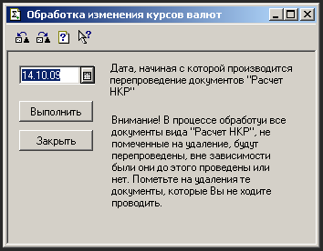
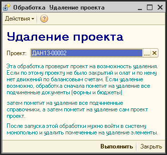
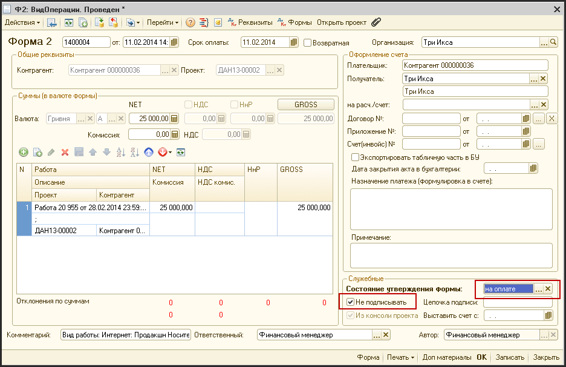
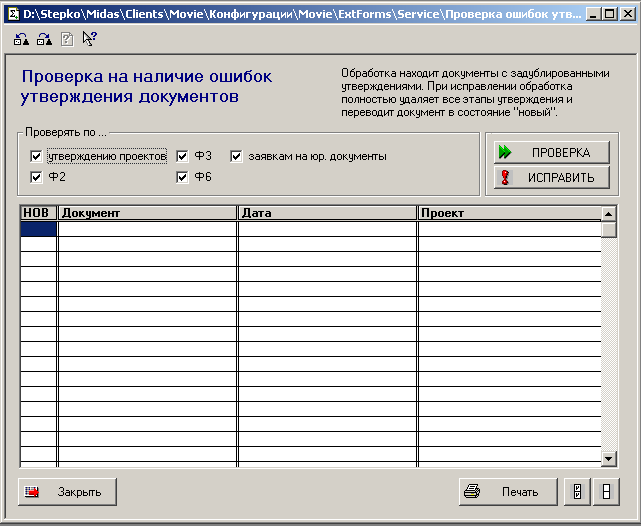
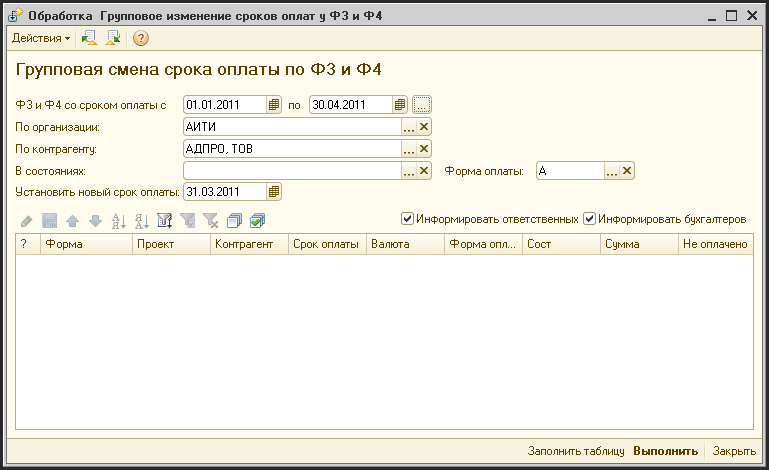
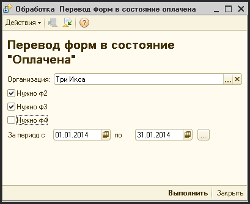
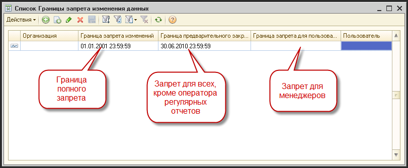
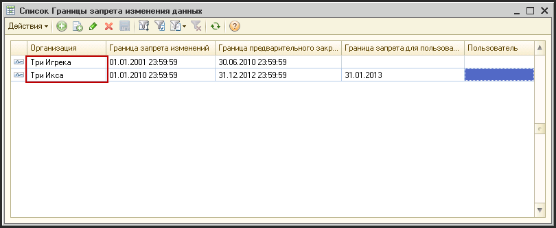

# Сервис

> **Описание:** Описывает сервисные функции системы, доступные финансовому менеджеру и финансовому директору. Рассматриваются: перепроведение курсов валют, удаление проекта, исключение документов из цепочки утверждения, исправление ошибок утверждения, групповая замена сроков оплат и порядок закрытия периодов.

## Содержание

- [Обработка изменения курсов валют](#обработка-изменения-курсов-валют)
- [Удаление проекта](#удаление-проекта)
- [Исключение документа из стандартной цепочки документооборота](#исключение-документа-из-стандартной-цепочки-документооборота)
- [Исправление ошибок утверждения](#исправление-ошибок-утверждения)
- [Групповая замена сроков оплат по т3 и т4](#групповая-замена-сроков-оплат-по-т3-и-т4)
- [Перенос форм в состояние «оплачено»](#перенос-форм-в-состояние-оплачено)
- [Порядок закрытия периодов](#порядок-закрытия-периодов)

---

Сервисные обработки, доступны для запуска только для финансового менеджера и финансового директора.

## Обработка изменения курсов валют

Для облегчения процесса перепроведения документов «Изменение курсов валют» в систему включена обработка «Обработка изменения курсов валют». Она может запускаться как из журнала документов «Изменения курсов валют» так и отдельно, из меню («Сервис - Обработка курсов валют»).

В появившемся диалоговом окне ввести дату изменения валютных остатков и нажать кнопку «Выполнить». После этого все документы «Изменение курсов валют», созданные после указанной даты будут перепроведены.

Использование этой обработки необходимо, когда в системе меняются валютные остатки задним числом.

## Удаление проекта

В связи со сложной структурой проекта и привязкой к нему большого количества документов, удаление проекта возможно только с помощью специальной обработки, которая осуществляет проверки на возможность удаления проекта и, если удаление возможно, вместе с элементом справочника «Проекты», удаляет все связанные с ним элементы в системе.

Запустить обработку «Удаление проекта» можно как из журнала проектов (кнопка «Удалить проект»), так и напрямую из меню («Сервис - Удаление проекта»).

После запуска обработки, на экране появиться форма ввода, в которой нужно выбрать проект, который вы хотите удалить.

После выбора нужного проекта, и нажатия кнопки «Выполнить» система проверит проект по таким параметрам:

- были ли по проекту какие-либо оплаты или закрытия;
- есть ли утвержденные формы по проекту;
- находится ли проект в состоянии «в работе»;
- есть ли какие-либо балансовые остатки по этому проекту.

Если ни одно из этих условий не выполняется, система помечает на удаление все формы, документы и элементы подчиненных справочников, убирает ссылки на этот проект в документах «Подписи» и помечает сам проект на удаление.

## Исключение документа из стандартной цепочки документооборота

В некоторых случаях, может возникнуть необходимость исключить форму или любой другой документ из стандартной цепочки утверждения. Эта операция доступна для выполнения только финансовому менеджеру, должна выполняться в исключительных случаях и должна быть подтверждена служебными записками, подписанными финансовым директором компании.

Новые формы № 2,3 можно исключить из стандартной цепочки утверждения можно таким способом (только для финансового менеджера):

- Создается новая форма;
- В нижней части форму отмечается реквизит «Не подписывать» (виден только финансовому менеджеру и финансовому директору);
- Состояние формы устанавливается в значение «на оплате».
- Форма сохраняется.

После этих операций, форма сразу становиться на оплату.

## Исправление ошибок утверждения

Иногда, в процессе модификации документов, которые проходят по цепочке утверждения, может возникнуть ситуация, когда новая цепочка утверждения начинается до того, как закончится предыдущая. Это приводит к тому, что документ находится в двух и более состояниях одновременно. Для того, чтобы исправить эту ситуацию в системе имеется обработка «Исправление ошибок утверждения».

В связи, со спецификой методики утверждения, чтобы исправить эту ситуацию, нужно удалить все шаги утверждения и перевести документ в состояние «Новый», а затем провести утверждение еще раз.

Для некоторых документов есть возможность, что финансовый менеджер сам может вручную перевести документ в нужное состояние, а в некоторых случаях потребуется провести процесс утверждения заново.

Для открытия обработки нужно выбрать пункт меню «Сервис - Ошибки утверждения - Исправление ошибок утверждения»:

Исправить можно утверждение таких документов:

проект;

Форма 2;

Форма 3;

Для исправления ошибок утверждения нужно:

Выбрать виды документов, по которым нужно проверить на ошибки.

Нажать кнопку «Проверка».

После этого, в таблицу будут выведены документы, по которым имеются ошибки в процессе утверждения.

Теперь можно распечатать список документов (для этого нужно нажать на кнопку «Печать»).

Нужно проверить какие документы могут быть переведены финансовым менеджером в нужное состояние самостоятельно, а какие нужно будет переутверждать по всей цепочке утверждения.

Теперь, если есть документы, по которым еще не понятно нужно исправлять утверждение или нет, нужно снять «птички» напротив этих документов.

Нужно нажать на кнопку «Исправить» и система отменить все шаги утверждения по выбранным документам и переведут документы (или проекты) в состояние «новый».

## Групповая замена сроков оплат по Ф3 и Ф4

### Назначение обработки

Данная обработка предназначена для установки одного срока оплаты для форм на исходящие платежи (Ф3 и Ф4), которые не были оплачены в предыдущие дни

Например, вы можете после проведения банковской выписки и разнесения ее по формам, выполнить эту обработку и установить по всем неоплаченным вчера формам текущую дату. А это значит, что эти формы попадут в реестр платежей для бухгалтерии на текущий день.

### Работа с обработкой

#### Запуск

Обработка запускается:

- Если у вас есть пункт меню «Операции»: «Операции - Дополнительные обработки - Групповое изменение сроков оплат у Ф3 и Ф4»
- Если есть пункт меню «Обработки»: «Обработки - Групповое изменение сроков оплат у Ф3 и Ф4»

#### Отбор форм

После запуска появляется консоль обработки:

Реквизиты отбора:

- «Ф3 и Ф4 со сроком оплаты с … по ….» - будут отбираться формы со сроками оплаты в указанном периоде
- По организации - отбор форм по организации
- По контрагенту - фильтрация по контрагенту
- В состояниях - список состояний, с которыми будут отбираться формы. Для того чтобы отбирать только утвержденные формы нужно выбрать состояние «на оплате»
- Форма оплаты - фильтрация по форме оплаты. Для бухгалтерии фильтрация должна проводится по форме «А»

После указания всех необходимых реквизитов отбора нужно нажать на кнопку «Заполнить таблицу» в нижней части формы.

После этого будет заполнена таблица. Каждая строка соответствует одной форме.

Вы всегда можете просмотреть нужную форму или проект, если дважды щелкните на соответствующей ячейке.

Для выбора или отмены выбора формы для выполнения смены срока оплаты нужно установить или снять «птичку» напротив формы.

Вы так же можете пользоваться функциями групповой пометки и снятия «птичек»:

Так же вы можете пользоваться функциями сортировки и отбора в таблице.

#### Выполнение замены сроков оплат

После того как вы выбрали все необходимые формы для смены срока оплаты:

- Внесите новый срок оплаты в поле «Установить новый срок оплаты»
- Нажмите на кнопку «Выполнить» в нижней части формы

После этого сроки оплат у выбранных птичками форм будут изменены.

#### Информирование

Если установить флаг «Информировать ответственных», то при изменении сроков оплат система будет информировать об этом ответственных по соответствующим Ф3 или Ф4.

Если установить флаг «Информировать бухгалтеров», то при изменении сроков оплат будут проинформированы:

- Бухгалтер организации, если среди форм были формы по потоку «А»
- Казначей, если среди форм были формы по потокам «В» или «С».

## Перенос форм в состояние «оплачено»

После того, как формы №2,3 принимаются на оплату, они переводятся в состояние «на оплате». После оплаты по форме, она автоматически не переводится в состояние «оплачена», т.к. есть вероятность, что это не полная, а частичная оплата по форме.

Для перевода всех полностью оплаченных форм в состояние «оплачена», финансовый менеджер раз в день должен запускать обработку «Перевод форм в состояние «Оплачена» («Обработки - Исправление ошибок по формам - Перенос форма в состояние «оплачена»»).

После нажатия кнопки «Выполнить», система поменяет состояние всех полностью оплаченных форм на состояние «оплачена».

## Порядок закрытия периодов

- Под закрытием периода понимается установка граничной даты, после чего, никакие документы с датой меньшей или равной установленной - закрыты для редактирования
- Есть три уровня закрытия:
  - закрытие доступа на редактирование менеджеров к проектным работам
  - закрытие доступа на редактирование всем кроме оператора регулярной отчетности ко всем документам
  - полное закрытие периода - вообще никто не может редактировать документы в установленном периоде
- Закрытие не касается форм №2,3,4
- Доступ на закрытие периодов имеет оператор регулярной отчетности

Для закрытия периода, нужно выбрать пункт меню «Операции - Настройка системы - Границы запрета изменения данных»

Границы можно устанавливать как для всех организаций базы одновременно. Для этого колонку «Организация» оставляют пустой.

Так же можно указывать границы закрытия для каждой организации в отдельности.

Для этого для каждой организации системы нужно добавить отдельную строчку:

При этом следует помнить, что в этом случае нужно не забыть перечислить все организации системы.

