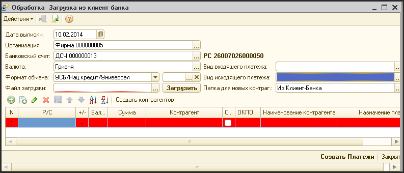
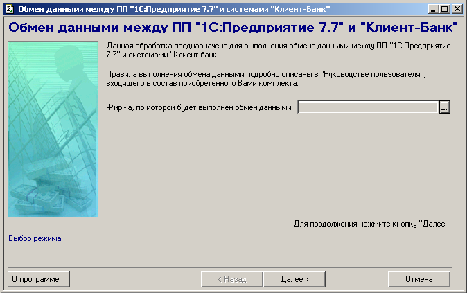
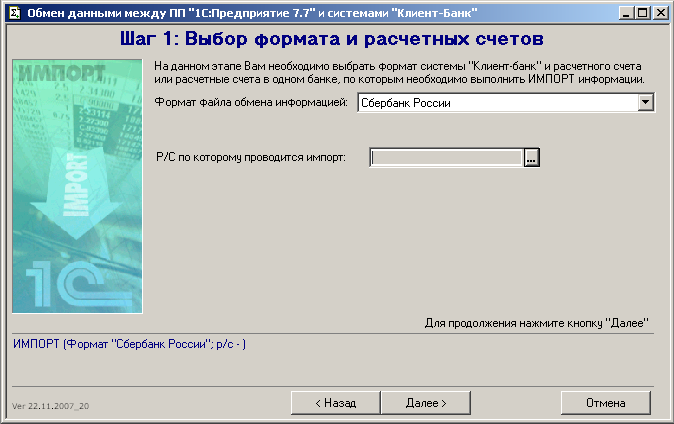
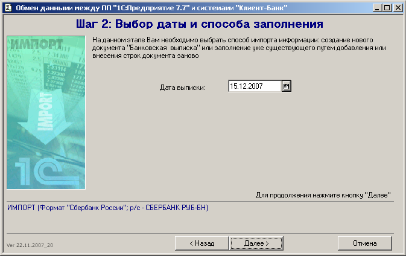
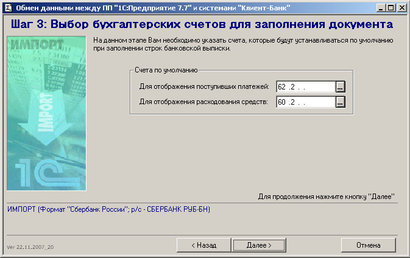
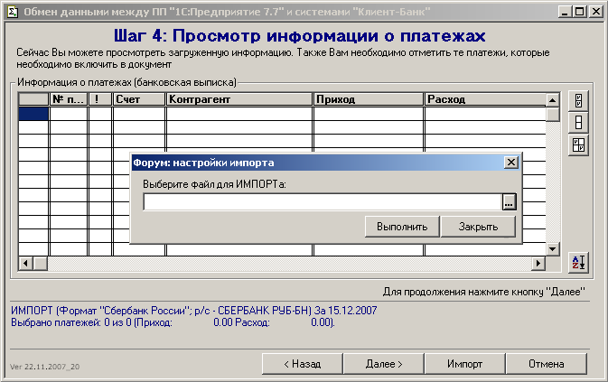
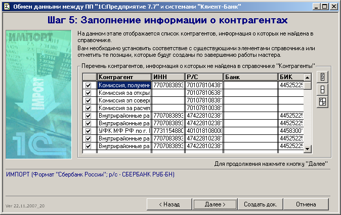

# Интеграция

> **Описание:** Описывает обработку загрузки банковских выписок из системы «клиент-банк» в систему АУРА 3. Показывается: пашаговая работа с обработкой мастера (выбор фирмы, типа канала, даты выписки), проверка и создание новых контрагентов, создание документа «Платежи» на основании выписки.

## Содержание

- [Загрузка выписок из системы «клиент-банк»](#загрузка-выписок-из-системы-клиент-банк)

---

## Загрузка выписок из системы «клиент-банк»

Обработка «Загрузка из клиент-банка» является сторонней разработкой, адаптированной под систему управленческого учета.

Эта обработка позволяет загружать банковские выписки из системы «Клиент-банк».

Для нормального функционирования этой обработки необходимо, чтобы текстовые файлы с выписками за определенный день были доступны для финансового менеджера, ответственного за разнесение банковских выписок.

Для запуска обработки нужно выбрать пункт меню «Обработки - Загрузка из клиент-банка»

???

Обработка построена по принципу мастера, когда операция загрузки выписок разбивается на цепочку этапов.

На первом этапе выбирается фирма, по которой загружается выписка:

На втором этапе выбирается тип клиент-банка и расчетный счет, по которому будет производится выгрузка:

На третьем этапе выбирается дата выписки:

Именно этой датой будет создавать документ «Платежи» в системе.

На четвертом этапе выбираются счета учета, которые подставляются по-умолчанию по входящим и исходящим платежам (обычно это счета «36.2» - по входящим и «63.2» - по исходящим):

На пятом этапе производится загрузка внешнего файла. Для этого нужно нажать кнопку «Импорт» в нижней части формы и выбрать нужный файл:

После этого в таблицу будет загружена информация из выписки.

Описание столбцов таблицы:

- В первом столбце можно указать, загружать или не загружать соответствующую страницу в финальный документ;
- № п/п - номер платежного поручения (эта информация в документ «Платежи» не загружается);
- «!» - если в этом столбце рядом с контрагентом стоит красный восклицательный знак, это значит, что контрагент не найден в справочнике контрагентов;
- Контрагент - наименование плательщика /получателя
- Приход - сумма входящего платежа;
- Расход - сумма исходящего платежа;
- Содержание - назначение платеже (как оно фигурирует в выписке).

Если рядом с наименованием контрагента стоит красный восклицательный знак, значит он не найден в справочнике контрагентов. В этом случае возможно два варианта:

- 1. Контрагента действительно нет в справочнике и он будет автоматически создан при создании документа «Платежи» и занесен в группу «Клиент-Банк» справочника;
  - Контрагент существует в справочнике, но он по какой-либо причине не был найден обработкой (неправильное наименование или код ИНН). В этом случае, вы можете выбрать нужный элемент справочника вручную. Для этого вы должны дважды щелкнуть мышью на ячейке с наименованием контрагента и выбрать с списке нужного контрагента. После этого восклицательный знак исчезнет.

На следующем этапе в таблице отображается список контрагентов, которые не были найдены в справочнике. Вы должны отметить тех контрагентов, которые должны автоматически создаться путем установки «птички» напротив нужных контрагентов.

После выбора всех контрагентов, которые должны быть созданы нужно нажать кнопку «Создать док.».

После этого на экране появиться заполненная форма ввода документа «Платежи».

