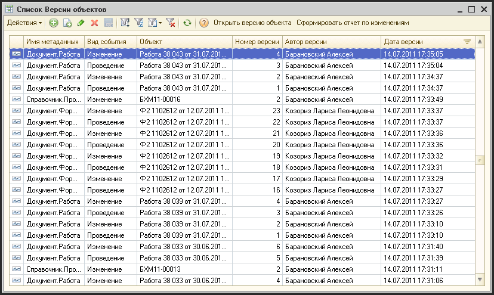
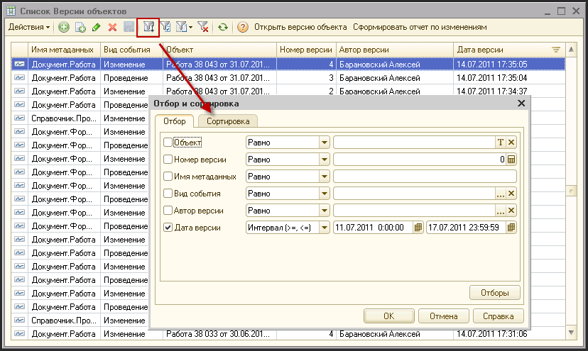
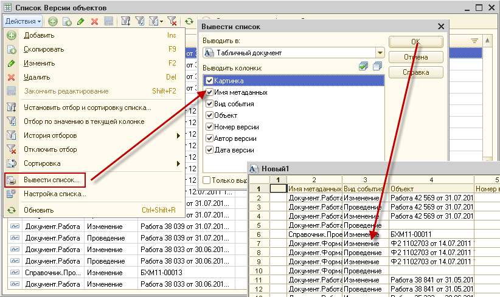
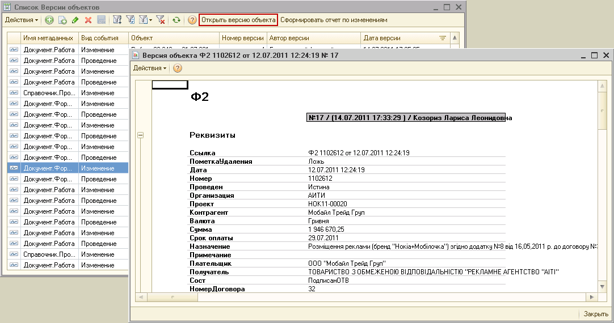
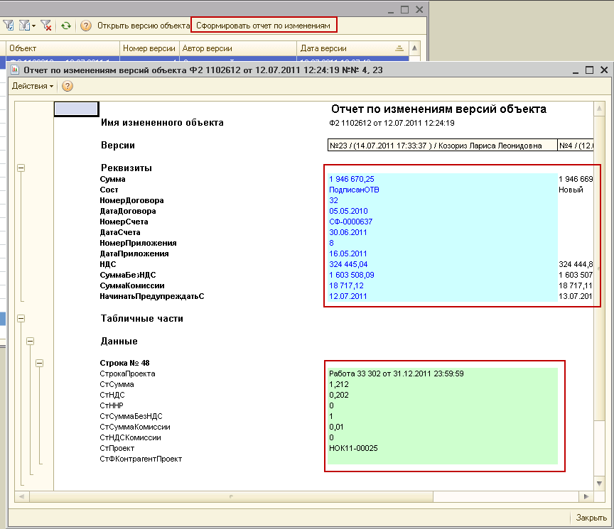

# Система регистрации изменений в системе

> **Описание:** Описывает подсистему аудита изменений системы АУРА 3. Реестр регистрирует события: создание, редактирование, проведение и пометку на удаление справочников и документов. Показывается: просмотр реестра, открытие версии объекта на дату изменения и сравнение версий.

---

Для того чтобы определить какие пользователи какие вносили изменения в системе, в систему АУРА.3 добавлена подсистема регистрации изменений.

Система регистрирует такие события:

- Справочники
  - Создание
  - Редактирование
  - Пометка на удаление
- Документы
  - Создание
  - Редактирование
  - Проведение
  - Отмена проведения
  - Пометка на удаление

Система так же фиксирует какие конкретные изменения были произведены и какие реквизиты поменялись.

**Реестр изменений**

Реестр изменений содержит полный список всех изменений, которые производились со справочниками и документами в системе.

Для того чтобы открыть журнал регистрации, нужно выбрать пункт меню: «Операции - Настройки системы - Реестр изменений».

После этого на экране откроется окно реестра изменений.

- Имя метаданных -наименование типа объекта, который модифицировался
- Вид события - это операция которая была произведена
- Объект - это конкретный элемент справочника или документ, который модифицировался
- Номер версии - номер версии конкретного объекта. Каждое новое сохранение документ генерирует новую версию документа
- Автор версии - пользователь, который внес изменения
- Дата версии - дата и время внесения изменений

По-умолчанию реестр открывается за последние 7 дней, но с помощью стандартных средств фильтрации вы можете как изменить этот период, так и отфильтровать по любой из колонок:

Так же с помощью стандартных средств, можно вывести реестр выбранными записями на печать или экспортировать его в Эксель:

**Просмотр содержимого объекта**

Прямо из журнала вы можете просмотреть содержимое изменяемого объекта. Для этого в панели инструмента реестра нужно выбрать функцию «Открыть версию объекта»:

Отличие от открытия существующего объекта системы (документа или элемента справочника) состоит в том, что с помощью функции «Открыть версию объекта» вы увидите состояние объекта в момент изменения, даже если он после этого уже 10 раз менялся или даже бы удален.

**Сравнение версий объектов**

Вы так же имеете возможность сравнить разные версии одного и того же объекта и увидеть, что конкретно поменялось в этом объекте. Для этого есть функции «Сформировать отчет по изменениям»

Для того чтобы сравнить версии объекта нужно:

- Отфильтровать список по нужному объекту
- Выбрать две версии этого объекта
- Выбрать функцию «Сформировать отчет по изменениям»

На рисунке мы видим что у Ф2 1102612 поменялась сумма на 1.212 грн, за счет того чтобы ла добавлена строка в табличнкую часть по работе № 33302.

